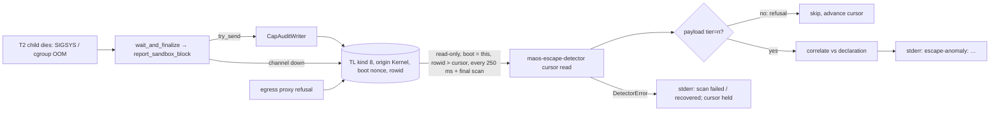

# Story 17.10: Live sandbox anomaly consumer

Status: done

<!-- Created 2026-10-23 at 8e93ffad by bmad-create-story under the lighter creation contract (no party-mode preflight; no cargo — one cargo session per host). Every open decision is D-17-10-FW-xx, status PROPOSED. `ready-for-dev` is set ONLY by the integrator after the operator rules; the tracker row stays `backlog` until then. -->

> **The capability:** *A Spirit that trips its sandbox is named to the operator while the daemon is still running — once per kernel fact, within a stated bound, by a consumer that only reads the log and says so when it cannot.*

**Closes:** NFR-Sec-3's production half — *"The kernel raises a structural alarm; the interpretation … is Spirit-side or operator-side"* (`_bmad-output/planning-artifacts/prd/non-functional-requirements.md:36`) — and ADR-024's user-space correlation over a read-only Transparency-Log query/tail (`docs/adr/ADR-024-out-of-kernel-sandbox-escape-structural-detector.md:64-70`), for the signal 11.4b delivered (seccomp/resource-cap kill vs manifest declaration). Owner row `deferred-work.md:1072` (R17-222, D-17-9-PF-R4b A); `requirements-inventory.md:544`.

**Does NOT close, and says so:**
- NFR-Sec-3 signals 2 and 3 (fd-table growth, unexpected outbound IAC) — still "deferred to a bounded follow-up" (`prd/non-functional-requirements.md:36`); no raw-fact seam exists.
- A manifest-declared *anticipated kill*: no manifest field expresses it (`crates/maos-manifest/src/manifest.rs:83-101,148-158`), so every real kill fact is unanticipated (FW-05). Adding one is a schema bump, not this story.
- Exactly-once across a daemon **crash**: a kill fact persisted after the last scan of a crashed boot is never surfaced as an anomaly line; it stays in `maos audit query` (FW-07). Labelled limit, not a control.
- A durable anomaly record or an operator pull command (`maosctl`): the surface is the daemon's stderr (FW-03).
- Egress refusals (`sandbox.block.egress.*`, `crates/maos-bin/src/egress.rs:315-337`) are refusals, not kill facts; they stay audit rows only (FW-04).
- A low-latency kernel push stream — ADR-024 §3 keeps it a future option gated on a measured latency requirement (`ADR-024…md:70,84`); this story supplies the measurement.

## Story

As **the operator of a running MAOS daemon** that hosts third-party WASM Spirits under T2,
I want **every real sandbox kill the kernel journals to appear, while the daemon runs, as one `escape-anomaly:` line carrying the Spirit, the observed and declared tier, the kill label, the log frame it traces to and the detector's rationale — and a typed, visible error whenever the consumer cannot read the log**,
so that **NFR-Sec-3's structural alarm reaches a human without the kernel classifying anything, and silence means "no kill", never "the scan broke".**

**Contract:** epic-17 §17-10 (AC1–AC3, `_bmad-output/planning-artifacts/epics/epic-17-workers-and-third-party-form-w2.md:364-376`, creation note `:368`) as corrected in place at creation (§Current-tree corrections); ADR-024 §1–§3 (`docs/adr/ADR-024-…md:50-70`); confidence rules 9–11 (`epic-17…md:80-82`); `docs/testing/proof-contract.md` (binding 2026-10-23).

## Current-tree corrections — read before implementing

Measured at `8e93ffad` by three read-only scouts (daemon wiring; operator surfaces and gates; tests and proof), direct reads and `tokei 14.0.0` (`17-10-evidence/creation/governance-8e93ffad.txt`). No cargo was run.

| Premise (epic / tracker / brief) | Fact at `8e93ffad` and consequence |
|---|---|
| Callers of `report_escape_anomalies`: its unit test and `spawned_scope_17_3c.rs:1630` (`epic-17…md:370`) | The unit test (`crates/maos-bin/src/escape_detector_consumer.rs:52-95`, call `:89`) and `crates/maos-bin/tests/spawned_scope_17_3c.rs:1668-1678` (call `:1673`). `deferred-work.md:1072` cites `:24`; the fn is `:28`. Corrected in the epic. No production caller (module doc `:13-19`). |
| The existing consumer can be called on a timer | **No.** `Detector::read_kernel_sandbox_blocks` selects **every** kind-8 row on each call (`crates/maos-escape-detector/src/lib.rs:219-271`, no cursor) and de-dups only within that call (`:259-269`) → a periodic `report_escape_anomalies` re-reports every past kill on every tick. A cursor read is owed (FW-02). |
| 17-4's Observer activity corpus / `hook_pump` is the TL-tail precedent | **No.** The hook pump consumes a broadcast receiver (`crates/maos-bin/src/hook_pump.rs:594-633`); Observer activity is stdout NDJSON on an OS thread (`:829-841,886-893`). The daemon's TL tail precedent is the Worker progress stamper: `FrameFilter.cursor_insertion_id` + `order_by_insertion`, 1 s `STAMPER_TICK`, root cancellation token (`crates/maos-bin/src/supervision.rs:2358,2596-2641`; cursor is `t.rowid > ?`, `crates/maos-iac/src/adapter/transparency_log.rs:248-254,2119-2121`). SIEM tails by timestamp watermark every 60 s (`main.rs:204-258`). |
| A SIGSYS row is the only kind-8 fact | Three production producers: T2 SIGSYS (`crates/maos-kernel-core/src/lifecycle/cli_wrapper/runtime.rs:1021-1034`, intent `sandbox.block.seccomp-kill-process (SIGSYS; syscall number unavailable)`, payload `tier=2`), T2 cgroup OOM (`:1035-1043`, `sandbox.block.resource-cap: cgroup memory.max oom_kill x<n>`, `tier=2`) — both via the cap-audit writer (`writer_task.rs:101-115`) or the direct fallback (`runtime.rs:815-832`) — and the **egress proxy's refusal** (`crates/maos-bin/src/egress.rs:315-337`, intent `sandbox.block.egress.<dest>`, JSON payload, `FrameOrigin::Kernel`). The detector maps a payload without `tier=` to observed tier **0** (`lib.rs:187`) and would print a "sandbox kill at tier=0" anomaly for every egress refusal → FW-04. |
| The daemon stays up after the T2 session | `maos run` on a `wasm-component` manifest takes the session root and **tears down as soon as the session returns** (`main.rs:5683-5715`, `:5735`, teardown `:5873-5946`). A tail that only ticks would miss the kill of a single-session daemon → a **final scan after the audit-writer drain** at every `maos run` teardown is an obligation (AC1.3). |
| The fixture is `fixtures::fixture("forbidden-syscall-probe")` | That probe is a bare native `ptrace` binary for `maos-wasm-host::t2_sandbox_kill` (`crates/maos-wasm-host/test-fixtures/forbidden-syscall-probe/src/main.rs:22-41`); it never speaks the session wire. The session-shaped T2 child is the debug runner `maos-wasm-runner-fault-inject --test-forbidden-syscall-after-ready` — a real `ptrace` after Ready, killed by T2 seccomp (`crates/maos-wasm-host/src/runner.rs:279-299`; release builds refuse the feature `:32-36`), registered in `build-test-fixtures` (`xtask/src/build_test_fixtures.rs:173-190`) and already built by `wasm-host-tests` (`.github/workflows/discipline.yml:3602`). The 17-3c precedent uses exactly it (`spawned_scope_17_3c.rs:1570,1595-1602`). |
| A wiring check would be new | **Exists, ABSENT today:** `check-reza-production-path` leg `audit-escape-anomaly-detector-wiring` syn-probes `main.rs` for a call to `report_escape_anomalies` (`xtask/src/check_reza_production_path.rs:31-38,47-104`). Its oracle runs `cargo test -p maos-bin --bin maos escape_detector_consumer::tests::… -- --exact` (`:74-87`), but the module lives in the **library** (`crates/maos-bin/src/lib.rs:41-42`; `main.rs` declares no such module, `:31-64`) → 0 tests run, and the leg requires `running 1 test` + `1 passed` (`xtask/src/evidence_ledger.rs:1053-1054`): it could never turn green. Fixed at origin (rule 10(a); CR-5). |
| Operator surface "named at creation" | Today's only surface is a stderr line, `format_anomaly_line` (`lib.rs:323-333`) printed by `report_escape_anomalies` (`escape_detector_consumer.rs:36-38`). No `maosctl` watch/tail command exists (`crates/maos-cli/src/cli.rs:23-141`; `audit query` is a one-shot snapshot, `crates/maos-audit/src/lib.rs:276-314`). Kind 8 rows are already visible in `maos audit query` plain output (`crates/maos-audit/src/lib.rs:689-718,918-945`). The detector contract says the report goes **out of** the TL (`lib.rs:117-122`). → FW-03. |
| Which daemon runs T2 | Only the `maos run` WASM session reaches T2 in production: the session refuses any other admitted tier (`crates/maos-bin/src/spirit_session.rs:260-262`), spawns through the bridge (`:287-301`) and finalizes with the audit sender (`:511-514`); `wasm-host` is off by default (`crates/maos-bin/Cargo.toml:30`) and the runner is resolved beside the binary (`main.rs:2346-2377`). CLI Workers are T3 (`worker_spawn.rs:635-638`); the cohort root's host-B intake is T3 too (`delegation.rs:702-725`). |
| Stale owners in docs | `docs/adr/ADR-057-…md:67` ("a second, separate dead-wire"), `docs/adr/ADR-055-multi-tenant-loom.md:92` and `docs/loom-threat-model.md:91` ("escape-anomaly wiring is Story 11.4b"). Corrected in T7. |
| Governance | maos-bin **27614 measured = 27614 ceiling** (`xtask/kloc.toml:517`) — zero headroom; maos-escape-detector **284 / 376** (`:671`) — 92 free; kernel untouched. maos-bin already depends on the detector (`Cargo.toml:55`) and forwards `escape-fault-inject` (`:38`). |

## Rulings — RULED 2026-10-23 by the operator (Lunarpulse): every row as recommended; FW-08 includes the per-story authorization to push the throwaway branch `ci/17-10-verify` (planted-red run on `ubuntu-24.04`, never merged, deleted after)

Ruled 2026-10-23: the recommended option of every row below (FW-01…FW-09) and the creation defaults CR-n are the contract. Options are listed with the recommendation first; evidence is cited. CR-n are creation defaults the operator may overrule.

| ID | Question | Options | Recommendation and evidence | Status |
|---|---|---|---|---|
| **D-17-10-FW-01** | Wiring point | **A** — a maos-bin tokio task (`EscapeAnomalyTail`) owned by the `maos run` root: spawned right after `RootSupervision::arm` (`main.rs:4108-4118`, before any admission), cancelled and joined with a **final scan after the audit-writer drain** at each `maos run` teardown — topology `main.rs:4789`, standalone CLI `:4947`, session/`--once` `:5922`, serving `:8674`. **B** — a hook after `wait_and_finalize` in maos-bin (`spirit_session.rs:511-514`, `worker_spawn.rs:1145`). **C** — a kernel broadcast. | **A.** ADR-024 §3 selects query/tail over the TL sink-of-record (`ADR-024…md:64-70`). B races the writer: `report_sandbox_block` only enqueues (`runtime.rs:815-822`) and the row is inserted later by the writer task (`writer_task.rs:18-26,101-115`), so a finalize hook reads before the row exists; B also misses the fallback and egress producers and couples the detector to the producer. C is rejected by ADR-024 §3/§5 (`:69-70,84`) and ADR-069 (kernel at zero headroom). Scope: the four `maos run` roots; `maos shell` (`:3954`), the smoke one-shots and the cohort root (`:8128`) host no T2 child (§Current-tree corrections) — named non-goal. | RULED 2026-10-23 |
| **D-17-10-FW-02** | How the tail reads | **A** — a cursor read **in `maos-escape-detector`**: `Detector::read_kernel_sandbox_blocks_after(db_path, boot_nonce, after_rowid) -> Result<Vec<(i64, SandboxBlockFrame)>, DetectorError>` plus `Detector::max_rowid(db_path)`, both on the existing `SQLITE_OPEN_READ_ONLY \| SQLITE_OPEN_NO_MUTEX` connection (`lib.rs:222-225`), `WHERE kind = 8 AND boot_nonce = ?1 AND rowid > ?2 ORDER BY rowid`; correlation through the existing `correlate` (`lib.rs:152-202`). **B** — the daemon's `TransparencyLogAdapter::query_frames` with `cursor_insertion_id` (stamper precedent `supervision.rs:2605-2610`) mapped into `SandboxBlockFrame`. | **A.** Read-only **by construction** (AC2.1) and kernel-free (ADR-024 Gate `:99`; `check-escape-detector` closure leg `xtask/src/check_escape_detector.rs:374-395`). B reads through the writer's own adapter, whose inner lock every TL insert takes (`transparency_log.rs:1211`), every tick, and is read-only only by convention. The detector has 92 lines of headroom (§Governance). `detect`/`read_kernel_sandbox_blocks` stay (detector tests and gate legs use them) and share the row decoder. | RULED 2026-10-23 |
| **D-17-10-FW-03** | Operator surface and shape | **A** — the daemon's **stderr**, the existing 11.4b line, unchanged: `escape-anomaly: spirit_pid=<pid> tier=<observed>/declared=<declared> syscall=<label> frame=<frame_id hex> rationale="<rationale>"` (`format_anomaly_line`, `lib.rs:323-333`; fields of `AnomalyReport`, `:124-133`), one line per anomaly; plus `maos: escape-anomaly scan failed (<n> consecutive): <DetectorError>` / `maos: escape-anomaly scan recovered after <n> failed scan(s)` and the wiring/stop lines (AC1.3). **B** — `NotificationEvent::AnomalyFlagged` on the daemon's terminal channel (`crates/maos-domain/src/notification.rs:50-65`; `main.rs:1926-1933`). **C** — a TL row written by maos-bin (e.g. kind 4, non-Kernel origin, intent `escape.anomaly`). **D** — a `maosctl` pull command. | **A.** It is the surface 11.4b named (Sally's observability constraint, `escape_detector_consumer.rs:8-11`; `lib.rs:319-322`), carries the dedupe identity (`frame=`), and the daemon already reports operator events on stderr (e.g. `main.rs:2827`; `hook_pump.rs:437-442`) which service managers journal. B truncates the summary to 80 characters, drops the frame id and needs a `confidence` the structural detector does not have (it would be fabricated). C writes to the TL — contradicts AC2 ("never writes kernel state") and the detector contract (`lib.rs:117-122`; ADR-006 via ADR-024 §1). D does not make a *running daemon* surface anything (epic AC1). | RULED 2026-10-23 |
| **D-17-10-FW-04** | Which kind-8 rows are correlated | **A** — **kill facts only**: a row whose payload parses as `tier=<n>` (T2 SIGSYS, T2 cgroup OOM — `runtime.rs:1021-1043`; the writer's shape `writer_task.rs:106-107`). `correlate` returns `NoAnomaly` for a row with no tier (replacing `observed_tier().unwrap_or(0)`, `lib.rs:187`); the cursor still advances past it. **B** — every kernel-origin kind-8 row (status quo `detect`). **C** — seccomp kills only (intent prefix `sandbox.block.seccomp-kill-process`). | **A.** B prints a false *"sandbox kill at tier=0"* for every egress refusal (`egress.rs:315-337`; JSON payload). C narrows 11.4b's correlation domain, which includes resource-cap kills (`lib.rs:76-78`, label `possible-oom-or-resource-cap`), without a ruling. Under `escape-fault-inject` the canned TP still fires first (`lib.rs:159-170`) — the falsifier is unchanged. | RULED 2026-10-23 |
| **D-17-10-FW-05** | Manifest declarations | **A** — the tail exposes `declare(pid, declared_tier)`; the `maos run` root declares the admitted pid with `admitted.sandbox.tier` right after admission (`main.rs:5638-5662`; `Admitted.sandbox`, `crates/maos-bin/src/admission.rs:665-668`; `SandboxSpec.tier`, `crates/maos-kernel-core/src/security/sandbox/mod.rs:32-33`); `anticipated_kill = false` always (no manifest field). Undeclared pids keep the detector's default (`lib.rs:294-309`). **B** — declare nothing; every line reads `declared=0`. | **A.** B prints `tier=2/declared=0` for a Spirit that declared T2 — a false statement on a security surface. A costs one call site; the declaration precedes the session launch (`main.rs:5683-5704`), so no kill can be correlated before it. | RULED 2026-10-23 |
| **D-17-10-FW-06** | Tail interval and the AC1 bound | **A** — `ESCAPE_TAIL_INTERVAL = 250 ms` (`MissedTickBehavior::Delay`, the stamper's), bound **≤ 1 s** from the row's `timestamp_ns` to the surfaced line. **B** — 1 s / ≤ 2 s (the stamper's `STAMPER_TICK`, `supervision.rs:2358`). **C** — 100 ms / ≤ 500 ms. | **A.** No PRD/ADR latency figure exists (NFR-Sec-3 `:36` has none; ADR-024 §3 asks for a measurement before any push stream, `:70`) — this is an operator-selected figure, measured by AC1. Cost per tick is one read-only open and a rowid-range query over rows since the cursor (`rowid > ?` uses the table key); 4 opens/s. 4× interval leaves 750 ms for scan and runner jitter on the arm images. The row stamp and the observed line stamp share one clock: the TL stamps `SystemTime` at insert (`transparency_log.rs:1212,2670-2674`) and the test writer stamps `SystemTime` when the daemon writes the line — an observed clock, no sleep. | RULED 2026-10-23 |
| **D-17-10-FW-07** | Exactly-once and restart semantics | **A** — dedupe key = the TL **rowid** (`insertion_id`) within this daemon's **boot nonce**: the cursor starts at `max(rowid)` at spawn, each scan reads `boot_nonce = <this boot> AND rowid > cursor`, the cursor advances only past rows it handled, and the final scan runs after the writer drain. A previous boot's rows are never re-surfaced. **B** — a persisted cursor file. **C** — surface from rowid 0 every boot. | **A.** `frame_id` is the table's primary key (`transparency_log.rs:2826`) so one row is one frame; the rowid cursor is the daemon's own precedent (`supervision.rs:2596-2629`); `boot_nonce` is a column on every row (`:2831`) and the adapter is opened with the root's nonce (`main.rs:2107-2112`). B writes state the consumer must then own (AC2's spirit) for a crash case only; C re-surfaces every historical kill at every boot. The crash gap is a labelled limit (§Does NOT close). The adapter never deletes rows (only a test does, `transparency_log.rs:3192-3193`), so the rowid cannot be reused inside a live boot. | RULED 2026-10-23 |
| **D-17-10-FW-08** | CI proof route (AC3) | **A** — green: a new step in `wasm-host-tests` (the four pinned 17-6 images, kept matrix `docs/testing/proof-contract.md:85`; `.github/workflows/discipline.yml:3583-3590`) running the T2 suite inside `scripts/run_cgroup_ceiling_17_2.py run --mode delegated` with an exact pass count, required test names and SKIP rejection (`:3665-3700` template); proven red: **one** branch-only workflow `ci/17-10-verify` on `ubuntu-24.04` running that step with the one plant (17-9 FW-07 precedent), run id, plant diff and provenance archived in `17-10-evidence/ci/`, branch deleted. **B** — local red only. | **A.** The proof contract requires the red on one CI image (`proof-contract.md:10-18`); rule 11(c) permits local evidence only where CI cannot host the substrate, and CI hosts it (`discipline.yml:3475-3480`). Needs the operator's per-story authorization to push the throwaway branch (17-2 precedent: CI-run grants do not inherit). | RULED 2026-10-23 |
| **D-17-10-FW-09** | kloc | maos-bin exact measured request **at landing** (zero headroom); maos-escape-detector inside 376 (no raise); xtask measured at landing; `_aggregate_hardfail` = measured + 1 if any raise. Forecast [INFERENCE, not a grant]: maos-bin +60–110 (tail ≈ 70, `main.rs` wiring ≈ 20, minus the deleted `report_escape_anomalies`), detector +25–45. | Contract 2026-10-23 (non-kernel crates measured at landing); `xtask/kloc.toml:60-70,86-95`. | RULED 2026-10-23 |
| CR-1 | Tail API (shape, not text to paste) | In the existing `crates/maos-bin/src/escape_detector_consumer.rs` (no new `src` file — `cohort_daemon_smoke_13_5c.rs:932-956,1040-1057` pins the roster): `pub fn spawn_escape_anomaly_tail(tl_path: PathBuf, boot_nonce: u64, interval: Duration, out: Box<dyn Write + Send>) -> EscapeAnomalyTail`; `EscapeAnomalyTail::{declare(&self, pid: u32, tier: SandboxTier), async shutdown(self) -> TailStopReport}`; `pub const ESCAPE_TAIL_INTERVAL`. The distinct free-function name is what the gate probes (CR-5). `report_escape_anomalies` is **deleted** (clean cutover, T4). | — |
| CR-2 | Failure printing | Every failed scan is counted and the cursor does not move; the **first** failure of a run and every recovery print one line each (edge-triggered, with the consecutive count) so an unreadable TL does not flood stderr at 4 lines/s; the stop line reports the count of failed scans. A failed **final** scan is printed, never swallowed. | — |
| CR-3 | Blocking I/O | Each scan runs in `tokio::task::spawn_blocking` (SQLite open + query are blocking file I/O on the multi-thread runtime that also serves the operator door). The stamper's inline query (`supervision.rs:2605`) is not copied. | — |
| CR-4 | Shutdown ordering | `shutdown` cancels the ticker, joins the task, then runs the final scan — called **after** the audit-writer drain at each teardown site, so every row the writer was holding is visible to it. | — |
| CR-5 | Gate leg at origin (rule 10(a)) | `check-reza-production-path` leg `audit-escape-anomaly-detector-wiring` (`xtask/src/check_reza_production_path.rs:73-104`): probe `spawn_escape_anomaly_tail` (not `report_escape_anomalies`); oracle `test -p maos-bin --test escape_anomaly_tail_17_10 final_scan_surfaces_a_row_after_the_last_tick_exactly_once -- --exact`; the ABSENT detail names 17-10; the probe's unit test (`:1148-1160`) migrates to the new name. | — |
| CR-6 | 17-3c migration | `actual_runner_sigsys_reaches_escape_consumer_but_planned_stop_does_not` (`spawned_scope_17_3c.rs:1567-1689`) replaces its consumer call (`:1668-1678`) with `maos_escape_detector::Detector::detect` (the library it always exercised); row, audit-view and `RUNNER-SIGSYS` marker assertions unchanged; the CI guards' 23-count and `RUNNER-SIGSYS :2` stay (`discipline.yml:3530,3581,3675-3677`). The live consumer's proof moves to AC1. | — |
| CR-7 | Fault-inject feature | Hermetic tests that depend on the real correlation carry `#[cfg(not(feature = "escape-fault-inject"))]` (precedent `escape_detector_consumer.rs:52`), because `--workspace --all-features` turns on maos-bin's forwarding flag (`Cargo.toml:34-38`). | — |

## Acceptance Criteria

*(Epic §17-10, tightened; every AC cites the code it changes. Selected options above are PROPOSED; if the operator rules otherwise, the integrator rewrites the affected clauses.)*

### AC1 — command: a running daemon surfaces a real escape attempt

1. **The live proof (T2).** **Given** a session World built as `spawned_scope_17_3c.rs:65-170` builds it (real TL at boot nonce `NONCE`, real capability registry and cap-audit writer, real `RootSupervision`), the production tail started through `spawn_escape_anomaly_tail(dir/transparency.sqlite, NONCE, ESCAPE_TAIL_INTERVAL, out)` **before** admission, `out` a test writer that forwards each completed line over a channel stamped with `SystemTime::now()`, the admitted pid declared with `admitted.sandbox.tier`, and `fixtures::fixture("maos-wasm-runner-fault-inject")` + `echo_spirit.wasm` as the launch plan (`spawned_scope_17_3c.rs:1570,1595-1608`),
   **when** `env -u CI -u GITHUB_ACTIONS MAOS_17_2_CGROUP_MODE=delegated cargo test --locked -p maos-bin --features network,wasm-host --test live_escape_anomaly_17_10 -- --nocapture --test-threads=1` runs (CI wraps it in `scripts/run_cgroup_ceiling_17_2.py run --mode delegated`),
   **then** exactly these two tests pass:
   1. `real_sigsys_surfaces_exactly_one_anomaly_within_bound` — with `--test-forbidden-syscall-after-ready` the session returns `Err(SessionError::Child(ExitCause::Signaled { signal: 31 }))`; exactly one kind-8 row exists for the pid (`query_frames`, `FrameFilter { spirit_pid, kind: SandboxBlock }`); **while the tail is still running** exactly one line starting `escape-anomaly:` arrives (awaited on the channel; a 10 s hang guard is a guard, not the bound) with `spirit_pid=<pid>`, `tier=2/declared=2` and `frame=<that row's frame_id hex>`; its observed stamp minus the row's `timestamp_ns` is **≤ 1 s** (FW-06); after `world.drain()` and `tail.shutdown().await` (final scan) the total is still **exactly one** line and zero `scan failed` lines; the test prints `ESCAPE-TAIL-17-10 sigsys pid=<pid> frame=<hex> latency_ms=<n>`.
   2. `planned_stop_surfaces_no_anomaly` — the same runner without the flag reaches Ready, `stop_workers()` stops it (binding phase `PlannedStop`, `spawned_scope_17_3c.rs:1621-1658`); zero kind-8 rows for the pid; through the final scan zero `escape-anomaly:` and zero `scan failed` lines; prints `ESCAPE-TAIL-17-10 planned-stop pid=<pid> anomalies=0`.
   Off CI, an undeclared cgroup lane or a host that refuses T2 prints one `SKIP:` line per test and passes (`t2_available()` as `crates/maos-bin/tests/recall_17_3d.rs:521-558`; `tests/harness/ci.rs:24-30`); with `CI` set the same test fails closed.
2. **Exactly-once and row classes (hermetic, default features).** `cargo nextest run -p maos-bin --locked --test escape_anomaly_tail_17_10` passes, rows inserted with the writer's own shape (`TransparencyLogAdapter::insert_frame_event(FrameKind::SandboxBlock, pid, None, "sandbox.block.<label>", b"tier=<n>", FrameOrigin::Kernel)`, `writer_task.rs:106-115`):
   1. `final_scan_surfaces_a_row_after_the_last_tick_exactly_once` — interval 1 h (only the immediate first tick fires); a row inserted after it is surfaced by `shutdown()` exactly once (the CR-5 oracle).
   2. `rows_of_other_boots_and_before_spawn_are_never_surfaced` — kill rows of another boot nonce, and rows of this boot written before `spawn`, produce no line; a later row of this boot produces one.
   3. `only_kill_facts_are_correlated` (FW-04) — an egress-refusal row (`sandbox.block.egress.example.com:443`, JSON payload, `egress.rs:315-337`) produces no line and does not stall the cursor; a following `tier=2` resource-cap row produces exactly one.
3. **Wired (rule 11(a)).** `main.rs` declares `escape_tail` beside `root_supervision`, spawns it immediately after `RootSupervision::arm` (`:4108-4118`) on `audit_db_path` (`:2107-2112`) and `boot_nonce`, prints `maos: escape-anomaly consumer wired (Story 17-10, ADR-024)` (17-4 precedent `:2827`), calls `declare` after admission (`:5662`), and at **each** `maos run` teardown calls `shutdown().await` **after** the audit-writer drain (`:4789`, `:4947`, `:5922`, `:8674`), printing `maos: escape-anomaly consumer stopped (final scan: <n> anomaly line(s), <m> failed scan(s))`. Proof: `one_daemon_one_door_16_1::ac1_sigterm_exits_promptly_and_drains_the_audit_channel` (`crates/maos-bin/tests/one_daemon_one_door_16_1.rs:472-489`, a `maos run` serving root) additionally asserts the wired line, the stop line before `exiting cleanly`, and keeps its < 3 s bound; `cargo run -p xtask -- check-reza-production-path --json` reports leg `audit-escape-anomaly-detector-wiring` **PROVEN** (CR-5), not ABSENT.

### AC2 — read-only and failure-visible

1. **Read-only.** The tail's only log handle is the detector's read-only connection (FW-02; `lib.rs:222-225`); `escape_detector_consumer.rs` constructs no `TransparencyLogAdapter` and calls no `insert_frame_event*`. Hermetic test `the_tail_never_writes_the_transparency_log`: the TL's `count(*)`, `max(rowid)` and a SHA-256 of every row in rowid order are identical before and after a tail lifetime that surfaced at least one anomaly.
2. **Typed, visible failure.** Hermetic test `scan_failure_is_typed_and_visible_never_silent`: a TL path that does not exist yields `maos: escape-anomaly scan failed (1 consecutive): sqlite open failed: …` (`DetectorError::Open`, `lib.rs:365-367`); a non-SQLite file at the path yields `… sqlite query failed: …` (`DetectorError::Query`, `:368-369`); neither ever yields an `escape-anomaly:` line or advances the cursor; once a valid TL appears at the path, a kill row written meanwhile is surfaced exactly once after one `scan recovered after <n> failed scan(s)` line, and the stop line reports the failed-scan count (CR-2).

### AC3 — proven red in CI

1. **One plant** (`docs/testing/proof-contract.md:22-27`): in `crates/maos-bin/src/escape_detector_consumer.rs`, the tick arm no longer calls the scan (the consumer is disconnected from the log; the final scan is untouched). `real_sigsys_surfaces_exactly_one_anomaly_within_bound` reds at its within-bound arrival assertion (the hang guard elapses with zero lines). Run once on `ubuntu-24.04` (FW-08), restored with `git checkout -- crates/maos-bin/src/escape_detector_consumer.rs`; plant count, wall-clock and run id in the Dev Agent Record. Removing the `main.rs` spawn is falsified by AC1.3's assertion and the gate leg without a second plant.
2. **Green once on the matrix:** the new `wasm-host-tests` step on the four images with `--expected-count 2`, both test names required, `^SKIP[: ]` rejected, `ESCAPE-TAIL-17-10` markers annotated (`discipline.yml:3665-3700` template); the rest of `discipline.yml` green on the final tree.

## Tasks / Subtasks

- [x] **T0 — Preflight at the dev HEAD** (all ACs)
  - [x] Confirm the operator's rulings on **D-17-10-FW-01…09** are recorded in §Rulings with status RULED, the selected options materialized, and story and tracker read `ready-for-dev` (set by the integrator); stop if any row is still PROPOSED.
  - [x] `git diff --stat 8e93ffad -- crates/maos-bin crates/maos-escape-detector crates/maos-iac/src/adapter/transparency_log.rs crates/maos-kernel-core/src/lifecycle/cli_wrapper/runtime.rs xtask/src/check_reza_production_path.rs .github/workflows/discipline.yml`; any drift → Debug Log and re-anchor the cites.
- [x] **T1 — Detector cursor read and kill-fact filter** (FW-02, FW-04; AC1.2, AC2.1) — `crates/maos-escape-detector/src/lib.rs`: `read_kernel_sandbox_blocks_after`, `max_rowid`, one shared row decoder for both reads; `correlate` returns `NoAnomaly` for a row without `tier=<n>` (doc comment names the egress producer); `DetectorError` unchanged. No `maos-kernel-core` dependency (gate leg `out-of-kernel-boundary`).
- [x] **T2 — The tail** (FW-01, FW-03, FW-05…07; CR-1…CR-4) — `crates/maos-bin/src/escape_detector_consumer.rs`: `spawn_escape_anomaly_tail`, `EscapeAnomalyTail::{declare, shutdown}`, `ESCAPE_TAIL_INTERVAL`, `TailStopReport`; rewrite the module doc (`:1-19`) to the live design and its limits. Delete `report_escape_anomalies` and its unit test (`:24-95`).
- [x] **T3 — Composition root** (AC1.3) — `crates/maos-bin/src/main.rs` at the sites in AC1.3; no other root.
- [x] **T4 — Migrations** (CR-5, CR-6) — `xtask/src/check_reza_production_path.rs` leg and its probe test; `spawned_scope_17_3c.rs:1668-1678` → `Detector::detect`.
- [x] **T5 — Tests** — `crates/maos-bin/tests/escape_anomaly_tail_17_10.rs` (new, default features: AC1.2 ×3, AC2 ×2; CR-7); `crates/maos-bin/tests/live_escape_anomaly_17_10.rs` (new, `#![cfg(all(target_os = "linux", feature = "network", feature = "wasm-host"))]`, own World copied from `spawned_scope_17_3c.rs:65-267` — the house pattern, `recall_17_3d.rs:59` has its own — `ci`/`fixtures` via `#[path]`, AC1.1 ×2); `one_daemon_one_door_16_1.rs:472-489` assertions (AC1.3). No `cargo` inside a test (`check-test-cost`); fixtures only via `fixtures::fixture`.
- [x] **T6 — CI and proven red** (AC3; FW-08) — `wasm-host-tests` step after `:3700`; the branch-only red run on `ubuntu-24.04`; evidence `17-10-evidence/ci/` (run ids, plant diff + sha256, image, toolchain); branch deleted. *(Dev scope done: step added, plant proven red locally under real T2, branch workflow `17-10-evidence/ci/ci-17-10-verify.yml` + `plant.diff` prepared. The push of `ci/17-10-verify`, its run id and the branch deletion are the integrator's, per the dev assignment — the dev does not push or switch branches.)*
- [x] **T7 — Docs and drift** — ADR-024: implementation note (consumption live in `maos run`, measured latency, FW-04 row classes, FW-07 crash limit, egress refusals not correlated); `docs/adr/ADR-057-…md:67`, `docs/adr/ADR-055-multi-tenant-loom.md:92`, `docs/loom-threat-model.md:91` re-owned to 17-10 / closed; `deferred-work.md:1072` resolved note (row stays); `requirements-inventory.md:544` NFR-Sec-3 clause → resolved by 17-10 (signals 2/3 still open).
- [x] **T8 — Governance and record** — maos-bin (and xtask, if it moved) exact measured request returned to the operator **before** landing (`kloc-check --json` after `cargo fmt --all`); detector inside 376; `check-kernel-baseline` unchanged; Dev Agent Record populated (plant count, per-plant wall-clock, suite wall-clocks); `check-dev-record-completeness`.

### Review Findings

**Review 2026-10-24 (bmad-code-review, anthropic/claude-fable-5-1; non-author; dev of record anthropic/claude-opus-5-5) — AC5 contract (`docs/testing/proof-contract.md`).** Read-only layers: Blind Hunter (diff only), Edge Case Hunter, Acceptance Auditor, Test-Infra Auditor on the 1,654-line diff (`git diff` on `15b02d98` + 4 new files). No re-execution by the layers. 19 findings after dedup: 2 HIGH decisions (ruled, applied as patches) + 11 patches = 13 to apply, 0 deferred, 6 dismissed. Operator rulings 2026-10-24: **D1 = A**, **D2 = funnel every post-run exit**.

- [x] [Review][Decision→Patch] HIGH — **T3 Worker self-reported `maos-sandbox-block:` rows are surfaced as kills** [`crates/maos-kernel-core/src/lifecycle/cli_wrapper/runtime.rs:909-922` (producer, pre-existing) → `crates/maos-escape-detector/src/lib.rs:187-205`, `crates/maos-bin/src/escape_detector_consumer.rs:109-118`]: any T3 child stderr line prefixed `maos-sandbox-block: ` becomes a kind-8 `tier=3` row (process keeps running); the tail prints `tier=3/declared=0 … "sandbox kill"` — `declared=0` is false (Workers are never declared), "kill" is false, and `syscall=` is child-controlled (spoof/flood surface). FW-04's premise listed three producers and missed this one. **Ruled A:** correlate only kernel-observed kill facts — intent prefixes `sandbox.block.seccomp-kill-process` and `sandbox.block.resource-cap` (the two `== SandboxTier::T2` sites, `runtime.rs:1024,1036`, and the writer path); every other kind-8 row (T3 self-report, egress refusal) is a refusal: cursor advances, nothing printed. Add a hermetic row-class test for a `tier=3` `maos-sandbox-block` row (not surfaced) and correct the module doc + ADR-024 note. (accept+edge) **APPLIED 2026-10-24** — `crates/maos-escape-detector/src/lib.rs:396-415` `is_kernel_observed_kill` (used by `correlate` `:194-205`): a row is a kill fact iff `tier=2` AND its label is one a kernel site writes — `seccomp-kill-process (SIGSYS; …)` / `resource-cap: cgroup memory.max oom_kill x<n>` (the bridge's two `== SandboxTier::T2` sites `runtime.rs:1022-1043`, via the writer `writer_task.rs:101-115` or the fallback `runtime.rs:823-832`; the WASM T2 session of `live_escape_anomaly_17_10` reaches the same `wait_and_finalize`) or `classify_exit`'s `unknown` / `access-violation-possible-sandbox` (`security/sandbox/mod.rs:218-245` → `SecurityManagerAdapter::emit_sandbox_block` `security/mod.rs:504-520`). The `classify_exit` labels are kept because the 11.4b corpora and unit tests are exactly that kernel fact (`sandbox.block.unknown`, `tier=2`); dropping them would change their verdict. T3 self-reports (`runtime.rs:912-923`, always `tier=3`, even with a copied kill label) and egress refusals (JSON payload) → `NoAnomaly`, cursor passes. No caller/corpus verdict changed: detector 15/15, `check-escape-detector` 9/9 legs green, 17-3c CR-6 `consumer_anomalies=1/0`. Test `escape_anomaly_tail_17_10.rs:170` `t3_self_reports_are_not_surfaced_and_do_not_hold_the_cursor` (two `tier=3` fallback-shape rows + a `tier=2` non-kernel label → no line; SIGSYS and `unknown` rows → one line each); module doc `escape_detector_consumer.rs:24-30`; ADR-024 implementation note.
- [x] [Review][Decision→Patch] HIGH — **post-run error exits skip the final scan** [`crates/maos-bin/src/main.rs:4489,4503-4510,4664,4892,4909-4914`; consumer `escape_detector_consumer.rs:179-194`]: a crashed `cli_wrapper` Worker → `WorkerCompletion::NotCompleted(ProcessCrash)` returns before unload / `drop(audit_tx)` / drain / `tail.shutdown()`; the runtime drops and the ticker is aborted, so a T2 kill row in the last interval (or held by the writer) is never surfaced and the stop line never prints (the 16-3 teardown is bypassed there too). **Ruled:** every exit after the first Worker/Spirit has run is routed through the existing funnels (`standalone_result` / `topology_flush_error` + `break`) so it reaches drain → `tail.shutdown()` → `return Err`; pre-run boot failures are documented in the module doc (no admitted process ⇒ no kill row). (edge) **APPLIED 2026-10-24** — `main.rs:4190-4687`: the whole topology load (every Worker and Spirit entry) runs in ONE async block `topology_load` (the 16-3 `standalone_result` funnel shape, so a `?` added later is caught too); `:4688` `if run.once || topology_load.is_err()` enters the existing teardown (no `on_idle` pass `:4690-4695` and no cassette flush `:4734-4741` on error), and `:4835` `topology_load?` returns the unchanged error after unload → `drop(audit_tx)` → drain → `tail.shutdown`. The standalone sites `:4892`, `:4909-4914` were already inside `standalone_result` (16-3) — verified, no change; the session arm's post-run exits are inside `once_result`. Pre-run boot failures documented in the module doc `escape_detector_consumer.rs:35-37`. Test `one_daemon_one_door_16_1.rs:509` `d2_a_topology_error_after_a_spirit_ran_still_runs_the_final_scan` (a second `nash` entry repeats the first's `spirit_id` after it was admitted and started): green; RED with the funnel bypassed (temporary early `topology_load?` before the teardown: panicked at `:550`, "the error exit must run the tail's final scan"). No cheap crashed-Worker harness: every topology/standalone Worker-crash vector (`worker_completion_2a::planted_refusal::*`, `worker_supervision_16_3` crash scenes, `root_shutdown_unload_16_3` v3/v3b) needs the T3 substrate and SKIPs on this host.
- [x] [Review][Patch] MEDIUM — CR-5 gate oracle orders "first tick before row" with a 300 ms sleep [`crates/maos-bin/tests/escape_anomaly_tail_17_10.rs:92-97`; `escape_detector_consumer.rs:172-176`]: `tokio::time::interval` fires immediately; on a loaded runner the first scan can see the row and red the Blocking `check-reza-production-path` leg. Fix: `tokio::time::interval_at(Instant::now() + interval, interval)` (cursor is taken synchronously at spawn, first production scan at +250 ms inside the 1 s bound); drop the sleep. (all four layers) **APPLIED 2026-10-24** — `escape_detector_consumer.rs:212-219` first tick at `interval_at(Instant::now() + interval, interval)` (instant taken at spawn); `escape_anomaly_tail_17_10.rs:90-104` 300 ms sleep removed, `no tick may run before shutdown` kept.
- [x] [Review][Patch] MEDIUM — a `JoinError` from the blocking scan is mapped to `0` with no failure count or line [`escape_detector_consumer.rs:140-146`]: contradicts CR-2 ("a failed final scan is printed, never swallowed"). Fix: route `Err(join)` through the failure path (both counters, typed `scan failed … join error` line honouring `is_final`). (blind+edge+accept) **APPLIED 2026-10-24** — `escape_detector_consumer.rs:159-174` `Err(join)` → `fail("scan task join error: …", is_final)` (both counters, edge-triggered typed line, always printed for the final scan); `fail` takes `&dyn Display`.
- [x] [Review][Patch] MEDIUM — cursor advances only on kind-8 rows, so each tick re-walks every TL row since the last kill [`escape_detector_consumer.rs:114`; `crates/maos-escape-detector/src/lib.rs:272`]: O(rows since last kill) per 250 ms tick under the state mutex. Fix: read `MAX(rowid)` and select `rowid > cursor AND rowid <= max` in one read transaction; set the cursor to `max` after the batch's lines are written. (blind) **APPLIED 2026-10-24** — `lib.rs:94-101` `SandboxBlockBatch { through_rowid, frames }`; `read_kernel_sandbox_blocks_after` `:273-310` reads `MAX(rowid)` and `kind = 8 AND boot_nonce = ?2 AND rowid > ?3 AND rowid <= ?4` in one read transaction (`query_max_rowid` `:445-452` shared with `max_rowid`); consumer sets `cursor = max(cursor, through_rowid)` after the batch's lines (`escape_detector_consumer.rs:133-147`).
- [x] [Review][Patch] LOW — `declared` records the effective (ceiling-adjusted) tier but the line and rationale say "declared"/"manifest" [`main.rs:5701`; `lib.rs:195-204`]: declare the manifest-declared tier; if the admitted bundle does not carry it cheaply, rename the field and rationale to "effective". (edge) **APPLIED 2026-10-24** — the manifest-declared tier is carried cheaply: `main.rs:5723-5728` declares `gated.sandbox_cfg.tier` (the manifest `[sandbox] tier`; gate 6 pins it to T2 for `wasm-component`) instead of `admitted.sandbox.tier`; the live test does the same (`live_escape_anomaly_17_10.rs:329`); line format and rationale unchanged.
- [x] [Review][Patch] LOW — final scan after an audit-drain timeout is presented as authoritative [`main.rs:4805-4812,4966-4975,5965-5971,8718-8726`]: pass `drained: bool` into `shutdown` and mark the stop line "(audit drain timed out — final scan not authoritative)" when false. (edge) **APPLIED 2026-10-24** — `EscapeAnomalyTail::shutdown(drained, output_detached)` (`escape_detector_consumer.rs:254-276`): `drained = false` appends " (audit drain timed out — final scan not authoritative)" and sets `TailStopReport.authoritative = false` (`:69-71`); `drained = timeout(...).is_ok()` at the four teardowns `main.rs:4819-4833`, `:4984-5000`, `:5988-6000`, `:8746-8758`. Test `escape_anomaly_tail_17_10.rs:208`.
- [x] [Review][Patch] LOW — stop/final-scan lines are blocking stderr writes before the 17-4 `output_detached` check [`escape_detector_consumer.rs:68-72,190-193`; `main.rs:8724-8747`]: a stalled `2>&1` pipe can hang teardown on the tail's own new write. Fix: skip the tail's writes when output is detached (17-4 `activity_stats().detached`), counters unchanged. (edge) **APPLIED 2026-10-24** — `output_detached = hook_pump.activity_stats().detached` passed to `shutdown` at all four sites (serving `main.rs:8753` now computes it once, before the tail); `TailState.muted` (`escape_detector_consumer.rs:87-95,257`) drops the final scan's and stop lines, counters unchanged. Same test as above (detached → zero lines, `final_scan_anomalies = 1`).
- [x] [Review][Patch] LOW — state mutex held across SQLite I/O; `declare()` on the admission path waits on it [`escape_detector_consumer.rs:134-137,163-165,195-197`]: keep `declared` in its own mutex (or snapshot it before I/O). (blind+edge+accept) **APPLIED 2026-10-24** — `type Declared = Arc<Mutex<HashMap<i64, u8>>>` (`escape_detector_consumer.rs:74-76`) shared by the tail and `TailState`; `declare` locks only it (`:243-245`); the scan takes it per row for a map lookup only (`:134`), never across SQLite or stderr I/O.
- [x] [Review][Patch] LOW — `select!` without `biased;` can run one extra scan after `cancel()` [`escape_detector_consumer.rs:175-180`]: `biased;` with the cancel arm first. (blind) **APPLIED 2026-10-24** — `escape_detector_consumer.rs:222-224` `biased;` with the cancel arm first.
- [x] [Review][Patch] LOW — live test not fenced from `escape-fault-inject` (CR-7) [`crates/maos-bin/tests/live_escape_anomaly_17_10.rs:8`]: add `not(feature = "escape-fault-inject")` to the file cfg. (accept) **APPLIED 2026-10-24** — `live_escape_anomaly_17_10.rs:8-13` `#![cfg(all(target_os = "linux", feature = "network", feature = "wasm-host", not(feature = "escape-fault-inject")))]`.
- [x] [Review][Patch] LOW — proven-red workflow prints the plant digest but never checks it; `plant.diff` hunk header stale [`17-10-evidence/ci/ci-17-10-verify.yml:37-41`; `17-10-evidence/ci/plant.diff`]: regenerate `plant.diff` against the patched tree, record the new sha256 in `plants.md`, and verify it in the workflow with `sha256sum -c -`. (test-infra+blind) **APPLIED 2026-10-24** — plant re-proven once on the patched tree (same mutation, target now `escape_detector_consumer.rs:226`): RED at `live_escape_anomaly_17_10.rs:428:10` (`the running tail surfaced no line before the hang guard`), planned stop green, `1 passed; 1 failed`, libtest 12.42 s / command 25.9 s, 2026-10-24T08:40:09Z; `ci/plant.diff` regenerated (sha256 `d7c46ca4c2b2540a955fad18b731fb8ef7fb7b1eef41b78a7657ac3ebd859dc7`, `git apply --check` forward on the restored tree and `-R` on the planted one); `plants.md` row 2; `ci-17-10-verify.yml:39` `echo "<sha>  <path>" | sha256sum -c -`.
- [x] [Review][Patch] LOW — docs claim closure before the CI red/green, and ADR-024 goes one clause past the measurement [`docs/adr/ADR-024-…md:93`; `deferred-work.md:1072`, ADR-057:67, ADR-055:92, `loom-threat-model.md:91`, `requirements-inventory.md:544`]: ADR-024 → "this is the measurement §3 asks for; no push stream is requested by this story"; the closure statements stand once the integrator records the `ci/17-10-verify` run id and the four-image `wasm-host-tests` green before `done`. (accept) **APPLIED 2026-10-24** — ADR-024 `:93` now reads "this is the measurement §3 asks for; no push stream is requested by this story" (re-measured 58–232 ms on the patched tree; note also carries the D1 row classes, the batch cursor, the D2 funnel and the drain/detach labels). The other closure statements stand as ruled, owed the `ci/17-10-verify` run id and the four-image green before `done`.
- Dismissed (6): rowid reuse/VACUUM (no production `DELETE FROM transparency_log`, only `VACUUM INTO`; `transparency_log.rs:500-503` — recorded as the cursor's precondition in the module doc by the patch pass); `boot_nonce as i64` (writer stores the same cast, `transparency_log.rs:1237,1804`); `detect()` behaviour change for rows without `tier=` (neutral for 11.4b corpora, all `tier=2`); SQLite busy handler (rusqlite default busy timeout applies); `line()` discarding write errors (stderr is best-effort, same as `eprintln!` minus the panic); single `declare` site for non-Worker forms (topology and door admissions are in-process only, `require_in_process`).

## Dev Notes

### The consumer after this story



### Tail shape (sketch — shape, not text to paste)

```rust
pub fn spawn_escape_anomaly_tail(tl: PathBuf, boot: u64, every: Duration, out: Box<dyn Write + Send>) -> EscapeAnomalyTail {
    // cursor = Detector::max_rowid(&tl) (a failure here is the first typed scan failure, cursor = 0)
    // loop { select! { cancel => break, tick => scan(&mut state) } }   // scan in spawn_blocking
}
fn scan(state: &mut State) {
    match Detector::read_kernel_sandbox_blocks_after(&state.tl, state.boot, state.cursor) {
        Err(e) => { state.failed += 1; if state.failed_run == 0 { writeln!(out, "maos: escape-anomaly scan failed ({} consecutive): {e}", ..) } }
        Ok(rows) => for (rowid, frame) in rows {
            if let CorrelationOutcome::Anomaly(r) = correlate(&frame, &state.declaration(frame.spirit_pid)) { writeln!(out, "{}", format_anomaly_line(&r)) }
            state.cursor = rowid;                                   // after the line, never before
        },
    }
}
```

### File implementation map

| Area | Files |
|---|---|
| Detector | `crates/maos-escape-detector/src/lib.rs` |
| Tail | `crates/maos-bin/src/escape_detector_consumer.rs` |
| Composition root | `crates/maos-bin/src/main.rs` (`:4108-4118`, `:5662`, `:4789`, `:4947`, `:5922`, `:8674`) |
| Tests | `crates/maos-bin/tests/escape_anomaly_tail_17_10.rs` (new), `crates/maos-bin/tests/live_escape_anomaly_17_10.rs` (new), `crates/maos-bin/tests/one_daemon_one_door_16_1.rs`, `crates/maos-bin/tests/spawned_scope_17_3c.rs` (CR-6) |
| Gate | `xtask/src/check_reza_production_path.rs` (CR-5) |
| CI | `.github/workflows/discipline.yml` (`wasm-host-tests`) |
| Docs | `docs/adr/ADR-024-…md`, `docs/adr/ADR-057-…md`, `docs/adr/ADR-055-multi-tenant-loom.md`, `docs/loom-threat-model.md`, `deferred-work.md`, `requirements-inventory.md` |
| Governance | `xtask/kloc.toml` (maos-bin, xtask if moved, aggregate) — at landing |

### Guardrails

- Never write the TL, the lifecycle journal or any kernel store from the consumer; never hold a `TransparencyLogAdapter` in it.
- Never map a scan failure to "no anomaly"; never advance the cursor past a row that was not handled; never print an `escape-anomaly:` line on a failed scan.
- Never re-surface a previous boot's rows; never surface a row twice within a boot (tick + final scan included).
- Never classify intent: the line carries the detector's structural rationale only — no severity, verdict or confidence (ADR-024 §2, `:60-62`; NFR-Sec-3).
- Never add a kernel line, a kernel broadcast or a `FrameKind`; never add a manifest field.
- Never add a `src` file without growing the `cohort_daemon_smoke_13_5c` roster (`:932-956,1040-1057`); CR-1 keeps the existing file.
- Never run `cargo` inside a test; never sleep to wait for the anomaly — await the line; the latency figure comes from the two wall-clock stamps.
- Never ship `escape-fault-inject` or `runner-fault-inject` in a release build (`lib.rs:36-40`; `runner.rs:32-36`).

### Proven-red control (rule 11; proof contract)

| Control | Plant | Expected red |
|---|---|---|
| The running daemon surfaces the kill (AC1/AC3) | the tick arm no longer scans (final scan untouched) | `real_sigsys_surfaces_exactly_one_anomaly_within_bound` at the within-bound arrival assertion, on `ubuntu-24.04` |

AC2's two hermetic tests are falsified by their own assertions (a failure vector and a digest), and `main.rs` wiring by AC1.3's test and the gate leg — no second plant (`proof-contract.md:26`).

### Tests and commands

```bash
# local (agent shell exports CI=true)
env -u CI -u GITHUB_ACTIONS cargo run --locked -p xtask -- build-test-fixtures --only maos-wasm-runner-fault-inject,echo_spirit.wasm,maosctl
env -u CI -u GITHUB_ACTIONS cargo nextest run -p maos-bin --locked --test escape_anomaly_tail_17_10 --test one_daemon_one_door_16_1
env -u CI -u GITHUB_ACTIONS cargo nextest run -p maos-escape-detector --locked
env -u CI -u GITHUB_ACTIONS cargo test --locked -p maos-bin --features network,wasm-host --test live_escape_anomaly_17_10 -- --nocapture --test-threads=1   # SKIP locally without the 17-2 lane
cargo run -p xtask -- check-escape-detector --json
cargo run -p xtask -- check-reza-production-path --json   # leg audit-escape-anomaly-detector-wiring PROVEN
cargo run -p xtask -- check-test-cost && cargo run -p xtask -- check-kernel-baseline && cargo run -p xtask -- kloc-check --json
cargo fmt --all -- --check
```

The T2 binary is compiled only with `network,wasm-host` (CI's `workspace-test-suite` does not build it — `discipline.yml:5171`; `Cargo.toml:15,30`), so its cost is outside the junit budget; the hermetic file is inside it (default 30 s Σ, `xtask/test-budgets.toml:24`).

### Previous-story intelligence

- **17-3c (done):** the real runner SIGSYS → kind-8 row → consumer chain, post-drain only (`spawned_scope_17_3c.rs:1567-1689`); planned stop yields no row (`:1667`). The release runner refuses the debug flag (`:1690-1717`).
- **17-6 (done):** T2 runs on the four pinned images; every Ubuntu image is declared T2-capable (`discipline.yml:3475-3480`); `^SKIP` is a CI failure.
- **17-4 (done):** long-lived maos-bin tasks own a `CancellationToken` and are joined at every root's teardown, before unload (`hook_pump.rs:567-591`; `main.rs:5879-5880`); the wiring line precedent (`main.rs:2827`).
- **17-9 (done):** proven red through a branch-only workflow, one leg per control (FW-07); zero-headroom crates land as measured requests returned before landing; barriers, never sleeps.
- **20-12 (done):** fixtures only through `build-test-fixtures`; `SKIP:` locally via `skip_unless`; no `cargo` in tests; per-binary 30 s budget (advisory at v1.0).

### Git intelligence

`8e93ffad` ADR-069 kernel envelope; `a4cb586d`/`e1d09f0b` 20-12; `f1db3356` 17-9; `3a7c4260` 17-8; `1241ce52` 17-4. `escape_detector_consumer.rs` and the detector were last touched by 17-3c/17-6 (doc and fixture route). Working tree at creation carries the 17-11 creation prototype (`crates/maos-kernel-core/src/capability/cap_policy/mod.rs`, `crates/maos-domain/src/invariants/i1.rs`) — not this story's.

### Latest technical information

- rusqlite read-only connections (`SQLITE_OPEN_READ_ONLY`) see a transaction-consistent snapshot beside a live WAL writer — proven in-tree by `crates/maos-escape-detector/tests/concurrent_read.rs`. A transient `SQLITE_BUSY` surfaces as `DetectorError::Query` and is retried next tick (visible, CR-2).
- `tokio::time::interval` fires its first tick immediately; `MissedTickBehavior::Delay` (stamper precedent) avoids burst catch-up after a stalled scan.

### Project Structure Notes

- New tests follow `<topic>_17_10.rs`; evidence under `_bmad-output/implementation-artifacts/17-10-evidence/` (`creation/`, `ci/`).

### References

- Epic `epic-17-workers-and-third-party-form-w2.md`: §17-10 `:364-376` (creation note `:368`); story table `:104`; rules 9–11 `:80-82`; R17-222 `:770`.
- `17-9-flag-winston-decision.md:76` (D-17-9-PF-R4b); `deferred-work.md:1072`; `requirements-inventory.md:544`; `dependency-dag.md:219` (17-10: no edge).
- ADR-024 `:12,50-70,81-85,94-101`; ADR-006 (via ADR-024 §1); `docs/testing/proof-contract.md`.

## Evidence

- `17-10-evidence/creation/governance-8e93ffad.txt` — tokei 14.0.0 at `8e93ffad`: maos-bin 27614 / 27614, maos-escape-detector 284 / 376.

## Dev Agent Record

### Story context creation

Created 2026-10-23 by `anthropic/claude-opus-5-5` (bmad-create-story, lighter creation contract) at `8e93ffad`: three read-only scouts (daemon wiring; operator surfaces and gates; tests and proof), direct reads of every cited range, tokei measurement; **no cargo run** (one cargo session per host; the 17-11 creation holds it). No party-mode preflight; no non-author validation pass was run. Epic §17-10 corrected in place (two OLD→NEW rows). Status stays `backlog`; nine decisions PROPOSED (D-17-10-FW-01…09) await the operator.

### Agent Model Used

`anthropic/claude-opus-5-5` (bmad-dev-story, dev of record), 2026-10-24, at HEAD `15b02d98` on `main`.

### Debug Log References

- **T0 drift** (`git diff --stat 8e93ffad`): `crates/maos-bin/src/main.rs` +19/−1 and `crates/maos-bin/tests/researcher_8_14c.rs` (17-11). Re-anchored sites at `15b02d98`: arm `main.rs:4108-4118`, admission `:5655-5679`, drains topology `:4789`, standalone `:4947`, session/`--once` `:5939`, serving `:8691`. Nothing else in the listed paths moved. All FW-01…09 rows RULED 2026-10-23; story `ready-for-dev`.
- 17-3c full suite run locally (lane declared by env, NOT inside the systemd delegated unit): the migrated `actual_runner_sigsys_reaches_escape_consumer_but_planned_stop_does_not` passes alone (1 passed, 2.22 s; `RUNNER-SIGSYS` ×2, `consumer_anomalies=1/0`). Three delegated-cgroup tests (`admitted_t2_echo_enforces_exact_live_caps_in_delegated_mode`, `fast_t2_crash_then_restart_orders_one_downgrade_after_crash`, `memory_only_t2_live_child_has_exact_rlimits_and_mode_truthful_journal`) FAIL and a later test hangs outside the unit — they need the real delegated cgroup (`scripts/run_cgroup_ceiling_17_2.py`, sudo systemd-run), not this story's code; the 23-count is owed to CI.
- First 17-3c attempt failed on a stale `equiv-native-twin` fixture (newer `maos-domain/src/invariants/i1.rs` from 17-11); rebuilt with `build-test-fixtures --only …`.
- `_bmad-output/implementation-artifacts/intent-lineage-coverage-report.md`: untouched by these runs.
- **Review patch pass 2026-10-24** (`anthropic/claude-opus-5-5`, sole cargo process, at `15b02d98` + working tree): `worker_supervision_16_3` first run had 12 FAIL on a stale `worker-cli-fixture` (older than 17-11's `maos-domain/src/invariants/i1.rs`) → `xtask build-test-fixtures --only worker-cli-fixture` (7 s) → 0 FAIL. D2 test validity check (not an AC plant): a temporary early `topology_load.as_ref().map_err(…)?` before the teardown reds `d2_a_topology_error_after_a_spirit_ran_still_runs_the_final_scan` at `one_daemon_one_door_16_1.rs:550`; `main.rs` restored from its copy. The re-indented topology loop was shifted 4 columns mechanically and then formatted by `cargo fmt --all` (rustfmt had declined the un-indented block). `intent-lineage-coverage-report.md` untouched; `sprint-status.yaml` and `epic-17-retro-2026-10-24.md` appear in the working tree from another session — not touched by this pass.

### Completion Notes List

- **T1** `maos-escape-detector`: `Detector::read_kernel_sandbox_blocks_after(db, boot_nonce, after_rowid) -> Vec<(rowid, SandboxBlockFrame)>` (`kind = 8 AND boot_nonce = ?2 AND rowid > ?3 ORDER BY rowid`), `Detector::max_rowid`, one `open_read_only` + one `decode_row` shared with `read_kernel_sandbox_blocks`; `correlate` returns `NoAnomaly` for a row without `tier=<n>` (FW-04; comment names the egress producer). `DetectorError` unchanged; no kernel dep. 321 / 376 lines.
- **T2** `escape_detector_consumer.rs`: `ESCAPE_TAIL_INTERVAL` 250 ms, `spawn_escape_anomaly_tail` (cursor = `max_rowid` at spawn, synchronously, so no row after `spawn` returns is missed; a failure there is the first typed scan failure, cursor 0), `EscapeAnomalyTail::{declare, shutdown}`, `TailStopReport { final_scan_anomalies, total_anomalies, failed_scans }`. Ticker `MissedTickBehavior::Delay` under a `CancellationToken`; each scan in `spawn_blocking` (CR-3); cursor advances per row after its line (FW-07); failures counted, cursor held, edge-triggered `scan failed (<n> consecutive)` / `scan recovered after <n> failed scan(s)`, the final scan's failure always printed (CR-2); `shutdown` cancels, joins, final-scans, writes the stop line (CR-4). `report_escape_anomalies` and its unit test deleted; module doc rewritten with its limits. No `TransparencyLogAdapter`, no insert.
- **T3** `main.rs`: `escape_tail` declared beside `root_supervision`; spawned right after `RootSupervision::arm` on `audit_db_path` + `boot_nonce` with the wired line; `declare(pid, admitted.sandbox.tier)` after the `maos run` admission; `shutdown().await` after the audit-writer drain at topology `--once`, standalone, session/`--once` and the serving tail (where `escape_tail` is `None` for non-`maos run` roots).
- **T4** CR-5 leg probes `spawn_escape_anomaly_tail`, oracle `test -p maos-bin --test escape_anomaly_tail_17_10 final_scan_surfaces_a_row_after_the_last_tick_exactly_once -- --exact`, ABSENT detail names 17-10, probe unit test migrated. `check-reza-production-path --json`: leg `audit-escape-anomaly-detector-wiring` = **PROVEN_BLOCKING** (`running 1 test; 1 passed`), no longer in `absent_successors`. CR-6: 17-3c calls `Detector::detect`; markers and counts unchanged.
- **T5 / AC tests and wall-clocks** (all `env -u CI -u GITHUB_ACTIONS`):
  - AC1.2 + AC2 — `cargo nextest run --locked -p maos-bin --test escape_anomaly_tail_17_10`: **5 passed** (0.567 s run, 11.7 s command). Whole file is `#![cfg(not(feature = "escape-fault-inject"))]` (CR-7).
  - AC1.1 — `MAOS_17_2_CGROUP_MODE=delegated cargo test --locked -p maos-bin --features network,wasm-host --test live_escape_anomaly_17_10 -- --nocapture --test-threads=1`: **2 passed**, 0 SKIP (real T2 available on this host), 2.29 s / 3.9 s command; `ESCAPE-TAIL-17-10 sigsys pid=2 frame=… latency_ms=202` (re-runs: 250 ms after restore, 127 ms final), `ESCAPE-TAIL-17-10 planned-stop pid=1 anomalies=0`. Not run inside the systemd delegated unit locally.
  - AC1.3 — `cargo nextest run --locked -p maos-bin --test one_daemon_one_door_16_1`: **15 passed** (5.66 s); `ac1_sigterm_exits_promptly_and_drains_the_audit_channel` asserts the wired line and `stopped (final scan: 0 anomaly line(s), 0 failed scan(s))` before `exiting cleanly`, < 3 s kept.
  - `cargo nextest run --locked -p maos-escape-detector`: **15 passed** (0.64 s). `cohort_daemon_smoke_13_5c`: 9 passed (roster unchanged — no new `src` file). xtask probe/ledger tests: 7 passed.
- **AC3 plant** (1 plant): `escape_detector_consumer.rs:172` tick arm no longer scans → `real_sigsys_surfaces_exactly_one_anomaly_within_bound` RED at `live_escape_anomaly_17_10.rs:424` (`the running tail surfaced no line before the hang guard`), planned-stop green, `1 passed; 1 failed`; 2026-10-24T00:36:09Z, 12.17 s libtest / 16.8 s command; restored from the pre-plant copy, green again. Recorded in `17-10-evidence/plants.md`; diff `17-10-evidence/ci/plant.diff` (sha256 `182436fd…a4a9`).
- **T6** `discipline.yml` `wasm-host-tests`: new step after the 17-3c step, delegated unit `maos-17-2-wasm-escape-tail`, `--expected-count 2`, both names `--required-test`, `^SKIP[: ]` rejected, each marker exactly once, markers annotated. Branch-only workflow `17-10-evidence/ci/ci-17-10-verify.yml` (`ubuntu-24.04`, applies `plant.diff`, requires the bound-assertion RED with the planned stop green). **Owed to the integrator:** push `ci/17-10-verify` (copy the workflow to `.github/workflows/ci-17-10-verify.yml`), record run id, delete branch; the four-image green of the new step on `main`.
- **T7** ADR-024 implementation note (live consumption, measured 127–250 ms vs ≤ 1 s bound, FW-04 row classes, FW-07 crash limit, egress not correlated); ADR-057 `:67`, ADR-055 `:92`, `loom-threat-model.md:91` re-owned to 17-10; `deferred-work.md:1072` resolved note; `requirements-inventory.md:544` NFR-Sec-3 clause resolved (signals 2/3 open).
- **T8 kloc** (after `cargo fmt --all`, `kloc-check --json`, tokei 14.0.0) — **measured request for the operator:** maos-bin 27626 → **27752 (+126)**, ZERO HEADROOM; maos-escape-detector 321 / 376 (+37 since creation, no raise); xtask 46363 / 46363 (unchanged); `_aggregate_hardfail` 181318 → **181481** (measured 181480 + 1). Pinned in `xtask/kloc.toml` with dated HISTORY notes. Gates: `kloc-check` PASSED; `check-kernel-baseline` PASSED (26361 / 95, unchanged); `check-service-boundary` PASSED (0 violations); `check-test-cost` PASS (517 files); `check-escape-detector` passed (oracle green, evidence INDETERMINATE — advisory at v1.5); `check-reza-production-path` passed (escape leg PROVEN_BLOCKING; Postgres legs ABSENT — substrate absent locally); `check-dev-record-completeness` PASSED (176 done-status stories). `cargo fmt --all -- --check` clean; clippy on the touched files clean after the nonce-literal fix.
- **Review patch pass (2026-10-24; all 13 `[Review]` items, rulings D1 = A, D2 = funnel)** — per-item what/where in §Review Findings. Commands (all `env -u CI -u GITHUB_ACTIONS`, sequential, one cargo process):
  - `cargo fmt --all` → `--check` clean.
  - `cargo clippy --locked -p maos-escape-detector -p maos-bin --features maos-bin/network,maos-bin/wasm-host --tests` → rc 0, 0 errors, 0 warnings in the touched code (detector `lib.rs`, `escape_detector_consumer.rs`, the two 17-10 test files, the patched `main.rs` ranges); remaining warnings are pre-existing elsewhere. Not `-D warnings`: `discipline.yml` installs the clippy component but runs no clippy step, so that is not the repo norm. 22.8 s.
  - `cargo nextest run --locked -p maos-escape-detector` → **15/15** (0.70 s run, 7.3 s command) — detection_quality, producer_wired_e2e (real seccomp `sandbox.block.unknown`), concurrent_read, source_identity_blind, unit tests: no verdict changed by D1.
  - `cargo nextest run --locked -p maos-bin --features network,wasm-host --test escape_anomaly_tail_17_10 --test one_daemon_one_door_16_1` → **23/23** (7 tail incl. the new `t3_self_reports_are_not_surfaced_and_do_not_hold_the_cursor` and `undrained_stop_is_not_authoritative_and_detached_output_is_muted`; 16 door incl. the new `d2_a_topology_error_after_a_spirit_ran_still_runs_the_final_scan`) — 5.66 s run / 19 s command; default features the same **23/23** (5.62 s / 7 s).
  - live: `MAOS_17_2_CGROUP_MODE=delegated cargo test --locked -p maos-bin --features network,wasm-host --test live_escape_anomaly_17_10 -- --nocapture --test-threads=1` → **2 passed**, 0 SKIP, `latency_ms=232` (2.46 s / 7.2 s); after the plant restore `226` (3.24 s) and `58` (2.25 s); `planned-stop … anomalies=0` each time.
  - CR-6: `spawned_scope_17_3c actual_runner_sigsys_reaches_escape_consumer_but_planned_stop_does_not --exact` (same env/features) → **1 passed**, `RUNNER-SIGSYS … consumer_anomalies=1` / `=0` unchanged (2.48 s / 6 s).
  - teardown/Worker binaries on the touched topology and teardown paths: `cargo nextest run --locked -p maos-bin --features network,wasm-host --test root_shutdown_unload_16_3 --test worker_completion_2a --test observer_live_17_4 --test worker_supervision_16_3` → **83/83** (10.2 s run / 11 s command); 19 of them log `SKIP: T3 …` (the signed T3 substrate is not provisioned here), so the topology-Worker crash vectors are proven only by CI. `worker_terminal_facts_17_7` not run: no code path it covers changed.
  - gates: `check-escape-detector --json` passed, 9/9 legs green (oracle green, evidence INDETERMINATE — advisory at v1.5), 8 s; `check-reza-production-path --json` passed, `audit-escape-anomaly-detector-wiring` **PROVEN_BLOCKING** (oracle `final_scan_surfaces_a_row_after_the_last_tick_exactly_once` without the sleep), Postgres legs ABSENT (no substrate), 85 s; `check-test-cost` PASS (517 files); `check-kernel-baseline` PASSED **26361 / 95**; `kloc-check --json` PASSED (after re-pin); `cargo nextest run -p xtask --locked --test d11_xtask_ceiling_ratchet --test recovery_lane_ceiling_rule` **20/20** (0.31 s / 3 s); `check-dev-record-completeness` (after this record).
  - AC3 plant re-proven once (same mutation, now `escape_detector_consumer.rs:226`): RED at `live_escape_anomaly_17_10.rs:428:10`, `1 passed; 1 failed`, 12.42 s libtest / 25.9 s command, 2026-10-24T08:40:09Z; restored from the copy (sha256 identical); new `plant.diff` sha256 `d7c46ca4c2b2540a955fad18b731fb8ef7fb7b1eef41b78a7657ac3ebd859dc7`, checked by `sha256sum -c -` in the branch workflow. Plant count 1.
  - **kloc (measured request for the operator, after `cargo fmt --all`, tokei 14.0.0):** maos-bin 27752 → **27804 (+52)**, ZERO HEADROOM (D2 async-block funnel + rustfmt re-wrap of the re-indented loop, drained/detached flags, consumer patches); maos-escape-detector 321 → **347** / 376 (no raise; the D1 row-class unit test moved to the uncharged hermetic file to stay inside); xtask 46363 (unchanged); aggregate 181480 → 181558, `_aggregate_hardfail` 181481 → **181559**. Re-pinned in `xtask/kloc.toml` with dated notes citing `17-10-live-sandbox-anomaly-consumer`. Kernel 0.

### File List

- MODIFIED `crates/maos-escape-detector/src/lib.rs`
- MODIFIED `crates/maos-bin/src/escape_detector_consumer.rs`
- MODIFIED `crates/maos-bin/src/main.rs`
- NEW `crates/maos-bin/tests/escape_anomaly_tail_17_10.rs`
- NEW `crates/maos-bin/tests/live_escape_anomaly_17_10.rs`
- MODIFIED `crates/maos-bin/tests/one_daemon_one_door_16_1.rs`
- MODIFIED `crates/maos-bin/tests/spawned_scope_17_3c.rs`
- MODIFIED `xtask/src/check_reza_production_path.rs`
- MODIFIED `xtask/kloc.toml`
- MODIFIED `.github/workflows/discipline.yml`
- MODIFIED `docs/adr/ADR-024-out-of-kernel-sandbox-escape-structural-detector.md`
- MODIFIED `docs/adr/ADR-055-multi-tenant-loom.md`
- MODIFIED `docs/adr/ADR-057-enterprise-governance-is-a-daemon-posture.md`
- MODIFIED `docs/loom-threat-model.md`
- MODIFIED `_bmad-output/implementation-artifacts/deferred-work.md`
- MODIFIED `_bmad-output/planning-artifacts/epics/requirements-inventory.md`
- MODIFIED `_bmad-output/implementation-artifacts/17-10-live-sandbox-anomaly-consumer.md`
- NEW `_bmad-output/implementation-artifacts/17-10-evidence/plants.md`
- NEW `_bmad-output/implementation-artifacts/17-10-evidence/ci/plant.diff`
- NEW `_bmad-output/implementation-artifacts/17-10-evidence/ci/ci-17-10-verify.yml`
- MODIFIED (review patch pass) `_bmad-output/implementation-artifacts/17-10-evidence/plants.md`, `17-10-evidence/ci/plant.diff`, `17-10-evidence/ci/ci-17-10-verify.yml`, `crates/maos-escape-detector/src/lib.rs`, `crates/maos-bin/src/escape_detector_consumer.rs`, `crates/maos-bin/src/main.rs`, `crates/maos-bin/tests/escape_anomaly_tail_17_10.rs`, `crates/maos-bin/tests/live_escape_anomaly_17_10.rs`, `crates/maos-bin/tests/one_daemon_one_door_16_1.rs`, `docs/adr/ADR-024-out-of-kernel-sandbox-escape-structural-detector.md`, `xtask/kloc.toml`

### Change Log

- 2026-10-23 — Story created (backlog; D-17-10-FW-01…09 PROPOSED): three scouts at `8e93ffad`; corrections (callers `:1673`; whole-log scan; egress kind-8 producer; session root tears down immediately → final scan; fixture is the fault-inject runner; the existing ABSENT wiring leg whose oracle targets the wrong target); tokei evidence; epic §17-10 corrected in place.
- 2026-10-24 — Dev (bmad-dev-story, `15b02d98`): T0–T8 implemented — detector cursor read + kill-fact filter; live tail with edge-triggered typed failures and final scan; wired in the four `maos run` teardowns; CR-5 leg PROVEN_BLOCKING; CR-6 migration; 5 hermetic + 2 live T2 tests; 16-1 AC1.3 assertions; one plant proven red locally; `wasm-host-tests` step and branch-only red workflow prepared (push owed to the integrator); docs re-owned; maos-bin 27752 / aggregate 181481 re-pinned. Status → review.
- 2026-10-24 — Review patch pass (bmad-code-review findings, rulings D1 = A, D2 = funnel): all 13 items applied — kernel-observed kill filter (T3 self-reports and egress refusals are refusals); topology load funneled through the teardown (final scan on every post-run error exit); `interval_at` first tick, `biased;` cancel, JoinError → typed failure, one-transaction `MAX(rowid)` batch cursor, separate `declared` lock, manifest-declared tier, non-authoritative stop line on drain timeout, muted output on 17-4 detach; live test fenced from `escape-fault-inject`; AC3 plant re-proven (new `plant.diff` sha256 verified in the workflow); ADR-024 wording; maos-bin 27804 / aggregate 181559 re-pinned. Status stays review.
- 2026-10-24 — Integrator close: patch pass verified (sole cargo process; `escape-detector` 15/15, `escape_anomaly_tail_17_10` + `one_daemon_one_door_16_1` green incl. the new D2 funnel test, live T2 2/2 with 58–232 ms latency, plant re-proven red at `live_escape_anomaly_17_10.rs:428`, `check-reza-production-path` leg PROVEN_BLOCKING, `kloc-check`, `check-kernel-baseline` 26361/95, `check-test-cost`; xtask `d11_xtask_ceiling_ratchet` + `recovery_lane_ceiling_rule` + `retro_action_items` 30/30 after the flip; `check-dev-record-completeness` PASSED after the Epic 17 retrospective re-owned its 16 deferred rows). Status → done (17-11 precedent): the `ubuntu-24.04` proven-red run on `ci/17-10-verify` and the four-image `wasm-host-tests` green on the landing commit are recorded in `17-10-evidence/plants.md` when they run.
