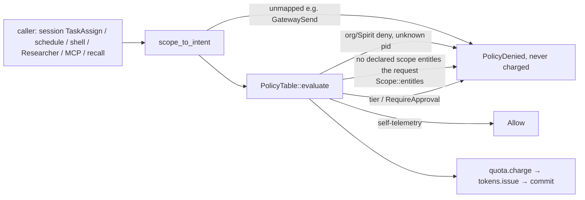

# Story 17.11: Selector-level scope entitlement at issuance

Status: done

<!-- ◆ FLAG-Winston. Created 2026-10-23 under the lighter creation contract (no party-mode preflight; no non-author validation pass run). Decisions D-17-11-FW-01…FW-09 were RULED A by the operator (Lunarpulse) 2026-10-23 (`17-11-flag-winston-decision.md` §Rulings); code-review rulings 2026-10-24 are in §Review Findings. E16-A7: the kernel figure was measured by an in-place prototype of FW-01 A and the prototype removed (`17-11-evidence/creation/prototype-removal.log`). Every "(FW-nn A)" below is the ruled contract. -->

> **Capability.** A Spirit is issued a capability token only for a selector it declared: the MCP server and tool, the IAC peer class, the provider, the file subtree, the domain — not merely for the same *kind* of capability.

**Closes:** FR5's *"Spirit cannot exfiltrate data outside its declared capability scope"* (`_bmad-output/planning-artifacts/prd/functional-requirements.md:28`) and token scoping in capability mediation (`prd/domain-specific-requirements.md:46`) **at issuance**; `deferred-work.md:1074` (MCP selector entitlement, widened by 17-9's preflight to every parameterized scope).
**Does NOT close:** use-time selector checks for scopes that have none (Fs/Net/ProcExec/SubSpirit/Mem/IacSend/Gateway/CLI triplet — the inventory found only MCP `crates/maos-kernel-core/src/mcp/mod.rs:68-75` and inference `crates/maos-kernel-core/src/inference/mod.rs:240-243`); new manifest fields that would *produce* Fs/Net/ProcExec/SubSpirit/Mem/CLI/Gateway grants (admission produces none, `crates/maos-manifest/src/manifest.rs:820-867`); mediating `GatewaySend` (`crates/maos-kernel-core/src/capability/mod.rs:105-108` refuses it); inference fallback routing (`crates/maos-kernel-core/src/inference/router.rs:46-74` tries fallback ids the token never named — see Dev Notes, not this story's AC); provider selection or rerouting (FW-05 B is not recommended).

## Story

As the operator of a MAOS daemon — and the author of any Spirit admitted to it —
I want the kernel to issue a capability only when a declared manifest scope entitles the exact selector requested (the same MCP server and tool, IAC peer class, provider, binary, sub-Spirit class, memory scope and CLI triplet; a path at or beneath a declared subtree; the declared domain),
so that a Spirit cannot obtain authority over a server, tool, provider, path or destination it never declared by asking for a token of the same kind, and every caller that relied on that gap fails typed instead of silently succeeding.

**Contract:** epic-17 §17-11 (AC1–AC4, `_bmad-output/planning-artifacts/epics/epic-17-workers-and-third-party-form-w2.md:378-391`, with the creation OLD→NEW note at `:382`); decision record `17-11-flag-winston-decision.md` (FW-01…FW-09, RULED A 2026-10-23); `docs/testing/proof-contract.md` (binding: focused suites, `build-test-fixtures`, ONE plant per AC in place, proven red on one image, no `cargo` inside `#[test]`, per-binary budget 30 s `xtask/test-budgets.toml:24`); ADR-069 (`docs/adr/ADR-069-kernel-core-envelope-through-v1.md:35-46`); 17-9's order policy → quota → tokens (`crates/maos-kernel-core/src/capability/mod.rs:179-234`).

## Current-tree corrections — read before implementing

Measured at `8e93ffad` by direct reads, a read-only inventory scout (`17-11-evidence/creation/static-inventory.md`), `kloc-check --json` before/after, `check-kernel-baseline --json`/`--emit-pin`, `check-service-boundary`, and the focused suites run on an in-place prototype (`17-11-evidence/creation/prototype-A.diff`) and at HEAD.

| Epic premise | Current fact and consequence |
|---|---|
| `evaluate` matches by discriminant at `cap_policy/mod.rs:161-166` | At `:159-167`: comment `:159-160`, `manifest.scopes.iter().any(\|s\| std::mem::discriminant(s) == std::mem::discriminant(&capability.scope))` `:161-164`, `Deny` `:165-167`. It runs after the self-telemetry always-allow (`:125-131`), the org/Spirit deny sets (`:138-151`) and the unknown-Spirit deny (`:154-157`), and before the tier check (`:170-173`) and the approval arms (`:179-203`). Only this closure changes. |
| Parameterized scopes at `i1.rs:60-90` | The enum spans `crates/maos-domain/src/invariants/i1.rs:60-131`; selector-bearing variants `:62-111` (Fs `:62-64`, Net `:66`, ProcExec `:68`, SubSpirit `:70`, Provider `:72`, IacSend `:74`, Mem `:76-78`, McpCall `:90`, CLI triplet `:96-102`, Gateway `:108-111`). `Scope: PartialEq + Eq` (`:58`), so exact matching is `==`. |
| Every parameterized scope "is issued for undeclared selectors" | True of the kernel, but **admission grants only `ProviderInfer`, `McpCall`, `IacSend`, `LoomRead/Write/Scan`, `LogRecall/LogFetch`** (`crates/maos-manifest/src/manifest.rs:820-867`, stored by `crates/maos-kernel-core/src/security/mod.rs:336-357`). Fs/Net/ProcExec/SubSpirit/Mem/CLI/Gateway grants exist only in hand-built test policy tables. Their requesters are frame `TaskAssign` scopes (`crates/maos-bin/src/spirit_session.rs:882-907`) and schedule `side_effect_scopes` (`crates/maos-kernel-core/src/scheduler/schedule_watchdog.rs:303-324`), which today issue for any selector of a declared kind. |
| "`GatewaySend` gateway" is an issuance selector | `scope_to_intent` refuses it (`capability/mod.rs:105-108`); no grant producer; the dispatcher's capability is a stub (`crates/maos-kernel-core/src/orchestrator/gateway_dispatcher.rs:127-128`, `:457-463`). The exact rule applies but is inert until a story mediates it. |
| "CLI path and argv hash" | The request is built from one resolved path, one hash and one manifest version (`crates/maos-bin/src/worker_spawn.rs:924-932`; hash `crates/maos-kernel-core/src/lifecycle/cli_wrapper/runtime.rs:77-85`). No admission grant exists, so it is `KernelPolicyDenied` today and proceeds by D1 (`worker_spawn.rs:946-990`) — unchanged by this story. Test fixtures that do grant it use the identical triplet (`crates/maos-bin/tests/support/t0_worker.rs:94-114`, `cli_wrapper_exhaustion_17_9.rs:80-96`). |
| Use-time checks cannot repair an over-broad token | Confirmed: MCP compares the call to its token (`mcp/mod.rs:68-75`), inference compares the request provider to its token (`inference/mod.rs:240-243`, provider from request or router default `:256-262`); neither consults the manifest. |
| "Selector semantics measured" | **Executed regressions:** on the prototype 7 `maos-bin` tests red, all green at HEAD (`17-11-evidence/creation/prototype-A-regressions.md`). One root cause: the composition root mints `ProviderInfer { <router default> }`; with no API key the router registers Ollama without a probe and makes it the default (`crates/maos-bin/src/main.rs:3571-3589`, `:3585`), while hello-spirit and Researcher declare `anthropic` (`spirits/hello-spirit/manifest.toml:12`, `spirits/researcher/manifest.toml:46`; prefix rule `manifest.rs:828`). At HEAD the kernel issues the `ollama` token for a Spirit that never declared it — the defect this story closes, live in the default configuration. Static-only: the legacy cassette arm mints the undeclarable literal `"replay"` (`main.rs:5507`). |
| `NetHttps` "exact or suffix" | No manifest, example, template, fixture, inline TOML or corpus declares a `*.` domain (`static-inventory.md`). |
| Governance | `kloc-check --json` at HEAD: kernel **20594** tokei (`xtask/kloc.toml:264`, ADR-069 envelope 23,000, alarm 22,000 — `xtask/tests/recovery_lane_ceiling_rule.rs:288-290`), `maos-domain` 9713 (`kloc.toml:425`), `maos-bin` 27614 (`:517`), aggregate 181231 vs `_aggregate_hardfail` 181232 (`:718`) — all zero headroom. `check-kernel-baseline`: 26361 physical, 95 files (`kernel-core-baseline.toml:505`). |

## Rulings — RULED 2026-10-23 by the operator, every row option A (decision record §Rulings)

| ID | Question | Recommended (A) | Alternatives |
|---|---|---|---|
| D-17-11-FW-01 | Implementation home | `Scope::entitles` in `maos-domain` `i1.rs`; kernel calls it at `cap_policy/mod.rs:161-164` — measured kernel 0 / 0, domain +23 | B in `cap_policy` — +29 / +21 kernel |
| D-17-11-FW-02 | Kernel grant | Δ 0 physical / 0 tokei, exact at landing; `cap_policy/mod.rs` only; digest `:787` + `set_hash` `:779` + HISTORY row | — |
| D-17-11-FW-03 | Out-of-kernel rows | measured requests at landing: `maos-domain` (prototype 9736), `maos-bin` (expected ±0 under FW-05 A), aggregate = measured + 1 | — |
| D-17-11-FW-04 | Identifier selectors | exact on every field (MCP, IAC, Gateway, ProcExec, SubSpirit, Mem, CLI triplet); selector-free variants by kind | B hierarchical memory scopes |
| D-17-11-FW-05 | `ProviderInfer` | exact; refuse on mismatch, never reroute; `main.rs:5507` mints the router default; test envs use `MAOS_OLLAMA_URL=skip` | B select declared∩registered + pin `provider_id`; C exempt; D declare every provider |
| D-17-11-FW-06 | Zero-key shell | hello-spirit also declares `ollama.llama3.1:8b` | B unchanged; six shell tests set `MAOS_OLLAMA_URL=skip` |
| D-17-11-FW-07 | Fs subtree | lexical component-wise containment; any `..` refuses; absolute/relative must match; no symlink resolution at issuance | B resolve `..`; C canonicalize |
| D-17-11-FW-08 | `NetHttps` | exact byte equality, no wildcard | B `*.suffix`; C case-insensitive |
| D-17-11-FW-09 | Refusal vocabulary | unchanged `PolicyDenied`, no kernel row; existing 17-9 path receipts | B distinct error + kind-7 row |

## Acceptance Criteria

### AC1 — command: only declared selectors are issued, before any charge

**Given** a `CapabilityRegistryAdapter` built as 17-9's harness builds it (`crates/maos-kernel-core/tests/issuance_quota_window_17_9.rs:179-224`: mock crypto, `CapQuotaTracker::with_clock` with a frozen manual clock, audit receiver drained) with an explicit `IssuanceQuota { budget_per_window: 1, .. }`, and a `PolicyTable` whose `manifest_scopes` give each test pid exactly one declared selector,
**when** `env -u CI -u GITHUB_ACTIONS cargo nextest run --locked -p maos-kernel-core --test scope_selector_entitlement_17_11` runs,
**then** exactly these three tests pass (wall time recorded in the Debug Log; < 30 s):

1. `declared_selectors_issue_and_undeclared_are_denied_uncharged` — one row per mediated parameterized scope, each on its own pid. For every row: each undeclared request returns `CapError::PolicyDenied`; then the declared request issues; then a second declared request returns `CapError::IssuanceQuotaExhausted` (budget 1 ⇒ the refusals charged nothing); the drain saw exactly one `CapAuditEvent::Issue` for the pid. Rows (declared → undeclared requests):
   - `McpCall {web, search}` → `{web, fetch}`, `{github, search}`;
   - `IacSend {spirit:peer}` → `{broadcast}`;
   - `ProviderInfer {anthropic}` → `{ollama}`, `{replay}`;
   - `ProcExec {/usr/bin/git}` → `{/usr/bin/curl}`, `{git}`;
   - `SubSpiritSpawn {researcher}` → `{butler}`;
   - `MemRead {spirit:butler:digest}` → `{spirit:butler}`, `{spirit:butler:digest:x}`; `MemWrite` the same;
   - `NetHttps {api.example.com}` → `{example.com}`, `{evil.api.example.com}`, `{API.example.com}` (FW-08 A);
   - `FsRead {/data/project}` → `{/data/projectX}`, `{/data}`, `{/data/project/../secret}`, `{data/project}`; `FsWrite` the same; declared `FsRead {/data/project}` → requested `FsWrite {/data/project}`;
   - `CliSubprocessSpawn {p, h, v}` → `{p', h, v}`, `{p, h', v}`, `{p, h, v'}`.
2. `fs_subtree_containment_issues_beneath_the_declaration` — declared `FsRead {/data/project}` issues `/data/project`, `/data/project/`, `/data/project/a/b`, `/data//project/./a` (budget raised for this test); declared `/data/../etc` entitles nothing (FW-07 A).
3. `kind_only_and_unmediated_scopes_are_unchanged` — `LoomRead`/`LogRecall` by kind; `SelfTelemetryRead` always-allow even undeclared (`cap_policy/mod.rs:125-131`); `DistillateWrite` still `PolicyDenied` via `RequireApproval` (`:180-184`, `capability/mod.rs:199-201`); a **declared** `GatewaySend {gw, r}` still `PolicyDenied` (unmediated, `capability/mod.rs:105-108`); an org deny on `mcp.call` (`cap_policy/mod.rs:138-151`) still beats a matching selector.

No assertion reads `CapabilityRegistryAdapter::list_active_tokens` (feature the kernel test does not enable, 17-9 CR-8).

### AC2 — selector semantics stated per scope (FW-04, FW-05, FW-07, FW-08 as ruled)

1. `pub fn Scope::entitles(&self, requested: &Scope) -> bool` in `crates/maos-domain/src/invariants/i1.rs` (after `:131`), rustdoc stating the ruled rule per variant: Fs lexical containment; every other variant `self == requested`. Allocation-free (no `Vec`, no `String`; `split('/')` iterators). No `unsafe`, no new dependency.
2. `crates/maos-domain/tests/scope_entitles_17_11.rs` (tokei-excluded; default features) — the full vector table: Fs (beneath, equal, trailing slash, `//` and `.` components, sibling prefix, parent, root, `..` on either side, relative vs absolute, empty requested, FsRead vs FsWrite), every identifier scope (each field mismatched alone), `NetHttps` (parent, child, wildcard-looking declaration `*.example.com` entitling nothing, case), unit variants by kind, different variants never.
3. The kernel comment `cap_policy/mod.rs:159-160` is rewritten line-for-line to name `Scope::entitles` (Δ 0 lines — FW-02 has no slack).

### AC3 — no silent regression (D-17-11-FW-05/FW-06 as ruled)

Every production and fixture manifest still receives what it declares; every caller found relying on an undeclared selector is fixed at origin or its manifest corrected, each named in the Debug Log. The creation regression list (executed; `17-11-evidence/creation/prototype-A-regressions.md`) is the floor:

| # | Test | Fix (FW-05 A + FW-06 A) | Fix if FW-06 B |
|---|---|---|---|
| R1 | `inference_mode_15_6::explicit_replay_is_observable_before_an_empty_shell_exits` (`crates/maos-bin/tests/inference_mode_15_6.rs:129`) | manifest corrected: `spirits/hello-spirit/manifest.toml:12` declares `ollama.llama3.1:8b` too → green unchanged | test sets `MAOS_OLLAMA_URL=skip` (siblings `:487`, `:586`) |
| R2 | `researcher_8_14c::researcher_8_14c_mcp_fanout` (`crates/maos-bin/tests/researcher_8_14c.rs:263-266`) | test env corrected: `MAOS_OLLAMA_URL=skip` → router default `anthropic` (`main.rs:3591-3595`), the Researcher's declaration; `--live` without a mode stays `Live` (`crates/maos-bin/src/inference_mode.rs:35-37`) | same |
| R3 | `shell_8_14a::audit_query_returns_shell_turn_rows` (`crates/maos-bin/tests/shell_8_14a.rs:206`) | as R1 | as R1 |
| R4 | `shell_8_14a::shell_hello_spirit_say_hi_and_audit_query` (`shell_8_14a.rs:98`) | as R1 | as R1 |
| R5 | `shell_host_16_2::shell_boot_then_butler_boot_on_one_tl_never_mix` (`crates/maos-bin/tests/shell_host_16_2.rs:1241`) | as R1 | as R1 |
| R6 | `shell_host_16_2::shell_boots_and_answers_from_a_cwd_with_no_spirits_dir` (`shell_host_16_2.rs:465`) | as R1 | as R1 |
| R7 | `shell_host_16_2::repl_clarification_resolves_with_no_control_json` (`shell_host_16_2.rs:830`) | as R1 | as R1 |
| R8 | legacy cassette arm mints `ProviderInfer {"replay"}` (`crates/maos-bin/src/main.rs:5507`; static, no local test) | caller fixed: mint the router default, as `:5438-5443` / `:5467-5470` do (`CassetteReplayPort` ignores the token, `crates/maos-bin/src/cassette_replay.rs:170-174`) | same |

Plus: (a) a refused mismatch surfaces typed — shell `capability issue failed: policy denied capability`, Researcher `maos run: token issue failed: kernel policy denied capability issuance` (`main.rs:5679`, `crates/maos-bin/src/worker_spawn.rs:320`) — never a silent fallback; (b) every other suite listed in §Tests and commands stays green; (c) under FW-06 A the hello-spirit change passes every test that pins shipped manifests (dev records which, if any).

### AC4 — proven red (rule 11; proof contract)

ONE plant, in place: restore `std::mem::discriminant(s) == std::mem::discriminant(&capability.scope)` at `cap_policy/mod.rs:161-164`. Expected red: AC1 tests 1 and 2 at their first undeclared vector (test 3 stays green — it proves the kind-level paths). Run once on `ubuntu-24.04` (`docs/testing/proof-contract.md:10-18`), recorded under `17-11-evidence/ci/` (run id, plant diff sha256, commit, image), restored with `git checkout --`; the story's final tree gets one green `discipline` run. The Dev Agent Record states plant count (1) and its wall-clock (`proof-contract.md:26-27`).

### Delivery gate — FW-02 grant and the enumerated re-pin set

- **Kernel:** only `capability/cap_policy/mod.rs`; physical **26361**, tokei **20594**, exact after `cargo fmt --all`. Any other kernel file or any non-zero figure is a charter request, never a re-pin.
- **Re-pin set (one commit, in the order `xtask/kernel-core-baseline.toml:899-907` mandates):** (1) `kernel-api-classes.toml` — no row; (2) re-derive `docs/ci-baselines/kernel-surface-v0.1-beta.json`, expected byte-identical; (3) `src_lines` `:505` stays 26361; (4) one `# HISTORY:` row after `:505`; (5) digest `:787` + `set_hash` `:779` from `--emit-pin` (prototype values in `measurements.json`; re-emit at the landing tree); `PINNED_ENTRIES` 95; (6) `kernel_pin_content_hash_16_0.rs` — no literal moves; (7)–(8) `kloc.toml:264` / `RATIFIED_AT_EASING` unchanged; (9) `maos-domain` `:425`, `maos-bin` `:517` (only if moved), `_aggregate_hardfail` `:718` — FW-03 measured requests with inline drivers; (10) run `check-service-boundary` **and** `check-kernel-baseline` at the landing tree.
- **Gates:** `check-kernel-baseline`, `check-service-boundary`, `check-empty-kernel`, `kloc-check --json`, `check-test-cost`, `check-test-budget` (advisory), `recovery_lane_ceiling_rule`, `kernel_pin_content_hash_16_0`, `cargo fmt --all -- --check`; `check-dev-record-completeness` once the record is final.
- No `unsafe`; no new dependency edge; no `wit/` edit; no manifest-schema change (FW-06 A edits a manifest's values, not its schema).

## Tasks / Subtasks

- [x] **T0 — Preflight at the dev HEAD** (all ACs)
  - [x] Confirm FW-01…FW-09 are ruled in `17-11-flag-winston-decision.md` §Rulings and materialized here; story and tracker read `ready-for-dev`. Stop if any is still proposed.
  - [x] `git diff --quiet 8e93ffad -- crates xtask spirits`; any drift → Debug Log, re-run `kloc-check --json` into `17-11-evidence/t0/`, re-check the cites in §Current-tree corrections.
- [x] **T1 — Domain rule** (AC2.1–AC2.2; FW-01, FW-04, FW-07, FW-08) — `Scope::entitles` + `subtree_contains` in `i1.rs` (shape: `17-11-evidence/creation/prototype-A.diff`, a sizing instrument); `crates/maos-domain/tests/scope_entitles_17_11.rs`. Prototype: +23 tokei.
- [x] **T2 — Kernel call site** (AC2.3; FW-02) — `cap_policy/mod.rs:159-164`: comment line-for-line, closure `\|s\| s.entitles(&capability.scope)`; rustfmt keeps the four-line chain (measured 670 → 670 lines, 495 → 495 tokei).
- [x] **T3 — AC1 kernel suite** — `crates/maos-kernel-core/tests/scope_selector_entitlement_17_11.rs`, three tests, budget-1 manual-clock quota per pid.
- [x] **T4 — Regressions** (AC3; FW-05, FW-06) — R1–R8 as ruled; `main.rs:5507`; hello-spirit manifest (FW-06 A) or the six `MAOS_OLLAMA_URL=skip` edits (FW-06 B); `researcher_8_14c.rs` env. Rerun `-p maos-bin` (focused) and list every red found beyond R1–R8 in the Debug Log with its fix.
- [x] **T5 — Docs** — `deferred-work.md:1074` appended *resolved by 17-11* note (row stays); ADR-030 (`docs/adr/ADR-030-capability-registry-decomposition.md`) implementation note: selector entitlement at issuance, the per-scope rule, FW-05's refuse-not-reroute posture, `GatewaySend` inert until mediated; the stale "re-exported through `maos-spirit-abi`" claim at `i1.rs:56-57` is not touched (out of scope; `abi-baseline/v1-pre-bump.txt` does not list `Scope`).
- [x] **T6 — Proven red (AC4)** — the one plant, one image, evidence in `17-11-evidence/ci/`. (Local red proven and recorded; the `ubuntu-24.04` CI run is owed at push — plant diff + sha256 staged in `17-11-evidence/ci/README.md`; the integrator pushes.)
- [x] **T7 — Governance** — §Delivery gate re-pin set in one commit; FW-03 figures returned to the operator before landing. (Re-pin set staged in the working tree for the integrator's single commit; FW-03 figures in the Completion Notes.)
- [x] **T8 — Record** — §Tests and commands; Dev Agent Record (plant count, wall-clock, regressions found, measured figures); reconcile story and tracker; `check-dev-record-completeness`. (Story → `review`; `sprint-status.yaml` left to the integrator.)

### Review Findings

**Review 2026-10-24 (bmad-code-review, anthropic/claude-fable-5-1; non-author; dev of record anthropic/claude-opus-5-5) — AC5 contract (`docs/testing/proof-contract.md`).** Read-only layers: Blind Hunter, Edge Case Hunter, Acceptance Auditor, Test-Infra Auditor on the 772-line diff. Integrator re-execution (sole cargo session, 38 s wall): `-p maos-domain -p maos-kernel-core -p maos-capability` 727 passed; `cargo test -p maos-kernel-core --lib` 258 passed; `-p maos-bin --features network,wasm-host` regression binaries (`researcher_8_14c`, `shell_8_14a`, `shell_host_16_2`, `inference_mode_15_6`, `mcp_mint_receipt_17_9`) 37 passed; gates `check-kernel-baseline` 26361/95, `check-service-boundary` 0, `check-empty-kernel` 0, `kloc-check` PASS 181258, `check-test-cost` PASS. Issuance-path inventory (Blind): the only reachable mint primitive is called after `evaluate` (`capability/mod.rs:193,219-222`); every production caller funnels through `issue_with_mediation`; `entitles`' `_ => self == requested` compares every field (derived `PartialEq`). Operator rulings 2026-10-24: keyless replay arms mint the Spirit's **first declared provider** (no provider is contacted, so not a reroute; FW-05 A kept); `openai` declared in the hello-spirit and Researcher manifests; `ci/17-11-verify` push authorized.

- [x] [Review][Patch] MEDIUM — keyless offline cassette replay of the Researcher is refused [`crates/maos-bin/src/main.rs:5467-5471,5510-5514`]: both replay arms mint `ProviderInfer{router.default_id()}` (= `ollama` on a keyless box) while the Researcher declares only `anthropic`. **Ruled:** replay arms mint the Spirit's first declared `ProviderInfer` scope (`CassetteReplayPort` contacts no provider); a keyless legacy-cassette test pins it. (blind+edge+accept+test-infra) **APPLIED 2026-10-24** — `main.rs` legacy cassette arm (`ResolvedInferenceMode::Replay{explicit:false}`) mints the first `ProviderInfer` of `capabilities_required_to_scopes(&gated.caps_required)`; pinned by `researcher_8_14c::researcher_17_11_keyless_legacy_cassette_replays` (keyless, Ollama at dead port ⇒ router default `ollama`, exit 0, cassette arm wired). The explicit-mode arm (`:5467-5471`) is NOT changed: it routes through `InferencePortAdapter`, whose `check_capability` compares the token against the router default (`inference/mod.rs:256-262`), so a first-declared token there would be refused at use; explicit replay keyless + undeclared default stays a typed issuance refusal.
- [x] [Review][Patch] MEDIUM — OpenAI-only configuration now refuses the shell, the one-shot hello and the Researcher (router default `openai`, `main.rs:3552-3561`; undeclared). **Ruled:** `spirits/hello-spirit/manifest.toml:12` and `spirits/researcher/manifest.toml:46` also declare an `openai.<model>` entry (model from the router's OpenAI default; `check-model-currency` must pass). (edge+accept) **APPLIED 2026-10-24** — `openai.gpt-4o-mini` (the router's `OpenAiProvider::new` pin, allowed in `xtask/model-currency.toml`) appended to `spirits/hello-spirit/manifest.toml` and `spirits/researcher/manifest.toml`; `check-model-currency --json` passed (14 pins, 0 findings; `17-11-evidence/gates/review-patches-check-model-currency.json`).
- [x] [Review][Patch] MEDIUM — AC3(a) "surfaced typed" has no test once `MAOS_OLLAMA_URL=skip` hides the keyless path [`researcher_8_14c.rs:253`, `journey_researcher.rs:76`]. Fix: one `maos-bin` test with no keys and Ollama at a dead port (`MAOS_OLLAMA_URL=http://127.0.0.1:9`) for a Spirit that declares only `anthropic` (a fixture manifest, since the reference manifests now declare ollama/openai) asserting a non-zero exit and `kernel policy denied capability issuance` on stderr. Both researcher tests also `env_remove` `MAOS_OPENAI_API_KEY`/`MAOS_ANTHROPIC_API_KEY` so ambient keys cannot flip the router default. (test-infra) **APPLIED 2026-10-24** — `researcher_8_14c::researcher_17_11_keyless_undeclared_provider_refused_typed` (fixture = Researcher manifest rewritten to declare only `anthropic`; keys removed, `MAOS_OLLAMA_URL=http://127.0.0.1:9`; non-zero exit + `kernel policy denied capability issuance`); `researcher_8_14c_mcp_fanout` `env_remove`s both keys; `journey_researcher::jr2` blanks both (the `JourneyWorld` builder has no removal; a blank key is `Unconfigured`).
- [x] [Review][Patch] MEDIUM — `subtree_contains` [`crates/maos-domain/src/invariants/i1.rs:170-181`]: a relative declared subtree with zero components (`""`, `"."`, `"./"`) vacuously entitles every relative path; `\\` is not a separator (Windows is a CI target) and `"…/..\\..\\x"` passes as one component; NUL and trailing-dot/space components (`".. "`, `"... "` resolve to `..` on Win32) pass. Fix (fail-closed; no production Fs grant exists): a declared subtree with zero components entitles nothing unless it is absolute `/`; any component containing `\\` or `\0`, or ending in ` ` or `.` (other than the filtered `.`), refuses on either side; vectors for each in `scope_entitles_17_11.rs`. (blind+edge) **APPLIED 2026-10-24** — `i1.rs` `subtree_contains`: a relative zero-component declaration entitles nothing; a component containing `\` or NUL or ending in space/dot refuses on either side (subsumes `..`); vectors in `scope_entitles_17_11::fs_subtree_fails_closed_on_ambiguous_components`.
- [x] [Review][Patch] MEDIUM — admission accepts selectors `entitles` can never match [`crates/maos-manifest/src/manifest.rs:744-833`]: empty/whitespace MCP `name` or `allowed_tools` entries, `*` in `allowed_tools`, empty or non-lowercase `provider.complete` prefixes — admitted, then every mint silently `PolicyDenied`. Fix: reject at `RawCapabilitiesRequired::validate` with typed errors; one vector each. (edge) **APPLIED 2026-10-24** — `RawCapabilitiesRequired::validate` refuses empty/whitespace and non-lowercase provider prefixes, blank MCP `name`, blank or `*`-bearing `allowed_tools` (`ManifestError::Toml` naming the field, the existing iac.send pattern); vectors in `iac_send_capability_17_3c::unmatchable_selectors_are_refused_at_admission`.
- [x] [Review][Patch] MEDIUM — "before any quota charge" only inferred [`crates/maos-kernel-core/tests/scope_selector_entitlement_17_11.rs:292-308`]: after the `IssuanceQuotaExhausted` assertion, issue one undeclared request again and assert `PolicyDenied` (quota-first ordering would return `IssuanceQuotaExhausted`). (test-infra) **APPLIED 2026-10-24** — after the `IssuanceQuotaExhausted` assertion each row re-issues its first undeclared request and asserts `PolicyDenied`.
- [x] [Review][Patch] MEDIUM — a drain-thread panic hangs the kernel test until nextest's terminate-after [`scope_selector_entitlement_17_11.rs:144,177-179`]: bounded `wait_timeout_while` (5 s) asserting no timeout. (test-infra) **APPLIED 2026-10-24** — `Harness::issues` uses parking_lot `wait_while_for(…, 5 s)` and asserts `!timed_out()`.
- [x] [Review][Patch] LOW — records: story frontmatter `kernel_grant.status: proposed` and `maos-bin prototype: 27614`, the `:27` HTML comment, decision-record per-row Status column → ruled; the baseline HISTORY row names FW-01 and FW-02; `check-dev-record-completeness`, `check-model-currency --json` and `-p xtask --test model_currency_gate` run and logged in `17-11-evidence/gates/`; ADR-030 note states that the CLI wrapper's AC5 host-grant path still proceeds on `KernelPolicyDenied` (17-1 D1, ratified, unchanged). (accept+blind) **APPLIED 2026-10-24** — frontmatter `kernel_grant.status: ruled`, `out_of_kernel_requests` carry landed + review figures, `:27` comment says ruled; decision-record Status column → `ruled A`; baseline HISTORY names FW-01 and FW-02; ADR-030 AC5 host-grant note added; gate logs `17-11-evidence/gates/review-patches-*` (kloc-check, check-kernel-baseline, check-service-boundary, check-test-cost, check-model-currency --json, check-dev-record-completeness, xtask gate tests).
- [x] [Review][Defer] Schedule watchdog fires the hook when a side-effect-scope mint is refused (`schedule_watchdog.rs:216-221,331-342`; 17-9 records the fire with `TokenId::ZERO`): the hook runs without a token, so any mediated capability use still needs one — whether an untokened fire should be suppressed is a design question, not a 17-11 regression. Owner `epic-17-retrospective`.
- [x] [Review][Defer] Inference router walks `fallback_provider_ids` without a capability check and maps an empty provider id to the default (`inference/mod.rs:294-303`, `router.rs:32-35,46-74`) — latent (no production request sets fallbacks; empty prefixes are rejected by the admission patch above). Owner `18-1-butler-inference-seam-and-conformant-mcp` (the inference seam).
- [x] [Review][Defer] Explicit `MAOS_INFERENCE_MODE=replay` arm for the Researcher on a keyless box (`main.rs:5467-5471`) still mints the router default and is refused: that arm dispatches through the shared router, whose adapter checks the token against the router default at use time (`inference/mod.rs:256-262`) and the Researcher sends no provider id — a declared-provider token would be minted and then refused at use. Making it work needs the Researcher to choose its provider per request or a replay-aware router check; the legacy cassette arm (the keyless offline path) is fixed per the ruling. Owner `18-3-researcher-replay-live-and-judged-five-metric` (owns `--replay`/`--deterministic` and "no silent fallback").
- [x] [Review][Defer] AC4 planted-red CI run on `ubuntu-24.04` — owed at push on `ci/17-11-verify` (authorized 2026-10-24); recorded in `17-11-evidence/ci/` when it runs. **RESOLVED 2026-10-24** — run `40045099664` @ `636bed02` (image `ubuntu-24.04` 20261012.334.1): tests 1 and 2 red at `:354`/`:304`, test 3 green (`17-11-evidence/ci/README.md`, `run-40045099664-excerpt.log`).

**Post-patch (integrator):** patches re-run by the patch agent as the sole cargo process — `-p maos-bin --features network,wasm-host` `researcher_8_14c`+`inference_mode_15_6` 18/18, `one_shot_hello`+`shell_8_14a`+`shell_host_16_2` 16/16, `maos-audit` fr4 19/19, journey `journey_j0`+`journey_researcher` 8/8, `-p maos-domain --test scope_entitles_17_11` 5/5, `-p maos-manifest` 200/200, `-p maos-kernel-core --test scope_selector_entitlement_17_11` 3/3; gates `kloc-check` PASS (aggregate 181317), `check-kernel-baseline` 26361/95, `check-service-boundary` 0, `check-test-cost` PASS, `check-model-currency` 14 pins/0 findings, `check-dev-record-completeness` PASS, xtask `model_currency_gate`+`recovery_lane_ceiling_rule`+`kernel_pin_content_hash_16_0` 57/57. kloc re-pins (FW-03, measured at landing): `maos-domain` 9743, `maos-manifest` 4540, `maos-bin` 27626, `_aggregate_hardfail` 181318. Kernel src unchanged by review (Δ 0/0 total). 8 patches applied, 4 deferred, 0 dismissed. Status → done (AC4's CI planted-red run follows on `ci/17-11-verify`).

## Dev Notes

### Issuance after this story



### Rule sketch (FW-01 A, FW-07 A — measured shape, not text to paste)

```rust
impl Scope {
    pub fn entitles(&self, requested: &Scope) -> bool {
        match (self, requested) {
            (Scope::FsRead { subtree: d }, Scope::FsRead { subtree: r })
            | (Scope::FsWrite { subtree: d }, Scope::FsWrite { subtree: r }) => subtree_contains(d, r),
            _ => self == requested,
        }
    }
}
fn subtree_contains(declared: &str, requested: &str) -> bool {
    fn parts(p: &str) -> impl Iterator<Item = &str> { p.split('/').filter(|c| !c.is_empty() && *c != ".") }
    if declared.starts_with('/') != requested.starts_with('/')
        || parts(declared).chain(parts(requested)).any(|c| c == "..") { return false; }
    let mut r = parts(requested);
    parts(declared).all(|d| r.next() == Some(d))
}
```

The `_ => self == requested` arm is also what makes a different variant refuse (FsRead never entitles FsWrite; ProcExec never entitles CliSubprocessSpawn, although `scope_to_intent` maps both to the `ProcExec` intent, `capability/mod.rs:100-104`).

### Selector provenance (AC2 evidence)

| Scope | Declared by | Requested by | Rule (FW) |
|---|---|---|---|
| `McpCall` | `manifest.rs:839-845` verbatim | Butler `main.rs:969-980`, Researcher `:1117-1126`, `:1218-1227`, all match `spirits/butler/manifest.toml:26-40`, `spirits/researcher/manifest.toml:61-75` | exact (04) |
| `IacSend` | `manifest.rs:856-860`, closed set `:625-627` | `spirit_session.rs:756-765` (`broadcast`/`spirit:peer`), precheck `:868` | exact (04) |
| `ProviderInfer` | `manifest.rs:823-838` (prefix before `.`) | `shell_host.rs:91-98`, `main.rs:8369-8377`, `:5667-5679`, smoke `:7029-7036` | exact (05) |
| `CliSubprocessSpawn` | none (tests only) | `worker_spawn.rs:924-932` | exact triplet (04) |
| `GatewaySend` | none | none (unmediated) | exact, inert (04) |
| Fs / Net / ProcExec / SubSpirit / Mem | none (tests only) | `TaskAssign` scopes `spirit_session.rs:882-907`; schedules `schedule_watchdog.rs:303-324` | 07 / 08 / 04 |
| Loom / Log / Distillate / SkillAuthorSelf / SelfTelemetry | `manifest.rs:847-866` (Loom, Log) | unit | by kind |

### Guardrails

- Never resolve symlinks, read the filesystem or allocate in `entitles`; never accept a `..` component on either side.
- Never reroute an inference request to a declared provider the operator did not select (FW-05 A); never add `"replay"` or a wildcard to a manifest to make a test pass.
- Never change the evaluate order: deny sets and unknown-pid before the selector match; selector match before tier and approval; policy before quota (17-9).
- Never add a kernel line, a kernel file, a kernel audit row or a `CapError` variant (FW-02, FW-09 A); the kernel diff is the closure and its comment.
- Never put the AC1 vectors inside `cap_policy/mod.rs`'s `#[cfg(test)]` module — inline tests count toward kernel tokei (`xtask/src/kloc_check.rs:294-318` excludes only `tests/`, `benches/`, … directories).
- Never run `cargo` inside a `#[test]` (`check-test-cost`); use `build-test-fixtures` for binaries the `maos-bin` suites need.

### Tests and commands

```bash
env -u CI -u GITHUB_ACTIONS cargo nextest run --locked -p maos-domain -p maos-kernel-core -p maos-capability -p maos-pdp -p maos-manifest
env -u CI -u GITHUB_ACTIONS cargo nextest run --locked -p maos-kernel-core --test scope_selector_entitlement_17_11   # AC1: 3 passed
env -u CI -u GITHUB_ACTIONS cargo test --locked -p maos-kernel-core --lib
env -u CI -u GITHUB_ACTIONS cargo run -p xtask -- build-test-fixtures
env -u CI -u GITHUB_ACTIONS MAOS_17_2_CGROUP_MODE=undelegated cargo nextest run --locked -p maos-bin --features network,wasm-host --no-fail-fast   # R1–R8
env -u CI -u GITHUB_ACTIONS cargo nextest run --locked -p maos-wasm-host -p maos-shell -p butler -p researcher -p maos-iac -p maos-journey-test -p maos-cli
cargo run -p xtask -- check-kernel-baseline && cargo run -p xtask -- check-service-boundary && cargo run -p xtask -- check-empty-kernel
cargo run -p xtask -- kloc-check --json && cargo run -p xtask -- check-test-cost
cargo test --locked -p xtask --test kernel_pin_content_hash_16_0 --test recovery_lane_ceiling_rule
cargo fmt --all -- --check
```

Creation baselines on the prototype: core 944, kernel lib 258, `maos-bin` 553 + the 7 reds, others 372, journey/cli 201. `-p maos-kernel-core` nextest appends to `intent-lineage-coverage-report.md` — revert it (17-9 Debug Log trap). T2/T3/delegated suites print `SKIP` off CI (`proof-contract.md:66-71`); a skip is not a pass.

### Previous-story intelligence

- **17-9 (done):** order policy → quota → tokens (`capability/mod.rs:179-234`) — a policy denial is uncharged, which AC1 proves with a budget-1 tracker; 17-9 AC1's harness (`issuance_quota_window_17_9.rs:179-224`) is the template. Kind-28 receipt vocabulary `<op>.refused:<code>` (MCP payload carries server and tool, `worker_spawn.rs:425-474`). Kernel figures are ratified ceilings re-pinned exact at landing.
- **17-3c:** disclosed the MCP selector gap (`deferred-work.md:1074`); the session IAC precheck (`spirit_session.rs:868`) is the only selector check before mint today.
- **20-12 (proof contract):** one plant per AC, one image, focused suites; `MAOS_OLLAMA_URL=skip` is already the hermetic test idiom (`one_shot_hello.rs:19`, `f4_pairing.rs:347`, `cert_rotation_trigger_14_2a.rs:242`).

### Git intelligence

`8e93ffad` (ADR-069), `a4cb586d`/`e1d09f0b` 20-12. Last edits to `cap_policy/mod.rs`: 16-6 (posture ceiling) and 11.4a (deny sets) — neither touched the scope match. Working tree clean at creation except planning/evidence files.

## Evidence

`17-11-evidence/creation/`: `measurements.json` (all figures); `kloc-check-8e93ffad-before.json`, `kloc-check-prototype-A.json`; `check-kernel-baseline-prototype-A.{json,log}`, `emit-pin-prototype-A.toml`; `check-service-boundary-prototype-A.log`; `prototype-A.diff` (sha256 `2ff00dfc6c0e1509e67c49919b5b2d42ab6ff307e3b7410a2d67cbb407d3353d`); `option-B-sizing.diff` (`c30f566914f497200ce5b46ab614dc6b7c3e683cf47f89c8d272cd40a69fe1ed`); suite logs `prototype-A-nextest-{core,bin,other,journey,journey-rerun}.log`, `prototype-A-kernel-lib.log`; HEAD controls `head-8e93ffad-{the-seven,maos-cli-two,nextest-journey}.log`; `prototype-A-regressions.md`; `static-inventory.md`; `prototype-removal.log`.

## Dev Agent Record

### Agent Model Used

`anthropic/claude-opus-5-5` (bmad-dev-story, dev of record, 2026-10-23)

### Debug Log References

- **T0:** FW-01…FW-09 read `ruled` (decision record line 4, §Rulings, all A). Dev HEAD `cf2fc355`; `git diff --stat 8e93ffad cf2fc355 -- crates xtask spirits` empty → no drift, no `t0/` re-run needed. Tree clean.
- **T1 (AC2):** `env -u CI -u GITHUB_ACTIONS cargo nextest run --locked -p maos-domain --test scope_entitles_17_11` → 4 passed (0.003 s).
- **T3 (AC1):** `env -u CI -u GITHUB_ACTIONS cargo nextest run --locked -p maos-kernel-core --test scope_selector_entitlement_17_11` → **3 passed**, 0.005 s test time, 6.0 s wall incl. incremental build (< 30 s budget). Drain asserts exactly one `CapAuditEvent::Issue` per pid; no `list_active_tokens`.
- **T4 (AC3):** `cargo run -p xtask -- build-test-fixtures` (14 artefacts) then `env -u CI -u GITHUB_ACTIONS MAOS_17_2_CGROUP_MODE=undelegated cargo nextest run --locked -p maos-bin --features network,wasm-host --no-fail-fast` → **560 passed, 14 skipped** (22.7 s test, 52 s wall) — R1–R7 green (553 + 7). Fixes: R1, R3–R7 by FW-06 A (`spirits/hello-spirit/manifest.toml:12` declares `ollama.llama3.1:8b` — the router's Ollama model, `main.rs:3581`); R2 by `MAOS_OLLAMA_URL=skip` in `researcher_8_14c.rs`; R8 at origin (`main.rs:5507` mints `router.default_id()` with the explicit-mode arm's typed refusal, never `"replay"`).
- **Red beyond R1–R8 (found, fixed at origin):** R9 `maos-journey-test::journey_researcher::jr2_live_mcp_fan_out_via_pty` — `Error: "maos run: token issue failed: kernel policy denied capability issuance"` (typed refusal, AC3(a)); same root cause as R2 (`maos run researcher --live` on a keyless box ⇒ router default `ollama`, undeclared). Fix: the test's `JourneyWorld` sets `MAOS_OLLAMA_URL=skip` (`journey_researcher.rs:74-76`) → green (3/3).
- **Not a regression:** `maos-wasm-host::recall_runner_17_3d::unknown_tag_reply_latches_broken_after_export` red once in the second `-p maos-wasm-host … -p maos-cli` run (it was green in the first); three isolated reruns 11/11 green — a door flake unrelated to issuance (no capability mint on that path).
- **Other suites:** `-p maos-domain -p maos-kernel-core -p maos-capability -p maos-pdp -p maos-manifest` → 949 passed, 4 skipped (creation 944 included the 2-test prototype domain file; +4 domain +3 kernel −2); `cargo test --locked -p maos-kernel-core --lib` → 258 passed; `-p maos-wasm-host -p maos-shell -p butler -p researcher -p maos-iac -p maos-journey-test -p maos-cli` → 573 run, 572 passed + the flake above (after the R9 fix). `intent-lineage-coverage-report.md` reverted after the kernel nextest run.
- **AC2(c) shipped-manifest pins:** no test pins `spirits/hello-spirit/manifest.toml` content (whole `maos-bin`, journey and cli suites green with the edit).
- **AC4 plant (count 1):** `cap_policy/mod.rs:164` restored to the discriminant match → tests 1 and 2 red at their first undeclared vector (`declared McpCall { server: "web", tool: "search" } must not entitle McpCall { server: "web", tool: "fetch" }`), test 3 green; wall-clock **10.44 s** (2026-10-23T16:06:53Z). File copied aside and restored (it carried the story's uncommitted edit); rerun 3 passed. `17-11-evidence/plants.md`, `plant-ac4-local.log`, `ci/ac4-plant.diff` (sha256 `d66a75ae…62ba`).
- **T7 gates (after `cargo fmt --all`; logs `17-11-evidence/gates/`):** `check-kernel-baseline` PASSED (26361 lines, 95 files, pinned 26361); `check-service-boundary` PASSED (0 violations; `kernel-surface-v0.1-beta.json` byte-identical — no public symbol added/moved, no `kernel-api-classes.toml` row); `check-empty-kernel` PASSED; `check-test-cost` PASS (515 files); `kloc-check --json` passed (aggregate 181258, over_budget []); `kernel_pin_content_hash_16_0` 25 passed, `recovery_lane_ceiling_rule` 12 passed; `cargo fmt --all -- --check` clean. `check-test-budget` needs `--junit` (CI-only, advisory) — not run locally.

### Completion Notes List

- 2026-10-23 — Created by `anthropic/claude-opus-5-5` (bmad-create-story, lighter contract). Status left `backlog`: FW-01…FW-09 PROPOSED; the integrator sets `ready-for-dev` after the operator rules.
- 2026-10-23 — Dev (`anthropic/claude-opus-5-5`): `Scope::entitles` in `maos-domain` (Fs lexical component-wise containment with `..`/absolute-relative refusal; every other variant `==`; allocation-free; per-variant rule in rustdoc) and the kernel closure swap at `cap_policy/mod.rs:159-164` (comment rewritten line-for-line). AC1–AC3 green on focused suites; AC4 plant proven red locally.
- **Kernel (FW-02):** measured **26361 physical / 20594 tokei — Δ 0 / 0, exact**; only `capability/cap_policy/mod.rs`. Re-pin: `kernel-core-baseline.toml` HISTORY row after `:505`, `set_hash` `45b89741…06d8`, `cap_policy/mod.rs` digest `6276a69f…2a37` (identical to the creation prototype's `--emit-pin`); `PINNED_ENTRIES` 95; `kloc.toml:264` and `RATIFIED_AT_EASING` 20_594 unchanged. ADR-069 remaining 2,406.
- **FW-03 figures for the operator:** `maos-domain` 9713 → **9736** (+23), `maos-bin` 27614 → **27618** (+4, the cassette arm), aggregate measured **181258** → `_aggregate_hardfail` 181232 → **181259**; rows re-pinned exact with dated notes citing `17-11-scope-selector-entitlement`.
- **Owed at push (integrator):** the AC4 `ubuntu-24.04` planted-red run (`17-11-evidence/ci/README.md`) and the final tree's green `discipline` run; the re-pin set lands in one commit; `sprint-status.yaml` reconciliation.

### File List

- `crates/maos-domain/src/invariants/i1.rs`
- `crates/maos-domain/tests/scope_entitles_17_11.rs` (new)
- `crates/maos-kernel-core/src/capability/cap_policy/mod.rs`
- `crates/maos-kernel-core/tests/scope_selector_entitlement_17_11.rs` (new)
- `crates/maos-bin/src/main.rs`
- `crates/maos-bin/tests/researcher_8_14c.rs`
- `crates/maos-journey-test/tests/journey_researcher.rs`
- `spirits/hello-spirit/manifest.toml`
- `xtask/kernel-core-baseline.toml`
- `xtask/kloc.toml`
- `docs/adr/ADR-030-capability-registry-decomposition.md`
- `_bmad-output/implementation-artifacts/deferred-work.md`
- `_bmad-output/implementation-artifacts/17-11-scope-selector-entitlement.md`
- `_bmad-output/implementation-artifacts/17-11-evidence/plants.md` (new)
- `_bmad-output/implementation-artifacts/17-11-evidence/plant-ac4-local.log` (new)
- `_bmad-output/implementation-artifacts/17-11-evidence/ci/ac4-plant.diff` (new)
- `_bmad-output/implementation-artifacts/17-11-evidence/ci/README.md` (new)
- `_bmad-output/implementation-artifacts/17-11-evidence/gates/` (new: gate logs, `kloc-check.json`)
- `_bmad-output/implementation-artifacts/17-11-evidence/kloc-check-landing-before-repin.json` (new)

## Change Log

- 2026-10-23 — Dev: selector-level entitlement at issuance (`Scope::entitles`), kernel call-site swap (Δ 0/0), AC1/AC2 suites, AC3 regressions R1–R9 fixed at origin, ADR-030 note, deferred-work row resolved, kernel and kloc re-pins; status → `review`.
- 2026-10-24 — Review (fable-5.1, AC5 contract): 8 patches, 4 deferred; status → `done` (`15b02d98`).
- 2026-10-24 — CI: AC4 proven red on `ubuntu-24.04` (run `40045099664`). Landing-tree discipline run `40045055432` found two workspace reds caused by the review patches and outside the focused set — `researcher_log_grant_17_3d` (scope count with the ruled `openai` provider) and `spirit_boundary_invariants` corpus case `sb-007` (empty provider prefix now refused) — fixed in a follow-up commit (test + corpus case + `MANIFEST.toml` re-pin); details `17-11-evidence/ci/README.md`. Lesson recorded at the Epic 17 retrospective: a manifest or admission change must run the corpus and manifest-reading suites of every crate that parses that manifest (E17-A6).
