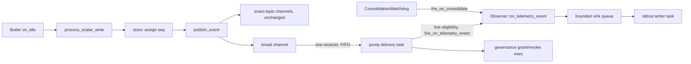

# Story 17.4: Hooks, Observer, and the activity corpus

Status: done

<!-- ◆ FLAG-Winston, ratified by Lunarpulse 2026-10-19: D-17-4-FW-01 at creation (publish-order `seq`), amended the same day at the party-mode preflight by D-17-4-PF-R1 (one broad "firehose" channel in `TelemetryStreamAdapter`; measured prototype) — kernel = `telemetry/mod.rs` only, ceiling ≤ 26304 physical / ≤ 20538 tokei, exact at landing; D-17-4-PF-R2: AC5.3 = no new coverage-matrix violations. All rulings are materialized into this one contract. Record: `17-4-flag-winston-decision.md`. -->

## Story

As an operator running first-party Spirits in one MAOS root,
I want the Observer Spirit admitted like every other compiled-in class, fed every live `scalar.tap` write through `on_telemetry_event` in its emitter's order, curating its window through `on_consolidate`, and its delivery quality measured against a 20-scenario activity corpus,
so that I can watch what my Spirits are doing as it happens and trust a published missed-event and causal-order figure instead of an assumed one.

**Contract:** epic-17 §17-4 (`_bmad-output/planning-artifacts/epics/epic-17-workers-and-third-party-form-w2.md:226-235`) as amended by §R4 rows R17-1/R17-2/R17-3/R17-11/R17-20 (`:399-401,409,418`), **§R15 R17-165…R17-174** (`:645-660`, creation) and **§R16 R17-175…R17-182** (`:662-675`, preflight). FR55 (`_bmad-output/planning-artifacts/prd/functional-requirements.md:69`); the Observer ship-gate corpus (`prd/project-scoping-phased-development.md:145`); NFR-Obs-3 (`prd/non-functional-requirements.md:103`); I7 broadcast telemetry (`architecture-maos-minimal-opus/3-vocabulary-invariants.md:34`); ADR-035 (`12-architecture-decision-records.md:488`). ◆ FLAG-Winston, security-sensitive (first production read path across Spirits): the non-author §A6 net (Blind + Edge + Acceptance + Test-Infra + Security + runtime) is non-degradable (`epic-17…md:78`). Confidence rule 11 applies to the AC4 oracle and to the subscription audit rows (AC2.7).

## Current-tree corrections — read before implementing

Re-measured at `c49032a1` by four scouts, direct reads, two creation validators and four preflight reviewers (§Preflight). OLD→NEW rows: epic §R15, §R16.

| Epic premise | Current fact and consequence |
|---|---|
| "alongside Butler" | Two `maos run` processes share no stream: each root builds its own `TelemetryStreamAdapter` (`crates/maos-bin/src/main.rs:1911`, registry `:1967`; per-process `crates/maos-kernel-core/src/telemetry/mod.rs:35-43`). `maos run` takes one manifest (`worker_spawn.rs:75-87`); topology refuses Butler (`main.rs:4564-4569`). Same-root route: the door — `maosctl load` builds via `build_spirit_obj`, stops at `Loaded` (`main.rs:8805-8857`), `spirit_id = [class].name` (`admission.rs:567-570`); `maosctl start butler` (`operator_door.rs:388-392,544`). The door's Butler keeps its seeded scenario and scalar port (`main.rs:655-724,825-843`); no provider key needed (`spirits/butler/src/lib.rs:395-422`). A serving root reaches the tail where IdleWatchdog scans door-loaded SCBs (`main.rs:5870-5873,8370-8376`). **CR-1.** |
| Registration sites | Enum `main.rs:438-449`; `classify_spirit` `:451-464`; exhaustive matches `build_spirit_obj` `:810-844`, topology `:4496-4570`, standalone `:4976-5557`; door `matches!` `:8820-8822`; `KNOWN_CLASS_NAMES: [&str; 8]` `admission.rs:344-353`; gate 5 `:494-501`. Parity tests: `story_16_6_known_class_names_match_classify_spirit` one-directional (`main.rs:13525-13539`); round-trip list has 7 names, Digest missing (`:13695-13723`); arm asserts `:13494-13509`. |
| `maos-observer` dependency | Package `observer` (`spirits/observer/Cargo.toml:2`); siblings bare at `crates/maos-bin/Cargo.toml:80-88`; `Cargo.lock` maos-bin entry (`:2677-2754`) gains the edge. |
| Observer prints | It emits nothing (`spirits/observer/src/lib.rs:453-475`), watches nothing by default (`:477-488`); its manifest comment claims the subscription is "kernel-granted at the capability layer" (`spirits/observer/manifest.toml:21-24`) — false: the right comes from operator admission of the compiled-in class (fixed, AC2.7). |
| Telemetry transport | Per-exact-tag channels, no wildcard (`telemetry/mod.rs:28-29,40,92-126`); a per-topic pump cannot order one emitter across tags and hides undeclared tags (any nonempty tag is accepted, `crates/maos-capability/src/working_memory/store.rs:43-62`). **D-17-4-PF-R1:** one broad channel, `subscribe_all()`. Prototype (`17-4-evidence/preflight/`): 1 500 alternating A/B writes from one emitter received in exact order; capacity-2 receiver → `Lagged(3)` once; `check-service-boundary` reds on the struct hash (`xtask/src/check_service_boundary.rs:539-553`) → baseline treatment in the Delivery gate. |
| Event identity | `ScalarTapEvent` has no sequence (`crates/maos-domain/src/invariants/i7.rs:43-54`). **D-17-4-FW-01:** `seq` = **store-write order** (assigned under the store lock; publish happens after it, `crates/maos-kernel-core/src/capability/mod.rs:220-234`) — an identity label, never a reorder key. |
| Payload | Bytes (`maos-spirit-abi/src/lifecycle.rs:73-76`), passed unchanged (`control_block.rs:125-134`). `set_scalar` refuses NaN/±Inf (`store.rs:54-58`); exact finite `f64` JSON parsing needs `serde_json/float_roundtrip` (serde_json 1.0.149 `tests/test.rs:957-979`). |
| Publisher and identity | One production publisher, reached by `process_scalar_write` before policy evaluation (`orchestrator.rs:65-80`); markers too (`:106-117`, e.g. `halt.context_provided`). `ButlerOrchestratorAdapter::write_scalar` ignores the Spirit's pid (D-16-3-N) but passes its **claimed** `spirit_id` through (`main.rs:598-633`) — fixed at origin (AC2.8). Butler's value is `f64::from(0.8_f32)` = 0.800000011920929 from one conflict pair (`spirits/butler/src/lib.rs:227-237,623-633`). |
| Admission is in-process only | **False:** the WASM arm also calls `load_admit_start` (`main.rs:5544-5584`; `tests/recall_17_3d.rs:296-318`). Registration happens only for compiled-in constructed objects. `AdmissionDeps` sites: `main.rs:4574,5564,8839`, `tests/recall_17_3d.rs:204`, `tests/spawned_scope_17_3c.rs:231`. `on_loaded` (`admission.rs:702`) precedes the admission decision (`:707-745`); the granted path is `:747-754`; start-failure rollback `:761-776`. |
| Hot-swap keeps the class | **False:** upgrade checks only `spirit_id` (`crates/maos-bin/src/migration_plan.rs:56`); hot-swap keeps the pid and replaces manifest and object (`crates/maos-kernel-core/src/hot_swap/coordinator.rs:299-316`); successor built from the successor's `class.name` (`main.rs:3067-3108`). Eligibility must be decided live (AC2.3). Cold-swap allocates a new pid but the live door refuses cold-swap (`operator_door.rs:802-812`); pids are never reused (`scheduler_loop.rs:29-33`). |
| `[lifecycle].enabled_hooks` | Validator accepts 11 names (`crates/maos-manifest/src/manifest.rs:1536-1550`) while the ABI has 14 (`crates/maos-spirit-derive/src/lib.rs:10-25`: + `on_swap_out`, `snapshot`, `migrate`) whose dispatchers read the same list — a refused `snapshot` aborts hot-swap (`hook_dispatch.rs:341-363,439-446`; `coordinator.rs:213-230`). A Spirit that registers explicitly can never be upgraded. Fixed at origin (AC3.7). |
| AC3 caller in `idle_watchdog.rs` | Kernel source with a pinned digest (`xtask/src/check_kernel_baseline.rs:7-17`), and once per quiescent epoch (`idle_watchdog.rs:93-96`); telemetry never refreshes `last_inbound_frame_ns` (`control_block.rs:339-347`). **CR-3:** maos-bin `ConsolidationWatchdog`. |
| Hook timeout = done | **False:** `BudgetExceeded` returns without joining the body (`hook_dispatch.rs:564-577,656-677`), accepted today for IdleWatchdog (`main.rs:8510-8514`); budget rows are written to the TL (`hook_dispatch.rs:184-262`). Hooks are not serialized per Spirit (`:574-575`). |
| Serving-tail drain | The watchdog drain waits **5 s** then drops the handle and proceeds (`main.rs:8480-8500`); Observer's budget is 10 s (`spirits/observer/manifest.toml:54-57`). New tasks must not inherit that detach (AC3.1). Early-return roots: topology `--once` `:4693-4750`, standalone Worker `:4862-4901`, standalone Spirit/session `:5806-5867`; serving `cancel` is created at `:8348`; owners are released before the audit drain (`:5819-5848`, `:8535-8587`). |
| Pause/unload race | The `Running` check and the dispatch are not atomic; the door's per-Spirit lock covers operator commands only (`operator_door.rs:380-386,543-547`). The same race exists today in IdleWatchdog/ScheduleWatchdog; an in-flight hook surviving pause is FR51(a), action item E16-A6 (`sprint-status.yaml:474-477`). Parity, named, not claimed fixed (AC2.3). |
| Tenancy | One tenant per kernel instance; a host speaks for one team (`crates/maos-cohort/src/manifest.rs:130-150`); the TL is team-bound before open (`main.rs:1835-1866`). Fan-out stays inside one tenant — no server-side team filter needed. Observer's `PrincipalScope` is a view filter, not an access control, and not FR31 (`prd/functional-requirements.md:77`). |
| Audit of broad reads | Self-telemetry reads write an audit row (`crates/maos-kernel-core/src/memory/self_telemetry.rs:187-199`); a broad read of everyone's scalars would write nothing; NFR-Sec-14 lists scalar.tap observation as an isolation category (`crates/maos-eval/fixtures/isolation-corpus-v0/README.md:36-37`). Grant/revoke governance rows (AC2.7), precedent `emit_vetter_key_event` (`admission.rs:67-107`). |
| ≤2 % / ≥99 % | Observer ship-gate floor (`prd/project-scoping-phased-development.md:142-145`), not NFR-Obs-3. |
| Harness | Reuse `crates/maos-bin/tests/shell_host_16_2.rs` (registry `:89-146`, scheduler `:493-514`, load/start `:518-551`) + `crates/maos-bench/src/harness/j4.rs:160-182`; AC1 scene reuses `maosctl_load_16_6.rs:96-169`; `maosctl` is a sibling-package binary — resolve beside `maos` and prebuild (`:67-84`), never `CARGO_BIN_EXE_maosctl`. |
| Coverage matrix | Unrelated rows already violate (`tests/coverage-matrix.yaml:242,632,645,796` name unregistered gates; checked regardless of phase, `xtask/src/coverage_matrix.rs:139-152`). **D-17-4-PF-R2:** no new violations against a recorded baseline; debt stays with 20-3b. |
| Kloc | Kernel 26291 / 20527 (`xtask/kernel-core-baseline.toml:505`, `xtask/kloc.toml:263`); `maos-domain` 9632 zero headroom (`kloc.toml:420-421`); `maos-capability` 1127/2000 (`17-2-evidence/t6-final-quality-gates.log:21`); `maos-bin` 26340 zero headroom (`:510-511`); `maos-manifest` 4493 exact; aggregate 177609 / 177610 (`:708-709`). `kloc.toml:681-682` books a spent registry raise to 17-4 (removed). `spirits/` excluded (`:1-4`). |
| Roster | `SCANNED_SOURCE_FILES: [(&str,&str); 27]` (`crates/maos-bin/tests/cohort_daemon_smoke_13_5c.rs:924`), dynamic count `:1033-1048` → 28. |
| Exit block | Line 5 added at creation (`epic-17…md:46`, provenance `:56`); `epic-17-exit` (`.github/workflows/discipline.yml:1822-2018`) is in `aggregate.needs` (`:5257`) under the generic guard (`:5414-5426`); workspace CI also runs the targets (`:4943`) — isolate artifact paths. Artifact step today uploads only terminal/sandbox outputs (`:2002-2013`). |
| Spawned forms | WASM world exports `handle-frame`, `on-start`, `on-shutdown` only (`wit/spirit.wit:343-355`). Neither hook reaches spawned forms (R17-173). |

## Rulings

| ID | Ruling |
|---|---|
| **D-17-4-FW-01** (operator, creation) | `ScalarTapEvent.seq: u64` (`#[serde(default)]`), assigned per `WorkingMemoryStore` under its write lock = store-write order. Identity and duplicate detection only; never a reorder key. |
| **D-17-4-PF-R1** (operator, preflight — amends FW-01's charter) | `TelemetryStreamAdapter` gains one broad broadcast channel (existing capacity, shared by clones); `publish_event` sends to it first, cloning only when it has receivers; new `pub fn subscribe_all(&self) -> broadcast::Receiver<ScalarTapEvent>`. Exact-topic channels and `drop_count` unchanged. Kernel = `telemetry/mod.rs` only (the broad channel + the two `seq` test literals): ≤ 26304 physical / ≤ 20538 tokei, exact at landing; kernel-surface baseline regenerated for the struct hash; `subscribe_all` classified `data-movement`. Supersedes the per-topic forwarders, the reorder hold and CR-4. |
| **D-17-4-PF-R2** (operator, preflight) | AC5.3: record the coverage-matrix violation set at the dev HEAD; 17-4 adds none and its FR55 / NFR-Obs-3 rows are clean. Existing debt stays with `20-3b-gate-retirement-and-coverage-generator`. |
| **CR-1** | AC1 scene: Observer is the serving root; Butler joins through the door. |
| **CR-2** | One `construct_observer(spirit_id, sink)` for standalone, topology and `build_spirit_obj` (D-16-1-W, `main.rs:642-649`). |
| **CR-3** | `on_consolidate` cadence = the Spirit's own `[scheduling].idle_window_ms`, repeated while Running and inbound-quiescent; caller in maos-bin. |
| **CR-4** (amended by PF-R1) | Observer-class Spirits are the broad subscribers (architecture `6-reference-spirits.md:84,88`); they see **every** scalar write in the root, markers included. A generic manifest subscription declaration is not built (no consumer). |
| **CR-5** | Payload = `serde_json::to_vec(&ScalarTapEvent)` once per event; `float_roundtrip` enabled in `spirits/observer/Cargo.toml` (unifies into the `maos` binary; full regression set must stay green). |
| **CR-6** | Epic exit line 5 = the AC1 scene suite + the AC4 corpus suite. |
| **D-17-4-CR-01** (operator, review, 2026-10-20) | **Output-thread-only detach:** ordinary locked stdio; stop accepting records, allow 250 ms to drain, then detach only a blocked activity-output thread. It owns no scheduler, Spirit or audit handles. Hook tasks still join before unload/audit drain. `shutdown_abandoned` counts unconfirmed output, not definite loss. Supersedes AC2.9's unconditional writer join and the blanket no-detach guardrail; full ruling in `17-4-flag-winston-decision.md`. |
| **D-17-4-CR-02** (operator, review, 2026-10-20) | Exact formatted review ceilings approved before closure: `maos-bin` **27323** (+129), aggregate measured **178625**, `_aggregate_hardfail` **178626** (+129, strict measured +1). No kernel change or speculative headroom; post-grant `kloc-check` passes. |

Non-goals (no consumer): live watch-threshold configuration for Observer; hooks for spawned forms; generic non-scalar telemetry and TL structural signals (ADR-024 `:63-70`); cross-process telemetry; a kernel dispatch fence against pause/unload (FR51(a), E16-A6); a capability token for telemetry subscription (would be a new `Scope` — kernel; the audit row is the control here); tightening the scalar-tag grammar (schema change).

## Acceptance Criteria

### AC1 — command: Observer live alongside Butler in one root

**Given** `maos` and `maosctl` from the same tree, an isolated root (`maosctl_load_16_6.rs:96-169`: fresh `maos init`, isolated `HOME`/`MAOS_HOME`/`XDG_DATA_HOME`, inherited inference/door overrides cleared), `MAOS_IDLE_FAST=1` (40 ms poll, windows ÷100; default window 30 000 ms, `crates/maos-manifest/src/manifest.rs:1466-1472`), stderr consumed continuously (pre-existing CRL-poller noise, E16-A5, is tolerated),
**when** `maos run spirits/observer/manifest.toml` serves and `maosctl load spirits/butler/manifest.toml` then `maosctl start butler` run against it,
**then**:

1. Observer is admitted (today: gate-5 `UnknownClass`); the root prints `spirit_loaded` for `observer` (`main.rs:5644-5655`).
2. Once Butler's idle hook fires, the root's stdout carries one line per scalar Observer received, produced inside `on_telemetry_event` by its sink (never by the pump): `{"event":"observer.scalar","observer":"observer","spirit_id":"butler","tag":"belief_variance","value":0.800000011920929,"seq":<u64>,"timestamp_ms":<u64>}`; the test compares `value` to `f64::from(0.8_f32)` exactly. Butler then halts as today.
3. The next consolidation poll after one Observer idle window prints one `observer.consolidated` line whose `streams` contain `{"spirit_id":"butler","tag":"belief_variance","count":1,"last_value":0.800000011920929}` (deadline: one effective window + one poll + Observer's `time_cap_seconds`).
4. `maos audit query --spirit observer --format plain` against the same root's store shows the `governance:telemetry-subscription:granted` row at Observer's pid (AC2.7).
5. SIGTERM → exit 0; AC2.6 shutdown completes before unload and before the audit drain.
6. Six-site registration, every arm through `construct_observer` with the stdout sink; door-load and hot-swap build a functional Observer.
7. Parity repaired at origin: names table ↔ `classify_spirit` both ways; round-trip list derived from `KNOWN_CLASS_NAMES` (Digest, Observer included); a tenth class without a table entry fails a test.
8. `maos run spirits/observer/manifest.toml --once` exits 0 with today's lines and no `observer.*` line; a topology `--once` with Observer as a member exits 0 through the same shutdown.
9. Observer's manifest: only the false comment at `:21-24` changes (schema 2, `rust-inproc`, `T0`, no `[lifecycle]` — all hooks enabled).

### AC2 — the telemetry pump (first production caller of `fire_on_telemetry_event`)

New lib module `crates/maos-bin/src/hook_pump.rs` (`network`-gated like `admission`), one `HookPump` per composition root, constructed after the scheduler's exclusive wiring and before any root admission, owning its own `CancellationToken`.

1. **Kernel (PF-R1).** `TelemetryStreamAdapter` gains the broad channel and `subscribe_all()` exactly as ruled; `publish_event` never blocks and clones only when the broad channel has receivers. Built from the root's own adapter (`main.rs:1911`) — never a second one (check-service-boundary P1, `check_service_boundary.rs:18-25,710-731`).
2. **One receiver, one ordered path.** The pump takes exactly one `subscribe_all()` receiver at construction and one delivery task drains it in arrival order (FIFO = each emitting thread's program order across tags). No per-topic forwarders, no reorder buffer, no tag declarations.
3. **Live eligibility.** `AdmissionDeps.hooks: Option<&HookPump>` is `Some` only where the built object is a compiled-in class (`classify_spirit` is `Some`), `None` on the WASM arm and in `tests/recall_17_3d.rs` / `tests/spawned_scope_17_3c.rs`. `load_admit_start` registers the pid as compiled-in **after** the granted admission (`admission.rs:747-754`) and **before** `start`; a start failure unregisters it (`:761-776`). Each event goes to every registered pid whose SCB is present, `Running`, and whose **current** `runtime_snapshot().manifest` class is `observer` — decided per delivery, so an upgrade that swaps the class under a pid stops delivery and an upgrade to Observer starts it. Delivery is sequential, ascending pid; the next starts after the previous returned. The pause/unload window between the check and the dispatch matches IdleWatchdog's today and is FR51(a)'s known gap (E16-A6) — named in docs, not claimed fenced.
4. **Accounted, never silent.** Counters: `delivered`, `lagged_skipped` (sum of `RecvError::Lagged(n)`, each printed once as `maos: telemetry pump lagged: <n> event(s) skipped`), `ineligible` (registered but not `Running`/not Observer), `skipped_manifest`, `failed`. `Panicked` → one stderr line; `K` consecutive (named constant) or one `BudgetExceeded` → the subscriber is **quarantined** for that runtime object (keyed by `Arc::as_ptr` of `runtime_snapshot().spirit_obj`, so a hot-swapped successor starts clean; resume does not lift it), one stderr line, a revoke audit row (AC2.7); later events count `ineligible`. Pump stderr lines print tags and panic text with `escape_debug` (no raw control or bidi characters).
   Review amendment: `shutdown_skipped` counts unread broadcast positions abandoned at cancellation, including lag not yet received. A queued dispatch pins the validated runtime snapshot; its result is charged to that same object, never a hot-swapped successor.
5. **Seam for tests:** `HookPump::stats()` (counters + `in_flight`) and `HookPump::flush().await` — a barrier acknowledged by the delivery task after every event received before the call has been dispatched or accounted, independent of the counter totals. No new CLI verb or flag.
6. **Shutdown on every exit path.** `HookPump::shutdown().await` cancels, then **joins without a detaching timeout** (each in-flight dispatch is bounded by the dispatcher's own budget timeout), then drops its scheduler/dispatcher/telemetry handles — before `unload_all_loaded` and before the audit-writer drain on the serving tail (`main.rs:8480-8524`, `:8535-8587`) and on each early-return root (topology `--once`, standalone Worker, standalone Spirit/session). A timed-out hook body is not joinable (as IdleWatchdog, `:8510-8514`); the story claims task shutdown, not hook-body termination.
7. **Audit (rule-11 control).** On registration of an Observer-eligible pid, and when eligibility begins after an upgrade, write one governance row `governance:telemetry-subscription:granted` (subscriber pid, spirit id, class, scope `scalar.tap.*`) through the confirmed `insert_frame_event` path (precedent `emit_vetter_key_event`, `admission.rs:67-107`); on quarantine, unregister, class change away from Observer, or root shutdown, `…:revoked` with the reason. Proven red once (drop the grant write → AC1.4 assertion red). Docs and Observer's manifest comment state the right comes from operator admission of the compiled-in class.
8. **Emitter identity at origin (rule 10(a)).** Every maos-bin `EpistemicScalarPort` implementation (`ButlerOrchestratorAdapter`, `main.rs:597-640`, and any sibling — enumerate in T0) derives `spirit_id` host-side from its bound pid (the scheduler's SCB id) and refuses a mismatched Spirit-supplied id with a typed `ScalarPortError` — never forwards the claim. One mismatch test; Butler and Mira (which send their own ids, `spirits/butler/src/lib.rs:117,466-468`; `spirits/mira/src/lib.rs:204-206`) stay green.
9. **The sink never blocks a hook (D-17-4-CR-01).** Observer's sink enqueues into a bounded channel owned by one maos-bin output thread; hook-side overflow handling is atomic accounting only. The output thread writes complete newline-terminated records on ordinary locked stdout, and reports overflow/write errors once on stderr. Shutdown stops acceptance and gives it 250 ms to drain; only this output-only thread may detach if blocked, with no scheduler, Spirit or audit handles retained. Descriptor flags are never changed. `shutdown_abandoned` counts records unconfirmed at detach (an in-flight write may still finish), and `detached` records the exception. Hook tasks remain unconditionally joined under AC2.6. Optional terminal shutdown notices are emitted only after teardown and only when output did not detach.

### AC3 — the `on_consolidate` caller (kernel untouched)

1. `ConsolidationWatchdog` (same module) spawned beside IdleWatchdog in the serving tail (`main.rs:8370-8376`) from `scheduler.scbs()` / `dispatcher_arc()`; shut down like the pump (AC2.6) — cancel then join without a detaching timeout, handles released before the audit drain. Regression: SIGTERM during a 6 s consolidation on a 10 s budget completes shutdown before unload.
2. Poll: IdleWatchdog's (3000 ms; 40 ms under `MAOS_IDLE_FAST`). Targets: registered compiled-in pids. Fire `fire_on_consolidate(&scb, &[])` (`hook_dispatch.rs:329-338`) when `Running`, `now − last_inbound_frame_ns ≥ idle_window`, `now − last_consolidate ≥ idle_window` (`idle_window` from the live manifest's `scheduling.idle_window_ms`, ÷100 fast; clock `cap_tokens::monotonic_now_ns`, `idle_watchdog.rs:70,76-84`). `last_consolidate` seeded at registration, stamped unless `SkippedManifest` (`:110-116` precedent). Quarantine as AC2.4 (shared with telemetry).
3. Empty payload: the kernel says *curate now*, never what.
4. **Observer `on_consolidate`:** window state is an aggregate only — per-`(spirit_id, tag)` `count` + `last_value`, plus `window_events` and `undecodable` — never a list of events. When non-empty, emit `ObservedActivity::Consolidated { window_events, streams, undecodable }` and reset; empty windows emit nothing. maos-bin prints `{"event":"observer.consolidated",…}`. Accounting + `Scalar` emission and extraction + `Consolidated` emission are one critical section.
5. Tests: repeated firing across ≥ 2 quiescent windows; none while inbound frames keep `last_inbound_frame_ns` fresh; none for `Loaded`/`Paused`; `SkippedManifest` (no stamp) when `enabled_hooks` omits `on_consolidate`; concurrent telemetry/consolidation ordering.
6. Every compiled-in Spirit now receives a default no-op `on_consolidate` per quiescent window. ProgressWatchdog/SilentFailureDetector read task/progress/heartbeat timestamps, not hook metrics (`supervision/progress_watchdog.rs:64-103`, `silent_failure_detector.rs:64-104`); only the shared scheduler-duration metric grows (`hook_dispatch.rs:608-623`). Re-run the regression set.
7. **`enabled_hooks` repaired at origin (FR55's registration surface, rule 10(a)).** `VALID_HOOK_NAMES` (`manifest.rs:1536-1550`) gains `on_swap_out`, `snapshot`, `migrate`; a parity test asserts it equals the ABI hook set (`maos-spirit-derive/src/lib.rs:10-25`, or the ABI's own list if exported); a test proves a manifest listing all 14 hooks hot-swaps.

### AC4 — the 20-scenario activity corpus and its oracle (rule-11 control)

1. **`seq` (FW-01).** Field, store assignment (`AtomicU64` under the slots write lock, `store.rs:27-29,64-78`), every literal migrated: `crates/maos-capability/src/working_memory/store.rs`, `crates/maos-domain/src/invariants/i7.rs`, `crates/maos-kernel-core/src/telemetry/mod.rs:175,199`, `spirits/observer/src/lib.rs` + `tests/{drift_watchdog,scalar_tap_subscribe,spirit_smoke}.rs`, `spirits/researcher/src/lib.rs:1306` + `tests/scalar_tap.rs`. Doc: store-write order, unique within one root. Tests: unique under concurrent writers; one thread's writes across tags strictly increasing.
2. **Corpus.** `tests/corpora/observer-activity-v1.jsonl`, 20 lines, registered in `tests/corpora/MANIFEST.toml` with the six required fields (`xtask/src/corpus_types.rs:13-27`; `red-team-640` convention `:36-42`); `check-corpus` and `corpus-staleness` green.
3. **Scenario schema** (`deny_unknown_fields`, loader-validated): `id` (`oa-NN-<slug>`), `class` ∈ {`steady`, `interleave-tags`, `interleave-emitters`, `burst`, `ramp-to-halt-band`, `mixed`}, `description`, `emitters: [{spirit_id, pid}]`, `segments: [{spirit_id, tag, start, step, count}]`, `schedule` ∈ {`sequential`, `round-robin`}, `pause_every`, `pause_us`. Floor: each class ≥ 2; ≥ 4 000 events; one ≥ 1 500-event burst without pause; one no-pause alternating-tag single emitter; one 4-emitter × 3-tag; one ≥ 8-tag; one scenario writing a tag no Spirit declares in any policy; `belief_variance` present.
4. **Harness** `crates/maos-bin/tests/observer_activity_corpus_17_4.rs` on the production path in-process (store → registry `set_scalar` → broad channel → pump → dispatcher → real `observer::Observer` loaded and started in a real `SpiritSchedulerAdapter` → sink). Emission starts after the Observer is `Running`. Each returned event is appended to `$CARGO_TARGET_TMPDIR/observer-activity-17-4/<id>.emitted.jsonl` before the next emission; the sink writes `<id>.received.jsonl`. **Completion:** stop emitting; `HookPump::flush().await` under a hard deadline; flush both files; run the oracle. Deadline expiry fails as a harness timeout, distinct from every oracle assertion.
5. **Oracle** (pure functions over the two files, unit-tested on synthetic lists):
   - Identity = `seq`; missed = emitted − received; **Σmissed / Σemitted ≤ 0.02**.
   - Unknown, duplicate, or field-mismatched (`spirit_id`, `tag`, `value_bits`) received records → fail.
   - Causal pairs = consecutive same-emitter events (any tags) both received; **correctness ≥ 0.99**; cross-emitter pairs not counted (printed).
   - **No silent loss:** per scenario missed = `lagged_skipped`; `ineligible = failed = skipped_manifest = 0`.
   - Zero denominator fails.
   - Per-scenario table + aggregate printed; `summary.json` (with commit SHA and corpus sha256) written beside the lists.
6. **Overflow regression** (separate from the ≤ 2 % aggregate): block the delivery task, publish more than the channel capacity, release; assert `lagged_skipped` equals the exact overflow count and the received records are the emitted suffix.
7. **Rule 11 (c), proven red once each, then green; each plant's evidence names the assertion that turned red** (a timeout, compile error or setup failure is not a red): delivery skips every 25th event (missed > 2 % + silent loss); delivery task swaps adjacent events (causal < 99 % — deterministic by construction); one event delivered twice incl. the final one (duplicate); one event dropped without counting (silent loss — reachable because `flush()` does not depend on totals); subscription grant row not written (AC1.4). Plants are throwaway patches on production code, recorded under `17-4-evidence/`, never knobs.

### AC5 — exit line 5, CI, docs, ledgers

1. Exit line 5 (`epic-17…md:46`): `cargo test --locked -p maos-bin --test observer_live_17_4 --test observer_activity_corpus_17_4 -- --nocapture --test-threads=1`. `epic-17-exit` gains the step on both x64 images with a required-name/executed-count guard (refuse SKIP/ignored/zero; line-4 precedent `discipline.yml:1893-1917`), prebuilds `maosctl`, and uploads the corpus journals, `summary.json` and the test log `if: always()`; a successful run without `summary.json` fails. Workspace CI also executes the targets — artifact paths are per-run.
2. Docs: `docs-site/docs/cookbook/lifecycle-hooks.md:92-104` + KO twin `:91-103` — when both hooks fire and for whom; Observer sees every scalar write in the root (markers included); the subscription right comes from operator admission and is audited; `seq` is a store-write label, not a clock; the pause race is FR51(a); spawned forms receive neither hook; `enabled_hooks` now accepts all 14 names.
3. Coverage matrix (PF-R2): record the violation set at the dev HEAD (`cargo run -p xtask -- coverage-matrix` output in the evidence); add `observer-activity-v1` to FR55 (`:780-790`) and NFR-Obs-3 (`:1165-1169`) `corpora`, cite suites and the CI step in `notes`, keep existing gates; after the edit the violation set equals the baseline set (no new id) and neither edited row appears in it.
4. Planning: epic §17-4 / story table / `epics/index.md` / `dependency-dag.md` carry the ◆ FLAG-Winston mark (done at preflight); on `done`, `requirements-inventory.md:565` FR55 hook-firers row reflects closure for compiled-in Spirits and `kloc.toml:681-682` is removed.

### Delivery gate — the ratified kernel ceiling and the re-pin set

Kernel edits are exactly PF-R1's broad channel and FW-01's two test literals, all in `telemetry/mod.rs`; anything else is a charter request. After `cargo fmt --all` (tokei 14.0.0, `kloc-check --json`): kernel ≤ 26304 physical / ≤ 20538 tokei, re-pinned exact (prototype: 26304 / 20538). Out-of-kernel: `maos-domain` (9632, zero headroom; prototype +3), `maos-bin` (26340, zero headroom), `maos-manifest` (4493, AC3.7), `_aggregate_hardfail` (177610) rise only by the exact measured figure approved by Lunarpulse **before** landing; `maos-capability` has headroom (prototype 1131/2000). Inline `#[cfg(test)]` in `src/` counts — put tests under `tests/`. Re-pin in one commit:

1. `xtask/kernel-core-baseline.toml` — `src_lines` line 505, the `telemetry/mod.rs` digest, `set_hash`, HISTORY. Nothing above `:505`.
2. `xtask/tests/kernel_pin_content_hash_16_0.rs` — four live `26291` literals (`:820,838,847,858`).
3. `xtask/kloc.toml` — kernel `:263` + ledger comment; `maos-domain`, `maos-bin`, `maos-manifest`, `_aggregate_hardfail` as approved; drop `:681-682`.
4. `xtask/tests/recovery_lane_ceiling_rule.rs:268` — `RATIFIED_AT_EASING`.
5. `docs/ci-baselines/kernel-surface-v0.1-beta.json` — regenerate; the only changed entries are `TelemetryStreamAdapter`'s two paths (`:1027`, `:1167`; struct hash includes private fields, `check_service_boundary.rs:539-553`); enumerate them in the commit.
6. `xtask/kernel-api-classes.toml` — add `"maos_kernel_core::telemetry::TelemetryStreamAdapter::subscribe_all" = "data-movement"` beside `:402-405`.

Gates: `check-kernel-baseline`, `check-service-boundary`, `kloc-check --json`, `check-corpus`, `corpus-staleness`, `coverage-matrix` (baseline comparison), `check-exit-commands` (`target/debug/{maos,maosctl}`; `CARGO_TARGET_DIR=/mnt/build/cargo`).

## Tasks / Subtasks

- [x] **T0 — Preflight at the dev HEAD:** re-read cites; enumerate every `EpistemicScalarPort` impl in maos-bin; confirm five `AdmissionDeps` sites and four exit paths; record `kloc-check --json` and `coverage-matrix` baselines into `17-4-evidence/`.
- [x] **T1 — Kernel + `seq`** (AC2.1, AC4.1): broad channel + `subscribe_all` (start from `17-4-evidence/preflight/transport-firehose-prototype.patch`, re-measured); `seq` field/store/literals; tests: one emitter's alternating tags arrive in order on `subscribe_all`; `Lagged` on overflow; seq uniqueness and per-thread monotonicity; existing telemetry tests unchanged.
- [x] **T2 — Observer** (AC1.2, AC3.4, AC1.9): `float_roundtrip`; `ObservedActivity`, sink, `with_activity_sink`; `on_telemetry_event` (decode; undecodable counted; namespace view filter; aggregate window; anomaly with watches); `on_consolidate`; manifest comment. `spirits/observer/tests/activity_hooks_17_4.rs` via `LocalRunnerFixture` (`crates/maos-spirit-sdk/src/local_runner.rs:21-37`): order, undecodable, filter, anomaly, empty window silent, reset, `to_bits()` round trips (`51.248178375505404`, `f64::from(0.8_f32)`), concurrent ordering. `fixtures_pin.rs` unchanged.
- [x] **T3 — Registration** (AC1.6–AC1.8): dep + `Cargo.lock`; enum, classify, `KNOWN_CLASS_NAMES` `[&str; 9]`, `construct_observer`, three arms, parity tests.
- [x] **T4 — HookPump** (AC2.2–AC2.9): module + export; `AdmissionDeps.hooks` at five sites; post-decision registration + rollback; live eligibility; quarantine; audit rows; stdout writer task; `flush`; shutdown on four paths; roster 28. Tests `crates/maos-bin/tests/hook_pump_17_4.rs`: Running-only + live class (upgrade observer→nash stops delivery, nash→observer starts it, successor clears quarantine); WASM-arm admission registers nothing; refused admission/start failure leaves no registration; panicking/over-budget subscriber quarantined with revoke row; closed-stdout and full-pipe sinks never panic or block a hook; escaped tag text.
- [x] **T5 — Emitter identity** (AC2.8): host-side `spirit_id` in every scalar port; mismatch test.
- [x] **T6 — ConsolidationWatchdog + `enabled_hooks`** (AC3): spawn/shutdown; tests per AC3.1/AC3.5; `VALID_HOOK_NAMES` repair, parity and 14-hook hot-swap tests.
- [x] **T7 — AC1 scene** — `crates/maos-bin/tests/observer_live_17_4.rs` (16-6 harness; `maosctl` resolved beside `maos`): AC1.1–AC1.5, AC1.8.
- [x] **T8 — Corpus + oracle** (AC4.2–AC4.6): scenarios, MANIFEST entry, loader, harness, oracle unit tests, overflow regression.
- [x] **T9 — Proven red** (AC4.7) — five plants, red then green, named assertions, evidence.
- [x] **T10 — CI, docs, coverage** (AC5.1–AC5.3).
- [x] **T11 — Delivery gate** — measure, request out-of-kernel figures, re-pin set, gates, regression set.

### Review Findings

Code review, 2026-10-20: **0 decision-needed, 8 patch, 0 defer, 0 dismissed**. Blind, Edge, Acceptance, Test Infrastructure and Security layers completed; the initial Edge agent failed to start and its replacement completed. Operator selected “Apply every patch.” The output contract was explicitly amended by D-17-4-CR-01 rather than silently weakening the original join requirement.

- [x] [Review][Patch] **R1 — High: keep overflow diagnostics off the hook thread** — `QueueSink::emit` now only enqueues and updates atomics. Diagnostics run on the output thread. The full-pipe regression covers aliased stdout/stderr and a contended stderr lock; hook emission and writer close complete without draining either pipe.
- [x] [Review][Patch] **R2 — High: make activity-writer shutdown independent of a stalled stdout reader** — implemented the operator-approved output-only detach after a 250 ms grace, with unconfirmed-output accounting and no scheduler/Spirit/audit ownership. Live smoke exposed two more blocking writes: the pre-cancellation shutdown notice and the planned-unload report. Both are now optional post-teardown output. With stdout/stderr aliased to a full 65,536-byte pipe that remained unread, the real Observer/Butler root exited 0 on SIGTERM in 0.364 s, with grant → revoke → unload persisted.
- [x] [Review][Patch] **R3 — Medium: bound flush and retain cancellation** — flush drains a finite captured boundary, checks cancellation between dispatches and accounts unread positions in `shutdown_skipped`. A feedback producer keeps publication active while flush and shutdown complete; delivered/lagged/shutdown counts reconcile with all emissions.
- [x] [Review][Patch] **R4 — Medium: bind eligibility, invocation and accounting to one runtime** — a dispatch-only SCB freezes the validated snapshot without changing the kernel or installed scheduler SCB. The blocked-dispatch interleaving swaps the live runtime before the old hook executes; the old panic stays with the old object and the successor receives only the next event.
- [x] [Review][Patch] **R5 — Medium: enforce exhaustive class enumeration** — one `compiled_in_classes!` declaration generates the enum, `ALL`, `KNOWN_CLASS_NAMES` and class-name mapping. The former two independent lists no longer exist; the classification round-trip test passes.
- [x] [Review][Patch] **R6 — Medium: synchronize paused-state regression** — join the prior watchdog before sampling the paused baseline, then use a fresh watchdog to test paused eligibility. The permitted in-flight pause race remains a documented non-goal.
- [x] [Review][Patch] **R7 — Medium: exercise production SIGTERM teardown** — the subprocess arms real `RootSupervision`, receives SIGTERM and uses the same `finish_serving_shutdown` function as `main`. Its `on_unload` capture requires both completion of the six-second hook and the subscription-revoke row before unload. Proven red by temporarily removing the production consolidation join: the named assertion observed `(false, true)` instead of `(true, true)`, not a timeout. Restored code passes.
- [x] [Review][Patch] **R8 — Medium: bound hook-entry wait** — the slow-hook subprocess uses a named 10 s entry timeout and a 15 s shutdown timeout; the parent owns and cleans up the child.

Review verification: `cargo test --locked -p maos-bin --test hook_pump_17_4 --test observer_live_17_4 --test observer_activity_corpus_17_4 -- --nocapture --test-threads=1` passed **13 + 3 + 16 = 32 tests**, zero failures/ignored. The corpus received **5,720/5,720** events with **5,687/5,687** correct causal pairs. An independent isolated CLI smoke admitted Observer, door-loaded/started Butler, printed the exact `0.800000011920929` scalar and its consolidated stream, observed grant then revoke before unload, and exited **0** on SIGTERM without an audit-drain timeout. R1's temporary probe linked the compiled production writer; other findings above are source-traced, not claimed runtime reproductions.

**Post-patch verification (2026-10-20):** after `cargo fmt --all`, the same three suites pass **16 pump + 3 live + 16 corpus = 35 tests**, with the compiled-in-class round-trip test adding **1 passed**. The full-pipe/contended-stderr regression, continuously publishing flush regression, queued hot-swap regression and real-SIGTERM slow-hook regression all pass. Independent CLI smokes exit 0 with exact scalar/consolidation output (0.113 s shutdown) and with combined output full and unread (0.364 s); both persist grant → revoke → unload. The R7 missing-join mutation fails at its causal assertion and is restored. `check-kernel-baseline` passes at **26304 physical / 95 files**, kernel tokei stays **20538**, `check-service-boundary` reports **0 violations**, and exit-command/coherence checks pass. Enforced canonical KO coverage is **41/41** and glossary-lock passes. Under Lunarpulse's D-17-4-CR-02 approval, `maos-bin = 27323` and `_aggregate_hardfail = 178626` are applied; `kloc-check` passes with aggregate **178625** and no over-budget entries. All eight review findings are resolved; no review deferrals remain. CI was not run in this review.

## Dev Notes

### Data flow after this story



### File implementation map

| File | Change |
|---|---|
| `crates/maos-kernel-core/src/telemetry/mod.rs` | broad channel, `subscribe_all`, two `seq` test literals (ratified) |
| `crates/maos-domain/src/invariants/i7.rs`; `crates/maos-capability/src/working_memory/store.rs` | `seq` |
| `crates/maos-manifest/src/manifest.rs` | `VALID_HOOK_NAMES` + 3 (AC3.7) |
| `spirits/observer/{Cargo.toml,manifest.toml,src/lib.rs}` + tests; `spirits/researcher/{src/lib.rs,tests/scalar_tap.rs}` | hooks, sink, comment, literals |
| `crates/maos-bin/{Cargo.toml}`, `Cargo.lock` | `observer` dep |
| `crates/maos-bin/src/main.rs` | registration arms, `construct_observer`, scalar-port identity, pump + watchdog + writer construction and shutdown on four paths, parity tests |
| `crates/maos-bin/src/admission.rs` | `KNOWN_CLASS_NAMES` 9; `AdmissionDeps.hooks`; post-decision registration + rollback |
| `crates/maos-bin/src/{hook_pump.rs,lib.rs}` | new module |
| `crates/maos-bin/tests/{recall_17_3d,spawned_scope_17_3c,cohort_daemon_smoke_13_5c}.rs` | `hooks: None`; roster 28 |
| `crates/maos-bin/tests/{hook_pump_17_4,observer_live_17_4,observer_activity_corpus_17_4}.rs` | new |
| `tests/corpora/{observer-activity-v1.jsonl,MANIFEST.toml}`; `tests/coverage-matrix.yaml` | corpus; rows |
| `.github/workflows/discipline.yml` | line-5 step + artifacts |
| `docs-site/docs/cookbook/lifecycle-hooks.md` + KO twin | semantics |
| `xtask/{kernel-core-baseline.toml,kloc.toml,kernel-api-classes.toml}`, `docs/ci-baselines/kernel-surface-v0.1-beta.json`, `xtask/tests/{kernel_pin_content_hash_16_0,recovery_lane_ceiling_rule}.rs` | re-pin set |

### Guardrails

- Kernel: only the ruled `telemetry/mod.rs` lines. No dispatcher fence, no `idle_watchdog.rs`, no new `Scope`.
- One broad receiver; never per-topic forwarders, never reorder by `seq`.
- Eligibility is decided at each delivery from live state; never by `forms`, never cached across a swap.
- Never print `observer.scalar` from the pump; never let a hook block on stdout; never `println!` from the sink.
- Never forward a Spirit-claimed `spirit_id` from a scalar port.
- Never detach telemetry/consolidation tasks; never retain their scheduler/dispatcher/Spirit handles into audit drain. D-17-4-CR-01 permits only a blocked output-only thread to detach after its bounded drain.
- Never round values; never let a timeout stand in for a red; never let a zero denominator pass; never add a fault knob.
- Do not re-open closed Observer NaN debt (`spirits/observer/src/lib.rs:190-202,338-363,560-577`).

### Tests and commands

```bash
cargo test --locked -p maos-kernel-core --lib telemetry
cargo test --locked -p maos-capability && cargo test --locked -p maos-domain && cargo test --locked -p maos-manifest
cargo test --locked -p observer && cargo test --locked -p researcher && cargo test --locked -p butler && cargo test --locked -p mira
cargo test --locked -p maos-bin --test hook_pump_17_4 -- --nocapture
cargo test --locked -p maos-bin --test observer_live_17_4 --test observer_activity_corpus_17_4 -- --nocapture --test-threads=1
cargo test --locked -p maos-bin --test cohort_daemon_smoke_13_5c --test maosctl_load_16_6 --test shell_host_16_2
cargo test --locked -p maos-bin --features network,wasm-host --test recall_17_3d -- --test-threads=1
cargo test --locked -p maos-bin --bin maos story_16_6
cargo test --locked -p maos-bin --bin maos story_9_6
cargo run -p xtask -- check-corpus && cargo run -p xtask -- corpus-staleness && cargo run -p xtask -- coverage-matrix
cargo run -p xtask -- check-kernel-baseline && cargo run -p xtask -- check-service-boundary
cargo run -p xtask -- kloc-check --json && cargo run -p xtask -- check-exit-commands
```

A zero-test run is not a pass; check executed counts.

### Previous-story intelligence

- **17-3d:** re-pin order and FW-03 measured-request discipline; the preflight re-ruled a ratified transport because the tree had changed (R17-157) — the same move here (PF-R1).
- **16-1 / 16-6:** door `load` stops at `Loaded`; a retained `Arc` cost a measured 10 s exit (`main.rs:8472-8479`); D-16-1-W one construction per class; D-16-3-N host-side pid — AC2.8 completes it for `spirit_id`.
- **8-3:** subscription proven only with a dev-dependency; this story is the first daemon delivery.
- **Epic-16 retro:** "does this test read the tree, or only what it set itself?" — files, production path, named reds.
- Git: `c49032a1` (17-3d, HEAD), `39cd7966`, `6537454e`.

### Latest technical information

- tokio 1.52.3: `broadcast` send never blocks; an overflowing receiver gets `Lagged(n)` then resumes at the oldest retained value; one channel's sends are linearized under its tail lock, so one thread's sends arrive in order ([source](https://github.com/tokio-rs/tokio/blob/master/tokio/src/sync/broadcast.rs); measured in the prototype). The ring is allocated eagerly: ≈ 192 KiB of slots per root at capacity 2048, plus retained strings [INFERENCE beyond the layout test].
- serde_json 1.0.149: `float_roundtrip` for exact finite `f64` parsing.

### Project Structure Notes

- `hook_pump.rs` lives in the maos-bin lib beside `admission.rs`, `network`-gated (`main.rs:438,451,788`).
- `tests/corpora/` is the content-addressed corpus home; no generator needed for 20 authored scenarios.

### Non-author validation — creation (2026-10-19)

Two validators: 3 blockers, 14 should-fix, 1 nit — all applied; the ordering blocker produced D-17-4-FW-01.

### Preflight — long-term correctness (2026-10-19)

Party-mode preflight at the operator's request (*resolve the issues raised in the story creation for the long-term correctness*). Four independent reviewers — transport (with an isolated, measured prototype; evidence `17-4-evidence/preflight/`), lifecycle, security, test infrastructure — re-read the contract at `c49032a1`. Operator rulings D-17-4-PF-R1 (broad channel) and D-17-4-PF-R2 (no new coverage violations). Epic §R16 R17-175…R17-182.

| ID | Problem → disposition | Oracle |
|---|---|---|
| **PF-01** | **R1.** The time-hold reorder buffer only made cross-tag order likely; declared-tag subscription hid undeclared writes. One broad FIFO channel (AC2.1–2.2). | Alternating-tag and undeclared-tag scenarios; deterministic swap plant (AC4.7). |
| **PF-02** | `seq` is store-write order, not publish order: label, never a reorder key (AC4.1). | Concurrency seq tests. |
| **PF-03** | New tasks inherited the drain's 5 s detach vs a 10 s hook budget: join without detaching (AC2.6, AC3.1). | 6 s consolidation under SIGTERM. |
| **PF-04** | Hot-swap can change the class under a pid; quarantine keyed by pid would leak to successors: live eligibility + object-keyed quarantine (AC2.3–2.4). | Upgrade observer↔nash tests. |
| **PF-05** | Registration preceded the admission decision: register after grant, roll back on start failure (AC2.3). | Refusal/start-failure tests. |
| **PF-06** | Broad reads were unaudited and the manifest misstated the right's origin: grant/revoke governance rows, comment fixed (AC2.7). | Grant-row plant. |
| **PF-07** | Scalar ports forwarded a claimed `spirit_id`: host-side identity (AC2.8). | Mismatch test. |
| **PF-08** | `println!` panics on closed stdout and blocks on a full pipe → false `BudgetExceeded`: bounded sink queue + writer task; panic quarantine (AC2.4, AC2.9). | Closed/full stdout tests. |
| **PF-09** | Window could grow without bound: aggregate only (AC3.4). | Window test. |
| **PF-10** | `enabled_hooks` accepts 11 of 14 hook names; explicit registration blocks hot-swap: fixed at origin (AC3.7). | Parity + 14-hook hot-swap test. |
| **PF-11** | Drain barrier depended on totals, so the silent-loss plant only timed out; no positive lag case; summary unpublished: `flush()`, overflow regression, artifacts with provenance (AC4.4–4.7, AC5.1). | Named-assertion reds. |
| **PF-12** | **R2.** "Zero violations" was unmeetable: baseline comparison (AC5.3). | Baseline vs after. |
| **PF-13** | Raw tags in stderr allow terminal escapes: `escape_debug` (AC2.4). | Escaped-tag test. |
| **PF-14** | Planning: `security_sensitive: true`; ◆ mark in story table, index, DAG; stale compiled context refreshed. | `check-epic-close-coherence` green. |

Accepted with parity, not fixed here: the pause/unload-vs-dispatch window (FR51(a), E16-A6); a timed-out hook body is not joinable (IdleWatchdog parity).

**Verification boundary:** a corrected development contract, not an implementation. The prototype proved the transport and measured the kernel; the pump, Observer hooks, oracle, CI, proven reds and the full §A6 net remain development obligations.

### References

- Epic `epic-17-workers-and-third-party-form-w2.md`: §17-4 `:226-235`, exit block `:37-56` (line 5 `:46`, provenance `:56`), rules `:74-76`, §R4 `:361-364,399-401,409,418`, §R15 `:645-660`, §R16 `:662-675`, Dependencies `:677-`.
- Decision record `17-4-flag-winston-decision.md`; evidence `17-4-evidence/preflight/`.
- PRD FR55 `:69`; corpus floor `project-scoping-phased-development.md:142-145`, Observer `:114,118`; NFR-Obs-3 `non-functional-requirements.md:103`; inventory `requirements-inventory.md:53,484,565`.
- Architecture `5-spirit-abi.md:210,221`; `6-reference-spirits.md:84-92`; `4-kernel-design.md:474-476`; `3-vocabulary-invariants.md:34`; ADR-035 `12-architecture-decision-records.md:488`; ADR-024 `:63-70`.
- Stories `8-3-…md:95-124`; `16-6-maosctl-load-over-the-door.md`; `17-3d-wasm-log-recall.md:106-118,424-443`.
- No `project-context.md` matched the activation glob.

## Dev Agent Record

### Story context creation

Created 2026-10-19 by `anthropic/claude-opus-5-5` (bmad-create-story) at `c49032a1`: four scouts, two non-author validators, ruling D-17-4-FW-01; `check-exit-commands` PASS after adding line 5. Preflight the same day (party mode): four reviewers, one isolated measured prototype, rulings D-17-4-PF-R1/R2. The prototype is a sizing instrument, not shipped code.

### Agent Model Used

`anthropic/claude-opus-5-5` (bmad-dev-story), 2026-10-20, at baseline `c49032a1`. Three sub-agents worked to written contracts: AC3.7 manifest repair, AC4.2–AC4.6 corpus harness, AC5.2 docs. Their output was read and re-run before acceptance.

### Debug Log References

- `17-4-evidence/t0/` — dev-HEAD baselines: `kloc-check-baseline.json`, coverage-matrix violation set (33).
- `17-4-evidence/t2/float-roundtrip-red-green.md` — `float_roundtrip` is load-bearing. Without it 51.248178375505404 decodes 1 ulp off; with it the value is bit-exact.
- `17-4-evidence/t9/` — five plants, plus a 1b variant: patches, red logs, `README.md` naming the assertion that went red in each, green after revert.
- `17-4-evidence/t10/` — coverage violations after the edit, identical to the baseline (`coverage-matrix-diff.txt` is empty); local exit-line-5 log.
- `17-4-evidence/t11/` — final gate logs; `kloc-check-final.json` (passed, aggregate 178496); xtask and crate regression logs; workspace summary and classified failures.
- A manual smoke of AC1 (Observer serves, door-loaded Butler) printed `observer.scalar` 0.800000011920929, then `observer.consolidated`. The grant row was at pid 1. Exit was 0 with no drain timeout.

### Completion Notes List

- **Kernel (AC2.1, PF-R1):** applied the measured prototype exactly. `TelemetryStreamAdapter` gets one broad channel, shared by clones, sent to first and cloned only when it has receivers, plus `subscribe_all()`. Measured 26304 physical / 20538 tokei, exactly the ratified ceiling. Re-pinned: baseline + HISTORY under `src_lines` (line 505 held), pin-test literals, `kloc.toml`, `RATIFIED_AT_EASING`, and the `subscribe_all` data-movement class. The surface pin changed in **one** entry, the struct hash at `:1028`. The `api::…` `use` re-export hash did not move, so the story's "two entries" was one; this is measured.
- **`seq` (AC4.1):** `WorkingMemoryStore.next_seq` is bumped under the slot write lock and documented as a store-write identity label. Tests cover concurrent uniqueness with no gaps, per-thread monotonicity across tags, refused writes consuming no seq, and independent stores.
- **Observer (AC1.2, AC3.4, AC1.9):** adds `ObservedActivity` (`observer.scalar` / `observer.anomaly` / `observer.consolidated`), `ActivitySink`, `with_activity_sink`, and the two hooks. One lock covers accounting, the sink call and window extraction. The window holds aggregates only. `float_roundtrip` is enabled. The false manifest comment is fixed. 8 tests through the real vtable.
- **Registration (AC1.6–1.8, review R5):** `compiled_in_classes!` is the single declaration generating `LoadedSpiritKind`, `ALL`, `KNOWN_CLASS_NAMES` and the class-name mapping. The former array-length check was insufficient and is superseded. The classification round-trip remains behavioural; Digest and Observer are included. One `construct_observer` serves standalone, topology and `build_spirit_obj` (door + successor).
- **HookPump (AC2.2–2.9, review R1–R4):** one broad receiver, one FIFO delivery task, live eligibility and exact-object quarantine accounting. A cached dispatch-only SCB pins the validated snapshot; it is replaced on swap and released on unregister/shutdown, never installed in the scheduler. Scheduler/dispatcher references remain weak so audit ownership cannot leak through the pump. Flush uses a finite boundary and cancellation accounts the unread suffix. Hook callers join before unload; the output-only thread follows D-17-4-CR-01's 250 ms drain/detach exception. Grant/revoke rows remain at the subscriber pid.
- **Emitter identity (AC2.8):** the only maos-bin `EpistemicScalarPort` impl, `ButlerOrchestratorAdapter`, used by Butler and both Mira arms, is bound to its SCB id. Any other claimed id is refused with the new typed `ScalarPortError::SpiritIdMismatch`: nothing is stored, nothing published. One test lives in `main.rs`'s module because the adapter is a binary-private type.
- **Consolidation (AC3):** `ConsolidationWatchdog` uses IdleWatchdog's cadence via `ConsolidationCadence::from_env`, an empty payload, and a stamp unless `SkippedManifest`, and shares the pump's quarantine. It is spawned in the serving tail and joined before unload. Tests cover repetition across windows, no fire while Loaded or Paused, no fire under inbound traffic, the no-stamp behaviour on `SkippedManifest`, concurrency, and the AC3.1 regression: shutdown during a 6 s consolidation joins the hook before unload. `VALID_HOOK_NAMES` gains 3 names. The parity test is behavioural (the 14 ABI methods via `count_hooks!()`); the 14-hook hot-swap test drives the real coordinator. Both were red first.
- **Corpus + oracle (AC4.2–4.6):** 20 scenarios, 5,720 events, all floors asserted over the real file. The oracle is pure and runs over the two journals read back from disk, with named assertions. Result: 5720/5720, missed 0.00000000, causal correctness 5687/5687. The overflow regression skips exactly 7 events, and the receiver keeps the first record plus the emitted suffix.
- **Proven red (AC4.7):** all five plants went red at a named assertion. None was a timeout. Plant 1b, the same skip booked as lag, isolates the missed-rate gate.
- **CI / docs / coverage (AC5.1–5.3):** `epic-17-exit` runs line 5 on both x64 images. It checks executed counts (16 + 3) and required test names, refuses SKIP/ignored/zero, fails when `summary.json` is missing, and uploads the artifacts with `if: always()`. The guard went red when the counts were swapped. EN/KO cookbook updated; docs build and KO coverage 41/41 pass. FR55 and NFR-Obs-3 list `observer-activity-v1`, and the violation set equals the baseline.
- **Delivery gate (T11):** Lunarpulse approved the measured out-of-kernel pins on 2026-10-20: maos-bin 27194 (+854), maos-domain 9647 (+15), maos-manifest 4496 (+3), `_aggregate_hardfail` 178497 (measured 178496 + 1). The maos-domain growth beyond `seq` is two items. `GovernanceEventKind::TelemetrySubscription` exists because `load_ratification_frames` decodes every kind-28 row, so an untyped row would break `check-abi-ratification`. `ScalarPortError::SpiritIdMismatch` is the typed AC2.8 refusal. The 17-4 registry booking was dropped from `kloc.toml` (R17-171). Gates passing: check-kernel-baseline (26304/95), check-service-boundary (0), kloc-check, check-corpus, corpus-staleness, coverage-matrix (no new violation), check-exit-commands, check-epic-close-coherence.
- **Regression:** `cargo test --locked --workspace --no-fail-fast` gave 4888 passed / 56 failed. Every failure is an environment precondition on this host, which declares `CI=true`: unprovisioned T3 runtime (45), no strace (3), no cgroup delegation (4), no Python Ed25519 (2), unbuilt probe fixtures (2). The per-test list is in `t11/workspace-test-final-failures.txt`. The listed story commands all pass, including `story_16_6`, `story_9_6`, `cohort_daemon_smoke_13_5c`, `maosctl_load_16_6` and `shell_host_16_2`. `recall_17_3d` / `spawned_scope_17_3c` compile under `network,wasm-host`; their runtime needs a delegated cgroup that is not available here.
- **Remaining contracted limits:** pause/unload versus dispatch remains unfenced (FR51(a), E16-A6), and timed-out hook bodies are not joinable (IdleWatchdog parity). The old unbounded stdout-writer join is superseded by D-17-4-CR-01; output unconfirmed at detach may be lost or finish later. FR55 closure is limited to compiled-in Spirits; spawned forms remain outside this story.

### File List

New:
- `crates/maos-bin/src/hook_pump.rs`
- `crates/maos-bin/tests/hook_pump_17_4.rs`
- `crates/maos-bin/tests/observer_live_17_4.rs`
- `crates/maos-bin/tests/observer_activity_corpus_17_4.rs`
- `crates/maos-capability/tests/scalar_seq_17_4.rs`
- `crates/maos-kernel-core/tests/telemetry_firehose_17_4.rs`
- `crates/maos-kernel-core/tests/lifecycle_all_hooks_hot_swap_17_4.rs`
- `crates/maos-manifest/tests/lifecycle_hook_parity_17_4.rs`
- `spirits/observer/tests/activity_hooks_17_4.rs`
- `tests/corpora/observer-activity-v1.jsonl`
- `_bmad-output/implementation-artifacts/17-4-evidence/{t0,t2,t9,t10,t11}/**`

Modified:
- `.github/workflows/discipline.yml`
- `Cargo.lock`
- `crates/maos-bin/Cargo.toml`
- `crates/maos-bin/src/{admission.rs,lib.rs,main.rs,supervision.rs}`
- `crates/maos-bin/tests/{cohort_daemon_smoke_13_5c.rs,maosctl_load_16_6.rs,recall_17_3d.rs,spawned_scope_17_3c.rs}`
- `crates/maos-capability/src/working_memory/store.rs`
- `crates/maos-domain/src/{governance.rs,invariants/i7.rs,ports/epistemic_scalar.rs}`
- `crates/maos-kernel-core/src/telemetry/mod.rs`
- `crates/maos-manifest/src/manifest.rs`
- `docs-site/docs/cookbook/lifecycle-hooks.md`
- `docs-site/i18n/ko/docusaurus-plugin-content-docs/current/cookbook/lifecycle-hooks.md`
- `docs/ci-baselines/kernel-surface-v0.1-beta.json`
- `spirits/observer/{Cargo.toml,manifest.toml,src/lib.rs}`
- `spirits/observer/tests/{drift_watchdog.rs,scalar_tap_subscribe.rs,spirit_smoke.rs}`
- `spirits/researcher/{src/lib.rs,tests/scalar_tap.rs}`
- `tests/corpora/MANIFEST.toml`
- `tests/coverage-matrix.yaml`
- `xtask/{kernel-api-classes.toml,kernel-core-baseline.toml,kloc.toml}`
- `xtask/tests/{kernel_pin_content_hash_16_0.rs,recovery_lane_ceiling_rule.rs}`
- `_bmad-output/implementation-artifacts/sprint-status.yaml`
- `_bmad-output/implementation-artifacts/17-4-hooks-observer-and-activity-corpus.md`
- `_bmad-output/implementation-artifacts/17-4-flag-winston-decision.md`
- `_bmad-output/planning-artifacts/epics/{epic-17-workers-and-third-party-form-w2.md,requirements-inventory.md}`

### Change Log

- 2026-10-19 — Story created (ready-for-dev); epic §R15 R17-165…R17-174 and exit line 5 filed; D-17-4-FW-01 ratified.
- 2026-10-19 — Party-mode preflight: PF-01…PF-14 applied; D-17-4-PF-R1 (broad channel; kernel ≤ 26304 / ≤ 20538) and D-17-4-PF-R2 (no new coverage violations) ratified by Lunarpulse; epic §R16 R17-175…R17-182.
- 2026-10-20 — Development complete (bmad-dev-story, anthropic/claude-opus-5-5): T0–T11. The kernel landed at the ratified 26304 / 20538. Lunarpulse approved the out-of-kernel measured pins: maos-bin 27194, maos-domain 9647, maos-manifest 4496, aggregate hard-fail 178497. Exit line 5 is green locally (16 + 3); five proven-red plants are recorded. Status → review.
- 2026-10-20 — Code-review repairs R1–R8 applied and verified. D-17-4-CR-01 records Lunarpulse's output-thread-only detach decision; telemetry/consolidation joins remain mandatory. Added finite/cancellable flush accounting, exact-runtime dispatch, single-source class enumeration and synchronized/real-signal regressions. Fixed root terminal notices that still blocked combined-output shutdown. Lunarpulse approved D-17-4-CR-02's exact formatted pins (maos-bin 27323, aggregate hardfail 178626); post-grant KLOC passes. FR55 compiled-in hook-firer row closed; story/sprint status → done.

## 완료 기능과 후속 작업 — 한국어 보고 (2026-10-20)

### 무엇이 생겼나

17-4는 **실행 중인 Spirit의 숫자형 상태 변화를 Observer가 실제로 받아 보여주고, 한동안 조용할 때 모아서 정리하도록 연결한 작업**이다. Butler가 `belief_variance` 같은 값을 기록하면 Observer가 값과 발행자를 출력하고, 자기 유휴 주기에 맞춰 모은 내용도 출력한다. 호출 이름만 있던 `on_telemetry_event`와 `on_consolidate`에 실제 실행 경로가 생겼다. 이것은 모델의 사고 능력을 높인 기능이 아니라, 실행을 관찰하고 검증할 수 있게 만든 기능이다.

- Observer를 일반 내장 Spirit처럼 실행하거나 운영자 명령으로 불러올 수 있다.
- 구독 권한을 주고 회수한 사실이 감사 기록에 남는다. 발행자 신원은 Spirit의 주장 대신 호스트가 확인한다.
- 이벤트가 밀리거나 종료 때문에 처리하지 못한 수를 구분해서 센다. 계속 문제가 나는 실행 객체는 격리하며, 교체된 새 객체에 이전 객체의 실패를 넘기지 않는다.
- 종료할 때 훅 호출을 먼저 끝내고, 구독 회수와 Spirit 언로드, 감사 기록 마무리를 진행한다. 출력이 막힌 경우에는 승인된 예외에 따라 출력 전용 스레드만 250 ms 뒤 기다리지 않을 수 있다. 그 시점에 완료가 확인되지 않은 출력은 유실될 수 있다.
- 적용 범위는 컴파일된 내장 Spirit이다. WASM/CLI Worker의 해당 훅, 프로세스 간 관찰, 이미 실행 중인 훅을 즉시 중단시키는 기능까지 제공한 것은 아니다.

### 후속 스토리와 에픽에 미치는 영향

| 대상 | 달라지는 점과 주의할 점 |
|---|---|
| Epic 17 | 내장 Spirit의 FR55 훅 호출과 Observer 활동 검증 경로가 채워졌다. 그러나 17-8과 17-9가 backlog이므로 에픽 전체가 끝난 것은 아니다. |
| 17-8 참가자 기록 조회·동의 | 기능상 선행 작업은 17-3d이며 17-4에 직접 의존하지 않는다. 다만 이번 교훈인 “검사한 신원과 실제 사용하는 객체를 일치시키기”와 “실제 운영 경로에서 거부를 입증하기”를 동의·조회 검증에 적용해야 한다. |
| 17-9 권한 발급 한도 구간 | 오래 실행되는 Spirit의 권한이 평생 누적 한도 때문에 소진되는 문제는 아직 별개로 남아 있다. Observer가 있다는 사실만으로 그 문제가 해결되지는 않는다. |
| Epic 18·19 | 추론을 연결할 Butler/Researcher와 후속 작업 흐름의 상태 변화를 관찰하는 데 활용할 수 있다. 관찰 출력이 있다는 것과 추론 품질·실제 작업 효과가 검증됐다는 것은 구분해야 한다. |
| Epic 20 | 활동 코퍼스와 실제 CLI 시나리오가 회귀 검증에 들어갔다. 이번 리뷰는 로컬 검증이며, 두 Ubuntu 이미지에서 CI가 통과했다는 증거를 대신하지 않는다. |
| Epic 21 | 현재의 이벤트 식별자와 순서는 한 루트 안의 규칙이다. 여러 호스트의 전역 순서·중복 제거를 보장한다고 확대 해석하면 안 된다. |

### 잘한 점

- **실제 동작을 확인했다.** Observer 루트에 Butler를 운영자 명령으로 추가하고 숫자 값, 집계 출력, 감사 순서를 확인했다.
- **테스트가 결함을 잡는지도 확인했다.** 운영 코드의 통합 훅 종료 대기를 제거하자 “언로드가 먼저 실행됨”이라는 구체적인 단언에서 실패했고, 복원 후 통과했다.
- **안전성의 절충을 숨기지 않았다.** 출력 스레드만 분리할 수 있다는 예외와 정확한 코드 크기 증가를 운영자 승인 후 문서와 제한값에 반영했다.
- **순서와 권한을 명확히 했다.** 하나의 수신 경로를 사용하고, 승인된 내장 클래스만 구독하며, 구독 부여·회수를 감사 기록으로 남긴다.

### 더 잘할 수 있었던 점

- 설계 시작부터 훅 실행, 화면 출력, 감사 저장의 소유권과 종료 책임을 나눴다면 출력 예외를 늦게 다시 설계하지 않아도 됐다.
- 첫 테스트 묶음부터 stdout·stderr가 같은 막힌 파이프를 공유하는 경우, 계속 발행되는 경우, 교체와 실행이 겹치는 경우를 넣을 수 있었다.
- 로컬 완료, 전체 작업공간 검사, CI 검증을 처음부터 별도 상태로 기록하면 `done`을 모든 환경에서 검증 완료했다는 뜻으로 오해하기 어렵다.

### 잘못됐던 접근 — 이번 리뷰에서 수정됨

- 큐에 넣는 작업만 비동기적이면 안전하다고 보고, 큐가 찼을 때 찍는 stderr 메시지가 훅을 막을 수 있다는 점을 놓쳤다.
- `flush`가 모든 발행이 멈출 때까지 기다리게 만들어, 계속 이벤트가 오면 종료도 늦어질 수 있었다.
- 교체 전 객체를 검사하고 실제 호출은 교체 후 객체에 갈 수 있어, 실패 책임이 다른 객체에 붙을 수 있었다.
- 종료 테스트가 운영 코드 대신 스스로 올바른 종료 순서를 만들어 검사했다. 클래스 목록 검사도 같은 누락이 있는 두 목록을 비교하면 통과할 수 있었다.
- 출력 작성기만 고친 뒤에도 운영 루트의 종료 알림과 언로드 보고가 같은 파이프를 막았다. 실제 프로세스 실험으로 찾아 출력이 막혔을 때 감사 종료를 방해하지 않도록 수정했다.

### 다음 작업에서의 개선 제안

다음 항목은 후속 스토리의 계약을 자동으로 바꾼 것이 아니라, 생성·사전 검토 때 적용할 제안이다.

- **17-8 생성 시:** 허용·만료·철회·헤더만 허용하는 동의를 native/WASM의 실제 경로로 검증하고, 허용되지 않은 본문이 한 바이트도 노출되지 않는지 확인한다. 권한 검사와 실제 공개 대상의 신원도 함께 검증한다.
- **17-9 생성 시:** 주입 가능한 시간 또는 턴 경계로 한도 초기화를 검증한다. 거부된 요청은 한도를 소모하지 않고, 다음 구간에서 정상 발급이 재개돼야 한다.
- **Epic 17 회고에서 Epic 18을 준비할 때:** 막힌 출력, 느린 훅, 교체 중 실행을 필수 실패 시나리오로 삼고, 출력 유실과 감사 기록 유실을 같은 것으로 다루지 않는다. 이때 이번 스토리의 미실행 CI도 별도로 확인한다.
- **20-7 성능 검증 시:** 큰 부하에서의 지연·손실·종료 시간을 재현 가능한 환경에서 측정한다. 이번 한 번의 0.364초 종료 결과를 성능 보장 수치로 쓰지 않는다.

### 추천하는 다음 스토리

**`17-8-participant-recall-and-consent-envelopes`부터 생성한다.** 선행 스토리 17-3d는 done이고, 17-8은 backlog이며 별도 구현 스토리 파일은 아직 없다. 새 대화에서 **[CS] `bmad-create-story 17-8-participant-recall-and-consent-envelopes`**로 최신 코드 기준 계약부터 준비하는 것이 순서에 맞다.

이후 순서는 **17-8 → 17-9 → Epic 17 회고·Epic 18 사전 검토 → 18-1**이다. 17-8이 Epic 18–21 기능의 직접 기술 의존성이라는 뜻은 아니며, 현재 에픽 완료·검토 순서에 따른 추천이다.

### 검증 범위

리뷰 수정 후 집중 검사 35개와 클래스 대응 검사 1개가 통과했다. 실제 루트는 stdout/stderr가 공유하는 65,536바이트 파이프를 비우지 않은 채 SIGTERM을 받아 0.364초에 종료 코드 0으로 끝났고, 감사 기록은 구독 부여 → 회수 → 언로드 순서였다. 커널·서비스 경계·코드 크기·종료 명령·에픽 상태 일치 검사와 한국어 문서 검사는 통과했다. 이번 리뷰에서는 CI나 전체 작업공간 테스트를 새로 실행하지 않았다.
