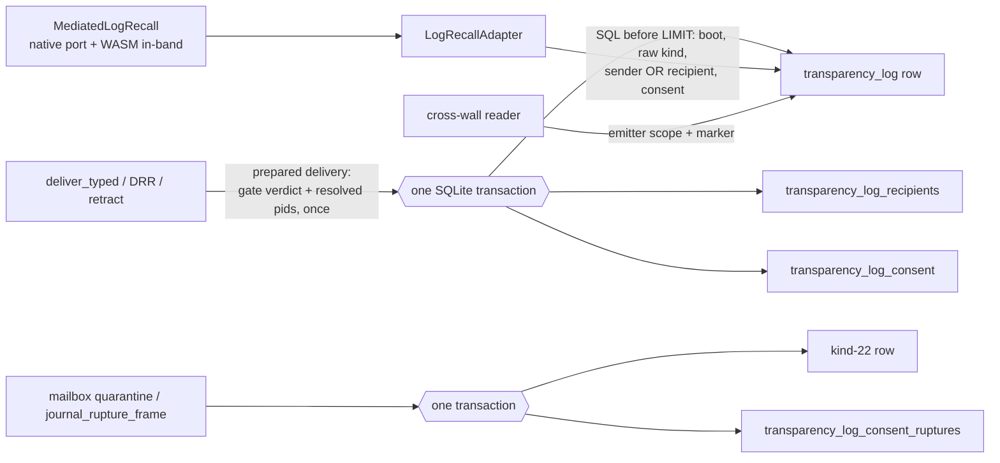

# Story 17.8: Participant recall and consent envelopes for both forms

Status: done

<!-- Rulings D-17-8-01…05 ruled 2026-10-20 by the operator (Lunarpulse), each as recommended at creation; every ruling is materialized into this one contract (17-3d precedent). Rejected alternatives stay in §Rulings as history only. -->

## Story

As the author of a native or WASM Spirit,
I want `recall`/`fetch` to return the frames my Spirit sent **or received** in this daemon run — every recipient persisted, the frame's consent envelope persisted and evaluated at disclosure (expired, ruptured or withheld → omitted / `consent-withheld`; header-only → the header without its payload),
so that my Spirit can ground its reasoning in the conversations it actually took part in, while the granter's consent still governs every re-disclosure and every recall, fetch and refusal stays an attributed, token-bearing audit row.

**Contract:** epic-17 §17-8 (AC1–AC6) as amended by **§R17 (R17-183…R17-198)**, filed with this story; ADR-013 (`docs/adr/ADR-013-log-recall-kernel-mediated-spirit-abi-capability.md:11`, incarnation note `:25-27`, 17-3d note `:29-57`); ADR-012 (`docs/adr/ADR-012-typed-intent-a2a-consent.md:12`); ADR-034 (`_bmad-output/planning-artifacts/architecture-maos-minimal-opus/12-architecture-decision-records.md:474-482`); ADR-058 Decision 2 (`docs/adr/ADR-058-cross-wall-provenance-and-consented-recall.md:30-38`); FR29 (`_bmad-output/planning-artifacts/prd/functional-requirements.md:75`). Not FLAG-Winston: kernel-Δ **0** (§Delivery gate). Security-sensitive: the non-author §A6 net (Blind + Edge + Acceptance + Test-Infra + Security + runtime execution) is non-degradable.

## Current-tree corrections — read before implementing

Re-measured at `1241ce52` by five read-only scouts (TL persistence, recall mediation, consent semantics, readers/tests/CI, governance), direct reads, a fresh `kloc-check --json`, and three non-author validators (§Non-author validation). OLD→NEW rows: epic §R17.

| Epic premise | Current fact and consequence |
|---|---|
| The TL lives at `crates/maos-iac/src/transparency_log.rs` | `crates/maos-iac/src/adapter/transparency_log.rs`. `FrameFilter` `:229-254`; base DDL `SCHEMA_SQL` `:313-327`. |
| "Only the first recipient is written (`adapter.rs:584-595`)" | True; the `.first()` is `crates/maos-iac/src/adapter.rs:563` (direct) and `crates/maos-iac/src/adapter/drr_scheduler.rs:294` (DRR); both reach the shared `insert_frame_row_with_correlation` (`transparency_log.rs:862-923`), which writes one `to_spirit_id TEXT` — no recipient pid, no set, no envelope. Only `frame.payload` is serialized (`adapter.rs:497`). |
| Side-table precedent `transparency_log.rs:312-319`, "same transaction" | **False.** `:312-319` is the base DDL. `transparency_log_retractions` (`:340-344`) is written by `mark_retracted` as a separate INSERT (`:1827-1851`). The frame writer is **one autocommitted INSERT, no transaction** (`:885-904`); every non-duplicate error panics by design (I2, `:909-920`). The atomic precedent is `register_schema_lifecycle`: manual `BEGIN;`/`COMMIT;`/`ROLLBACK;` on the guarded connection (`:1942-1971`). The in-file test `approval_log_is_distinct_table` asserts exactly five tables (`:2692-2714`). |
| "Recipient identity binds the admitted Spirit" | IAC has no resolver; `FrameAddress { spirit_id, host_id, role }` carries no pid (`crates/maos-domain/src/frame.rs:53-59`). The trusted map exists: `pid_by_spirit_id` (`crates/maos-bin/src/main.rs:2487-2488`), inserted only on a granted admission (`crates/maos-bin/src/admission.rs:786-792`), removed on unload/rollback (`:864-875`), read by IAC's digest closure (`main.rs:2489-2506`) and the session's `IdentityOwner` (`crates/maos-bin/src/spirit_session.rs:249-253`) — "the map every id-resolving surface reads" (`crates/maos-bin/src/operator_door.rs:111-113`). Names are reusable after unload while scheduler pids only advance (`crates/maos-kernel-core/src/scheduler/scheduler_loop.rs:29-32`); a hot-swapped successor keeps the SCB, pid, Spirit id and boot (`crates/maos-kernel-core/src/hot_swap/coordinator.rs:301-327`). |
| "Addressed by role" (ADR-013) is a delivery mode | **No role fan-out exists.** The mailbox validates and routes by `spirit_id` only; `role` is ignored (`crates/maos-iac/src/adapter/mailbox.rs:330-340`); no empty/wildcard convention; `SpiritId` accepts any string (`crates/maos-spirit-abi/src/identity.rs:165-168`). Guest-chosen addressees survive the session's restamp (`spirit_session.rs:813-830`, `:971-999`) and may repeat. CR-1 rules what "by role" means. |
| Consent is evaluated at delivery | Production installs **no** `ConsentGate` (`main.rs:2514-2519`); implementations: kernel test `RejectingGate` (`crates/maos-kernel-core/tests/consent_rupture_adr_034.rs:24-52`) and smoke `AlwaysRejectB` (`main.rs:12190-12222`). Installed, it runs inside `Mailbox::deliver_inner` **after** the routed TL row is committed (`mailbox.rs:342-368` vs `adapter.rs:583-617`); telemetry returns before it (`:317-325`); kernel senders are exempt; the depth guard is `< 2` (comment says `≥ 1`). A rejection writes a kind-22 `consent.rupture.quarantine` row at pid 0 (`:370-398`) then emits `ConsentRupture` to the sender (`:400-445`). `Mailbox::deliver` is also called directly, without a TL row — production `crates/maos-bin/src/delegation.rs:313-317` and the kernel tests (`consent_rupture_adr_034.rs:108-320`). |
| A frame can be "ruptured since delivery" | **No such transition exists.** ADR-034 rupture = receiver-side rejection *at delivery*; the frame is quarantined, never delivered (`12-architecture-decision-records.md:474-482`; `4-kernel-design.md:412`). `ConsentRupturePayload` (`frame.rs:359-378`); six `#[non_exhaustive]` reasons (`:383-405`). Production producers: the A2A router's accept-policy and cohort denials — rupture frame `from` = the denied frame's first addressee, `to` = its sender, envelope cloned (`crates/maos-a2a-core/src/router.rs:421-476`, `:1568-1589`, `:1649-1658`) — journaled by `journal_rupture_frame`, which requires an intent class (`crates/maos-cohort/src/digest.rs:320-364`; sink `:366-382`, wired `main.rs:10868-10884`); and the peer-identity failure (`router.rs:499-551`, no original frame). No grant-withdrawal registry or `is_ruptured` API exists. D-17-8-03 rules the semantics. |
| `ConsentEnvelope` can carry header-only | Five fields — `consent_id`, `granter`, `timestamp_ns`, `intent_class`, `valid_until_ns` (`frame.rs:430-444`); no recall/scope/purpose field (the architecture sketch's `scope`, `7-inter-agent-communication.md:19`, was never built). `with_fine_grained_intent` mints `consent_id` from a process-local `AtomicU64` (not restart-unique; its comment wrongly says `[0u8; 16]`, `:446-474`). No `deny_unknown_fields` on `IacFrame`/`FrameAddress`/`ConsentEnvelope`. A2A carries frames as length-delimited serde JSON with no frame signature (`crates/maos-a2a-core/src/transport/json_rpc.rs:90-116`, `:212-214`). D-17-8-01 rules the representation. |
| Expiry = "the router's semantics" | Router intake: granter `spirit_id`+`host_id` must equal `frame.from` (role not compared), then strictly `now_ns > valid_until_ns`; equality is valid; `None` open-ended (`router.rs:1401-1455`). Clock `wall_now_ns`: Unix wall ns, **pre-epoch → `u64::MAX`** (fail-closed) (`:65-71`), pinned by `with_pinned_consent_clock` (`:237-243`, `:340-342`). The TL's `wall_clock_now_ns` returns **0** pre-epoch (`transparency_log.rs:2231-2238`) — fail-open; never use it for expiry. **Values above `i64::MAX` are real** (`u64::MAX` clock, saturating TTL `router.rs:1029-1046`): any clamp to `i64::MAX` breaks the strict comparison — AC3.1 uses an order-preserving encoding. |
| 17-3d's consent comment at `log_recall.rs:489-497` | Now `crates/maos-iac/src/adapter/log_recall.rs:446`. `ScopeViolation` `:430-439`; `recall_inner`/`fetch_inner` `:368-469`; `query_page` `:276-325`; `is_spirit_disclosable` `:45-47` duplicated as SQL `kind IN (0,1,2,3,4,5,6,18)` (`transparency_log.rs:1646-1648`). |
| `consent-withheld` only needs filling | WIT reserves it (`wit/spirit.wit:321-330`), the wire carries it (`crates/maos-wasm-host/src/recall_wire.rs:74-97`), but native `LogRecallError` lacks it (`crates/maos-domain/src/log_recall.rs:340-378`) and mediation never produces it (`crates/maos-bin/src/recall_mediation.rs:192-200`, `:399-412`). |
| Header-only needs "the frame and WIT change" | Any byte edit to root `wit/spirit.wit` (comments included) forces the re-issue of the 4 provenance-pinned components (`tests/fixtures/wasm/equiv-fixtures.provenance.toml:21-76`); a field in `consent-envelope` changes the exported `handle-frame` type and breaks every deployed `@2.x` guest at instantiation (17-3d §Latest technical information); `wit_corpus` pins `("consent-envelope", 5)`, `("iac-frame", 11)` (`crates/maos-wasm-host/tests/wit_corpus.rs:209-241`). `recall-entry.payload-available: bool` already exists (`wit/spirit.wit:300-306`). |
| "A remote artifact without side tables" | = a foreign-team TL shard opened read-only by `CrossWallLogReadPort::read_remote` (`crates/maos-bin/src/cross_wall_log_read.rs:25-68`) through the shared `query_page(…, None, …)` — emitter-scoped metadata, no fetch, no boot bound; ADR-058 D2 keeps that. `LogRecallPage` has no marker (`crates/maos-domain/src/log_recall.rs:195-205`); seven `LogRecallPage::new` sites (`log_recall.rs` iac `:285`, `:288`, `:324`, `:835`; domain `:403`; `crates/maos-bin/tests/cross_team_consent_13_3.rs:429`; `spirits/researcher/tests/incremental_recall.rs:260`) and one struct literal (`spirits/researcher/src/lib.rs:1347-1361`). **Hazard:** a participant predicate inside the shared `query_page` makes every legacy remote artifact fail with `no such table`. |
| "Independent TL readers stay compatible" | Every reader names its columns: `maos_audit::query` (`crates/maos-audit/src/lib.rs:186-198`), `query_with_redaction` (`:368-371`), SIEM via `query_with_redaction` (`crates/maos-siem/src/lib.rs:91-177`; live export `VACUUM INTO`, `crates/maos-bin/src/enterprise_identity.rs:407-455`), backup Merkle over `frame_id` (`crates/maos-audit/src/backup.rs:39-64`), loom-lite canonical over 11 columns (`crates/maos-loom-lite/src/canonical.rs:185-197`; a normal maos-bin dependency, `crates/maos-bin/Cargo.toml:53`). `xtask rto-drill` and `check-migration-merkle` build base-only schemas (`xtask/src/check_rto.rs:298-330`; `xtask/src/check_migration_merkle.rs:305-344`; generated corpus pinned by whole-file SHA, `tests/corpora/MANIFEST.toml:102-119`). No reader enumerates tables. Recall never reads PostgreSQL (`log_recall.rs:60-63`); the migration copies base rows only (`crates/maos-loom-lite/src/migration.rs:115-127`, `:366-409`). `load_ratification_frames` selects `seq, payload` — columns the production schema lacks — and decodes every kind-28 row as `GovernanceEventPayload` (`maos-audit/src/lib.rs:526-560`); 17-3c's `spirit.frame.authorization` rows (`spirit_session.rs:917-961`) and 17-3d's receipts are already untyped kind-28 rows. 17-8 adds no new kind-28 payload shape (CR-5). |
| Direct and DRR are production paths | DRR is **not installed in production**: `with_drr_scheduler` has no caller outside tests (`crates/maos-iac/tests/iac_send_token_17_3c.rs:71`; `crates/maos-kernel-core/tests/drr_scheduler.rs:69-199`). DRR's flush writes serialized `intent_lineage` into `intent` (`drr_scheduler.rs:303`) where the direct path writes the coarse intent (`adapter.rs:502-506`); `Submission.intent_str` is unused (`:54-56`). `retract()` builds its frame with id `[0u8; 16]` (`adapter.rs:734-737`): DRR persists that zero id while the direct arm generates one, and both then read the shared `last_frame_id` (`:802-851`) — side rows would attach to the wrong id and a second DRR retract collides. Fixed at origin (CR-3, CR-4). |
| Native Spirits send and receive frames | Compiled-in Spirits are **not** mailbox-registered — admission records the pid map and hooks only (`admission.rs:786-803`); `IacBusPort::deliver` reaches `deliver_typed` with pid **0** (`mailbox.rs:672-691`), so native bus sends are never attributed to the sender's pid. Other disclosable rows are written outside routed delivery at their own pid with no addressees: MCP invocations (`crates/maos-kernel-core/src/mcp/mod.rs:109-116`), halt/termination rows (`halt/mod.rs:554-560`), scheduler/crash `TaskComplete` (`scheduler/scheduler_loop.rs:713-719`), verb-resolver `DecisionDispatch` (`scheduler/verb_resolver.rs:124-130`), raw-byte helpers (`adapter.rs:205-299`). A2A ingress reaches IAC only through `delegation.rs:430-486` (pid 0, `to` host fields cleared); the gateway dispatcher uses a `StubMailbox` (`crates/maos-kernel-core/src/orchestrator/gateway_dispatcher.rs:126-140`, `:435-452`). |
| 17-3d's tests and exit line stay valid | They encode emitter scope and change with this story (§T7): `recall_17_3d.rs` seed vector `:527-551`, empty page `:553-567`, cross-boot `:659-711` (its unfiltered recall now sees the seed), own-frame `:835-884` (its single-entry page now includes received inputs), receipt isolation `:886-945` (bootstraps a receipt with `fetch self`, which now succeeds), consent safety `:946-1011`, SSO `:1013-1102` (its child process runs `--exact <name>`); helper `assert_r1_r2_r3` `:458-476`. CI pins those names and `16 passed` twice (`.github/workflows/discipline.yml:3578-3608`); line 2b's step (`:2023-2043`) and checker (`scripts/epic_17_exit_line2b.py:1-20`, `:17-64`) require R3. The TS scaffold rethrows everything but `scope-violation` (`examples/example-spirit-ts/src/index.ts:21-38`; `templates/spirit-ts/src/index.ts:16-40`) — a `consent-withheld` would trap a TS Spirit. |
| Governance | Measured at `1241ce52` (`kloc-check --json`, tokei 14.0.0): kernel 20538 tokei / 26304 physical (`xtask/kloc.toml:264`; `xtask/kernel-core-baseline.toml:505`; `RATIFIED_AT_EASING` `xtask/tests/recovery_lane_ceiling_rule.rs:268`); **zero headroom:** `maos-iac` 7298 (`:405`), `maos-bin` 27323 (`:516`), `maos-domain` 9647 (`:424`), `maos-wasm-host` 2253 (`:702`; guest sources count, `xtask/src/kloc_check.rs:299-317`), `maos-audit` 7351 (`:408`), aggregate 178625 vs `_aggregate_hardfail` 178626 (`:716`); headroom: `maos-a2a-core` 4937/4986 (`:469`), `maos-cohort` 5857/6247 (`:660`). |
| Kernel-Δ 0 | Holds if the kernel compiles unchanged: kernel `src` constructs no `ConsentEnvelope` and sets only `consent_envelope: None` (`crates/maos-kernel-core/src/inference/mod.rs:188`, `scheduler/hook_dispatch.rs:237`); it reaches the TL through existing public writers (§Guardrails). Domain frame types reach the kernel through an **explicit** re-export list (`crates/maos-iac/src/adapter/frame.rs:18-22` → `crates/maos-kernel-core/src/iac.rs:13`), so a new domain enum is not surfaced; `xtask/kernel-api-classes.toml:284` classifies `ConsentEnvelope` by name. |

## Rulings

**Ruled 2026-10-20 by the operator (Lunarpulse), each as recommended** — the AC text below is the contract; the right-hand column is rejected history, not an option. CR-n are creation defaults the operator may overrule before dev.

| ID | Question | Ruling (2026-10-20) | Rejected alternatives |
|---|---|---|---|
| **D-17-8-01** | Header-only representation | **A.** `ConsentEnvelope` gains `recall: ConsentRecall { Full, HeaderOnly, Withheld }` in `maos-domain` (default `Full`, omitted from serialization when `Full`, unknown values decode to `Withheld`). The daemon persists and enforces it; **`wit/spirit.wit` is not touched** — no version change, no re-issue. Guests see its effect through `recall-entry.payload-available = false` and `recall-error::consent-withheld`; the policy itself is daemon-side disclosure metadata elided from the lowered envelope (like `capability_token`), ratified as a documented exception to 17-3b's lossless-frame contract. Guests cannot author envelopes (restamped `None`, `spirit_session.rs:971-999`). | **B.** Mirror it in WIT: a breaking `interface frames` change → `maos:spirit@3.0.0`, every guest rebuilt, 4-component re-issue, runner major gate, template/example, compat proofs. **C.** Drop header-only: superseding ruling + ADR-013 amendment; FR29 stays PARTIAL (R17-164). |
| **D-17-8-02** | Policy of an envelope that declares none (every envelope minted today) | **`Full`** — consent to deliver a frame to a recipient includes that recipient's later recall of it; recall re-discloses only to a party that already received it. `HeaderOnly`/`Withheld` only when the granter says so. | `HeaderOnly` by default (fail-closed on payload; every existing envelope-bearing frame loses payload recall). |
| **D-17-8-03** | "Ruptured since delivery" | **A — grant-scoped rupture rows.** Both rupture writers (mailbox quarantine; `journal_rupture_frame`) also record, in the same transaction as the kind-22 row, `(granter, intent class, rejected recipient incarnation)` — only when the ruptured frame carries an envelope whose granter equals the ruptured frame's sender. A received frame F is withheld from recipient R once such a row with F's exact granter and exact intent class (NULL-safe; no wildcard) names R and its kind-22 row was inserted **after** F in the current boot (insertion order, never wall time). ADR-012's consent unit is `(peer, intent class)`; a rupture can only withhold its own granter's frames. Real producer: A2A accept-policy/cohort denials; the mailbox gate is not installed in production (labelled); peer-identity ruptures carry no envelope and withhold nothing (labelled). | **B — delivery-time only.** A recipient rejected at delivery is never a participant; no post-delivery withdrawal exists in the product; the epic's "ruptured since delivery" clause is amended. |
| **D-17-8-04** | Remote artifact scope | **A.** Cross-wall recall stays emitter-scoped (ADR-058 D2 unchanged); **every** cross-wall page carries `RecallScope::Emitter { reason: CrossWall }`; the cross-wall query never references the new tables, so artifacts with and without them both work. | **B.** Participant scope on remote artifacts that carry the side tables, emitter + marker otherwise — widens ADR-058, and remote pids/boots are not local incarnations (no identity mapping exists). |
| **D-17-8-05** | CI proof route for exit line 2b green/red/green and the delegated suites | **A.** A `ci/17-8-<purpose>` branch under D-17-3d-FW-10's exact terms (read-only, no secrets, bounded plants, archived positive/red/restored bundles with commit/tree/diff-hash/toolchain/run/image, branch deleted after capture; no merge, ceiling or `unsafe` authority). This host cannot run the delegated lane (17-3d Debug Log). | **B.** No branch: the PR's CI shows green; the red stays local-only (rule 11 accepts local evidence only where CI cannot host the substrate — it can). |
| CR-1 | Participant | Participant = the **sender** (the row's own `(boot, spirit_pid)`) or a **recorded recipient**. A recipient is recorded iff its address is local (`host_id = None`, the mailbox's local set), the consent gate (if installed) accepted it, and its `spirit_id` resolves through `pid_by_spirit_id`. The accepted set is resolved **once, under one map read, before the TL write or DRR enqueue**, and those pids are persisted unchanged (a name reused after unload never captures a queued frame). Duplicate addresses dedupe by pid; the recorded role is the first non-`None` role in address order. `role` never confers participation; role fan-out is not built. A recorded addressee whose mailbox delivery later fails (`UnknownSpirit` after logging, pre-existing order) stays a participant by address (ADR-013). A hot-swapped successor keeps pid and boot, so it inherits its predecessor's rows (I6, intended); unload/reload is a new incarnation. Rows written outside routed delivery (MCP, halt, crash, verb resolver, raw-byte helpers) keep sender-only disclosure with no inferred recipients. | — |
| CR-2 | Who consent binds | Only a caller that is a **recipient and not the sender**. The router enforces granter = sender at intake (`router.rs:1401-1438`); a sender's own frames keep 17-3d behavior whatever their envelope says. An envelope can only restrict the frame it rides on. | — |
| CR-3 | DRR intent | `flush_batch` writes `sub.intent_str` (coarse) like the direct path — 17-8 edits that exact call and recall's exact-intent predicate reads the column (rule 10(a)). A test pinning lineage-in-`intent` pins the defect and is migrated. | — |
| CR-4 | Retract identity | `retract()` allocates one frame id per operation before either arm and uses it for the base row, its side rows, the retraction marker and the delivered frame; never the shared `last_frame_id` (rule 10(a): 17-8 must write side rows there). | — |
| CR-5 | Non-goals (recorded, not built) | PostgreSQL migration of side tables (recall never reads PostgreSQL; earlier incarnations are non-recallable). `retract()`'s first-recipient routing (`adapter.rs:743-764`). Native bus-send attribution at pid 0 (`mailbox.rs:672-691`; fixing it reaches the kernel send path). `load_ratification_frames`' column mismatch and the untyped kind-28 rows of 17-3c/17-3d (17-8's receipt adds a code, not a shape). Root `wit/spirit.wit:1` still says "emitter-scoped log recall" (a comment edit forces the 4-component re-issue). Each gets one `deferred-work.md` row with `` Owner: `epic-17-retrospective` `` unless an existing row already covers it. | — |

## Acceptance Criteria

### AC1 — command: participant recall end to end; exit line 2b re-stated

**Given** a `network,wasm-host` build with the release runner and the recall-probe guest built like `recall_17_3d` (`crates/maos-bin/tests/recall_17_3d.rs:28-40` target dir from `current_exe()` and `child| ` relay; `:41-75` `FIXTURES`), and the harness of §Test harness,
**when** `cargo test --locked -p maos-bin --features network,wasm-host --test participant_recall_17_8 -- --nocapture --test-threads=1` runs in the delegated envelope (`scripts/run_cgroup_ceiling_17_2.py run --mode delegated`, the `recall_17_3d` step pattern at `.github/workflows/discipline.yml:3565-3608`) with an exact pass count and every test name required,
**then** both forms run every applicable vector — **native** = the checked-in Researcher admitted for real (`recall_17_3d.rs:1180-1224` pattern) calling `MediatedLogRecall` as its `LogRecallPort`; **WASM** = the recall-probe through the admitted session's in-band path — and each vector asserts the exact token-bearing `log.recall`/`log.fetch` rows at the caller pid (kind 7, 16-byte token id + 16 zero bytes), the exact receipts, and **zero unauthorized payload bytes**: each withheld frame carries a unique sentinel that appears in no guest-emitted frame, no reply, no row written at the caller pid and no native result **within its withheld window** (an earlier authorized fetch in V6→V7/V8 is outside it).

| # | Frame relation to caller C | `recall` | `fetch` | Receipt |
|---|---|---|---|---|
| V1 | C sent it (WASM: the probe's own emitted frame; native: an `McpInvocation` row at the Researcher pid, the kernel MCP journal shape — native bus sends are pid 0, CR-5) | listed | payload | — |
| V2 | addressed to C by id | listed | payload | — |
| V3 | addressed `{spirit_id: C, role: Some(r)}` (also `to = [C, C]`, deduped) | listed | payload | — |
| V3b | addressed `{spirit_id: other, role: Some(C's role)}` | absent | `scope-violation` | `log.fetch.refused:scope-violation` |
| V4 | `to = [a, C, b]` — C is not first | listed | payload | — |
| V5 | V2 and V4 through the DRR path (test-installed `DrrScheduler`) | as direct | as direct | as direct |
| V6 | received under a valid envelope (granter = a peer, future `valid_until_ns`) | listed | payload | — |
| V7 | **the same frame as V6** after the pinned consent clock passes `valid_until_ns` | absent | `consent-withheld` | `log.fetch.refused:consent-withheld` |
| V8 | **the same frame as V6** after a rupture row for its (granter, intent class, C) is written (D-17-8-03) | absent | `consent-withheld` | `log.fetch.refused:consent-withheld` |
| V9 | received; envelope `HeaderOnly` (also with a payload larger than the reply bound) | listed, `payload-available = false` | `consent-withheld` (never `reply-too-large`) | `log.fetch.refused:consent-withheld` |
| V10 | received; envelope `Withheld` | absent | `consent-withheld` | `log.fetch.refused:consent-withheld` |
| V11 | neither sent nor received by C — **with a recorded different recipient** | absent | `scope-violation` | `log.fetch.refused:scope-violation` |
| V12 | received by the same pid in an earlier boot | absent | `scope-violation` | `log.fetch.refused:scope-violation` |
| V13 | C sent it under an expired / `HeaderOnly` envelope (CR-2) | listed, payload available | payload | — |
| V14 | addressed to C but rejected at delivery by a test-installed counting `ConsentGate` | absent | `scope-violation` | `log.fetch.refused:scope-violation` |
| V15 | native only: cross-wall page over a remote artifact **without** the side tables | emitter-scoped metadata + `RecallScope::Emitter { CrossWall }` | no fetch path | `log.recall.cross-wall` row as today |
| V16 | native only: the same over an artifact **with** the side tables (D-17-8-04) | identical to V15 | — | as V15 |

**Exit line 2b is re-stated (R17-162):** under participant scope the `--once` seed (TaskAssign from `operator`, pid 0, addressed to the TS Spirit, `spirit_session.rs:106-132`, `:368-374`) is a received frame, so the scaffold's `fetch(seed.frameId)` succeeds. At the TS pid the recall-operation rows are exactly **R1 `capability.invocation`/`log.recall` → R2 `capability.invocation`/`log.fetch`** (both token-bearing), as an ordered subsequence before the turn's 17-3c rows, with **no** `log.*.refused:*` or `recall.channel.closed:*` row. `scripts/epic_17_exit_line2b.py` (docstring, `R_ROWS`, ordering diagnostic, success literal `:1-20`, `:48-64`) asserts exactly that and prints `LINE-2B OK R1 log.recall -> R2 log.fetch (participant scope: seed fetched, no refusal)`. Proven red once (D-17-8-05): recipient recording disabled on the branch → the seed fetch refuses → R3 reappears → `epic-17-exit` red; restored → green.

### AC2 — participant scope at origin (both forms, one predicate)

1. **Recipients persisted.** `transparency_log_recipients(frame_id BLOB NOT NULL, recipient_pid INTEGER NOT NULL, recipient_spirit_id TEXT NOT NULL, recipient_role TEXT, PRIMARY KEY (frame_id, recipient_pid))` + `idx_tlog_recipient_pid(recipient_pid, frame_id)`, created idempotently at open beside the existing indexes (`transparency_log.rs:530-568`) and in `open_in_memory*` (`:593-615`); `approval_log_is_distinct_table` (`:2692-2714`) lists the new tables and keeps its independence checks. Rows follow CR-1. The base row is unchanged (`to_spirit_id` still holds the first addressee).
2. **One transaction per routed write.** The frame row, its recipient rows and its consent row (AC3.1) are written in **one** SQLite transaction by one new `TransparencyLogAdapter` method used by every routed writer: `deliver_typed`'s direct arm (`adapter.rs:583-595`), DRR's `flush_batch` (`drr_scheduler.rs:292-312`), and `retract()`'s direct and DRR arms (`adapter.rs:802-851`, with CR-4's single id). A `Duplicate` base row writes **no** side row and replaces nothing; side rows are deduped before insertion (CR-1), so a side-row conflict is never mistaken for a duplicate frame. Any other failure rolls back and keeps the I2 panic (`:909-920`).
3. **Identity.** One recipient resolver, built at the composition root over `pid_by_spirit_id` (the digest-closure pattern, `main.rs:2489-2506`) and installed once; never a second map, never a pid from the frame, the wire, a guest or the runner's OS pid. A guest names addressees, but only admitted incarnations become recipients, and no guest becomes a recipient of a frame it did not address to itself. No resolver installed → no recipient rows (received frames stay undisclosable; fail-closed); production installs it (exit line 2b proves it).
4. **Prepared delivery (gate once).** A routed write first builds one *prepared delivery* — the gate verdict per address (accepted / rejected with reason) and the resolved recipient pids — then journals with it, then hands it to the mailbox, which consumes it instead of evaluating the gate again; DRR carries it in `Submission` (no gate call at flush). A standalone `Mailbox::deliver` (`delegation.rs:313-317`, kernel tests) prepares internally exactly as today. Preserved verbatim: the telemetry bypass, the kernel-sender exemption, the depth semantics, quarantine-row-before-`ConsentRupture` order and payloads (`mailbox.rs:317-445`); `consent_rupture_adr_034.rs` stays green unmodified. A counting gate proves one evaluation per applicable address and zero for exempt frames.
5. **Predicate.** Local recall and fetch disclose a row iff `boot_nonce` = the adapter's boot **and** its raw kind passes 17-3d's allow-list (R17-159, unchanged) **and** (`spirit_pid` = caller **or** a recipient row names the caller) **and** AC3's consent predicate passes. All of it in SQL before `LIMIT`, in both the timestamp-keyset and the native `order_by_insertion` modes. Native and WASM reach it only through `MediatedLogRecall`. The raw-kind list is defined once and shared by the Rust predicate and the SQL (today duplicated, `log_recall.rs:45-47` / `transparency_log.rs:1646-1648`).
6. **Fetch order.** Not found → `FrameNotFound`; foreign boot, non-disclosable kind or non-participant → `ScopeViolation` (indistinguishable from foreign, as today); participant failing consent → `ConsentWithheld`; then the payload bound (`BoundedFetch::PayloadTooLarge`). A withheld or header-only frame never yields `reply-too-large`, and its payload is never loaded.
7. `LogRecallEntry.peer_spirit_pid` stays the row's emitter pid (never sent to a guest).

### AC3 — persisted consent envelopes, evaluated at disclosure

1. **Persisted, order-preserving.** `transparency_log_consent(frame_id BLOB NOT NULL PRIMARY KEY, consent_id BLOB NOT NULL, granter_spirit_id TEXT NOT NULL, granter_host_id TEXT, granter_role TEXT, granted_at_key INTEGER NOT NULL, intent_class TEXT, valid_until_key INTEGER, recall_policy INTEGER NOT NULL)` — one row per frame carrying an envelope, in AC2.2's transaction. Every consent timestamp and the bound `now` use one order-preserving, lossless `u64 → i64` key, `(v ^ (1 << 63)) as i64`, defined once; `NULL` = open-ended. No clamp anywhere.
2. **One expiry predicate and clock.** `maos-domain` gains a pure `ConsentEnvelope::expired_at(now_ns) -> bool` (`valid_until_ns.is_some_and(|v| now_ns > v)`) and `consent_wall_now_ns()` with the router's exact semantics (Unix wall ns, pre-epoch → `u64::MAX`). The router's `wall_now_ns` and intake check (`router.rs:65-71`, `:1440-1455`) call them — no behavior change; its pinned-clock tests stay green. The recall adapter reads the same clock through an injectable seam (default `consent_wall_now_ns`; tests pin and advance it) and binds `key(now)`. SQL and `expired_at` agree at `valid_until ∈ {i64::MAX, i64::MAX + 1, u64::MAX}` × `now ∈ {v − 1, v, v + 1, u64::MAX}` (parity test). Never the TL's `wall_clock_now_ns`.
3. **Evaluation (CR-2).** A received row with a consent row is **omitted** from `recall` and is `ConsentWithheld` on `fetch` when expired at `now`, when `recall_policy` is not `Full`/`HeaderOnly` (an unknown stored integer counts as `Withheld`), or when ruptured since delivery (AC3.5). `HeaderOnly` → listed with `payload_available = false` (metadata projects length 0; no payload loaded); `fetch` → `ConsentWithheld`. A received row without an envelope (the seed, same-host frames) has no consent constraint. All in SQL before `LIMIT`: 2,000 withheld + 3 disclosable received rows → `recall(limit 16)` returns exactly the 3 with a correct cursor walk, in both ordering modes.
4. **Error and receipt.** `LogRecallError::ConsentWithheld { frame_id }` (Display carries no granter, pid, policy or length). Mediation maps it to wire `consent-withheld` and writes exactly one kind-28 `log.fetch.refused:consent-withheld` receipt in 17-3d's payload shape without `owner_pid`. Exhaustive matches migrate (the Researcher's integration tests use wildcard arms, `spirits/researcher/tests/recall_walker.rs:109-120`). The `log_recall.rs:446` comment is replaced by the evaluation.
5. **Rupture rows (D-17-8-03 A).** `transparency_log_consent_ruptures(rupture_frame_id BLOB NOT NULL, recipient_pid INTEGER NOT NULL, granter_spirit_id TEXT NOT NULL, granter_host_id TEXT, intent_class TEXT, PRIMARY KEY (rupture_frame_id, recipient_pid))` + `idx_tlog_rupture_recipient(recipient_pid, granter_spirit_id)`. One new TL method writes the kind-22 row and these rows in one transaction; the mailbox quarantine (`mailbox.rs:370-398`) and `journal_rupture_frame` (`digest.rs:320-364`) call it. Rows are written only when the ruptured frame carries an envelope whose granter equals that frame's sender — `frame.from` for a quarantined frame; `to[0]` of a router rupture frame (`router.rs:465`); otherwise none. Recipients: each rejected address whose `spirit_id` resolves through the resolver (a router rupture's address carries this host's id as the peer wrote it; resolution ignores `host_id` because the key's granter is the TLS-bound peer, so a rupture can only withhold that granter's own frames). Match: exact granter `spirit_id`, `host_id IS`, `intent_class IS` (no wildcard), recipient = caller, and the rupture's kind-22 `rowid` > F's `rowid`, both rows in the current boot. `journal_rupture_frame` keeps refusing a rupture without an intent (`:324-330`).
6. **Labelled honestly (rule 11).** At HEAD no production granter sets `HeaderOnly`/`Withheld`, no `ConsentGate` is installed in production, and envelope-bearing frames reach admitted local recipients only through A2A delegation intake; each consent vector is proven on frames the suites deliver through `deliver_typed`. Docs and ADR notes say so.

### AC4 — FR29's positive vector

V6 → V7 and V6 → V8 on the **same frame id**, both forms: start the session with `launch(…, false)`, await the guest report (`next_report`, `recall_17_3d.rs:803-834`), deliver the envelope-bearing frame through `deliver_typed`, let the guest recall and fetch it (V6), then advance the pinned clock past `valid_until_ns` (V7) or write the rupture (V8) between report barriers and deliver a command frame that makes the guest recall and fetch it again — withheld, token-bearing rows, receipt. This replaces 17-3d's AC4.1 safety vector (`recall_17_3d.rs:946-1011`, deleted with its CI name).

### AC5 — header-only elision delivered (D-17-8-01 A)

1. `maos-domain`: `ConsentRecall { Full, HeaderOnly, Withheld }`; `ConsentEnvelope.recall` with `#[serde(default, skip_serializing_if = …)]` so a `Full` envelope's JSON and CBOR are byte-identical to today (golden fixture captured before the change); an unknown value decodes to `Withheld` — never an error, never `Full` (explicit `Deserialize`: serde documents `#[serde(other)]` only for internally/adjacently tagged enums). `with_fine_grained_intent` sets `Full`.
2. Every exhaustive `ConsentEnvelope {` literal migrates (`recall: ConsentRecall::Full` unless the test is about policy): runtime `crates/maos-wasm-host/src/frame_bridge.rs:543`; smoke `main.rs:12099`, `:12114`, `:12146`; `crates/maos-a2a-core/src/router.rs:2244`, `:2605`; `crates/maos-a2a-core/tests/cohort_consent_router_12_2.rs:107`, `fail_closed_8_8.rs:99`; `crates/maos-a2a/src/adapter.rs:176`; `crates/maos-a2a/tests/a1_security_regression_guards.rs:134`, `:304`, `cross_host_consent_v1.rs:73`, `:239`; `crates/maos-bin/tests/spawned_scope_17_3c.rs:627`, `team_identity_13_6a.rs:311` (`recall_17_3d.rs:959` leaves with the deleted vector); `crates/maos-wasm-host/tests/equiv_harness.rs:1658`, `:1862`, `:1963`, `frame_bridge_roundtrip.rs:474`, `ts_component_17_3b.rs:136`; `crates/maos-wasm-host/guests/equiv-fixture/native-twin/src/bin/hostile_twin.rs:88`; the helper's `Self {` (`frame.rs:467-473`).
3. WASM: `wit/spirit.wit`, its template/example copies and the 4 pinned components are untouched (`check-equiv-fixture-provenance` unchanged). `frame_bridge` lowering drops `recall`; lifting sets `Full` (guest envelopes are restamped `None` anyway). `frame_bridge_roundtrip` asserts the elision explicitly (a `HeaderOnly` envelope lowers to the same 5 WIT fields and lifts back as `Full`). Ratification entry `17-8-consent-recall-policy` in `xtask/abi-ratifications.toml` (shape `:242-258`) records the domain field, default/unknown semantics, the guest-observable effects and the lossless-contract exception.
4. Effect: V9 for both forms. Old peers ignore the field (no `deny_unknown_fields`); an old receiver is emitter-scoped and never re-discloses received frames, so a mixed-version pair never over-discloses.

### AC6 — readers stay honest (D-17-8-04 A)

1. `query_page` gains an explicit scope parameter; the cross-wall path (`cross_wall_log_read.rs:42-68`) uses emitter scope and never references the new tables. `LogRecallPage` gains `scope: RecallScope` (`Participant` | `Emitter { reason: CrossWall }`), propagated through every early return (empty limit, unknown kind) — not defaulted; all seven constructor sites and the Researcher struct literal migrate; the IAC remote fake (`log_recall.rs:835`) is `Emitter { CrossWall }`; the trait's fail-closed `recall_cross_wall` default is unchanged (`crates/maos-domain/src/ports/log_recall.rs:48-61`). `cross_team_consent_13_3`'s single-production-caller pin and `cross_wall_log_read_13_6d` stay green.
2. Fixtures with and without the side tables (the legacy file is built from a copy of today's `SCHEMA_SQL` embedded in the test, never by dropping tables): `maos_audit::query`, `query_with_redaction`, SIEM `export_from_tl`, the backup Merkle root, loom-lite canonical rows and the cross-wall reader return identical base-row results; side rows do not move the Merkle root. `cargo run -p xtask -- rto-drill` and `check-migration-merkle` stay green unchanged (the pinned corpus SHA must not move).
3. Remote artifact without side tables → emitter-scoped metadata + marker, zero payload (no fetch path exists).

### Delivery gate — kernel unchanged; out-of-kernel figures are measured requests

- **Kernel:** no file under `crates/maos-kernel-core/src` changes. `check-kernel-baseline` passes unchanged (26304 physical, `kernel-core-baseline.toml:505`; 20538 tokei, `kloc.toml:264`; `RATIFIED_AT_EASING` 20_538). Any kernel edit is a FLAG-Winston charter request, never a re-pin. Kernel **tests** migrate only where a changed IAC API forces it.
- **Out-of-kernel:** `maos-iac`, `maos-bin`, `maos-domain`, `maos-wasm-host` and the aggregate are at zero headroom: after `cargo fmt --all`, measure with `cargo run -p xtask -- kloc-check --json` (tokei 14.0.0) and return every figure above its pin to the operator **before** landing (D-17-3d-FW-03: code exists, formatted, measured; no envelope is pre-granted). `maos-a2a-core` (+49) and `maos-cohort` (+390) have headroom and still land exact if they move. Forecast [INFERENCE, not a grant]: domain +60–90, iac +300–420, bin +20–40, cohort +10–25, a2a-core ±10, wasm-host +1–5.
- **Re-pin set (one commit):** touched `xtask/kloc.toml` rows (exact, inline driver citing this story), `_aggregate_hardfail` = measured + 1, `xtask/abi-ratifications.toml` (`17-8-consent-recall-policy`), `xtask/serde-error-allowlist.toml` entries whose `frame.rs` lines move (`:198-278`; matching is exact `path:line`, `xtask/src/check_serde_error_handling.rs:233-236`; propagate new serde failures, never blanket-exempt). Then: `check-kernel-baseline`, `check-service-boundary` (classify any newly surfaced symbol like its neighbour, `kernel-api-classes.toml:284`), `check-empty-kernel`, `check-serde-error-handling`, `check-equiv-fixture-provenance` (unchanged), `templates-regen --check`, `kloc-check --json`, `check-exit-commands` (with `target/debug/{maos,maosctl}` built), `check-dev-record-completeness`, `cargo fmt --all -- --check`.
- No `unsafe`, no new kernel holder, no new dependency edge (`maos-iac` gains no `maos-a2a-core`, `maos-cohort`, `maos-audit` or kernel edge; ADR-058 `:56`).

## Tasks / Subtasks

- [x] **T0 — Preflight at the dev HEAD** (all ACs)
  - [x] `git diff --quiet 1241ce52 -- crates wit spirits templates examples xtask scripts .github`; any drift → Debug Log; re-measure §Delivery gate pins (`kloc-check --json` into `17-8-evidence/t0/`).
  - [x] Capture the golden JSON/CBOR of a default envelope **before** T1 (AC5.1).
- [x] **T1 — Domain** (AC3.2, AC3.4, AC5.1, AC6.1)
  - [x] `crates/maos-domain/src/frame.rs`: `ConsentRecall`, `ConsentEnvelope.recall`, `expired_at`, `consent_wall_now_ns`; fix the `with_fine_grained_intent` comment.
  - [x] `crates/maos-domain/src/log_recall.rs`: `LogRecallError::ConsentWithheld { frame_id }`; `RecallScope` + `LogRecallPage.scope` (constructor takes the scope).
  - [x] Unit tests: golden bytes; `"summary"` → `Withheld`; `expired_at` boundaries; Display has no pid/granter.
  - [x] Migrate the literal sites (AC5.2) and the seven page constructors + Researcher literal (AC6.1); the router calls the shared predicate/clock.
- [x] **T2 — TL schema and transactional writers** (AC2.1, AC2.2, AC3.1, AC3.5)
  - [x] DDL for the three side tables + indexes in `SCHEMA_SQL`/open paths (idempotent on existing files); update `approval_log_is_distinct_table`.
  - [x] The routed-write method: base row + deduped recipients + consent in one transaction (`BEGIN IMMEDIATE;`…`COMMIT;`/`ROLLBACK;` on the guarded connection per `:1942-1971`, or `transaction_with_behavior(Immediate)`); `Duplicate` → no side rows; other errors → rollback + I2 panic.
  - [x] The rupture-write method: kind-22 row + rupture rows in one transaction.
  - [x] The one `u64 → i64` order key + its boundary tests.
  - [x] Route `deliver_typed` direct, DRR `flush_batch` (CR-3), and `retract()` both arms (CR-4) through it. Keep every existing public writer signature (§Guardrails).
- [x] **T3 — Resolver and prepared delivery** (AC2.3, AC2.4)
  - [x] Resolver type + set-once installation; the composition root installs one over `pid_by_spirit_id` (`main.rs:2487-2512`).
  - [x] Prepared delivery built once (gate verdicts + resolved pids under one map read), carried through DRR's `Submission`, consumed by the mailbox; standalone `Mailbox::deliver` prepares internally; mailbox quarantine and `journal_rupture_frame` call the rupture-write method.
- [x] **T4 — Predicates** (AC2.5–AC2.6, AC3.3–AC3.4)
  - [x] `FrameFilter` gains the participant caller and the consent `now` key (exhaustive literals migrate); `frame_query` (`:1626-1705`) binds participant, consent and rupture predicates before `LIMIT` in both ordering modes; metadata projects length 0 for a header-only received row; one shared raw-kind list.
  - [x] `fetch_inner` order per AC2.6; replace the `:446` comment.
  - [x] `query_page` scope parameter; cross-wall uses emitter scope + marker.
- [x] **T5 — Mediation** (AC3.4): map `ConsentWithheld` ↔ `consent-withheld` in both tables (`recall_mediation.rs:192-200`, `:399-412`); receipt per AC3.4.
- [x] **T6 — TS scaffold** (AC1)
  - [x] `templates/spirit-ts/src/index.ts`, then regenerate `examples/example-spirit-ts/`: success, `scope-violation` and `consent-withheld` are normal outcomes, anything else rethrows; comments teach participant scope and consent; Vitest covers the four branches (`tests/spirit.test.ts:34-70` pattern); READMEs by hand; `templates-regen --check`. Verify the error shape against the generated `.d.ts`. `ts_component_17_3b` stays green unchanged. CI template-drift and Vitest steps stay green (`discipline.yml:1107-1108`, `:1125-1152`).
- [x] **T7 — Migrate 17-3d's emitter-scope vectors** (AC1, AC4) — never weaken an assertion
  - [x] Keep separate helpers: success `R1→R2` and refusal `R1→R2→R3(code)`.
  - [x] Seed vector → "seed fetch succeeds, R1→R2, no receipt" (renamed); SSO vector → R1→R2 with interleaved `identity.asserted` never recalled (renamed — update its child `--exact` string, `:1013-1030`); delete the consent safety vector (replaced by V6–V10).
  - [x] Empty-page (`:553-567`) and own-frame (`:835-884`) vectors: filter so the seed/received inputs are deliberately excluded or asserted; cross-boot (`:659-711`): keep its refusal assertions with the refusal helper; receipt isolation (`:886-945`): bootstrap the receipt by fetching a known non-disclosable row, not `self`.
  - [x] `crates/maos-iac/tests/log_recall_17_3d.rs`, `recall_mediation_17_3d`, `researcher_log_grant_17_3d` and Researcher `incremental_recall` stay green (its walk filters `McpInvocation`; participant rows do not change it).
- [x] **T8 — New suites** (AC1–AC6; §Test harness)
  - [x] `crates/maos-iac/tests/participant_recall_17_8.rs`: adapter-level V1–V14 on direct and DRR (multi-thread Tokio, `iac_send_token_17_3c.rs:63-77`, `:140-144`); atomicity (a side-row INSERT made to fail through a second connection → panic caught → reopened file has no base row); duplicate replay adds/replaces nothing; repeated addresses; same-boot unload/reload (a queued frame keeps the predecessor pid); retract ids (two originals, interleaved direct/DRR); pagination 2,000 withheld + 3 disclosable (both orders); the order-key parity matrix; legacy file through the cross-wall `query_page`; counting gate.
  - [x] `crates/maos-bin/tests/participant_recall_17_8.rs` (`#![cfg(all(target_os = "linux", feature = "network", feature = "wasm-host"))]`): AC1's table for both forms and AC4's sequence.
  - [x] `crates/maos-bin/tests/tl_readers_side_tables_17_8.rs`: AC6.2 (audit, SIEM, backup Merkle, loom-lite canonical, cross-wall).
  - [x] `frame_bridge_roundtrip`: the explicit elision assertion (AC5.3).
- [x] **T9 — Proven red** (rule 11(c); §Proven-red controls): each local plant RED at a named assertion, GREEN after exact restoration; bundles under `17-8-evidence/t9-proven-red/` with source commit, `HEAD^{tree}`, SHA-256 of the dirty diff, `rustc --version`, command, full output (exemplar `17-3d-evidence/t8-proven-red/a-disclosure.log:1-11`).
- [x] **T10 — CI and exit line 2b** (AC1)
  - [x] `wasm-host-tests`: a separate delegated step for `participant_recall_17_8` (own unit and log, exact count = its number of tests, every name, SKIP refused, `check-log --expected-count N --required-test …`); the `recall_17_3d` guard changes **both** counts to 15, drops the consent name, swaps the renamed seed/SSO names, updates its commentary.
  - [x] `epic-17-exit` line 2b: step title/comment (`:2023-2030`) and `scripts/epic_17_exit_line2b.py` re-stated per AC1; the epic exit-block `# 2b` comment and its `- Line 2b` provenance bullet name 17-8 AC1 (`check-exit-commands` needs no code change: resolved verbs bypass owed-story lookup, `xtask/src/check_exit_commands.rs:1324-1329`).
  - [x] Green/red/green on the D-17-8-05 route; archive under `17-8-evidence/ci/`; delete the branch.
- [x] **T11 — Docs, ADRs, registers** (AC3.6, AC5, AC6)
  - [x] `docs-site/docs/cookbook/wasm-component-spirit.md:74-104` + KO `:75-105`; `docs-site/docs/manifest/v5.md:49-64` + KO `:53-68`: participant scope, consent outcomes, `payload-available`, `consent-withheld`, the labelled production limits; EN/KO TOML blocks byte-identical (`cookbook_manifests_17_3b.rs`).
  - [x] ADR-013 "Implementation note — Story 17-8"; ADR-012 note (`ConsentEnvelope.recall`); ADR-034 note (grant-scoped rupture rows withhold earlier frames); ADR-058 note (cross-wall marker).
  - [x] `requirements-inventory.md:557` FR29 row; CR-5's deferred rows, each with `` Owner: `epic-17-retrospective` `` on the same line (`xtask/src/check_dev_record_completeness.rs:207-225`, `:295-323`), after checking no existing row covers it.
- [x] **T12 — Governance** (§Delivery gate): measure, return over-pin figures before landing, re-pin, run every listed gate; figures in Completion Notes.

### Review Findings

<!-- Code review 2026-10-21 (bmad-code-review): Blind + Edge + Acceptance + Test-Infra + Security layers; all listed suites and xtask gates re-run green on this host (undelegated mode). -->

- [x] [Review][Patch] Participant predicate scans every row of the boot per recall page under the TL connection mutex — `RECIPIENT_PREDICATE` is an `OR` over a correlated `EXISTS`, so the planner degrades to `(boot_nonce=?)` + temp B-tree sort; measured 80 ms/page at 200 k boot rows vs 4.2 ms with the same predicate written as `t.frame_id IN (SELECT frame_id FROM transparency_log_recipients WHERE recipient_pid = caller.pid)` (`MULTI-INDEX OR` over `idx_tlog_boot_pid_ts` ∪ `idx_tlog_recipient_pid`). Ruled 2026-10-21 (operator): rewrite the one shared const as `IN (subquery)`; UNION rejected (forks recall from fetch's shape, measured slower); deferral to 20-7 rejected. [crates/maos-iac/src/adapter/transparency_log.rs:331-332] — applied 2026-10-21
- [x] [Review][Patch] V15 "remote artifact without the side tables" fixture is built by `DROP TABLE` — AC6.2 requires the legacy file to be built from an embedded copy of the pre-17-8 `SCHEMA_SQL`, never by dropping tables (`tl_readers_side_tables_17_8.rs:14-92` already does it right) [crates/maos-bin/tests/participant_recall_17_8.rs:1240-1242] — applied 2026-10-21
- [x] [Review][Patch] Unqualified `rowid`/column names in the `FROM transparency_log t, caller` query rely on SQLite hiding the CTE's rowid; qualify with `t.` in both branches (fail-closed `Storage` error on a future SQLite bump, not disclosure) [crates/maos-iac/src/adapter/transparency_log.rs:2056-2116] — applied 2026-10-21
- [x] [Review][Patch] `pids[accepted_count..]` panics with an index message if a `RecipientResolver` returns a short `Vec`; assert the trait's one-`Option`-per-id contract once with a named message [crates/maos-iac/src/adapter/mailbox.rs:367-380] — applied 2026-10-21
- [x] [Review][Patch] AC3.3 limit-16 assertion runs only in timestamp order — the `LogRecallFilter::new(…, 16, …)` inside the `order_by_insertion` loop never sets the flag (the limit-2 walk does cover both modes) [crates/maos-iac/tests/participant_recall_17_8.rs:808-813] — applied 2026-10-21
- [x] [Review][Patch] `queued_frame_keeps_the_predecessor_incarnation` swaps the pid map after two fixed 300 ms sleeps; `!queued.is_finished()` does not prove `prepare` ran, so a starved runtime makes correct code fail — wait on a resolve-count barrier instead [crates/maos-iac/tests/participant_recall_17_8.rs:641-657] — applied 2026-10-21
- [x] [Review][Patch] "Insertion order, never wall time" is asserted without divergence — the post-rupture frame also has the later timestamp, so a `timestamp_ns` comparison would pass; force the rupture row's `timestamp_ns` past the later frame via a second connection and re-assert [crates/maos-iac/tests/participant_recall_17_8.rs:396-412] — applied 2026-10-21
- [x] [Review][Defer] Rupture-id collision across restarts drops the grant-scoped rupture rows — `router.rs` mints `rupture_id = frame_id[0..8] ‖ process-local nonce`; a replayed denial whose id repeats hits `Duplicate` inside the transaction, so the `transparency_log_consent_ruptures` rows roll back with it and the earlier frames stay recallable by the rejected recipient [crates/maos-a2a-core/src/router.rs:435-438; crates/maos-cohort/src/digest.rs:362-375] — deferred, pre-existing id scheme; needs a decision on rupture-id minting (kernel-minted `None` id, or fold `boot_nonce` into the nonce half)

**Review patches applied 2026-10-21 (operator chose "apply every patch"):** `RECIPIENT_PREDICATE` is `t.frame_id IN (subquery)` (planner: `MULTI-INDEX OR`), `t.rowid` qualified in `frame_query` and the full-row projection, `prepare_at` asserts the resolver length contract (+1 code line, maos-iac re-pinned 7768 → 7769, `_aggregate_hardfail` 179186 → 179187, Lunarpulse-approved); V15/V16 build the legacy remote artifact (`team-c`) from the verbatim pre-17-8 DDL now shared at `tests/harness/legacy_tl_schema.rs` and populate the current artifact's (`team-b`) side tables with a recipient row naming the caller; AC3.3's limit-16 page runs in both orderings; the unload/reload vector waits on a resolve-count barrier (a counting wrapper delegating to the production `RwLock<BTreeMap>` resolver) instead of sleeping; V8 moves every quarantine row's `timestamp_ns` before/after the neighbouring frames through a second connection (proven red under a `tr.timestamp_ns > t.timestamp_ns` plant, restored). Re-run green: maos-iac 29/29 + 99 unit, maos-bin `participant_recall_17_8` 8/8, `recall_17_3d` 15/15, `recall_mediation_17_3d` 14/14, `tl_readers_side_tables_17_8` 1/1, `cross_team_consent_13_3` 10/10, `cross_wall_log_read_13_6d` 6/6, kernel `consent_rupture_adr_034`/`drr_scheduler`/`log_recall_scope`, `rupture_grant_17_8`; gates `check-kernel-baseline`, `check-service-boundary`, `check-empty-kernel`, `check-serde-error-handling`, `kloc-check`, `recovery_lane_ceiling_rule` 10/10, `cargo fmt --check`. The delegated-lane CI re-run of the patched tree is owed at the PR (D-17-8-05 route already proved the unpatched tree green/red/green).

## Dev Notes

### Recall after this story



### Disclosure predicate (SQL sketch — shape, not text to paste)

```sql
-- t = transparency_log, c = consent row (LEFT JOIN); :pid caller, :boot adapter boot,
-- :now = key(consent clock) with key(v) = (v ^ (1 << 63)) as i64
WHERE t.boot_nonce = :boot
  AND t.kind IN (0,1,2,3,4,5,6,18)                         -- one shared list
  AND ( t.spirit_pid = :pid                                -- sender: no consent constraint (CR-2)
        OR ( EXISTS (SELECT 1 FROM transparency_log_recipients r
                     WHERE r.frame_id = t.frame_id AND r.recipient_pid = :pid)
             AND ( c.frame_id IS NULL
                   OR ( c.recall_policy IN (0, 1)          -- Full, HeaderOnly; anything else withheld
                        AND (c.valid_until_key IS NULL OR :now <= c.valid_until_key)
                        AND NOT EXISTS (
                              SELECT 1 FROM transparency_log_consent_ruptures x
                              JOIN transparency_log tr ON tr.frame_id = x.rupture_frame_id
                              WHERE x.recipient_pid = :pid AND tr.boot_nonce = :boot
                                AND tr.rowid > t.rowid
                                AND x.granter_spirit_id = c.granter_spirit_id
                                AND x.granter_host_id IS c.granter_host_id
                                AND x.intent_class IS c.intent_class)))))
-- payload_len projected as 0 when t.spirit_pid <> :pid AND c.recall_policy = 1 (HeaderOnly)
```

### Error mapping (native and WASM share it; extends 17-3d's table)

| Outcome | `LogRecallError` | WIT `recall-error` | Receipt |
|---|---|---|---|
| Non-participant, foreign boot, non-disclosable | `ScopeViolation { .. }` | `scope-violation` | `log.fetch.refused:scope-violation` |
| Participant; consent expired / ruptured / withheld / header-only | `ConsentWithheld { frame_id }` (new) | `consent-withheld` | `log.fetch.refused:consent-withheld` |
| Mint refused, not found, invalid, limit, reply budget, storage | as 17-3d | as 17-3d | as 17-3d |

`recall` never errors on consent: withheld rows are absent, header-only rows carry `payload_available = false`; an empty page writes no receipt.

### Test harness (both suites)

`recall_17_3d.rs`'s `World` installs no resolver, gate or DRR, and `session()` builds a fresh recall adapter (`recall_17_3d.rs:153-156`, `:232-242`). The 17-8 harness must provide:

1. The resolver over the **same** admission-populated `lookup` the admission and session use.
2. Optional counting `ConsentGate` and optional `DrrScheduler`, installed before the IAC adapter is wrapped in `Arc`.
3. **One** shared `LogRecallAdapter` with an injectable, advanceable consent clock, used by both the native `MediatedLogRecall` and `SessionDeps.log_recall`.
4. Mailbox handles for every local addressee the vectors use (`a`, `b`, `other`, and `researcher` after its real admission — compiled-in Spirits are not mailbox-registered, and `Mailbox::deliver_inner` refuses an unregistered local addressee with `UnknownSpirit` before the gate, `mailbox.rs:330-340`). Never pre-register the WASM id: the session registers it (`spirit_session.rs:280-284`).
5. A non-`once` session helper with report barriers and bounded teardown (`launch(…, false)` + `next_report`, `recall_17_3d.rs:803-884`).

The recall-probe already scripts filtered recall and fetch of arbitrary stored ids (`crates/maos-wasm-host/guests/recall-probe/src/lib.rs:3-15`, `:118-141`, `:186-225`); no guest change is needed. V3b, V11, V12 and V14 need a **separate accepted command frame** carrying `fetch <hex>` (in V14 the only frame addressed to the guest is rejected, so it never runs).

### File implementation map

| Area | Files |
|---|---|
| maos-domain | `src/frame.rs`, `src/log_recall.rs` |
| maos-iac | `src/adapter/transparency_log.rs` (DDL, writers, order key, `FrameFilter`, `frame_query`, distinct-table test), `src/adapter.rs` (`deliver_typed`, `retract`, resolver, prepared delivery), `src/adapter/drr_scheduler.rs`, `src/adapter/mailbox.rs`, `src/adapter/log_recall.rs`; `tests/participant_recall_17_8.rs` |
| maos-a2a-core | `src/router.rs` (shared clock/predicate; test literals) |
| maos-cohort | `src/digest.rs` (`journal_rupture_frame` → rupture-write method) |
| maos-bin | `src/main.rs` (resolver install; smoke literals), `src/recall_mediation.rs`, `src/cross_wall_log_read.rs`; tests `participant_recall_17_8.rs`, `tl_readers_side_tables_17_8.rs` (new), `recall_17_3d.rs`, `cross_team_consent_13_3.rs`, literal sites |
| maos-wasm-host | `src/frame_bridge.rs`; literal sites incl. guest `hostile_twin.rs` (counts toward this crate's kloc row) |
| Researcher | `src/lib.rs` (`FakeLogRecallPort` literal), `tests/incremental_recall.rs` (constructor) |
| TS | `templates/spirit-ts/{src/index.ts,tests/spirit.test.ts,README.md}` → `examples/example-spirit-ts/` |
| CI / scripts | `.github/workflows/discipline.yml`, `scripts/epic_17_exit_line2b.py` |
| Docs / planning | cookbook + manifest v5 (+KO), ADR-013/012/034/058 notes, `requirements-inventory.md`, epic exit block, `deferred-work.md` |
| Governance | `xtask/kloc.toml`, `xtask/abi-ratifications.toml`, `xtask/serde-error-allowlist.toml` (and `kernel-api-classes.toml` only if `check-service-boundary` asks) |

Untouched by design: `wit/spirit.wit` (+ copies), the 4 pinned components and provenance, every file under `crates/maos-kernel-core/src`, `crates/maos-loom-lite/src/migration.rs`, `xtask/src/check_rto.rs`, `xtask/src/check_migration_merkle.rs`, `crates/maos-frame-codec`.

### Guardrails

- Keep every existing public TL writer's signature — kernel callers include `capability/cap_audit/writer_task.rs:40`, `halt/{mod.rs:554,resolver.rs:246,termination.rs:55}`, `hot_swap/{coordinator.rs:563,saga.rs:152}`, `inference/mod.rs:350`, `lifecycle/upgrade.rs:266`, `lifecycle/cli_wrapper/{admission.rs:246,runtime.rs:942}`, `mcp/mod.rs:109`, `memory/mod.rs:487,523,630` (`insert_kernel_event_returning_id`, `transparency_log.rs:1413-1458`) and `:572` (`insert_distillate_redaction_marker`), `memory/self_telemetry.rs:195`, `revocation/applier.rs:145`, `scheduler/{hook_dispatch.rs:259,schedule_watchdog.rs:247,scheduler_loop.rs:392,verb_resolver.rs:124}`, `supervision/{crash_detector.rs:162,progress_watchdog.rs:124,silent_failure_detector.rs:121}` (representative; add methods, never change existing ones).
- Never take a recipient pid from the frame, the wire, a guest or the runner's OS pid; only the resolver over `pid_by_spirit_id`, snapshotted once. Never let `role` confer participation.
- Never evaluate the consent gate twice for one frame; never record a gate-rejected recipient; never bypass the gate for standalone `Mailbox::deliver` callers.
- Never filter after `LIMIT`; never use wall time for "since delivery"; never clamp a consent timestamp; never use the TL's `wall_clock_now_ns` for expiry.
- Never disclose a side-table row; recall projects metadata only; never widen the raw-kind allow-list (R17-159).
- Never reference the side tables from the cross-wall path; never widen ADR-058's emitter scope.
- Never edit `wit/spirit.wit` (comments included) or the pinned components (D-17-8-01 A).
- Never expose granter, policy, payload length or owner pid to a guest through `consent-withheld`.
- One `MediatedLogRecall`, one `LogRecallAdapter` (the composition-root one), one resolver, one expiry predicate and clock, one order key, one raw-kind list.
- Never cite a recall latency number (17-3d AC5; 20-7 owns measurement).

### Proven-red controls (rule 11(c))

| Control | Plant | Expected red |
|---|---|---|
| All recipients | persist only `to.first()` | V4 |
| Caller binding | drop `recipient_pid = :pid` | V11 (its recorded other recipient makes the row match) |
| Role never confers | record a recipient on a role match | V3b |
| Participant clause | drop the recipient `EXISTS` | V2 |
| Expiry | drop the `valid_until_key` predicate | V7 |
| Order key | clamp to `i64::MAX` instead of the key | parity matrix (`now = i64::MAX + 1`) |
| Predicates before `LIMIT` | filter consent in memory after `LIMIT` | 2,000-withheld pagination |
| Header-only | skip the policy check in `fetch` | V9 (sentinel appears) |
| Rupture | drop the rupture `NOT EXISTS` | V8 |
| Atomicity | commit the base row before the side rows | atomicity vector (base row survives) |
| Gate once | evaluate the gate again in the mailbox | counting gate (2 evaluations) |
| Gate verdict | record recipients before the verdict | V14 |
| Snapshot | resolve at DRR flush instead of before enqueue | unload/reload vector |
| TS scaffold | rethrow `consent-withheld` | Vitest |
| Exit line 2b (CI, D-17-8-05) | disable recipient recording | `epic-17-exit` line 2b red (R3 reappears) |

### Tests and commands

```bash
cargo test --locked -p maos-domain
cargo test --locked -p maos-iac            # incl. participant_recall_17_8, log_recall_17_3d, iac_send_token_17_3c, distinct-table test
cargo test --locked -p maos-a2a-core -p maos-a2a -p maos-cohort
cargo test --locked -p maos-kernel-core --test consent_rupture_adr_034 --test drr_scheduler --test log_recall_scope
cargo test --locked -p maos-wasm-host --test frame_bridge_roundtrip --test equiv_harness --test wit_corpus --test wit_copies_17_3b
cargo test --locked -p maos-wasm-host --test ts_component_17_3b -- --ignored   # Node 24 component, as in 17-3d
MAOS_17_2_CGROUP_MODE=undelegated cargo test --locked -p maos-bin --features network,wasm-host --test participant_recall_17_8 --test recall_17_3d -- --nocapture --test-threads=1
MAOS_17_2_CGROUP_MODE=undelegated cargo test --locked -p maos-bin --features network,wasm-host --test spawned_scope_17_3c -- --nocapture --test-threads=1   # 22 must still pass
cargo test --locked -p maos-bin --features network --test recall_mediation_17_3d --test researcher_log_grant_17_3d --test cross_wall_log_read_13_6d --test cross_team_consent_13_3 --test team_identity_13_6a --test tl_readers_side_tables_17_8
cargo test --locked -p researcher
(cd templates/spirit-ts && npm ci && npm test) && cargo run -p xtask -- templates-regen --check
cargo run -p xtask -- rto-drill && cargo run -p xtask -- check-migration-merkle
cargo run -p xtask -- kloc-check --json && cargo run -p xtask -- check-kernel-baseline && cargo run -p xtask -- check-service-boundary && cargo run -p xtask -- check-serde-error-handling
```

Also build and test the standalone native-twin guest the literal migration touches (`crates/maos-wasm-host/guests/equiv-fixture/native-twin`). T2 suites print `SKIP` off CI and fail in CI on a refused spawn (17-6); a zero-test run is not a pass. Local delegated-lane execution is unavailable on this host (17-3d Debug Log); the delegated runs, exit lines 2/2b and the four-image matrix go through D-17-8-05.

### Previous-story intelligence

- **17-3d (done, `c49032a1`):** one `MediatedLogRecall` for both forms (FW-09 A); attributed adapter entry points carry the token id; every `Err` writes exactly one kind-28 receipt, an empty page none; predicates in SQL before `LIMIT` (R17-144); raw-kind allow-list (R17-159); metadata-only recall; native `order_by_insertion` resolves the cursor frame's rowid because wall clocks move backward (review patch) — the same reason "since delivery" uses rowid. CI lessons: target dir from `current_exe()`; relay child output with `child| `; name guards via `check-log --required-test`; isolated target dirs; release runner mandatory. Workspace-regression traps: `cohort_daemon_smoke_13_5c` lists every `maos-bin/src/*.rs` (a new module joins its manifest-scope negative); `cross_team_consent_13_3` pins exactly one production `recall_cross_wall` caller; `intent_lineage_corpus_v0` appends to `intent-lineage-coverage-report.md` on workspace runs (revert the append). FW-03: out-of-kernel figures are measured requests approved before landing.
- **17-4 (done, `1241ce52`):** changed no `maos-iac` source; recall harnesses pass `hooks: None`. Its advice for 17-8: bind the checked identity to the object actually disclosed; prove refusals through production paths; test valid/expired/ruptured/header-only in both forms with zero unauthorized payload bytes; keep local, workspace and CI completion claims separate (`17-4-hooks-observer-and-activity-corpus.md:407`, `:422-424`, `:438`). It added `GovernanceEventKind::TelemetrySubscription` because `check-abi-ratification` decodes kind-28 rows; 17-8 adds no new kind-28 shape (CR-5).
- **17-3b/17-3c:** lossless frames and the WIT re-issue cost (why D-17-8-01 A leaves WIT alone); the session restamps guest envelopes to `None`.
- **Git:** `1241ce52` 17-4, `c49032a1` 17-3d, `39cd7966` 20-3a. The working tree's modified `intent-lineage-coverage-report.md` is that test side effect, not 17-8's.

### Latest technical information

- rusqlite 0.31.0 locked (`Cargo.lock:4506-4507`; latest 0.40.2 — no upgrade here). `Transaction::new`/`transaction_with_behavior` take `&mut Connection` ([docs](https://docs.rs/rusqlite/latest/rusqlite/struct.Transaction.html)); the TL holds its connection behind a mutex guard, which is why `register_schema_lifecycle` uses manual `BEGIN;`/`COMMIT;`. Either is acceptable if every error path rolls back. Prefer `IMMEDIATE` so the write lock is taken at `BEGIN` (WAL, `transparency_log.rs:530-568`).
- serde 1.0.228: `#[serde(other)]` is documented only for internally/adjacently tagged enums ([serde.rs](https://serde.rs/variant-attrs.html#other)); implement unknown → `Withheld` explicitly and test it. `skip_serializing_if` keeps `Full` envelopes byte-identical.
- SQLite: `IS` is the NULL-safe comparison for the nullable granter host and intent columns; `transparency_log` (BLOB primary key) keeps an implicit `rowid` in insertion order — the 17-3d cursor already relies on it.
- Wasmtime 48.0.6, componentize-js 0.23.0, jco 1.35.0 unchanged (no WIT change).

### Project Structure Notes

- Side tables follow the `transparency_log_<name>` precedent (`transparency_log_retractions`, `:340-344`).
- Tests follow `<topic>_17_8.rs`; evidence under `_bmad-output/implementation-artifacts/17-8-evidence/`.
- `recall_mediation.rs` stays the only mediation module; no new maos-bin module is expected (if one is added, update `cohort_daemon_smoke_13_5c`).

### Non-author validation — 2026-10-20

Three fresh read-only validators (citations; design and security; tests and governance) checked the draft against `1241ce52`: 11 blockers (10 unique — the clamp was found twice), 13 should-fix, 5 nits — all applied. Headline dispositions:

| Finding | Disposition |
|---|---|
| Clamping consent timestamps to `i64::MAX` breaks the strict `now > valid_until` order (pre-epoch `u64::MAX` clock) | Order-preserving key `(v ^ (1 << 63)) as i64`, parity matrix, proven-red (AC3.1–AC3.2) |
| "Gate once" had no protocol for standalone `Mailbox::deliver` callers and DRR | Prepared delivery (AC2.4) |
| Repeated addresses would collide on the recipient key and hit the I2 panic | Dedupe by pid, role rule, vector V3 (CR-1, AC2.2) |
| Router ruptures name a host-bearing address; wildcard intent conflicted with the cohort sink | Resolve by `spirit_id`, granter-bound key, exact intent, granter = sender check (AC3.5) |
| Retract frames carry id zero and read the shared `last_frame_id` | CR-4 |
| Receipt "already decodes" claim was false | Corrected; no new kind-28 shape (CR-5) |
| DRR queue could rebind a reused name | Snapshot before enqueue + unload/reload vector (CR-1) |
| Hot-swap inheritance unstated; native pid-0 sends; legacy sender-only rows | CR-1, CR-5, V1 |
| Harness lacked resolver/gate/DRR/clock/mailbox recipe; V14 needs a separate command frame | §Test harness |
| T7 missed five affected 17-3d vectors and the SSO child `--exact` string | T7 |
| Seven page constructors + a Researcher literal; distinct-table test | AC6.1, AC2.1 |
| `check-rto` is not an xtask verb; owner syntax needs backticks; allowlist range | Commands, T11, Delivery gate |
| Citation fixes (`recall_17_3d.rs:28-40`, `maos-audit/src/lib.rs:186-198`, `spirit_session.rs:813-830`, memory TL writers) | Applied |

### References

- Epic `_bmad-output/planning-artifacts/epics/epic-17-workers-and-third-party-form-w2.md`: §17-8 `:327-340`, exit block `:39-58` (line 2b `:45`, provenance `:55`), confidence rules `:76-78`, §R13 R17-148/R17-156, §R14 R17-159/R17-162/R17-164, §R17 `:683-704` (this story), Dependencies `:706-`.
- `17-3d-wasm-log-recall.md` (AC1, AC3.3–AC3.4, AC4, §Error mapping, §Guardrails, Review Findings); `17-3d-flag-winston-decision.md` (FW-03, FW-07, FW-09, FW-10); `17-4-hooks-observer-and-activity-corpus.md:390-451`.
- ADRs: 013 `:11`, `:25-27`, `:29-57`; 012 `:12`; 034 (`12-architecture-decision-records.md:474-482`); 058 `:30-38`, `:56`; architecture `4-kernel-design.md:364` (revalidation at use), `:412`; `7-inter-agent-communication.md:19`, `:136`.
- PRD FR29 `functional-requirements.md:75`; inventory `requirements-inventory.md:557`; `dependency-dag.md:217`; `epics/index.md:156-157`.
- No `project-context.md` matched the activation glob.

## Dev Agent Record

### Story context creation

Created 2026-10-20 by `anthropic/claude-opus-5-5` (bmad-create-story) at `1241ce52`: five read-only scouts with follow-ups, direct reads, a fresh `kloc-check --json`, and three non-author validators (§Non-author validation). No prototype: no kernel file is in the change set. Operator rulings D-17-8-01…05 the same day. Ultimate context engine analysis completed — comprehensive developer guide created.

### Agent Model Used

anthropic/claude-opus-5-5 (bmad-dev-story), with five delegated slice agents on the same model (TsScaffold → T6, DocsAdrs → T11, Migrate3d → T7, BinParticipant and ReadersSuite → T8 bin suites) working against one written contract; their output was reviewed and re-run here.

### Debug Log References

- **T0.** `git diff --quiet 1241ce52 -- crates wit spirits templates examples xtask scripts .github` clean (no drift). `kloc-check --json` at `1241ce52` matched every pin (`17-8-evidence/t0/kloc-check-1241ce52.json`). Golden JSON + runner-codec CBOR of a bounded and an open envelope and a frame carrying one were captured BEFORE T1 by a throwaway `maos-wasm-host` test (deleted after capture) → `17-8-evidence/t0/golden-envelope-1241ce52.txt`; the permanent goldens are `crates/maos-domain/tests/consent_recall_17_8.rs` (JSON) and `frame_bridge_roundtrip::full_consent_envelope_cbor_is_byte_identical_to_pre_17_8_golden` (CBOR).
- **Pre-existing red gate fixed at origin (rule 10(a)).** `check-serde-error-handling` FAILED at `1241ce52` on `crates/maos-bin/src/recall_mediation.rs:392` (17-3d `kind_name`: `serde_json::to_value(..).expect(..)`). The file is in 17-8's change set, so `kind_name` now matches on the `Result`; the gate PASSES (0 violations). The `frame.rs` allowlist entries (`xtask/serde-error-allowlist.toml`) point into `#[cfg(test)]` code, which the checker skips, so no allowlist line moved and none was edited.
- **Design decisions.** (1) The one recipient resolver lives on `TransparencyLogAdapter` (set-once `OnceLock`), so the routed writer, the mailbox quarantine and `journal_rupture_frame` all reach the same resolver with no new plumbing; production installs `pid_by_spirit_id` itself (`impl RecipientResolver for std::sync::RwLock<BTreeMap<String,u32>>`, poisoned map ⇒ nobody resolves, fail-closed). (2) Participant SQL binds `(pid, key(now))` once in a one-row CTE `caller` and keeps every predicate in `WHERE` before `ORDER BY … LIMIT`; fetch classifies with ONE query (`participant_access`: out-of-scope / withheld / payload length) and the payload load re-applies the predicate at the same `now`, so a rupture journaled in between still withholds. (3) Side rows share the base writer: `insert_frame_row_with_correlation` gained an optional side-row set; with one, it runs `BEGIN IMMEDIATE` … `COMMIT`/`ROLLBACK`; only the BASE row's primary key can mean `Duplicate`. (4) The gate verdicts and resolved pids form `PreparedDelivery` (`Mailbox::prepare`), computed before the TL write or DRR enqueue and consumed by `deliver_prepared` / `deliver_with_overtake`; the standalone `Mailbox::deliver` prepares after its Phase-1 address check exactly as before.
- **Retract (CR-4).** `check_and_mark_retracted` used to store a `[0;16]` placeholder that `mark_retracted`'s `INSERT OR IGNORE` never overwrote; with the id minted first, the marker records the real id at once and the redundant `mark_retracted` call is gone. `iac_send_token_17_3c` no longer skips the second DRR retract (its comment documented the zero-id collision this story fixes).
- **CR-3.** No test pinned lineage-in-`intent`; `participant_recall_17_8::drr_flush_journals_the_coarse_intent` now pins the coarse intent on both paths. `DrrScheduler::submit` lost its dead `auto_marker`/`intent_lineage` arguments and gained `recipients`; the one kernel TEST that calls it (`crates/maos-kernel-core/tests/drr_scheduler.rs`) migrated (forced by the changed IAC API). No file under `crates/maos-kernel-core/src` changed.
- **Snapshot vector redesigned.** Its first version blocked the DRR flush on the SQLite write lock, but the flush had already evaluated its arguments — the "resolve at flush" plant stayed green. The vector now stalls the processor on a prior frame so the probe frame waits unflushed while the name is re-admitted; the plant then goes red (`13-snapshot-at-flush.log`).
- **Role plant.** `prepare` has no role knowledge of admitted Spirits, so the "role confers" control is planted read-side (a caller sharing a recorded role becomes a participant); V3b goes red.
- **TS toolchain.** System Node is v20.19.2 (< `engines`); Node v24.22.1 was provisioned under `/tmp`, outside the repo; generated lockfile/`node_modules` were moved out of `templates/spirit-ts` after testing (templates-regen reads template files recursively).
- **Workspace regression run** (`cargo test --workspace --locked --no-fail-fast`, log `17-8-evidence/t12-workspace-test.log.gz`): 4929 passed, 56 failed, 121 ignored. Every failure is a missing host prerequisite, none in 17-8 code: T3 substrate unset (`MAOS_T3_RUNTIME`, 45 in maos-bin/maos-eval/maos-journey-test/kernel `t3_substrate.rs:19`), cgroup2 not delegated (`cgroup_ceiling_smoke`, 6), `strace` absent (`otel_gates`, 3), forbidden-syscall probe unbuilt (escape-detector, 2), Python Ed25519 twin (`two_host_reconcile_2c`, 2). The `intent_lineage_corpus_v0` append to `intent-lineage-coverage-report.md` was reverted after each run.
- **check-migration-merkle** needs the generated corpus: generated locally with CI's exact command (`cargo run --locked --release -p maos-loom-lite --example generate_migration_corpus -- --out …`) → PASSED, pinned root `dd42bbd1…7d69` / oracle `6783fcae…0988`; `tests/corpora/` untouched.
- **CI flake (not 17-8).** `recall_runner_17_3d::undecodable_reply_latches_broken_after_export` hit `BrokenPipe` on `ubuntu-26.04-arm` (run 39592821938 attempt 1) and `ubuntu-26.04` (run 39599827898); 17-8 changes neither the runner, the recall wire nor that test. Routed: `deferred-work.md` (§Story 17-8, Owner `epic-17-retrospective`); the failed c1 job was re-run (attempt 2 green).
- **Delegated slices.** TsScaffold (T6), DocsAdrs (T11), Migrate3d (T7), BinParticipant and ReadersSuite (T8 bin) ran as sub-agents on the same model against `local://17-8-contract.md`; each result was re-run or reviewed here (diffs read; T2 suites re-run locally: `17-8-evidence/t8/t2-suites-local.log`).

### Completion Notes List

- **Kernel-Δ 0.** No file under `crates/maos-kernel-core/src` changed; `check-kernel-baseline` PASSED (26304 physical, 95 files, pinned 26304); `check-service-boundary`, `check-empty-kernel` 0 violations. Only kernel TEST `tests/drr_scheduler.rs` migrated (the changed `DrrScheduler::submit` API).
- **AC1 — participant recall end to end; exit line 2b re-stated: proven green / red / green in CI** (D-17-8-05 A under FW-10 terms; archive `17-8-evidence/ci/`):
  - Positive c1 `2345fa4d` (tree `82045cbd`), run 39592821938: exit lines 2 rc=0 and 2b `LINE-2B OK R1 log.recall -> R2 log.fetch (participant scope: seed fetched, no refusal)` on ubuntu-24.04 and ubuntu-26.04; `wasm-host-tests` on all four images: `participant_recall_17_8` 8/8, `recall_17_3d` 15/15, `spawned_scope_17_3c` at its 22-count guard (ubuntu-26.04-arm green on attempt 2 after the unrelated `recall_runner_17_3d` flake, routed to `deferred-work.md`).
  - Plant c2 `bdebbd4f` (tree `622f0da7`, `ci/line2b-plant.diff` sha256 `afeee8d4…18ce`: the composition root installs no recipient resolver), run 39599827898: line 2 still rc=0, line 2b RED on both images — `recall-operation rows [… ('governance.event', 'log.fetch.refused:scope-violation')]` (R3 reappears). The suites that install their own resolver stayed green.
  - Restored c3 `12504614` (tree `82045cbd`, identical to c1), run 39604986193: every job green on every image; line 2b OK on both.
  - Branch `ci/17-8-verify` deleted after capture (`git ls-remote` empty); no merge, ceiling or `unsafe` authority used.
  - Both forms, every AC1 vector (V1–V16) with exact token-bearing rows, exact receipts and zero-sentinel checks: `crates/maos-bin/tests/participant_recall_17_8.rs` — `sender_owned_frames_ignore_received_consent_in_native_and_wasm` (V1, V13), `direct_recipient_ids_roles_dedup_multiaddress_and_gate_rejection_both_forms` (V2, V3, V3b, V4, V11, V14), `drr_addressed_and_nonfirst_recipients_both_forms` (V5), `valid_consent_then_same_frame_expires_between_report_barriers_both_forms` (V6→V7), `valid_consent_then_real_gate_rupture_withholds_same_frame_both_forms` (V6→V8), `header_only_including_oversized_and_withheld_envelopes_both_forms` (V9, V10), `earlier_boot_same_pid_recipient_is_out_of_scope_both_forms` (V12), `cross_wall_remote_artifact_is_identically_emitter_scoped_with_or_without_side_tables` (V15, V16). WASM V13 journals the sender-row with an explicit envelope at the probe's pid because the session restamps guest envelopes to `None` (labelled in the test).
- **AC2 — participant scope at origin.** Three side tables in `SCHEMA_SQL` (idempotent, both open paths; `approval_log_is_distinct_table` lists eight tables). `TransparencyLogAdapter::insert_routed_frame` writes base row + recipients + consent in one `BEGIN IMMEDIATE` transaction for `deliver_typed` (direct and DRR) and `retract` (both arms, one minted id). Recipients come only from the installed resolver over `pid_by_spirit_id`, resolved once in `Mailbox::prepare` before the write/enqueue; gate evaluated once (`deliver_prepared`); `consent_rupture_adr_034` green unmodified. One shared raw-kind list (`SPIRIT_DISCLOSABLE_RAW_KINDS`). Fetch order not-found → scope → consent → size. Adapter suite `crates/maos-iac/tests/participant_recall_17_8.rs` 29/29 (V1–V14 on direct and DRR, atomicity, duplicate replay, unload/reload snapshot, retract ids, 2,000-withheld pagination in both orders, order-key parity matrix, legacy artifact, counting gate, local-only recipients, no-resolver fail-closed).
- **AC3 — consent persisted and evaluated at disclosure.** `ConsentEnvelope::expired_at` + `consent_wall_now_ns` shared with the router (pinned-clock tests green); `consent_order_key` `(v ^ 1<<63) as i64`, parity matrix at `{i64::MAX, i64::MAX+1, u64::MAX} × {v−1, v, v+1, u64::MAX}`; `LogRecallAdapter::with_consent_clock` seam. `ConsentWithheld` (Display carries only the frame id) → wire `consent-withheld` → one `log.fetch.refused:consent-withheld` receipt without `owner_pid`. Grant-scoped rupture rows from the mailbox quarantine and `journal_rupture_frame` (`crates/maos-cohort/tests/rupture_grant_17_8.rs` 1/1: exact granter + intent, insertion order, stolen envelope records nothing).
- **AC4 — FR29's positive vector:** V6→V7 and V6→V8 on the same frame id, both forms, report barriers (the two `valid_consent_then_…` tests above); 17-3d's emitter-scope consent vector deleted with its CI name.
- **AC5 — header-only elision.** `ConsentRecall` default `Full` (omitted when Full), unknown → `Withheld` via an explicit `Deserialize`; JSON and CBOR goldens byte-identical to `1241ce52`; all 22 AC5.2 envelope literal sites migrated; `frame_bridge` lifting sets `Full`, `consent_recall_policy_is_elided_by_lowering_and_lifts_as_full` pins the 5-field lowering; `wit/spirit.wit` and the 4 components untouched (`check-equiv-fixture-provenance` PASSED, 4 fixtures); ratification `17-8-consent-recall-policy` added to `xtask/abi-ratifications.toml` (`check-abi-ratification` PASS).
- **AC6 — readers stay honest.** `query_page(…, PageScope, …)`; every cross-wall page carries `RecallScope::Emitter { reason: CrossWall }`; `tl_readers_side_tables_17_8` 1/1 (audit query, redacted query, SIEM export, backup Merkle root, loom-lite canonical rows, cross-wall pages identical with and without side tables); `rto-drill` PASSED; `check-migration-merkle` PASSED with the generated pinned corpus.
- **Migrated suites:** `recall_17_3d` 15/15 (seed and SSO renamed to R1→R2; consent vector deleted; receipt isolation bootstraps on a kind-7 row); `recall_mediation_17_3d` 9/9; `researcher_log_grant_17_3d` 2/2; `log_recall_17_3d` 9/9; `iac_send_token_17_3c` 3/3; Researcher 43/43; `spawned_scope_17_3c` 22/22 (local undelegated + CI).
- **TS scaffold (T6):** success, `scope-violation` and `consent-withheld` are normal outcomes; Vitest 8/8 in template and example; `templates-regen --check` PASSED; `ts_component_17_3b` 1/1 (`--ignored`, Node 24 component). Proven red: `ts-scaffold-consent-withheld.log`.
- **Proven red (T9, local, isolated worktree):** 13 plants, each RED at its named assertion and GREEN after exact restoration — `17-8-evidence/t9-proven-red/01-all-recipients` (V4) … `13-snapshot-at-flush`; plus the TS plant and the CI line-2b plant above.
- **Governance (T12), operator-approved 2026-10-21 (FW-03), exact after `cargo fmt --all`, `kloc-check --json` (tokei 14.0.0):** maos-iac 7298 → 7768 (+470, above the +300–420 forecast; driver `transparency_log.rs` +354, `mailbox.rs` +78, `log_recall.rs` +55, `adapter.rs` −11, `drr_scheduler.rs` −6); maos-domain 9647 → 9713 (+66); maos-bin 27323 → 27332 (+9); maos-wasm-host 2253 → 2255 (+2); maos-cohort ceiling 6247 → 5873 (exact, measured +16); maos-a2a-core ceiling 4986 → 4933 (exact, measured −4); maos-a2a 303 → 304 (ceiling 1500 untouched); aggregate 178625 → 179185, `_aggregate_hardfail` 179186; kernel 20538 tokei unchanged. `kloc-check` PASSED; `recovery_lane_ceiling_rule` 10/10.
- **Gates run green:** check-kernel-baseline, check-service-boundary, check-empty-kernel, check-serde-error-handling (was red at baseline, fixed), check-equiv-fixture-provenance, check-abi-ratification, templates-regen --check, kloc-check, check-exit-commands (5 epics, 16 tokens resolved, 3 owed — unchanged owed set), check-dev-record-completeness, `cargo fmt --all -- --check`.
- **Labelled limits (AC3.6):** no production granter sets HeaderOnly/Withheld; no ConsentGate installed in production; envelope-bearing frames reach admitted local recipients only via A2A delegation intake; peer-identity ruptures carry no envelope; native bus sends journal at pid 0 (CR-5) — stated in the docs and ADR notes.
- **Non-author review is owed:** this story is security-sensitive; the full §A6 net (Blind + Edge + Acceptance + Test-Infra + Security + runtime execution) binds next.

### File List

- `.github/workflows/discipline.yml`
- `_bmad-output/implementation-artifacts/17-8-participant-recall-and-consent-envelopes.md`
- `_bmad-output/implementation-artifacts/sprint-status.yaml`
- `_bmad-output/implementation-artifacts/deferred-work.md`
- `_bmad-output/implementation-artifacts/17-8-evidence/t0/{kloc-check-1241ce52.json,golden-envelope-1241ce52.txt}`
- `_bmad-output/implementation-artifacts/17-8-evidence/t8/t2-suites-local.log`
- `_bmad-output/implementation-artifacts/17-8-evidence/t9-proven-red/{01-all-recipients,02-caller-binding,03-role-confers,04-participant-clause,05-expiry,06-order-key-clamp,07-consent-after-limit,08-header-only,09-rupture,10-atomicity,11-gate-once,12-gate-verdict,13-snapshot-at-flush,ts-scaffold-consent-withheld}.log`
- `_bmad-output/implementation-artifacts/17-8-evidence/ci/{commits.txt,ci-17-8-verify.yml.txt,line2b-plant.diff,run-c1-attempt1.json,run-c1-attempt1-failed-arm2604.log,run-c1-attempt2.json,run-c1-annotations.tsv,run-c2.json,run-c2-annotations.tsv,run-c3.json,run-c3-annotations.tsv}`
- `_bmad-output/implementation-artifacts/17-8-evidence/{t12-kloc-measured.json,t12-workspace-test.log.gz}`
- `_bmad-output/planning-artifacts/architecture-maos-minimal-opus/12-architecture-decision-records.md`
- `_bmad-output/planning-artifacts/epics/epic-17-workers-and-third-party-form-w2.md`
- `_bmad-output/planning-artifacts/epics/requirements-inventory.md`
- `crates/maos-a2a-core/src/router.rs`
- `crates/maos-a2a-core/tests/cohort_consent_router_12_2.rs`
- `crates/maos-a2a-core/tests/fail_closed_8_8.rs`
- `crates/maos-a2a/src/adapter.rs`
- `crates/maos-a2a/tests/a1_security_regression_guards.rs`
- `crates/maos-a2a/tests/cross_host_consent_v1.rs`
- `crates/maos-bin/src/cross_wall_log_read.rs`
- `crates/maos-bin/src/main.rs`
- `crates/maos-bin/src/recall_mediation.rs`
- `crates/maos-bin/tests/cross_team_consent_13_3.rs`
- `crates/maos-bin/tests/cross_wall_log_read_13_6d.rs`
- `crates/maos-bin/tests/participant_recall_17_8.rs` (new)
- `crates/maos-bin/tests/recall_17_3d.rs`
- `crates/maos-bin/tests/spawned_scope_17_3c.rs`
- `crates/maos-bin/tests/team_identity_13_6a.rs`
- `crates/maos-bin/tests/tl_readers_side_tables_17_8.rs` (new)
- `crates/maos-cohort/src/digest.rs`
- `crates/maos-cohort/tests/rupture_grant_17_8.rs` (new)
- `crates/maos-domain/src/frame.rs`
- `crates/maos-domain/src/log_recall.rs`
- `crates/maos-domain/tests/consent_recall_17_8.rs` (new)
- `crates/maos-iac/src/adapter.rs`
- `crates/maos-iac/src/adapter/drr_scheduler.rs`
- `crates/maos-iac/src/adapter/log_recall.rs`
- `crates/maos-iac/src/adapter/mailbox.rs`
- `crates/maos-iac/src/adapter/transparency_log.rs`
- `crates/maos-iac/tests/iac_send_token_17_3c.rs`
- `crates/maos-iac/tests/log_recall_17_3d.rs`
- `crates/maos-iac/tests/participant_recall_17_8.rs` (new)
- `crates/maos-kernel-core/tests/drr_scheduler.rs`
- `crates/maos-wasm-host/guests/equiv-fixture/native-twin/src/bin/hostile_twin.rs`
- `crates/maos-wasm-host/src/frame_bridge.rs`
- `crates/maos-wasm-host/tests/equiv_harness.rs`
- `crates/maos-wasm-host/tests/frame_bridge_roundtrip.rs`
- `crates/maos-wasm-host/tests/ts_component_17_3b.rs`
- `docs-site/docs/cookbook/wasm-component-spirit.md`
- `docs-site/docs/manifest/v5.md`
- `docs-site/i18n/ko/docusaurus-plugin-content-docs/current/cookbook/wasm-component-spirit.md`
- `docs-site/i18n/ko/docusaurus-plugin-content-docs/current/manifest/v5.md`
- `docs/adr/ADR-012-typed-intent-a2a-consent.md`
- `docs/adr/ADR-013-log-recall-kernel-mediated-spirit-abi-capability.md`
- `docs/adr/ADR-058-cross-wall-provenance-and-consented-recall.md`
- `examples/example-spirit-ts/README.md`
- `examples/example-spirit-ts/src/index.ts`
- `examples/example-spirit-ts/tests/spirit.test.ts`
- `scripts/epic_17_exit_line2b.py`
- `spirits/researcher/src/lib.rs`
- `spirits/researcher/tests/incremental_recall.rs`
- `templates/spirit-ts/README.md`
- `templates/spirit-ts/src/index.ts`
- `templates/spirit-ts/tests/spirit.test.ts`
- `xtask/abi-ratifications.toml`
- `xtask/kloc.toml`
- `tests/harness/legacy_tl_schema.rs` (new, code review 2026-10-21: the verbatim pre-17-8 TL DDL shared by `tl_readers_side_tables_17_8` and `participant_recall_17_8` V15)

### Change Log

- 2026-10-20 — Story created (rulings D-17-8-01…05 proposed); three non-author validators, all findings applied; epic §R17 R17-183…R17-198 filed.
- 2026-10-20 — Operator (Lunarpulse) ruled D-17-8-01 A, D-17-8-02 `Full`, D-17-8-03 A, D-17-8-04 A, D-17-8-05 A — all as recommended; materialized into this contract and epic §R17. Status → ready-for-dev.
- 2026-10-21 — Dev (bmad-dev-story, anthropic/claude-opus-5-5): T0–T12 implemented. Participant recall + persisted consent for both forms (side tables, transactional routed/rupture writers, one resolver, prepared delivery, SQL predicates before LIMIT, `ConsentWithheld`), CR-3/CR-4 fixed at origin, 17-3d vectors and exit line 2b re-stated, TS scaffold, docs/ADR notes, CR-5 + one CI-flake deferred rows. 13 local plants + TS plant red/green; CI green/red/green on `ci/17-8-verify` (runs 39592821938 / 39599827898 / 39604986193; branch deleted). Operator approved the measured kloc re-pins (maos-iac 7768, maos-domain 9713, maos-bin 27332, maos-wasm-host 2255, maos-cohort 5873, maos-a2a-core 4933, `_aggregate_hardfail` 179186). Status → review.
- 2026-10-21 — Code review (bmad-code-review; Blind + Edge + Acceptance + Test-Infra + Security, all suites and gates re-run on this host): 1 decision (participant predicate planner cost → ruled `IN (subquery)`), 6 patches, 1 defer (rupture-id collision across restarts → `deferred-work.md`), 5 dismissed. Operator chose "apply every patch"; all 7 applied and re-verified (§Review Findings); maos-iac 7769 / `_aggregate_hardfail` 179187 approved. Status → done.
