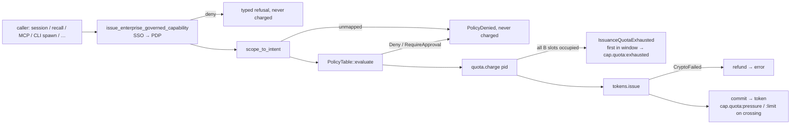

# Story 17.9: Capability issuance quota window

Status: done

<!-- ◆ FLAG-Winston. Charter RULED 2026-10-22 by the operator (Lunarpulse): D-17-9-FW-01…10 each as recommended, confirmed by consensus under the operator's decision rule (long-term correctness; PRD strictly; correct architectural drift; honour existing contracts; fill requirement gaps along the roadmap). Every ruling is materialized into this one contract (17-3d precedent); rejected alternatives stay in §Rulings as history only. E16-A7: the kernel figure is measured by an isolated prototype (variant V2/W). Preflight the same day (§Preflight): in-charter corrections PF-01…PF-06; operator rulings D-17-9-PF-R1…R5 (each A) materialized as PF-07…PF-10. -->

## Story

As the operator of a long-running MAOS daemon — and the author of any Spirit that mints capabilities through it —
I want each admitted Spirit's capability issuance bounded per time window instead of per lifetime, charged only for tokens actually issued, with pressure, limit and exhaustion attested once per window, and exhaustion surfacing as each named minting path's typed denial with its receipt,
so that a long-lived Spirit keeps its capabilities indefinitely while a runaway incarnation is throttled and attributable, and no named path proceeds without a token because the quota said no.

**Contract:** epic-17 §17-9 (AC1–AC5, `_bmad-output/planning-artifacts/epics/epic-17-workers-and-third-party-form-w2.md:348-362`) as amended by **§R18 (R17-199…R17-224)**, filed with this story and its preflight; Story 1b.2 AC4 (`epic-1b-evaluator-path-audit-spine-capability-mediation-baseline-v01.md:92-96`) and its implementation record (`1b-2-capability-registry-decomposition-runtime-cap-tokens-cap-policy-cap-audit-cap-quota.md:1093-1257`, window `:1167-1174`, superseded sketch note `:1259`); architecture §4.6 `cap-quota` row (`architecture-maos-minimal-opus/4-kernel-design.md:427`); ADR-030 (`docs/adr/ADR-030-capability-registry-decomposition.md:12`); ADR-013 note (`docs/adr/ADR-013-log-recall-kernel-mediated-spirit-abi-capability.md:46-48`); `deferred-work.md:1076`, `:1172`. **◆ FLAG-Winston:** kernel **+57 physical / +56 tokei, measured** (E16-A7, §Measured prototype). **Security-sensitive:** a capability control (rule 11) — the non-author §A6 net (Blind + Edge + Acceptance + Test-Infra + Security + runtime execution) is non-degradable.

## Current-tree corrections — read before implementing

Re-measured at `3a7c4260` by four read-only scouts (kernel quota substrate; minting paths; governance; tests/CI), direct reads, a fresh `kloc-check --json` (`17-9-evidence/creation/kloc-check-3a7c4260.json`), two isolated E16-A7 prototypes (K, then V2 after validation), a regression run of K (`17-9-evidence/creation/k-regression-summary.log`) and three non-author validators (§Non-author validation). OLD→NEW rows: epic §R18.

| Epic premise | Current fact and consequence |
|---|---|
| "The literal budget 1,000,000 at `capability/mod.rs:189-190`" is charged "before scope mapping and policy" | True, and wider: `issue_with_mediation` (`crates/maos-kernel-core/src/capability/mod.rs:179-211`) charges at `:190` before `scope_to_intent` (`:193`) and `PolicyTable::evaluate` (`:197`); `RequireApproval` collapses to `PolicyDenied` (`:203-205`); a signing failure inside `tokens.issue` (`crates/maos-capability/src/cap_tokens/mod.rs:177-183` → `CapError::CryptoFailed`) also keeps the charge; the returned state is discarded (`_quota_state`, `:190`). Nothing is ever refunded. |
| "The first over-budget issuance in a window is `EContextExhausted`" | The boundary is **exclusive** today: `ratio >= 1.0` refuses **at** budget (`crates/maos-capability/src/cap_quota/mod.rs:76-85`) — 999,999 of 1,000,000 succeed; a budget of 1 admits nothing. `EContextExhausted` is the architecture's name; the Rust error is `CapError::ContextExhausted { spirit_id }` (`crates/maos-domain/src/ports/capability.rs:135-137`, Display `Spirit {spirit_id} quota exhausted`) — ADR-016's context-token word on an issuance error, renamed **`CapError::IssuanceQuotaExhausted`** by this story (PF-05) so the name stays free for 18-5. |
| "Time-based or turn-based" window | **No all-form turn exists.** The DRR picker is not a dispatch count (`scheduler/scheduler_loop.rs:35-74`); `fire_on_frame` has no production caller (`scheduler/hook_dispatch.rs:299-301`); idle epochs are inbound-debounced (`scheduler/idle_watchdog.rs:66-115`); WASM turns live only in maos-bin (`crates/maos-bin/src/spirit_session.rs:376-437`); CLI Workers mint once per spawn (`crates/maos-bin/src/worker_spawn.rs:850-864`). Story 1b.2's record already fixed **"window rollover (v0.1-β: every 60s)"** (`1b-2-…md:1167-1174`) and never wired it → a **time** window (FW-04). |
| "One named budget source instead of the literal" | `set_budget` writes a `limits` map nothing reads; `check_and_increment` takes the budget as an argument (`cap_quota/mod.rs:41,56-59,63-68`). The manifest's `[budget].context_window_size` (`crates/maos-manifest/src/manifest.rs:1067-1117`) is ADR-016's **context-token** window — never reinterpret it as an issuance budget. |
| "`ContextPressure`/`ContextLimit` fire once per lifetime today (`cap_quota/mod.rs:96-116`)" | **They never fire.** `try_fire_pressure`/`try_fire_limit` have no caller in `crates/` or `spirits/`, no `ContextPressure`/`ContextLimit` type exists, and `reset_window` clears the counter but not the fired bits (`:118-123`). Story 1b.2's `emit_pressure_iac_frame` (`1b-2-…md:1242-1251`) was never built. AC4 needs an emitter and a sink (FW-05). |
| Story 1b.2's semantics are ADR-016's | **Different units.** ADR-016 (`architecture-maos-minimal-opus/12-architecture-decision-records.md:252-260`; PRD `prd/domain-specific-requirements.md:52`) is Spirit-self-reported **context-token** accounting with Spirit-facing `ContextPressure` IAC frames; `cap-quota` counts **capability issuances**. 17-9 builds the issuance window only; ADR-016 has no vehicle in Epics 17–21 (FW-09). |
| A reservation can own a threshold crossing | **No (validation, V2).** Charging `used` before signing and assigning crossings to the reservation loses a crossing when the owning reservation's signing fails after a later one succeeded, and lets a stale window sample roll a slot backwards and restore spent capacity; a sweep published before its `retain` can delete newer slots (`17-9-evidence/creation/prototype-K.diff` tracker). → two counters (`reserved` capacity, `issued` successes), `commit` after a successful issue, a slot epoch that never decreases, and a sweep of strictly older windows (CR-1, CR-3; measured V2). |
| AC5: the three paths "surface exhaustion as their typed denial with its receipt" | **Only recall does today.** Recall: any governed mint error → `LogRecallError::CapabilityDenied` (`crates/maos-bin/src/recall_mediation.rs:103-113`) + one kind-28 `log.<op>.refused:capability-denied` receipt (`:137-176`, `:192-194`); the token is minted and revoked per call (`:103-124`); the only exhaustion proof is WASM **recall** (`crates/maos-bin/tests/recall_17_3d.rs:664-702`), whose precharge `check_and_increment(1, 999_999, 1_000_000)` pins the exclusive boundary (`:99-106`); WASM fetch and native exhaustion are unproven. Spawned-session `iac.send`: exhaustion becomes `GovernedMintError::Mediation(String)` (`worker_spawn.rs:376-383`), so the `spirit.frame.authorization` row (`spirit_session.rs:952-961`) records `kernel_verdict: null` (`:739-744`); the frame is refused, not delivered; WIT has no send result (`wit/spirit.wit:340-350`). Native bus sends mint nothing (pid 0, `crates/maos-iac/src/adapter/mailbox.rs:776-809`; 17-8 CR-5). MCP: production mints are maos-bin's Butler (`crates/maos-bin/src/main.rs:955-997`, unit `ButlerMcpError::TokenIssuanceFailed`, `spirits/butler/src/lib.rs:50-61`) and both Researcher phases (`main.rs:1107-1122`, `:1210-1226`, `ResearcherMcpError::TokenIssuanceFailed(String)`, `spirits/researcher/src/lib.rs:100-109`) — **no receipt**, no call; kernel `mcp/mod.rs` mints are test-only (`:133`+). `ShellHost` mints directly (`crates/maos-bin/src/shell_host.rs:91-101`, `CapError` stringified by `maos-shell`), not through the governed wrapper. |
| "Never a tokenless fallback" | CLI-wrapper spawn proceeds with `None` on `KernelPolicyDenied \| Mediation(_)` — exhaustion included — on local **and** remote paths (`worker_spawn.rs:864-903`; ratified §A6 P16 / D1 2026-08-17 for the *absent* `proc.exec` grant, `:866-879`) → FW-06. Separately, `ScheduleWatchdog` mints before its rate bucket and dispatches after mint failures (`crates/maos-kernel-core/src/scheduler/schedule_watchdog.rs:203-217`, `:242`, `:313-345`); its audit record stores the first minted id or `TokenId::ZERO`, and the hook receives only the schedule payload (`:255-260`; `scheduler/control_block.rs:135-143`) — the narrowed tokens are audit-only and still charged when the bucket refuses → FW-10. |
| A kernel tokenless kind-7 writer is free | **No.** `maos-audit`'s FR4 doorbell `every_writer_site_demanding_a_disposition_has_one` (`crates/maos-audit/tests/fr4_classifier_16_2.rs:826-867`) failed on K at `(writer_task.rs, write_to_transparency_log, ord 5)` (`17-9-evidence/creation/fr4-doorbell-on-K.log`; existing writer calls at `writer_task.rs:40,58,74,92,108`); a `WRITER_SHAPES` NonCall entry is owed (intent grammar exact or `:`-terminated prefix, `crates/maos-audit/src/fr4_classifier.rs:104-123`) → intents `cap.quota:<signal>`. And `posture_delta` counts **every** kind-7 row as `CapabilityIssued` (`crates/maos-audit/src/log_composition.rs:373`, `:428-439`) — lifecycle, verify, revoke and quota rows included (CR-9). |
| The writer arm is a two-file kernel edit | And a gate edit if done naively: `writer_task.rs:39` (`serde_json::to_vec(scope).unwrap_or_default()`) is allow-listed by exact line (`xtask/serde-error-allowlist.toml:649`; matching `xtask/src/check_serde_error_handling.rs:237-248`); a new `use` line moves it. V2 keeps the arm import-free (`QuotaSignal::intent()` in `maos-capability`), so `:39` holds (gate exit 0). |
| Quota state is "bounded by Spirit lifetime" (`docs/invariants/i9-exemptions.md:19-23`) | **False**, and the path is stale (the tracker moved to `crates/maos-capability/src/cap_quota/mod.rs` in Story 6.1). Keys are process-global scheduler pids allocated monotonically without recycling (`AtomicU32`, wrapping, `scheduler_loop.rs:29-32`) and never pruned; unload/crash/CRL/WASM end call `revoke_all_for_pid`, which touches only tokens (`capability/mod.rs:358-362`). Hot swap keeps the pid (`hot_swap/coordinator.rs:128-139`, `:300-318`); cold swap (`lifecycle/upgrade.rs:162-164`, `:186-198`), re-admission (`crates/maos-bin/tests/spawned_scope_17_3c.rs:2948-2963`) and every CLI Worker bind (`crates/maos-bin/src/supervision.rs:1923-1941`) get a new pid — and therefore fresh capacity (FW-08). |
| Tests encode today's semantics | `cap_quota` unit tests (`cap_quota/mod.rs:140-183`) test the API being deleted; `recall_17_3d` precharge (`:99-106`); `cap_audit_backpressure::hot_path_never_blocks_under_audit_saturation` issues **100,000** times on one pid (`crates/maos-kernel-core/tests/cap_audit_backpressure.rs:85-124`); `audit_sink_truth_16_5` enumerates every `AuditDropSite` (`:156-164`) and its closed-sink lifecycle (`:107-147`) never sends a quota event; four `log_composition.rs` in-file posture tests pin "every kind 7 is issued" (V2 migrated them). `fr4_1000_call_fixture` (200/pid) and all benches/J4 stay under the default. |
| Governance | Measured at `3a7c4260` (`kloc-check --json`, tokei 14.0.0; `check-kernel-baseline`): kernel **26304 physical** (`xtask/kernel-core-baseline.toml:505`) / **20538 tokei** (`xtask/kloc.toml:264`; `RATIFIED_AT_EASING` `xtask/tests/recovery_lane_ceiling_rule.rs:268`) — zero headroom; `maos-capability` 1131 / 2000 (`:265`); zero headroom `maos-bin` 27332 (`:516`), `maos-audit` 7351 (`:408`), `maos-domain` 9713 (`:424`); aggregate 179186 vs `_aggregate_hardfail` 179187 (`:716`). The kernel surface gate `check-service-boundary` (399 items) does not traverse `maos-capability` re-exports (`capability/mod.rs:18`; `xtask/src/check_service_boundary.rs:393-416`); `xtask/kernel-api-classes.toml:134-136` rows are semantic maintenance. |

## Rulings

**Ruled 2026-10-22 by the operator (Lunarpulse), each as recommended** — decision record `17-9-flag-winston-decision.md` §Rulings. The rulings were checked against the operator's decision rule and hold under it: the PRD's "above 100 %" (`epic-1b-…md:96`; `prd/domain-specific-requirements.md:52`) fixes the inclusive boundary; Story 1b.2's recorded 60 s window is honoured (FW-04); D1 and R17-163 are honoured contracts (FW-06, FW-08); the cap-quota/ADR-016 conflation in architecture §4.6 is architectural drift, corrected in T9 and routed to a named roadmap story (FW-09). The middle column is the contract; the right-hand column is rejected history, not an option. CR-n are creation defaults the operator may overrule before dev. The preflight (§Preflight; D-17-9-PF-R1…R5) amends CR-1, CR-5…CR-7 and FW-03 where cited.

| ID | Question | Ruling (2026-10-22) | Rejected alternatives |
|---|---|---|---|
| **D-17-9-FW-01** | Kernel locations | `capability/mod.rs` (`issue_with_mediation`: scope → policy → `charge` → `tokens.issue` → `refund` on error / `commit` on success → one private `audit_quota` helper; no budget literal), `capability/cap_audit/writer_task.rs` (one import-free `Quota` arm) and `scheduler/schedule_watchdog.rs` (**move-only**, FW-10). No `unsafe`, no new dependency; any other kernel file returns as a charter request. | — |
| **D-17-9-FW-02** | Kernel ceiling | `src_lines` 26304 → **≤ 26361** (+57), tokei 20538 → **≤ 20594** (+56), **exact at landing** after `cargo fmt --all` (lower allowed). Measured V2: `capability/mod.rs` 468 → 503 (+35), `writer_task.rs` 118 → 140 (+22); W (FW-10) adds 0 / 0. | — |
| **D-17-9-FW-03** | Out-of-kernel rows | Each a **measured request approved before landing** (D-17-3d-FW-03): `maos-capability` (headroom; lands exact — V2 1310), `maos-audit` (V2 7382, +31, plus PF-08's ratification-loader repair — unmeasured, so the request is measured at landing), `maos-bin`, `maos-domain` (only if it moves; PF-05's rename is line-neutral), `_aggregate_hardfail` = measured + 1. Forecast [INFERENCE, not a grant]: bin +100–180 (sketch B +87 before the validation-added binary-local MCP tests), domain 0. | — |
| **D-17-9-FW-04** | Window and budget (AC2) | **A — 60 s tumbling window, 60,000 issuances per admitted pid per window**, one named source `DEFAULT_ISSUANCE_QUOTA` (maos-capability), monotonic clock captured at tracker construction. An operator-selected **throttle**, not a measured bound on legitimate demand: single-pid mediated issuance measured 26,768/s (base) / 25,871/s (K) on this host, so a runaway exhausts in ≈2.3 s and is held to ≤ 1,000 issuances/s averaged per window; it admits ≈52 theoretical-maximum WASM turns (1,152 mints each) per minute; Researcher backlog catch-up (up to 1,024 × 1,024 recall entries, each fetched) can exceed it and then resumes next window (AC5.3). | **B** — 1,000,000 / 60 s (≈38.7 s to exhaust; ≈16,667/s average ≈ 64 % of the measured single-pid ceiling — barely a bound). **C** — 6,000 / 60 s (100/s; one maximum WASM turn uses 19 %). Turn-based: rejected (no all-form turn). |
| **D-17-9-FW-05** | Pressure/limit/exhaustion sink (AC4) | **A — kind-7 audit rows** `cap.quota:pressure` / `:limit` / `:exhausted` via the cap-audit writer, token NULL, payload `{window, used, budget}`, FR4 NonCall disposition; never Spirit-recallable (kind 7 ∉ `SPIRIT_DISCLOSABLE_RAW_KINDS`, `crates/maos-iac/src/adapter/transparency_log.rs:318`). **Delivery: at most one non-blocking enqueue attempt per signal, pid and window**; a written row is durable, completeness is not guaranteed under audit saturation or writer closure, and a failed enqueue is counted under `AuditDropSite::Quota`, never retried. | **B** — typed IAC frame to the Spirit (ADR-016's literal): new `FrameKind`, delivery for both forms, a WIT change and the four-component re-issue; and ADR-016 is about context tokens. **C** — telemetry topic only: not durable, attests nothing (rule 11). |
| **D-17-9-FW-06** | CLI-wrapper spawn on exhaustion (AC5.5) | **A — refuse** on local and remote paths through the existing guard (`worker_spawn.rs:881-883`: `lifecycle.unload`, PlannedUnload receipt, stop disposition); D1's proceed posture stays for `KernelPolicyDenied`/`Mediation`, the absent-`proc.exec`-grant case it was ratified for. Note FW-08: a fresh Worker pid carries fresh capacity, so this closes the tokenless path, it does not rate-limit spawn churn. | **B** — keep proceeding with `None` (status quo). |
| **D-17-9-FW-07** | CI proof route (rule 11(c)) | **A** — `ci/17-9-verify` under D-17-3d-FW-10's exact terms: c1 green on the full `discipline` workflow; one branch-only proven-red workflow (17-1 precedent `17-1-evidence/proven-red-ci-workflow-37999039580.yml.txt`, plants `proven-red-ci-plants-37999039580.diff`) running **one matrix leg per §Proven-red control**, each RED at its named assertion with run id and provenance (commit, tree, plant-diff sha256, image, toolchain); c3 restored green. Local-only evidence only for a row whose CI-incapable substrate is recorded (none expected). Branch deleted after capture; no merge, ceiling or `unsafe` authority. | **B** — CI green only, reds local: rule 11(c) allows local evidence only where CI cannot host the substrate; it can. |
| **D-17-9-FW-08** | What the quota bounds (security scope) | **A — one admitted scheduler-pid incarnation, by design.** Hot swap keeps its window; cold swap, crash restart, unload/re-admission and every fresh Worker bind receive fresh capacity. No stable-Spirit, principal-wide or aggregate Worker-spawn limit — the kernel issuance path knows only the pid, and identity-bound accounting needs a verified stable Spirit identity (the reasoning of R17-163 / D-17-3d-PF-R4 for cross-incarnation recall). Stated as a residual limit in the story, ADR-030 note and docs; not a control claim. | **B** — key by a stable identity: a kernel identity map and a new charter (not measured; out of this story's scope). |
| **D-17-9-FW-09** | ADR-016 context-token accounting (unowned; rule 10 / E16-A3 forbid a default bucket) | **A — a named story** `18-5-context-token-budget-accounting` (Epic 18, after 18-1, whose inference seam is where Spirit-self-reported context counts originate; `backlog`; its creation measures its own kernel figure). | **B** — **withdraw ADR-016**: architecture §4.6/ADR-016 and PRD `domain-specific-requirements.md:52` amended to *withdrawn*, requirements row killed. |
| **D-17-9-FW-10** | `ScheduleWatchdog`'s narrowed tokens | **A — fix at origin (rule 10(a)):** consume the rate bucket **before** minting, so a refused fire mints nothing (measured move-only, 0 / 0 lines; `schedule_watchdog.rs` joins FW-01); the narrowed tokens are documented as an audit attestation of authority at fire time (the hook ABI carries no token), not hook authority. | **B** — no change; recorded as a non-goal by design (quota spent on refused fires, bounded by the window). |
| CR-1 | Accounting algorithm | Per pid one slot `{window, reserved, issued, fired, exhausted}` under the DashMap entry lock. `charge`: read the clock **under the lock**, `w = max(now/window_ns, slot.window)` (an epoch never decreases); a newer `w` resets the slot; `reserved == B` → `Exhausted { first_in_window }` and sets the latch; else `reserved += 1` and returns a guard-free `Charge { pid, window }`. A charge is **rolled** once its pid's slot was advanced by a later `charge` or removed by a sweep — the clock alone rolls nothing; `commit` and `refund` read no clock (PF-02). `commit(charge)` after a successful issue: same window → `issued += 1` and returns the crossings `issued` newly reached (Pressure at `pressure_at`, Limit at `limit_at`, both possible); rolled → no change, no signal. `refund(charge)` after a failed issue: same window → `reserved -= 1`; never touches `issued`, bits or the latch; rolled → a no-op. **Window membership is the admission window**; *exhausted* means all B slots occupied, pending signings included, and may be transient. | Bits owned by the reservation (prototype K): loses crossings, rolls epochs backwards. |
| CR-2 | Arithmetic | Inclusive capacity: exactly B charges per window. `pressure_at = ⌈0.80·B⌉`, `limit_at = ⌈0.95·B⌉` in u128; `window_ns` stored as u128 (`Duration::as_nanos`), quotient after widening `now_ns`; the production clock's elapsed ns saturate at `u64::MAX`; capacity checked before increment (no `B + 1`). Construction refuses B = 0 and a zero window. | — |
| CR-3 | Bounded state | Lazy, activity-driven: on the first charge that observes a window above the highest swept, a global CAS raises it and the winner runs `retain(|_, s| s.window >= w)` — **strictly older** slots only, never while the thread holds a map reference (DashMap `retain` deadlocks otherwise, `dashmap-6.2.1/src/lib.rs:688-691`). Not a fixed-cardinality bound: one slot per pid charged in the retained epoch; idle stale slots persist until another charge. No kernel line; `i9-exemptions.md:19-23` says exactly this. | Prune at scheduler unload (a kernel line outside FW-01). |
| CR-4 | Dead API | Delete `set_budget`, `limits`, `check_and_increment`, `try_fire_pressure`, `try_fire_limit`, `reset_window`, `consumed`, `QuotaState`, the three f64 consts. `CapQuotaTracker: Clone` (state behind `Arc`) so a test can charge an admitted pid after the tracker moved into the adapter — no kernel accessor. | — |
| CR-5 | Typed exhaustion and receipts | `GovernedMintError::QuotaExhausted` (from `CapError::IssuanceQuotaExhausted { .. }`, PF-05). Spawned-session `iac.send`: `kernel_verdict: "exhausted"`. Recall: unchanged `capability-denied` (WIT `recall-error` is final for 2.x). MCP: one library helper beside the governed mint in `worker_spawn.rs` returns `Result<CapabilityToken, GovernedMintError>` and, on **any** governed refusal (SSO, PDP, policy, exhaustion, identity-persistence rollback), writes exactly one kind-28 `mcp.call.refused:capability-denied` receipt (payload `{op, code, server, tool, boot_nonce}`) at the Spirit's pid and trusted id before returning; Butler maps to `ButlerMcpError::TokenIssuanceFailed`, both Researcher phases to `ResearcherMcpError::TokenIssuanceFailed(error.to_string())`. No new `src/` module (`crates/maos-bin/tests/cohort_daemon_smoke_13_5c.rs:925` pins 28 files). | A new `mcp_mint.rs` (+1 pinned file). |
| CR-6 | Paths without a per-call receipt | The kernel's `cap.quota:exhausted` row attests exhaustion once per pid and window **for every path**. Per-call receipts are delivered for the named trio and the spawned session only; the other governed callers (Researcher inference binding `main.rs:5654`, one-shot hello `:8357`, smoke `:7016`, collective Loom `crates/maos-bin/src/cross_team_crossing.rs:1050`, digest governance `main.rs:9975`) surface `QuotaExhausted` in their string errors, and `ShellHost` keeps `CapError::IssuanceQuotaExhausted` stringified on the operator's REPL — **explicitly a non-goal by design**, as are operator- or manifest-configurable budgets and **Spirit-facing issuance pre-warnings** (D-17-9-PF-R1 A, PF-07: a Spirit learns exhaustion from each path's typed denial). Native bus-send mediation keeps 17-8 CR-5's existing row. No new `deferred-work.md` row is owed. | — |
| CR-7 | Naming | `cap.quota:pressure` / `:limit` / `:exhausted` are Story 1b.2's `ContextPressure` / `ContextLimit` / `EContextExhausted` **for the issuance quota**, operator-facing only; the Rust error is **`CapError::IssuanceQuotaExhausted { spirit_id }`** (Display `Spirit {spirit_id} capability issuance quota exhausted`; PF-05), so `ContextExhausted` / `EContextExhausted` stay ADR-016's (18-5). Every doc that names them says so and that ADR-016's context-token accounting is not built here. | Reuse the ADR-016 names verbatim (misleading); keep `CapError::ContextExhausted` for issuance (hands 18-5 a name collision or a silent change of meaning). |
| CR-8 | Test placement | Tracker behavior tests in `crates/maos-capability/tests/issuance_quota_17_9.rs` (tokei-excluded) under **default features**; the sweep test is inline (private access is essential), so no feature gate hides it. Kernel tests use public observations only — never `CapabilityRegistryAdapter::list_active_tokens` (`capability/mod.rs:392-395`, a feature the kernel does not declare). No echo tests. | — |
| CR-9 | Posture delta (rule 10(a): the file is edited for AC4) | `posture_delta` counts `CapabilityIssued` only for kind-7 rows whose intent starts with `cap.issue.` (the cap-audit writer's issuance intent, `writer_task.rs:38`); quota, verify, revoke, lifecycle and ordinary call rows are not issuances. Doc line `log_composition.rs:373` updated; the four pinned in-file tests migrate (V2 did). | Exclude only `cap.quota:` (leaves the pre-existing miscount). |

## Acceptance Criteria

### AC1 — command: a long-lived Spirit keeps its capabilities

**Given** a `CapabilityRegistryAdapter` built as production builds it (`crates/maos-bin/src/main.rs:1959-1985`) except for an injected manual `QuotaClock`, `DEFAULT_ISSUANCE_QUOTA`, a mock `CryptoProvider` whose signing can fail or block on a barrier on demand, and a `PolicyTable` granting pid `P` `FsRead` and `DistillateWrite`; the audit receiver consumed by a draining thread that counts every event and signals progress, with issuances submitted in batches of ≤ 4,096 and each batch awaited on that progress counter (the 8,192-slot channel, `AUDIT_CHANNEL_DEPTH`, can never overflow), and `AuditDropSite::Quota`'s count asserted unchanged at the end of each test,
**when** `cargo test --locked -p maos-kernel-core --test issuance_quota_window_17_9 -- --nocapture --test-threads=1` runs,
**then** exactly these six tests pass:

1. `one_pid_keeps_its_capabilities_across_three_windows` — in each of three consecutive windows exactly 60,000 issuances succeed and the 60,001st and 60,002nd return `CapError::IssuanceQuotaExhausted { spirit_id: P }`; at `window − 1 ns` the window has not rolled, at exactly one window it has; a second pid issues normally while `P` is exhausted.
2. `pressure_limit_and_exhausted_fire_once_per_window` — per window and pid exactly one `Quota { Pressure }` (on the commit whose `issued` reaches 48,000), one `Limit` (57,000), one `Exhausted` (first refusal, `used = 60000`); none before its crossing, none repeated, re-armed by rollover.
3. `quota_rows_reach_the_transparency_log` — a small explicit quota (B = 20) through the **real** `CapAuditWriter` on an explicitly built Tokio runtime and an in-memory TL, two windows: after every adapter/sender clone is dropped and the writer handle awaited, exactly two each of `cap.quota:pressure` / `:limit` / `:exhausted` rows exist — kind 7, `capability_token` NULL, `FrameOrigin::Kernel`, payload exactly `{"window":w,"used":u,"budget":20}` with `used` 16 / 19 / 20.
4. `policy_denials_and_approval_required_never_charge` — interleaved: an undeclared `LoomWrite` (Deny, `cap_policy/mod.rs:166-174`), `DistillateWrite` (RequireApproval, `:180-183`) and an unmapped `GatewaySend` (`scope_to_intent` → `PolicyDenied`, `capability/mod.rs:105-108`) each return `PolicyDenied` ≥ 60,000 times, and exactly 60,000 `FsRead` issuances still succeed in the window.
5. `failed_or_late_signing_keeps_capacity_and_crossings_exact` — barrier-controlled signer, B = 20, no sleeps: (a) the reservation that would make `issued` reach 16 is held, a later one completes, then the held one fails and is refunded → exactly one Pressure signal, emitted by the commit whose `issued` first reaches 16, and the freed slot is issuable; (b) a failure on the 20th slot leaves that slot issuable; (c) a signing held while the manual clock crosses the boundary **and another charge for `P` advances the slot** (PF-02), then failed, refunds nothing in the new window; one held the same way and then succeeding commits into neither window's `issued` and emits no crossing; and one held while the clock crosses with **no** intervening charge commits into its admission window (the slot has not rolled); (d) reserve → refuse → refund → succeed → refuse records one `Exhausted` only.
6. `racing_issuers_under_stress_never_exceed_capacity` (renamed at review 2026-10-23, rule 11; was `racing_issuers_never_exceed_or_restore_capacity`) — (a) 8 threads × 10,000 issuances in one window: exactly 60,000 succeed; (b) the two-thread vector holds the holder inside its under-lock clock sample until the contender has started — it does NOT force an interleaving at the capacity decision (the contender signals before calling `issue`); atomicity rests on the DashMap entry lock in `charge` and is bounded observably by (a); (c) **adversarial injected clock** (PF-03): after window *w + 1* is filled, the manual clock returns a time in *w*; the next charge is refused as exhausted in *w + 1*, capacity is not restored and the slot's epoch stays *w + 1*. (Holding an already-sampled charge while another thread fills *w + 1* is impossible by construction — the authoritative sample is taken under the pid's entry lock.)

Wall time of the completed six-test run is recorded in the Debug Log (the creation drafts' 779 ms / 916 ms measured smaller harnesses). Proven red per FW-07 (§Proven-red controls).

### AC2 — a defined window from one named budget source (D-17-9-FW-04)

1. `crates/maos-capability/src/cap_quota/mod.rs` exports `IssuanceQuota { budget_per_window: u64, window: Duration }`, **`DEFAULT_ISSUANCE_QUOTA`** (60,000 / 60 s under FW-04 A — the one named source), `QuotaClock: Send + Sync + Debug { fn now_ns(&self) -> u64 }`, `QuotaSignal { Pressure, Limit, Exhausted }` with `intent()` (`"cap.quota:pressure"` / `":limit"` / `":exhausted"`), `Charge` (`#[must_use]`, no guard), `Committed { window, issued, signals }`, `Exhausted { spirit_pid, window, first_in_window }`, and `CapQuotaTracker::{new, with_quota, with_clock, quota, charge, commit, refund}` with CR-1…CR-3 semantics. `new()` = default quota + production clock, so `main.rs:1960` and every existing constructor call stay unchanged.
2. The production clock is a `std::time::Instant` captured at construction — never wall time and never `cap_tokens::monotonic_now_ns` (its base is rewritten on every `init_monotonic_base`, `cap_tokens/mod.rs:50-58`). The ≤ 2·B admission burst across one boundary is documented.
3. No budget literal under `crates/maos-kernel-core/src`; CR-4's dead API is deleted.
4. `docs/invariants/i9-exemptions.md:19-23` states the real path and CR-3's lazy bound.
5. Tracker tests (`crates/maos-capability/tests/issuance_quota_17_9.rs`, default features, CR-8): inclusive boundary at B ∈ {1, 2, 3, 20}; thresholds (PF-01: B = 1 fires both on commit 1; B = 2 both on commit 2 and none on commit 1; B = 3 both on commit 3; B = 20 → 16 and 19); rollover at exactly `window_ns`; refund and commit within the window, after the slot rolled (a later charge advanced it) and after the clock crossed with no later charge (admission window — PF-02); refund never touching `issued`/bits/latch; B = `u64::MAX` and a window above `u64::MAX` ns (exactly 2⁶⁴ ns included) construct and compute without overflow; zero budget and zero window refused. Inline: overlapping sweeps never remove a slot of epoch ≥ *w*, a refund never recreates a swept slot, and 10,000 distinct pids followed by rollover and one charge leave one slot.

### AC3 — charged for issued tokens only (`deferred-work.md:1076`)

1. `issue_with_mediation` runs `scope_to_intent` → `PolicyTable::evaluate` → `quota.charge` → `tokens.issue`; Deny, RequireApproval and an unmapped scope return `PolicyDenied` before any charge.
2. A `tokens.issue` error refunds (CR-1) and returns the original error; a success commits and only then emits crossings.
3. Enterprise SSO/PDP denials happen before the kernel call (`worker_spawn.rs:343-374`) and are never charged; the identity-persistence rollback after issuance (`:385-399`) revokes an issued token and stays charged — documented. Recall's per-call revoke (`recall_mediation.rs:115-120`) is not an issuance and refunds nothing.
4. The order is documented as **policy → quota → tokens** at `capability/mod.rs:179` and `crates/maos-domain/src/ports/capability.rs:18`.
5. `deferred-work.md:1076` gets an appended *resolved by 17-9* note (the row stays).

### AC4 — pressure, limit and exhaustion once per window (D-17-9-FW-05)

1. `CapAuditEvent::Quota { spirit_pid, signal, window, used, budget }` and `AuditDropSite::Quota` (`COUNT` 7 → 8) in `crates/maos-capability/src/cap_audit/mod.rs`; the kernel sends through one private helper with `try_send` and `record_send_error(AuditDropSite::Quota, ..)` — the hot path never blocks.
2. `writer_task.rs` writes `FrameKind::CapabilityInvocation`, token `None`, intent `signal.intent()`, payload `json!({window, used, budget}).to_string()`, `FrameOrigin::Kernel`; **no new `use` line** (the allow-listed `:39` must not move).
3. FR4: one `WRITER_SHAPES` NonCall entry — site `("writer_task.rs", "write_to_transparency_log", 5)`, kind 7, `TokenColumn::Absent`, `WriterIntent::Prefix("cap.quota:")`, shape `[("window", Num), ("used", Num), ("budget", Num)]` — plus its measured row in `fr4_classifier_16_2.rs` (`:146-150`, WRITER_SHAPES order); the doorbell (`:826`) and the full `maos-audit` suite pass.
4. CR-9 lands in `crates/maos-audit/src/log_composition.rs`; a mixed-row regression (issue, quota pressure/limit/exhausted, verify, revoke, lifecycle) proves only `cap.issue.*` count.
5. `audit_sink_truth_16_5`: the closed/full-sink lifecycle (`:107-147`) also drives real quota sends with a small explicit quota against a Full and a Closed receiver — exact `AuditDropSite::Quota` delta, Closed latches degraded, issuance results and quota accounting unchanged, no duplicate enqueue; `:156-164` lists `Quota`.
6. Confidentiality: native and WASM vectors (in `recall_mediation_17_3d.rs` and `recall_17_3d.rs`) prove `recall` never returns a real `cap.quota:*` row or an MCP refusal receipt and `fetch` of their known ids refuses without payload; guest-visible exhaustion errors carry neither pid, budget nor window; `maos audit query --spirit <id>` still lists the rows.
7. **Ratification loader at origin (D-17-9-PF-R2 A; PF-08).** `load_ratification_frames` (`crates/maos-audit/src/lib.rs:526-560`; consumer `xtask/src/check_abi_ratification.rs:186-191`) reads the production schema — `payload_redacted` in rowid order (`crates/maos-iac/src/adapter/transparency_log.rs:500-513`), the rowid becoming `RatificationFrame.seq` — and classifies every kind-28 row before decoding: **receipt/authorization rows** by their intent grammar (17-3c's `spirit.frame.authorization`, `recall_mediation.rs:167,244`'s `log.<op>.refused:<code>`, this story's `mcp.call.refused:<code>`) are skipped; **governance rows** are the rows whose payload decodes as the typed `GovernanceEventPayload` (today every typed producer also uses a `governance:` intent — `crates/maos-bin/src/admission.rs:104-110,180`, `crates/maos-bin/src/hook_pump.rs:73-75,266-271`), and only `AbiExtension` + `Ratified` is returned; **a row in neither class is an error naming its intent** (fail-closed, like the FR4 writer doorbell), so a malformed governance payload and any future untyped kind-28 producer both stop the gate. ABI-extension proposals have **no production Transparency-Log emitter** (FR62(b), `requirements-inventory.md:569`), so the regression writes them itself through the production adapter as the gate's documented input; the loader's doc says so. Proof: `crates/maos-audit/tests/ratification_loader_17_9.rs` builds a TL through the production adapter with one ratified ABI proposal, one non-ratified proposal, one vetter-key governance row, one authorization row, one recall refusal and one MCP refusal → exactly the ratified frame; a malformed governance payload and an unknown untyped kind-28 intent each error. `deferred-work.md:1172` gets a *resolved by 17-9* note.

### AC5 — typed exhaustion on every named minting path; no tokenless fallback

1. **Governed mint.** `GovernedMintError::QuotaExhausted` (Display `kernel capability issuance quota exhausted`) from `CapError::IssuanceQuotaExhausted { .. }` (`worker_spawn.rs:302-330`, `:376-383`).
2. **Spawned-session `iac.send` — both forms.** `mint` records `kernel_verdict: Some("exhausted")` (`spirit_session.rs:739-744`); the frame is refused, `denied_frames` += 1, the session continues, the seed is the only delivery, the FR4 view stays green. Proof: (a) a third case in `a_delivery_needs_its_iac_send_grant` (`crates/maos-bin/tests/spawned_scope_17_3c.rs:1043-1069`) — this harness launches the native hostile twin (`:831-865`, `:895-914`); (b) a **new WASM test** in the same suite through its component/runner harness. Both inject a cloned manual-clock tracker into `World` (`:133-151`), obtain the admitted pid, and exhaust it after admission and before the session's first turn. CI guards move 22 → 23 at `.github/workflows/discipline.yml:3397`, `:3445`, `:3540` (and the marker list beside `:3540` if the test prints one); the summary prose at `:5207` is corrected ("16 passed" for `recall_17_3d`, which guards 15; 22 → 23) — rule 10(a).
3. **Recall and fetch — both forms.** Mapping unchanged: `capability-denied`, exactly one operation-specific `log.<op>.refused:capability-denied` receipt, no invocation row, adapter never called. WASM: `recall_17_3d`'s exhaustion test (`:664-702`) is parameterized over `recall` **and** `fetch` with independent fixtures (`:99-106` → `CapQuotaTracker::with_quota` budget 1 + one retained charge; the exclusive-threshold comment goes; the fresh-child-process pattern `:669-685` stays). Native: recall and fetch exhaustion vectors in `crates/maos-bin/tests/recall_mediation_17_3d.rs` (fixed-pid harness `:25-76`), plus a budget-1 success-then-refusal vector proving one mediated call consumes exactly one issuance despite its revoke, and a small-budget multi-window Researcher catch-up vector through the mediated port proving cursor progress and eventual completion with no duplicate fetch and no tokenless call.
4. **MCP.** CR-5's helper serves Butler `call_mcp` and both Researcher phases; each call site returns before `mcp_client.call` on `Err`. Proof: (a) `crates/maos-bin/tests/mcp_mint_receipt_17_9.rs` drives the helper — exhaustion, policy denial, SSO/PDP refusal and identity-persistence rollback each give the typed `GovernedMintError` and exactly one receipt with the trusted id; success gives a token and no receipt; (b) binary-local tests in `main.rs` for `LiveButlerMcpPort` and both `LiveResearcherMcpPort` phases with a counting `McpClientPort` and a small injected tracker: the caller's `TokenIssuanceFailed` type is preserved, one receipt per failed mint, zero client calls for it; (c) `butler_undeclared_tool_returns_capability_denied` (`crates/maos-bin/tests/butler_8_14b.rs:390-442`) also asserts the policy-denial receipt.
5. **CLI-wrapper spawn (FW-06 A).** `QuotaExhausted` refuses on local and remote paths through the existing guard, never `None`; `KernelPolicyDenied`/`Mediation` keep D1's posture and comment. Proof: `crates/maos-bin/tests/cli_wrapper_exhaustion_17_9.rs` drives the **real** `run_cli_wrapper_manifest` (`worker_spawn.rs:461-475`) on the remote path (the `two_host_delegation_2b.rs:699-800` in-process context) and the local path, with the T3 trust anchor and image lock it requires before binding (`worker_spawn.rs:764-780`; admission probe `:690-733`), a `ManifestCapabilityScope` granting `Scope::CliSubprocessSpawn` to the predicted Worker pid in the shared `PolicyTable` (an empty policy yields `KernelPolicyDenied`, which proceeds by D1), and that pid exhausted through the retained tracker clone in a fresh child process: `Err` naming exhaustion, the bound pid equals the prepared pid, `lifecycle.unload` + PlannedUnload receipt, no workload launched after the refusal (pre-mint admission probes are allowed and distinguished), no `cli.subprocess.exit` row. A third case with no grant proves D1's proceed posture unchanged. Enrolled in the provisioned T3 lane of `epic-17-exit` beside `worker_terminal_facts_17_7` (`discipline.yml:1894-1911`): explicit command, every name required, SKIP/ignored/zero-test refused, log archived.
6. **Labelled limits** (story, ADR-013 note, ADR-030 note, docs-site): FW-08's per-incarnation scope, CR-6's non-goals and FW-10's audit-only schedule tokens — stated as limits, never as controls.

### Delivery gate — the FLAG-Winston grant and the enumerated re-pin set (E16-A7)

- **Kernel:** only FW-01's files; physical ≤ **26361**, tokei ≤ **20594**, re-pinned **exact** after `cargo fmt --all`. Any other kernel file is a charter request, never a re-pin.
- **Re-pin set — one commit, in the order `xtask/kernel-core-baseline.toml:886-895` mandates:**
  1. `xtask/kernel-api-classes.toml:134-136` FIRST: drop `QuotaState`; classify `IssuanceQuota`, `DEFAULT_ISSUANCE_QUOTA`, `QuotaClock`, `QuotaSignal`, `Charge`, `Committed`, `Exhausted` beside `CapQuotaTracker` (`universal-arithmetic`, its sibling's class);
  2. re-derive `docs/ci-baselines/kernel-surface-v0.1-beta.json` and enumerate the delta — expected **zero additions, zero removals, byte-identical** (the walker does not follow the `maos-capability` re-export; V2 measured 399 → 399); never manufacture an edit;
  3. `xtask/kernel-core-baseline.toml:505` `src_lines` (nothing inserted above `:505`);
  4. one `# HISTORY:` row (17-4 format, `:506-515`) naming FW-01/FW-02 and the measured drivers;
  5. digests `"capability/cap_audit/writer_task.rs"` (`:771`), `"capability/mod.rs"` (`:774`) and `"scheduler/schedule_watchdog.rs"` (`:831`), then `set_hash` (`:765`); `PINNED_ENTRIES` 95 unchanged;
  6. `xtask/tests/kernel_pin_content_hash_16_0.rs` literals `:820`, `:838`, `:847`, `:858`;
  7. `xtask/kloc.toml:264` kernel tokei + inline driver; 8. `RATIFIED_AT_EASING` (`xtask/tests/recovery_lane_ceiling_rule.rs:268`);
  9. `xtask/serde-error-allowlist.toml:649` — **conditional**: unchanged while `writer_task.rs:39`'s expression stays on `:39` (V2: it does); if it moves, re-anchor the same allowance with an unchanged-expression note; never a new waiver;
  10. `maos-capability` (`:265`) exact; 11. `maos-audit` (`:408`); 12. `maos-bin` (`:516`); 13. `_aggregate_hardfail` (`:716`) = measured + 1 — FW-03 measured requests with inline drivers.
- **Gates:** `check-service-boundary` and `check-kernel-baseline` (both, at the landing tree), `check-empty-kernel`, `kloc-check --json`, `recovery_lane_ceiling_rule`, `kernel_pin_content_hash_16_0`, `check-serde-error-handling`, `check-exit-commands`, `cargo fmt --all -- --check`; `check-dev-record-completeness` once the record is final and the tracker terminal.
- No `unsafe`; no new dependency edge; no `wit/` edit; no manifest-schema change.

## Tasks / Subtasks

- [x] **T0 — Preflight at the dev HEAD** (all ACs)
  - [x] Confirm the operator's rulings on **FW-01…FW-10** are recorded in `17-9-flag-winston-decision.md` §Rulings and **D-17-9-PF-R1…R5** in §Preflight rulings, the selected options and PF-01…PF-10 are materialized here, and story and tracker read `ready-for-dev`; stop if any FW or PF ruling is still proposed.
  - [x] `git diff --quiet 3a7c4260 -- crates xtask spirits wit .github docs docs-site`; any drift → Debug Log and re-measure §Delivery gate pins (`kloc-check --json` into `17-9-evidence/t0/`).
- [x] **T1 — Tracker** (AC2, AC3.2, CR-1…CR-4, CR-8; PF-01, PF-02, PF-05) — rewrite `cap_quota/mod.rs` (V2's algorithm: `17-9-evidence/creation/v2/prototype-V2-over-K.diff` on top of `../prototype-K.diff` is a sizing instrument, not text to paste); `tests/issuance_quota_17_9.rs` + the inline sweep tests; delete the old inline tests; rename `CapError::ContextExhausted` → `IssuanceQuotaExhausted` in `crates/maos-domain/src/ports/capability.rs:135-137,154-155` and every consumer.
- [x] **T2 — Audit event** (AC4.1, AC4.5) — `CapAuditEvent::Quota`, `AuditDropSite::Quota`; every exhaustive match; the extended `audit_sink_truth_16_5` lifecycle.
- [x] **T3 — Kernel (FW-01/FW-02)** (AC3, AC4.1–AC4.2) — `issue_with_mediation`; `audit_quota` helper; import-free writer arm; the move-only watchdog reorder (FW-10: consume the rate bucket before `issue_narrowed_token`; honest step comments, as `17-9-evidence/creation/v2/prototype-W-over-V2.diff` shows). W did **not** touch the mint-failure comment at `schedule_watchdog.rs:332-336`, which claims *"the hook will fail the in-Spirit capability check"* — false, the hook never receives a token (`:255-260`): rewrite it to FW-10's audit-attestation meaning **line-for-line** (physical and tokei Δ 0 — FW-02 has no slack; V2 measured exactly 26361 / 20594).
- [x] **T4 — maos-audit** (AC4.3–AC4.4, AC4.7, CR-9; PF-08) — `WRITER_SHAPES` entry + measured row; `log_composition.rs` predicate, doc, migrated tests, mixed-row regression; the ratification loader at origin + `tests/ratification_loader_17_9.rs`.
- [x] **T5 — AC1 kernel suite** (PF-03, PF-04) — `crates/maos-kernel-core/tests/issuance_quota_window_17_9.rs`, six tests, exact count, progress-barrier drain; the three registry-backed watchdog vectors in `schedule_watchdog_fr26.rs` (mint after bucket, Story 6.4 AC2.6 per-scope narrowing, AC2.4 revoked principal) and deletion of its deferral comment (`:371-376`).
- [x] **T6 — Migrations** — `cap_audit_backpressure.rs` (explicit `u64::MAX` budget, comment why); `recall_17_3d.rs:99-106`; `crates/maos-wasm-host/tests/equiv_harness.rs:948` tag `"IssuanceQuotaExhausted"` (PF-05); compile fallout listed in the Debug Log.
- [x] **T7 — maos-bin** (AC5, FW-06, CR-5)
  - [x] `GovernedMintError::QuotaExhausted`; session verdict; CLI-wrapper refusal on exhaustion (both paths) with D1's comment amended, not deleted.
  - [x] MCP helper in `worker_spawn.rs`; Butler/Researcher ports gain the journal handle and trusted id (all three mint sites).
  - [x] Tests: `spawned_scope_17_3c` third case + new WASM test; `recall_17_3d` recall/fetch parameterization + AC4.6 vector; `recall_mediation_17_3d` native vectors (exhaustion, one-charge-despite-revoke, Researcher catch-up, AC4.6); `mcp_mint_receipt_17_9.rs`; binary-local MCP port tests; `butler_8_14b` receipt assertion; `cli_wrapper_exhaustion_17_9.rs`.
- [x] **T8 — CI** — `discipline.yml`: 22 → 23 guards and marker list; `:5207` prose; the `epic-17-exit` T3-lane step for `cli_wrapper_exhaustion_17_9`.
- [x] **T9 — Docs and drift correction** (AC2.4, AC3.4, AC5.6, CR-7; PF-06) — `cap_quota` module docs; `capability/mod.rs:179`; `ports/capability.rs:18`; `i9-exemptions.md:19-23`; `ADR-013-…md:46-48` (implemented: per-window quota, exhaustion = `capability-denied`); `ADR-030-…md` implementation note (window, signals, delivery qualification, FW-08 scope, FW-10 audit-only schedule tokens, PF-07 no Spirit-facing issuance warning); **architectural drift corrected** in `_bmad-output/planning-artifacts/architecture-maos-minimal-opus/4-kernel-design.md:41,418,427` (the tree comment and the `cap-quota` row describe the capability-issuance window and its `cap.quota:*` audit signals; the context-token clause names ADR-016 and `18-5-context-token-budget-accounting`), `_bmad-output/planning-artifacts/epics/requirements-inventory.md:367` (the [ARCH] ADR-030 row's `cap-quota` clause, same split) and an implementation note under ADR-016 (`12-architecture-decision-records.md:252-260`: not implemented by 17-9; owner 18-5; `CapError::ContextExhausted` is free for it); docs-site en + ko — `manifest/v5.md:64`, `cookbook/wasm-component-spirit.md:101`, `cookbook/manifest-fields.md:95` and their `i18n/ko/docusaurus-plugin-content-docs/current/` mirrors — name the per-window, per-incarnation quota (60,000 per 60 s).
- [x] **T10 — Proven red (FW-07)** — `ci/17-9-verify`: c1 green; the branch-only proven-red workflow, one leg per §Proven-red row, each RED at its named assertion; c3 green; archive run ids, plant diff, provenance and annotations in `17-9-evidence/ci/`; delete the branch.
- [x] **T11 — Governance** — §Delivery gate re-pin set in one commit, in order; FW-03 measured requests returned to the operator **before** landing; `deferred-work.md:1076` and `:1172` notes. (Filed at creation and preflight, nothing owed by dev: `18-5-context-token-budget-accounting` (FW-09), `21-6-memory-tier-quota-enforcement` (PF-R3), `17-10-live-sandbox-anomaly-consumer` and `17-11-scope-selector-entitlement` (PF-R4b/d), `18-6-fr45-forget-redistillation-and-cascade-closure` (PF-R5) — tracker, epics, `dependency-dag.md`, `index.md`, `requirements-inventory.md:544,556,557,563`.)
- [x] **T12 — Regression and record** — §Tests and commands; `cargo test --workspace --locked --no-fail-fast` with host-prerequisite failures named and the `intent_lineage_corpus_v0` report append reverted; populate the Dev Agent Record; reconcile story and tracker status; then `check-dev-record-completeness`.

### Review Findings

**Review 2026-10-23 (bmad-code-review, anthropic/claude-fable-5-1; non-author) — REDUCED EXECUTION CONTRACT, operator-approved 2026-10-23 (`review-cost-diagnosis-2026-10-22.md` Phase 1):** four read-only layers (Blind Hunter, Edge Case Hunter, Acceptance Auditor, Test-Infra Auditor) on the production diff (12 files, +986/−271) and the test diff (5 new `*_17_9.rs` + 11 modified); re-execution limited to the touched crates and the kernel-contact gates — `cargo test -p maos-capability -p maos-domain -p maos-audit` (all green, 19 s), `-p maos-kernel-core --test issuance_quota_window_17_9 --test schedule_watchdog_fr26 --test audit_sink_truth_16_5 --test cap_audit_backpressure --test drr_scheduler` (23 passed, 8 s), `-p maos-bin --test cli_wrapper_exhaustion_17_9 --test mcp_mint_receipt_17_9` (10 passed, 59 s, with `CI` unset — the dev container exports `CI=true`, under which `t3_substrate.rs:19` fails closed on this unprovisioned host), `check-kernel-baseline` PASSED (26361 / 95 files / pinned 26361), `check-service-boundary` 0 violations, `check-empty-kernel` 0, `kloc-check` PASSED, `check-dev-record-completeness` PASSED. No workspace run, no mutation re-plant (the dev pass's `17-9-evidence/` proven-red stands), CI once on the final tree. Raw layer output: 12 findings → 10 after dedup; 1 dismissed.

- [x] [Review][Patch] `Charge` is not bound to its tracker — cross-tracker `refund`/`commit` restores or inflates another tracker's window [`crates/maos-capability/src/cap_quota/mod.rs:102-105,282-313`] — `Charge{spirit_pid, window}` carried no owner; `B.refund(A.charge(P))` decremented `B.reserved`. Production wiring uses one tracker, so not Spirit-reachable; API invariant hole. **APPLIED 2026-10-23:** `Charge.owner: Weak<State>`; foreign `commit` → `issued` 0 / no signals, foreign `refund` inert; test `charges_are_bound_to_their_own_tracker` (`issuance_quota_17_9.rs`). maos-capability 1336 → 1347 (+11, re-pinned). (blind+edge; medium)
- [x] [Review][Patch] AC3.3 — SSO/PDP refusals are not proven uncharged [`crates/maos-bin/tests/mcp_mint_receipt_17_9.rs:168-193`] — **APPLIED:** both tests now perform one authorized MCP mint on the same budget-1 tracker after the refusal and assert it succeeds. (auditor; medium)
- [x] [Review][Patch] AC3.3 — identity-persistence rollback is not proven to RETAIN its charge [`crates/maos-bin/tests/mcp_mint_receipt_17_9.rs:215-223`] — **APPLIED:** a subsequent issuance on the budget-1 tracker is asserted `CapError::IssuanceQuotaExhausted`. (auditor; medium)
- [x] [Review][Patch] AC1.2/AC4 — per-pid signal latches are not proven independent [`crates/maos-kernel-core/tests/issuance_quota_window_17_9.rs:378-435`; `crates/maos-capability/tests/issuance_quota_17_9.rs:91-93`] — **APPLIED:** `pressure_limit_and_exhausted_fire_once_per_window` (budget 20) drives `Q` across pressure after `P` fired pressure/limit/exhaustion and asserts `Q`'s own `cap.quota:pressure` exactly once with no `P` re-fire; `capacity_is_inclusive_at_small_and_medium_budgets` (capability) asserts `Q`'s pressure lands on its own threshold. (auditor; medium)
- [x] [Review][Defer] AC4.6 — operator visibility proved via `maos_audit::query(pid)` not `maos audit query --spirit <id>` [`crates/maos-bin/tests/recall_mediation_17_3d.rs:957-969`] — **BLOCKED by a pre-existing defect, deferred:** `MAOS_HOME=<root> MAOS_AUDIT_DB=<root>/audit/transparency.sqlite maos audit query --spirit recall-test --format plain` against the test root exits non-zero with `Error: Fr4SchemaViolation { line: 1, missing_field: "capability_token" }` — the root's tokenless `TaskAssign` seed is classified as a call by the FR4 projection, and `maos` (unlike `maos-cli`) ignores `--intent-contains`. Library assertion retained. Owner `20-3c-audit-truth-and-halt-receipt-residuals` (FR41/FR4 classification). (auditor; medium)
- [x] [Review][Patch] PF-04 — watchdog mint-after-bucket proof rests on a 400 ms sleep, not an observed rate-refused poll [`crates/maos-kernel-core/tests/schedule_watchdog_fr26.rs:129-136,505-542`] — **PARTIALLY APPLIED:** the sleep is replaced by a bounded wait on the admitted-fire TL row and the comment states what is proven. A deterministic refused-poll barrier needs a source hook (`check_and_fire` is private, refused/revoked polls emit nothing, `schedule_watchdog.rs:199,212`) and the kernel ceiling is exact — **deferred**, owner `epic-17-retrospective` (hook sized with the next kernel grant). (test-infra; medium)
- [x] [Review][Patch] Watchdog behaviour under an EXHAUSTED issuance quota has no vector [`crates/maos-kernel-core/tests/schedule_watchdog_fr26.rs:505-617`] — **APPLIED:** `schedule_17_9_exhausted_quota_records_fire_without_minting` — budget 1 pre-spent; the admitted hook fires, the journal record carries `TokenId::ZERO`, no `Issue` event, exactly one exhaustion evidence event. (test-infra; medium)
- [x] [Review][Patch] "Forced interleaving" atomicity claim is overstated [`crates/maos-kernel-core/tests/issuance_quota_window_17_9.rs:758-788`; Dev Agent Record AC1.6(b)/PF-03] — **APPLIED (rule 11):** renamed `racing_issuers_under_stress_never_exceed_capacity`; comment states the entry-lock serialisation and the stress bound; AC1 test-6 name and the Debug Log note below amended. (auditor+test-infra; low)
- [x] [Review][Patch] Quota fixtures on the production `Instant` clock [`crates/maos-bin/tests/cli_wrapper_exhaustion_17_9.rs:48-54`; `mcp_mint_receipt_17_9.rs:52-55`; `recall_17_3d.rs:104-109`; `schedule_watchdog_fr26.rs:434-437`] — **APPLIED:** `with_clock` + frozen atomic manual clock at every site (the `recall_17_3d` site is feature-gated `wasm-host`, not exercised locally). (test-infra; low)
- [x] [Review][Patch] kind-28 receipt code validator accepts `-`, `--`, `-x-` [`crates/maos-audit/src/lib.rs:613-614`] — **APPLIED:** every `-`-separated segment must be non-empty lowercase; public-path regression `receipt_codes_require_nonempty_lowercase_kebab_words`. maos-audit 7409 → 7410 (+1, re-pinned). (edge; low)
- [x] [Review][Defer] New quota cases inherit fixture builders that run `cargo build --release` inside `#[test]` [`crates/maos-bin/tests/spawned_scope_17_3c.rs:42-110,1130-1132`; `recall_17_3d.rs:54-60`] — deferred, pre-existing convention; owner `20-12-test-cost-budget-and-review-execution-contract`.
- Dismissed (1): "scheduler pid reuse shares a slot" — `allocate_pid` is a process-global monotonic `AtomicU32` (`scheduler_loop.rs:29-33`); the documented contract (`cap_quota/mod.rs:34-38`) is one slot per incarnation = per fresh pid.

**Post-patch re-execution (same reduced contract):** `-p maos-capability` 13 passed · `-p maos-audit` 4 passed (focused) · `-p maos-kernel-core --test issuance_quota_window_17_9 --test schedule_watchdog_fr26` 18 passed (1.67 s + 0.42 s) · `-p maos-bin --test mcp_mint_receipt_17_9 --test cli_wrapper_exhaustion_17_9 --test recall_17_3d --test recall_mediation_17_3d` 6 + 4 + 0 (feature-gated) + 14 passed · `cargo fmt --all --check` clean · `kloc-check` PASSED (aggregate 179799; `_aggregate_hardfail` 179788 → 179800) · `check-kernel-baseline` PASSED 26361 · `check-service-boundary` 0 · `check-empty-kernel` 0. Kernel-core src unchanged by the review. CI: one run on the final tree at push (the only CI obligation under the reduced contract).

## Dev Notes

### Issuance after this story



### Tracker shape (sketch — shape, not text to paste)

```rust
struct Slot { window: u64, reserved: u64, issued: u64, fired: u8, exhausted: bool }
fn charge(&self, pid: u32) -> Result<Charge, Exhausted> {
    self.sweep_if_new_window();                          // holds NO map reference; retain(|_, s| s.window >= w)
    let mut slot = self.slots.entry(pid).or_default();   // RefMut = shard write lock
    let w = (self.clock.now_ns() as u128 / self.window_ns) as u64;
    let w = w.max(slot.window);                          // an epoch never decreases
    if w > slot.window { *slot = Slot::fresh(w) }
    if slot.reserved == self.budget { let first = !slot.exhausted; slot.exhausted = true; return Err(Exhausted { pid, window: w, first_in_window: first }) }
    slot.reserved += 1;
    Ok(Charge { pid, window: w })                        // guard dropped here
}
// commit(charge): same window → issued += 1, newly reached crossings; refund(charge): same window → reserved -= 1
```

DashMap 6.2.1 (`Cargo.lock:1178-1179`): `entry().or_insert_with()` returns a `RefMut` holding the shard's write lock until dropped. Never hold it across `tokens.issue` (full mediated issuance measured ≈37.4 µs at base, ≈38.7 µs on K, signing included), an audit send, or `retain`.

### Mapping per path (after this story)

| Path | Typed denial | Receipt | Proof |
|---|---|---|---|
| Kernel (every path) | `CapError::IssuanceQuotaExhausted { spirit_id }` | `cap.quota:exhausted` (first refusal per pid and window) | AC1 |
| Governed wrapper | `GovernedMintError::QuotaExhausted` | — | AC5.1 |
| Spawned-session `iac.send` (native twin, WASM) | `kernel_verdict: "exhausted"`, frame refused | `spirit.frame.authorization` (kind 28) | `spawned_scope_17_3c` |
| Recall / fetch (both forms) | `LogRecallError::CapabilityDenied` / `recall-error::capability-denied` | `log.<op>.refused:capability-denied` | `recall_17_3d`, `recall_mediation_17_3d` |
| MCP (Butler; Researcher × 2) | `ButlerMcpError::TokenIssuanceFailed` / `ResearcherMcpError::TokenIssuanceFailed(String)` | `mcp.call.refused:capability-denied` | `mcp_mint_receipt_17_9`, `main.rs` port tests |
| CLI-wrapper spawn (FW-06 A) | spawn refused through the guard | `lifecycle.unload` + PlannedUnload | `cli_wrapper_exhaustion_17_9` |
| Other governed callers (CR-6) | `QuotaExhausted` in their string errors | kernel row only | non-goal |
| `ShellHost` turn (direct kernel mint) | `CapError::IssuanceQuotaExhausted` stringified by `maos-shell` (operator REPL, never returned to the Spirit) | kernel row only | non-goal |

### File implementation map

| Area | Files |
|---|---|
| Tracker + events | `crates/maos-capability/src/cap_quota/mod.rs`, `crates/maos-capability/src/cap_audit/mod.rs`, `crates/maos-capability/tests/issuance_quota_17_9.rs` (new) |
| Kernel (FW-01) | `crates/maos-kernel-core/src/capability/mod.rs`, `crates/maos-kernel-core/src/capability/cap_audit/writer_task.rs`, `crates/maos-kernel-core/src/scheduler/schedule_watchdog.rs` (move-only, FW-10) |
| Kernel tests | `crates/maos-kernel-core/tests/issuance_quota_window_17_9.rs` (new), `cap_audit_backpressure.rs`, `audit_sink_truth_16_5.rs`, `schedule_watchdog_fr26.rs` (PF-04) |
| maos-audit | `crates/maos-audit/src/fr4_classifier.rs`, `crates/maos-audit/src/log_composition.rs`, `crates/maos-audit/src/lib.rs` (`load_ratification_frames`, PF-08), `crates/maos-audit/tests/fr4_classifier_16_2.rs`, `crates/maos-audit/tests/ratification_loader_17_9.rs` (new) |
| maos-bin | `worker_spawn.rs`, `spirit_session.rs`, `main.rs` (live MCP ports, their construction, binary-local tests); tests `spawned_scope_17_3c.rs`, `recall_17_3d.rs`, `recall_mediation_17_3d.rs`, `butler_8_14b.rs`, `mcp_mint_receipt_17_9.rs` (new), `cli_wrapper_exhaustion_17_9.rs` (new) |
| Domain | `crates/maos-domain/src/ports/capability.rs` — `:18` doc; `:135-137`, `:154-155` rename (PF-05) |
| Other tests | `crates/maos-wasm-host/tests/equiv_harness.rs:948` (PF-05 tag) |
| CI | `.github/workflows/discipline.yml` (`:3397`, `:3445`, `:3540` guards; `:5207` prose; `epic-17-exit` T3-lane step) |
| Docs | `docs/invariants/i9-exemptions.md`, `docs/adr/ADR-013-…md`, `docs/adr/ADR-030-…md`, docs-site en + ko (T9) |
| Governance | `xtask/kernel-api-classes.toml`, `docs/ci-baselines/kernel-surface-v0.1-beta.json` (verify only), `xtask/kernel-core-baseline.toml`, `xtask/tests/kernel_pin_content_hash_16_0.rs`, `xtask/kloc.toml`, `xtask/tests/recovery_lane_ceiling_rule.rs`, `xtask/serde-error-allowlist.toml` (conditional), `deferred-work.md`, `sprint-status.yaml` |

### Guardrails

- Never charge before policy; never count an unissued token as issued; never emit a crossing that no successful issuance reached.
- Never let a slot's epoch decrease; never let a sweep remove a slot of the current or a later window; never call `retain` while holding a map reference.
- Never hold the DashMap guard across signing, I/O or an audit send.
- Never read wall time or `cap_tokens::monotonic_now_ns` for the window; never truncate `Duration` nanoseconds to u64.
- Never block the hot path on the audit channel; a dropped quota event is counted (`AuditDropSite::Quota`), never retried; never claim complete delivery.
- Never reinterpret `[budget].context_window_size`; never present the issuance events as ADR-016's context-token signals; never name issuance exhaustion with ADR-016's words in code (`IssuanceQuotaExhausted`, PF-05); never claim a Spirit is warned before issuance exhaustion (PF-07).
- Never let a Spirit observe `cap.quota:*` rows or MCP receipts through recall; never put a pid, budget or window in a guest-visible error.
- Never decode a kind-28 receipt as a governance event; never silently skip a kind-28 row that is neither a listed receipt/authorization intent nor a typed `GovernanceEventPayload` (PF-08).
- Never proceed with `None` after `QuotaExhausted` (CLI spawn); never change D1's posture for `KernelPolicyDenied`/`Mediation`.
- Never claim the quota bounds a Spirit across incarnations, a principal, or Worker-spawn churn (FW-08).
- Never edit `wit/`, the four pinned components, or a manifest schema; never add a `use` line above `writer_task.rs:39`.
- Never add a kernel line outside FW-01; never re-pin a kernel figure above FW-02; never treat a forecast as a grant.

### Proven-red controls (rule 11(c); CI route FW-07)

| Control | Plant | Expected red |
|---|---|---|
| Window rollover | `charge` never resets on a new window | AC1 test 1 |
| Inclusive capacity | refuse at `reserved + 1 >= B` | AC1 test 1 (59,999), tracker B = 1 |
| Charge after policy | charge before `scope_to_intent` | AC1 test 4 |
| Refund on failed issue | drop the refund | AC1 test 5(b) |
| Crossing on successful issuance | emit crossings at `charge` (reservation-owned) | AC1 test 5(a) |
| Once per window | emit on every commit ≥ threshold | AC1 test 2 |
| Re-arm on rollover | keep `fired` across windows | AC1 test 2 |
| Epoch never decreases | reset on `w != slot.window` | AC1 test 6(c) rewound-clock vector (PF-03) |
| Atomicity | read capacity outside the entry guard, rendezvous competing charges between read and write | AC1 test 6(b) (forced interleaving, never repeated stress) |
| Strictly-older sweep | `retain(|_, s| s.window == w)` + overlapping sweeps | inline sweep test |
| Quota rows reach the TL | drop the writer arm's insert | AC1 test 3 |
| Drop accounting | remove or mislabel the kernel's `record_send_error(AuditDropSite::Quota, ..)` | `audit_sink_truth_16_5` quota lifecycle |
| FR4 disposition | delete the `WRITER_SHAPES` entry | `fr4_classifier_16_2` doorbell |
| Posture delta | count every kind 7 as issued | `log_composition` mixed-row regression |
| Session verdict | map `QuotaExhausted` to `None` | `spawned_scope_17_3c` third case + WASM test |
| Recall/fetch typed denial | map exhaustion to `Ok(empty page)` | `recall_mediation_17_3d`, `recall_17_3d` |
| MCP receipt | skip the receipt write | `mcp_mint_receipt_17_9`, `main.rs` port tests |
| CLI refusal | treat `QuotaExhausted` like `Mediation` | `cli_wrapper_exhaustion_17_9` |
| Confidentiality | add kind 7 to the raw-kind allow-list | AC4.6 vectors |
| Mint after bucket (FW-10) | mint before the rate bucket again | `schedule_watchdog_fr26` mint-after-bucket vector (PF-04) |
| Ratification loader | select `payload`, or decode every kind-28 row as governance | `ratification_loader_17_9` (PF-08) |

### Tests and commands

```bash
cargo test --locked -p maos-capability
cargo test --locked -p maos-kernel-core --test issuance_quota_window_17_9 -- --nocapture --test-threads=1   # AC1: 6 passed
cargo test --locked -p maos-kernel-core --test cap_registry_integration --test fr4_1000_call_fixture --test cap_audit_backpressure --test audit_sink_truth_16_5
cargo test --locked -p maos-kernel-core --lib capability
cargo test --locked -p maos-kernel-core --features fixture_replay --test schedule_watchdog_fr26 && cargo test --locked -p maos-kernel-core --lib schedule_watchdog   # FW-10 + PF-04: 11 integration tests
cargo test --locked -p maos-audit   # incl. ratification_loader_17_9 (PF-08)
cargo test --locked -p maos-bin --features network --test recall_mediation_17_3d --test mcp_mint_receipt_17_9 --test butler_8_14b --test researcher_log_grant_17_3d
cargo test --locked -p maos-bin --features network --bin maos live_                      # binary-local MCP port tests (name prefix fixed at dev)
MAOS_17_2_CGROUP_MODE=undelegated cargo test --locked -p maos-bin --features network,wasm-host --test spawned_scope_17_3c --test recall_17_3d -- --nocapture --test-threads=1   # 23 and 15 must pass
cargo test --locked -p maos-bin --features network --test cli_wrapper_exhaustion_17_9 -- --nocapture --test-threads=1   # T3 substrate; CI T3 lane
cargo test --locked -p butler -p researcher
cargo bench --locked -p maos-kernel-core --no-run && cargo build --locked -p maos-bench --all-targets
cargo run -p xtask -- check-service-boundary && cargo run -p xtask -- check-kernel-baseline && cargo run -p xtask -- check-empty-kernel
cargo run -p xtask -- kloc-check --json && cargo run -p xtask -- check-serde-error-handling && cargo run -p xtask -- check-exit-commands
cargo test --locked -p xtask --test kernel_pin_content_hash_16_0 --test recovery_lane_ceiling_rule
cargo fmt --all -- --check
cargo run -p xtask -- check-dev-record-completeness   # after the record is final and the tracker terminal
```

This host cannot run the delegated lane (cgroup2 read-only, no user systemd bus — 17-3d/17-8 Debug Logs) or a T3 substrate; T2 suites print `SKIP` off CI and fail in CI on a refused spawn (17-6). A zero-test run is not a pass. Known host-prerequisite workspace failures: `cgroup_ceiling_smoke` and `tests/harness/t3_substrate.rs:19` (`17-9-evidence/creation/k-regression-summary.log`).

### Previous-story intelligence

- **17-8 (done, `3a7c4260`):** no kernel line; zero-headroom crates landed as FW-03 measured requests returned **before** landing (maos-iac +470 exceeded its forecast — forecasts are not grants); one receipt convention (`<op>.refused:<code>`, kind 28, `insert_frame_event_with_sender`); a review patch replaced two sleeps with a barrier — barriers, never sleeps, in concurrency vectors. Workspace traps: `cohort_daemon_smoke_13_5c` pins every `maos-bin/src/*.rs` (28); `intent_lineage_corpus_v0` appends to `intent-lineage-coverage-report.md` on workspace runs (revert); `check-serde-error-handling` was red at 17-8's baseline on a file it touched and was fixed at origin.
- **17-3d (done, `c49032a1`):** the Researcher walk is incremental and every mint failure maps to `capability-denied`; its exhaustion test runs in a fresh child process because scheduler pids are process-global (`recall_17_3d.rs:669-685`).
- **17-4 (done, `1241ce52`):** a kernel figure is ratified as a ceiling and re-pinned exact at landing; kind-28 rows are read by `check-abi-ratification` through `maos-audit/src/lib.rs:526-560`, a loader that never matched the production schema (`deferred-work.md:1172`) — repaired here at origin (PF-08), because this story adds a kind-28 producer.
- **17-1:** the CI proven-red matrix precedent (`17-1-evidence/proven-red-ci-*`, branch-only workflow, plants diff, jobs json).
- **Story 1b.2:** designed the 60 s window, the first-fire latches and the IAC emission; shipped only the counter.
- **Epic-16 retro:** E16-A1 — a kernel story re-derives **both** pins (content and surface); E16-A3 — no default bucket; E16-A7 — the measured figure and the enumerated re-pin set precede `ready-for-dev`.

### Git intelligence

`3a7c4260` 17-8, `1241ce52` 17-4 (touched `maos-capability` only in `working_memory/store.rs`), `c49032a1` 17-3d, `39cd7966` 20-3a. Last edits to `capability/mod.rs`/`cap_quota`: 17-4, 17-1, 17-3c, 16-6 — none touched the quota. Working tree clean at creation except the planning files of this story.

### Latest technical information

- **DashMap 6.2.1** (locked): `entry().or_insert_with()` → `RefMut` owning the shard `RwLockWriteGuard` (`dashmap-6.2.1/src/mapref/entry.rs:66-70`, `one.rs:86-99`); `retain` locks each shard in turn and deadlocks if the calling thread holds any reference (`lib.rs:688-691`).
- **`std::time::Instant`** is monotonic and unaffected by `tokio::time::pause`; tests drive windows through the injected `QuotaClock` (`cap_tokens::monotonic_now_ns` is `Instant`-based too; `crates/maos-bin/src/main.rs:12367-12370` records that trap).
- **`u128::div_ceil`** is stable; `Duration::as_nanos()` is u128.
- **serde_json 1.0.149**: `json!(..).to_string()` cannot fail — no serde error path in the writer arm.

### Measured prototype — E16-A7 creation precondition

Two isolated copies of `3a7c4260` (`git archive`, own `CARGO_TARGET_DIR` under `/mnt/build`, offline/locked, `cargo fmt --all` before every measurement, all removed afterwards). K = the first design; V2 = the design after non-author validation (this contract); W = V2 + FW-10 A. Evidence `17-9-evidence/creation/`: `measurements.json`, `prototype-K.diff` (sha256 `72402904…6f58`), `prototype-B-increment.diff` (maos-bin sketch, `a9338945…1a4b`), `smoke.log.gz`, `fr4-doorbell-on-K.log`, `k-regression-summary.log`; `v2/measurements.json`, `v2/prototype-V2-over-K.diff` (`5073f2b5…dc86`), `v2/prototype-W-over-V2.diff` (`f46e9ec2…ec7d`), `v2/smoke.log.gz`.

| Instrument | Base | K | **V2** | W | B (K + bin sketch) |
|---|---:|---:|---:|---:|---:|
| Kernel physical | 26,304 | 26,369 | **26,361 (+57)** | 26,361 | 26,369 |
| Kernel tokei | 20,538 | 20,603 | **20,594 (+56)** | 20,594 | 20,603 |
| `maos-capability` | 1,131 | 1,555 | 1,310 | 1,310 | 1,555 |
| `maos-audit` | 7,351 | 7,351 | 7,382 | 7,382 | — |
| `maos-bin` | 27,332 | 27,332 | 27,332 | 27,332 | 27,419 |
| Aggregate | 179,186 | 179,675 | 179,452 | 179,452 | 179,762 |
| Ring issuances/s (1 pid, 200k, release) | 26,768 | 25,871 | — | — | — |

V2 per-file kernel: `capability/mod.rs` 468 → 503 (+35), `cap_audit/writer_task.rs` 118 → 140 (+22); W: `scheduler/schedule_watchdog.rs` 388 → 388 (0 / 0). V2 suites: `maos-capability` 52 (default and `test-introspection`); kernel `--lib capability` 24; `cap_registry_integration` 4, `fr4_1000_call_fixture` 1, `cap_audit_backpressure` 1, `audit_sink_truth_16_5` 2; AC1 draft 3 (incl. both barrier probes; 120,000 issuances, two windows, six real rows, 916 ms); full `maos-audit` 245 (FR4 classifier 17, doorbell green); `check-serde-error-handling` exit 0 (`:39` unmoved); `check-service-boundary` exit 0 (399). W: `schedule_watchdog_fr26` 8, `--lib schedule_watchdog` 3. **Not prototyped:** the maos-bin AC5 work beyond sketch B, the docs, the CI edits. Prototypes are sizing instruments, not shipped code or tests.

### Project Structure Notes

- New tests follow `<topic>_17_9.rs`; evidence under `_bmad-output/implementation-artifacts/17-9-evidence/` (`creation/`, `t0/`, `t9-proven-red/` if any row is CI-incapable, `ci/`).
- The quota stays in `maos-capability` (Phase-2 extraction, `xtask/kloc.toml:25-28`); the kernel keeps orchestration only (`capability/mod.rs:10-15`).

### Non-author validation — 2026-10-22

Three fresh read-only validators (citations; design and security; tests and governance) checked the first draft against `3a7c4260`. Findings — 9 blockers, 26 should-fix, 3 nits — all applied; the design blockers were re-measured as prototype V2. Headline dispositions:

- **Algorithm (design B1–B3, S4):** a stale window sample could roll a slot back and restore capacity; a sweep could delete newer slots; reservation-owned crossings could vanish → CR-1/CR-3 rewritten (two counters, `commit`, monotonic epoch, strictly-older sweep), AC1 tests 5–6, inline sweep tests; kernel figure re-measured +65/+65 → **+57/+56**.
- **Scope (design B5):** per-pid accounting does not bound restarts or Worker churn → FW-08.
- **Harness (tests B1, S8, S9):** AC1 now specifies batched, progress-barriered draining, an awaited real writer, `--test-threads=1`, forced interleavings instead of stress for atomicity, and barrier-controlled signing.
- **Rule 11(c) (tests B2):** FW-07 now proves every control red in CI.
- **Rule 10 / E16-A3 (tests B3):** the blanket `epic-17-retrospective` routing is gone — FW-09 (ADR-016), FW-10 (watchdog), CR-6 explicit non-goals.
- **Ruling coverage (tests B4):** T0 checks FW-01…FW-10.
- **CLI vector (citation B1, design S6/S7, tests S11):** grant `CliSubprocessSpawn` first (policy precedes quota), T3 prerequisites, a D1 control case, a named file and a T3-lane step.
- **Watchdog facts (citation S2):** the zero token is in the audit record; the hook never receives a token → R17-208 and FW-10 corrected.
- **MCP typing (citation S3, design S13):** the helper returns `GovernedMintError`; call sites keep their own typed errors; binary-local port tests added; `ShellHost` is a direct-kernel path (citation S5).
- **Coverage (design S9, S11, S12, S14, S17):** posture-delta (CR-9), WASM `iac.send`, WASM fetch, one-charge-despite-revoke, Researcher catch-up, confidentiality vectors.
- **Gates (tests S5–S7, S10, S12; design S15, S16):** default-feature tracker tests, the line-pinned serde allowance (kept by an import-free arm), surface re-derivation first, the quota drop path, the full gate recipe.
- **Precision (design S8, S10; citation N6, N7):** FW-05's delivery qualification, u128 arithmetic, "≈37 µs is full mediated issuance", "monotonic, not never reused".

### Preflight — long-term correctness (2026-10-22)

Party-mode preflight at the operator's request (*resolve the issues raised in the story creation for the long-term correctness*) builds on, rather than repeats, the creation prototypes and the three-validator review. Four independent read-only reviewers checked the kernel and tracker contract, every minting path, audit consumers and governance pins, and planning consistency at `3a7c4260` (production source unchanged since creation); every claim below was re-read against the tree. The minting-path reviewer found no further defect (eleven governed call sites, no unlisted bypass). Epic §R18 adds **R17-215…R17-224**. The operator ruled five questions outside the charter (D-17-9-PF-R1…R5, each A, recorded in `17-9-flag-winston-decision.md`).

| ID | Problem / disposition | Required development oracle |
|---|---|---|
| **PF-01** | AC2.5 contradicted CR-2: `⌈0.80·2⌉ = ⌈0.95·2⌉ = 2`, so B = 2 fires both on the **second** commit (V2 computed it right: `v2/prototype-V2-over-K.diff:415-416`, `:1041-1047`). Corrected: B = 1 → commit 1; B = 2 → commit 2, none on commit 1; B = 3 → commit 3; B = 20 → 16 and 19. | Tracker threshold vectors (T1). |
| **PF-02** | "Rolled" was undefined. V2's `commit`/`refund` compare `slot.window == charge.window` and read no clock (`v2/…diff:468-501`), so a late finalization after the clock crosses the boundary but before any later charge belongs to the admission window. Defined in CR-1: rolled = the slot was advanced by a later charge or swept; AC1.5(c) and AC2.5 state both cases. | AC1.5(c) with and without an intervening charge; tracker vectors (T1, T5). |
| **PF-03** | AC1.6 asked to hold a charge that sampled *w* while another thread fills *w + 1*; the authoritative sample is taken under the pid's entry lock, so that test deadlocks or proves nothing (V2 re-reads under the lock, `:430-446`). Split into the atomicity vector and an adversarial injected-clock regression (rewind to *w* after filling *w + 1*). | AC1 test 6(b)/(c); proven-red rows retargeted (T5, T10). |
| **PF-04** | FW-10's ratified control had no proof: `schedule_watchdog_fr26` builds `ScheduleWatchdog::new` without `.with_capability` (`crates/maos-kernel-core/tests/schedule_watchdog_fr26.rs:119-121`), and its own comment parks Story 6.4's registry-backed AC2.4/AC2.6 vectors "to a follow-up" with no owner (`:371-376`). The registry-backed harness this story needs closes them at origin (rule 10(a)): (a) **mint after bucket** — `rate_limit_per_hour = 1`, a nonempty `side_effect_scopes`, a cloned small-quota tracker: issuance events and quota charge equal admitted fires × scopes, never polls × scopes; (b) **AC2.6** — one narrowed token per manifest scope per admitted fire; (c) **AC2.4** — a principal-revocable entry of a pid whose tokens were all revoked never fires and mints nothing. The v0.5 proxy treats "no active token" as revoked (`schedule_watchdog.rs:292-301`), so (a)/(b) seed one active token or use non-revocable entries. The pass side asserts equality and is timing-independent; the red side needs ≥ 2 eligible polls, which the fast-mode harness provides (40 ms poll, `schedule_watchdog.rs:141`) and the CI red leg records. Test-only — no kernel `src` line. | `schedule_watchdog_fr26` 8 → 11 in its existing CI job (`discipline.yml:2423-2424`); proven-red row "Mint after bucket". |
| **PF-05** | `CapError::ContextExhausted` named issuance exhaustion with ADR-016's context-token word — the drift FW-09/T9 correct, left in the type, and a collision waiting for 18-5. Renamed **`CapError::IssuanceQuotaExhausted { spirit_id }`** at its seven references (`maos-domain` `capability.rs:135-137,154-155`; `cap_quota/mod.rs:70,81,171`, rewritten by T1; `maos-wasm-host/tests/equiv_harness.rs:948`) plus the new kernel and maos-bin uses — line-neutral in `maos-domain` and in FW-01's `capability/mod.rs`. WIT `capability-denied` unchanged. | Workspace builds; `grep -rn ContextExhausted crates spirits` = 0; `equiv_harness` green in its job. |
| **PF-06** | T9 missed two places that still give `cap-quota` the ADR-016 signals: `4-kernel-design.md:41` (tree comment "Budget tracking + ContextPressure") and `requirements-inventory.md:367` (the [ARCH] ADR-030 row). Added to T9. | Doc review (T9). |
| **PF-07** | **Ruling R1 (A).** Story 1b.2's record sketched `emit_pressure_iac_frame` to the Spirit (`1b-2-…md:1236-1251`); FW-05 A made the signals operator-facing, and no PRD clause asks for Spirit-facing **issuance** warnings (`prd/domain-specific-requirements.md:52` is context tokens → 18-5). An **explicit non-goal**: a Spirit learns issuance exhaustion from each path's typed denial (AC5); epic-1b AC4's "the kernel emits" (`epic-1b-…md:92-96`) is met by the kind-7 rows; a supersession note is on the 1b.2 record; Spirit-facing typed frames stay ADR-016's. | None (decision; CR-6, T9). |
| **PF-08** | **Ruling R2 (A).** `load_ratification_frames` (`crates/maos-audit/src/lib.rs:526-560`, read by `check-abi-ratification`, `xtask/src/check_abi_ratification.rs:186-191`) selects `seq, payload` — absent from the production TL (`payload_redacted`, rowid; `crates/maos-iac/src/adapter/transparency_log.rs:500-513`) — and decodes every kind-28 row as `GovernanceEventPayload`; nothing tests it, and its only owner was `epic-17-retrospective` (`deferred-work.md:1172`). This story adds a kind-28 producer, so it repairs the reader at origin. | AC4.7 regression; proven-red row "Ratification loader" (T4, T10). |
| **PF-09** | **Ruling R3 (A).** FR28's memory-tier quota (`prd/functional-requirements.md:74`) was routed to 21-4 (`requirements-inventory.md:556`), whose ACs are the instrument and env registry (epic-21 §21-4); no memory-tier quota exists in code. New story **`21-6-memory-tier-quota-enforcement`** (Epic 21, backlog, ◆ FLAG-Winston measured at creation); inventory corrected. 17-9 does not close FR28 — a different unit. The same default routing had parked FR45's re-distillation trigger on 21-4 (`:563`): **ruling R5 (A)** → new **`18-6-fr45-forget-redistillation-and-cascade-closure`** (Epic 18, after 18-3), which also closes the Shared-tier and unindexed-distillate gaps in forget. | None (planning). |
| **PF-10** | **Ruling R4 (A), then R4a–R4d.** §References cited `deferred-work.md:1066-1076`; four of those 17-3c review rows had no owner and none is 17-9 work. References narrowed to this story's rows; the room researched each and the operator ruled: `:1070` delegation pid-0 attribution → `20-3c-audit-truth-and-halt-receipt-residuals` AC7 (R4a); `:1072` escape-detector consumer → new `17-10-live-sandbox-anomaly-consumer` (R4b); `:1073` typed admission redesign **killed** — the guards and their regression test stay (R4c); `:1074` MCP selector entitlement, **widened** — policy matches every parameterized scope by discriminant only (`crates/maos-kernel-core/src/capability/cap_policy/mod.rs:161-166`) → new `17-11-scope-selector-entitlement` ◆ FLAG-Winston, before 18-1 (R4d). 17-9 neither absorbs nor waits on any of them; its policy → quota → tokens order is what 17-11 builds on. | None for 17-9. |

**Verification boundary:** a corrected development contract, not an implemented runtime. No production code changed; the kernel charter (FW-01/FW-02) is unchanged — PF-04 and PF-08 add tests and `maos-audit` lines only, PF-05 is line-neutral.

### References

- Epic `_bmad-output/planning-artifacts/epics/epic-17-workers-and-third-party-form-w2.md`: §17-9 `:348-362` (R18 note `:352`), story table `:103`, confidence rules 10/11 `:80-82`, §R14 R17-161 `:679`, §R18 `:739-772` (this story and its preflight, R17-199…R17-224), Dependencies `:774` (R18 note `:790`: 17-10, 17-11).
- `_bmad-output/implementation-artifacts/17-3d-flag-winston-decision.md:58` (D-17-3d-PF-R3), `:59` (PF-R4); `17-8-participant-recall-and-consent-envelopes.md` (CR-5, §Delivery gate, Review Findings); `1b-2-…-cap-quota.md:1093-1257`; `epic-16-retro-2026-09-20.md:140-150` (E16-A1, A3, A7); `epic-10-process-agreements.md:21-27` (§A6).
- Architecture: `4-kernel-design.md:418-429`; `12-architecture-decision-records.md:252-260` (ADR-016); `5-spirit-abi.md:63-67`. PRD `prd/domain-specific-requirements.md:52`.
- `deferred-work.md:1076` (this story's row), `:1172` (PF-08); `requirements-inventory.md:556` (FR28 → 21-6, PF-09), `:557`; `prd/functional-requirements.md:74` (FR28).

## Dev Agent Record

### Story context creation

Created 2026-10-22 by `anthropic/claude-opus-5-5` (bmad-create-story) at `3a7c4260`: four read-only scouts, direct reads, a fresh `kloc-check --json` and `check-kernel-baseline`, prototype K (+ maos-bin sketch B), a regression run of K on a detached worktree (found the FR4 doorbell), three non-author validators (all findings applied), and prototype V2/W re-measuring the validated design. Charter ruled the same day by the operator (D-17-9-FW-01…10, all as recommended, consensus under the operator's decision rule); epic §R18 R17-199…R17-214 filed; `18-5-context-token-budget-accounting` filed (FW-09); tracker `ready-for-dev`. Party-mode preflight the same day (§Preflight): four independent read-only reviewers, PF-01…PF-10, operator rulings D-17-9-PF-R1…R5; `17-10`, `17-11`, `18-6` and `21-6` filed. Ultimate context engine analysis completed — comprehensive developer guide created.

### Agent Model Used

`anthropic/claude-opus-5-5` (bmad-dev-story), 2026-10-22, integrator of record. Delegated slices (each briefed with `local://17-9-contract.md`, edits confined to named files, plants only in private copies): SessionExhaustion (`spawned_scope_17_3c`), RecallExhaustion (`recall_17_3d`, `recall_mediation_17_3d`), McpReceipts (`mcp_mint_receipt_17_9`, `main.rs` port tests, `butler_8_14b`), CliExhaustion (`cli_wrapper_exhaustion_17_9`), DocsDrift (T9 docs). Every slice result was re-read and re-run by the integrator on the shared tree.

### Debug Log References

- **T0 (`3a7c4260`):** rulings FW-01…FW-10 and PF-R1…R5 recorded; `git diff --quiet 3a7c4260 -- crates xtask spirits wit .github docs docs-site` → exit 0 (no drift; no re-measure owed).
- **Starting point:** prototypes K → V2 → W applied (sha256 verified against the decision record), `proto_throughput.rs` removed, then every hunk reviewed against the contract. Deviations from V2, each proven: (1) `charge` takes its only clock sample under the entry lock and sweeps **after** its own reservation with the authoritative window — with V2's pre-lock sweep the charging pid's stale slot was always swept first, so the per-slot reset (the rollover path) was reachable only under races and the `window-rollover` / `rearm-on-rollover` plants stayed **GREEN** locally; after the change both are RED at AC1 tests 1/2; (2) a new slot never starts below the highest swept window (`max(.., swept)`), so an adversarially rewound clock cannot reopen an older window for a swept pid (inline vector); (3) module docs (window, ≤ 2·B burst, rolled charges, FW-08 scope, CR-3 bound, CR-7 naming).
- **Compile fallout (T6):** `equiv_harness.rs:948` tag → `IssuanceQuotaExhausted`; the prototype AC1 file (still `ContextExhausted`) rewritten; no other consumer (`grep ContextExhausted crates spirits` = 0 outside docs that name ADR-016).
- **AC1 (T5) wall time** (`--nocapture --test-threads=1`, debug): test 1 1.22 s, test 2 0.93 s, test 3 2.8 ms, test 4 0.46 s, test 5 1.9 ms, test 6 (a) 0.10 s / (b) 0.41 s / (c) 0.41 s; suite `finished in 3.54s`, 6 passed (`17-9-evidence/dev/suites/ac1.log`). AC1.3's payload is asserted as an exact JSON value (`{"window","used","budget"}` and nothing else): the AC4.2-prescribed `json!(..).to_string()` serializes keys sorted (serde_json without `preserve_order`), so byte order is not the contract.
- **AC1 6(b) atomicity vector:** the holder is held inside its under-lock clock sample until the contender thread has started; no implementation ordering can deadlock it, and the `atomicity` plant (capacity read outside the guard + a rendezvous of the two named threads) yields two successes → RED at `right: 1`. **Review correction 2026-10-23:** the plant's rendezvous is what makes that red reproducible; the vector itself forces no interleaving (the contender signals before `issue`). The honest claim is entry-lock serialisation + the 8-thread stress bound; test renamed accordingly.
- **`audit_sink_truth_16_5`:** both tests now serialize on one `parking_lot::Mutex` (they share the process-global health counters; the lifecycle's exact deltas would otherwise race the per-site test).
- **Plant hygiene incident:** cargo hashes workspace path packages relative to the workspace root, so a private plant copy built into the SAME target dir as the shared tree let a later shared-tree run reuse a PLANTED binary (McpReceipts' `if true` receipt plant produced five phantom receipts in a shared run). All slices were told to build plants in `…-plant` target dirs and to `touch` planted files before re-running greens; the integrator re-ran every affected suite after forcing rebuilds.
- **Regression found by the workspace run and fixed:** `cohort_daemon_smoke_13_5c::composition_root_does_not_seed_manifest_scopes` (13-5c's text guard: `manifest_scopes` must not appear in any maos-bin `src` file) — the binary-local MCP test fixture seeded a `PolicyTableInner`. It now obtains the grants through production admission (`SecurityManagerAdapter::admit_spirit` of a declared `[capabilities.required.mcp]`), the guard is untouched, maos-bin held at the approved 27614.
- **Gates on the candidate:** `check-service-boundary` PASSED (after adding the `p1-allow` marker on the test-only `CapabilityRegistryAdapter` root), `check-kernel-baseline` PASSED (26361, 95 files), `check-empty-kernel` PASSED, `check-serde-error-handling` PASSED (`writer_task.rs:39` unmoved; a test `from_slice(..).unwrap()` in `main.rs` replaced by exact-string receipt matching), `check-exit-commands` PASSED, `kloc-check --json` passed (aggregate 179787 < 179788), `cargo fmt --all -- --check` clean, `kernel_pin_content_hash_16_0` 24 + `recovery_lane_ceiling_rule` 10 passed (`17-9-evidence/dev/gates/`).
- **Surface pin (re-pin step 2):** re-derived with an EMPTY classes table — still `PASSED (0 violations)`, i.e. zero added and zero removed items; `docs/ci-baselines/kernel-surface-v0.1-beta.json` byte-identical, not edited (`dev/gates/surface-pin.txt`).
- **Focused suites** (`dev/suites/summary.txt`): maos-capability 46 (default and `test-introspection`), AC1 6, kernel integration 8, kernel `--lib capability` 24, watchdog 11 + 3, maos-audit 248, maos-bin network set 27, `live_mcp_` 3, spawned + recall (undelegated) 23 + 16, butler + researcher 74, `equiv_harness` 19, benches build OK. `cli_wrapper_exhaustion_17_9`: with `CI=true` the three T3 cases fail closed at `t3_substrate.rs:19` (no substrate here, as designed); without `CI` they SKIP and the policy-first control passes (4); with the generated signing-only lock both exhaustion cases pass (2) — refusal precedes launch, so no OCI workload is claimed locally.
- **Workspace regression** (`cargo test --workspace --locked --no-fail-fast`, `dev/workspace-test.log.gz`, `dev/workspace-test-summary.txt`): 4964 passed / 61 failed / 121 ignored; every failure is a named host prerequisite — T3 substrate not provisioned (48 panics, `t3_substrate.rs:19`), cgroup2 not delegated (`cgroup_ceiling_smoke`, 6), `strace` missing (`otel_gates`, 3), no Python Ed25519 backend (`two_host_reconcile_2c`, 2), forbidden-syscall probe fixture not built (escape-detector, 2; CI builds it first), stale `maosctl` (journey_j0, 2; 5 passed after `cargo build -p maos-bin -p maos-cli`). The `intent_lineage_corpus_v0` report append was reverted.
- **Proven red, local** (`17-9-evidence/plants/`, `plants.py run` in a private copy with its own target dir): all 22 §Proven-red controls RED at their named assertions (`plants/local/results.json`, logs in `plants/local/logs.tar.gz`); the plant diffs in `plants/diffs/` are what the CI legs apply.
- **CI route (T10, FW-07; `17-9-evidence/ci/`):** `ci/17-9-verify` = c1 `977e3a04` (candidate + branch-scoped discipline trigger) → c2 `29b6a773` (proven-red workflow, trigger withdrawn) → c3 `b08b3cd5` (exact revert; tree `4176bf6e…` identical to c1). **c2 proven-red run 39786988187: 22/22 legs PROVEN-RED** at their named assertions (`proven-red-verdicts.tsv`; provenance annotation per leg: sha, tree `3fbe68bc…`, plant-set sha256, rustc 1.99.1), one leg per §Proven-red row incl. the WASM legs in the undelegated cgroup unit and the CLI leg on the provisioned T3 substrate. **c1 discipline run 39786854742: 177/184 green**, every 17-9-affected job green (epic-17-exit CLI-quota step on ubuntu-24.04 + 26.04, the 23-case session suites on eight images, `recall_17_3d` 16 on four, `schedule_watchdog_fr26`, and the workspace suite's 17-9 tests: AC1 6, tracker 12, MCP 6, CLI 4 on real T3, loader 3, recall-mediation 14, cohort guard 9). **c3 discipline run 39795073681 (attempt 2): 177/184 green**; `wasm-host-tests (ubuntu-24.04-arm)` failed attempt 1 on the known `recall_runner_17_3d` EPIPE race (`deferred-work.md:1174`, recurrence noted) and passed on re-run; `check-multi-tenant-loom` red on c1, green on c3 (timing flake). The remaining reds are pre-existing and outside 17-9 (`origin/main` is still at 20-3a): `reproducible-build` (7 new RUSTSEC advisories; `Cargo.lock` unchanged), `check-env-contract` (17-4 `hook_pump.rs:653` `MAOS_IDLE_FAST`; reproduced red at `3a7c4260`), `workspace-test-suite` (17-3d guest fixtures not prefetched for `--offline` in that job), plus the three fan-in aggregates. Operator ruling 2026-10-22: *record as pre-existing, route to owners* — filed under `deferred-work.md` §*Deferred from: dev of 17-9 … pre-existing full-discipline reds* (owner `epic-17-retrospective`). A first c1 attempt (`27a5468d`, then `792d569c`) was cancelled after the local workspace run found the cohort-guard regression, and the first proven-red run (39783937612) showed four legs RED-OTHER because the cgroup harness only accepts `maos-17-[27]-*` unit names — the new `epic-17-exit` step's unit was renamed `maos-17-7-cli-quota-17-9` before the c1 that ran green. Branch deleted after capture (no merge).
- **FW-03 (T11):** measured requests returned to the operator before landing and approved 2026-10-22 as measured: maos-bin 27332 → 27614 (+282; `main.rs` +207, `worker_spawn.rs` +72, `spirit_session.rs` +3 — the +100–180 creation forecast was exceeded), maos-audit 7351 → 7409 (+58), maos-capability 2000 → 1336 exact, maos-domain 9713 unchanged, `_aggregate_hardfail` 179187 → 179788 (measured 179787). Kernel exactly the FW-02 ceiling: 26361 / 20594.

### Completion Notes List

- **AC2 / T1 — tracker.** `crates/maos-capability/src/cap_quota/mod.rs`: `IssuanceQuota`, `DEFAULT_ISSUANCE_QUOTA` (60,000 / 60 s, the one named source), `QuotaClock`, `QuotaSignal::intent()`, `Charge` (`#[must_use]`, no guard), `Committed`/`Signals` (inline, no allocation), `Exhausted`; `CapQuotaTracker: Clone` with `new/with_quota/with_clock/quota/charge/commit/refund`. Inclusive capacity, ⌈80 %⌉/⌈95 %⌉ in u128, `window_ns` u128, production `Instant` clock saturating at `u64::MAX`, B = 0 and a zero window refused. CR-4's dead API deleted. 12 integration tests (`tests/issuance_quota_17_9.rs`, default features: PF-01 thresholds, rollover at exactly `window_ns`, both PF-02 cases, refund invariants, `u64::MAX` budget and ≥ 2⁶⁴ ns windows) + 4 inline sweep tests. `CapError::ContextExhausted` → `IssuanceQuotaExhausted` (PF-05).
- **AC3 / AC4.1–4.2 / T3 — kernel (exactly FW-01's three files, FW-02's ceiling).** `issue_with_mediation`: scope → policy → charge → issue → refund/commit; `audit_quota` sends `CapAuditEvent::Quota` with `try_send` and `record_send_error(AuditDropSite::Quota, ..)`; import-free writer arm (kind 7, token NULL, `signal.intent()`, `{window,used,budget}`, `FrameOrigin::Kernel`); ScheduleWatchdog consumes its bucket before minting with the false mint-failure and step-4 comments rewritten line-for-line (FW-10).
- **AC1 / T5.** Six tests exactly (`issuance_quota_window_17_9.rs`), production-built adapter with manual clock, gated signer, draining thread + FIFO progress barrier (≤ 4,096 per batch), `AuditDropSite::Quota` unchanged per test. `schedule_watchdog_fr26` 8 → 11 (PF-04: refused fire mints nothing; one narrowed token per scope per admitted fire; revoked principal never fires), deferral comment deleted.
- **AC4.3–4.5, 4.7 / T2, T4.** `WRITER_SHAPES` `cap.quota:` NonCall entry + measured row (doorbell green); CR-9 posture delta counts only `cap.issue.*` (mixed-row regression incl. quota, verify, revoke, lifecycle, call rows); `audit_sink_truth_16_5` drives real quota sends against a Full and a Closed receiver (exact `Quota` deltas, Full never latches, no duplicate enqueue, accounting unchanged); `load_ratification_frames` repaired at origin (production schema, closed receipt table, fail-closed) + `ratification_loader_17_9.rs` (3).
- **AC5 / T7.** `GovernedMintError::QuotaExhausted`; session verdict `exhausted` (native third case + new WASM test, suite 22 → 23); recall/fetch keep `capability-denied` with one receipt (WASM parameterized over both ops in fresh children; native exhaustion, one-issuance-despite-revoke, multi-window Researcher catch-up; AC4.6 confidentiality both forms, operator view still lists the rows; `recall_17_3d` 15 → 16, `recall_mediation_17_3d` 14); `issue_governed_mcp_capability` writes exactly one `mcp.call.refused:capability-denied` receipt on any governed refusal (Butler + both Researcher phases; `mcp_mint_receipt_17_9` 6, `live_mcp_` 3, `butler_8_14b` asserts the policy-denial receipt); CLI-wrapper spawn refuses on exhaustion on both paths with D1 amended, not deleted (`cli_wrapper_exhaustion_17_9`, 4 tests, T3 lane).
- **T8.** `discipline.yml`: spawned-session guards 22 → 23 (five sites + `WASM-IAC-SEND :1` marker + notice regex), `recall_17_3d` 15 → 16 with the new required name, summary prose (23 / 16), new `epic-17-exit` T3 step for `cli_wrapper_exhaustion_17_9` (4 required names, 4 markers, SKIP/ignored/zero-test refused, log archived). The CLI test relays its fresh-child output prefixed so `check-log` counts one suite.
- **T9.** i9-exemptions (real path, lazy bound), ADR-013 and ADR-030 notes (window, signals, delivery qualification, FW-08 scope, CR-6 non-goals, PF-07, FW-10), architecture §4.6 drift corrected (`4-kernel-design.md`), ADR-016 note (owner 18-5), `requirements-inventory.md` split, docs-site en + ko.
- **T11.** Re-pin set applied in `kernel-core-baseline.toml:886-895` order: class rows first; surface re-derived (no change); `src_lines` 26361 + HISTORY; digests `writer_task.rs`, `capability/mod.rs`, `schedule_watchdog.rs` + `set_hash` (95 entries); pin-test literals; `kloc.toml` kernel 20594; `RATIFIED_AT_EASING` 20_594; serde allow-list unchanged (`:39` unmoved); maos-capability/maos-audit/maos-bin/aggregate as the approved measured figures. `deferred-work.md:1076` and `:1172` carry *resolved by 17-9* notes.
- **Labelled limits (AC5.6), stated as limits:** per-incarnation scope (FW-08); other governed callers and `ShellHost` surface exhaustion only in their string errors (CR-6); no operator/manifest-configurable budget; no Spirit-facing issuance pre-warning (PF-07); schedule tokens are an audit attestation only (FW-10).

### File List

- `crates/maos-capability/src/cap_quota/mod.rs`
- `crates/maos-capability/src/cap_audit/mod.rs`
- `crates/maos-capability/tests/issuance_quota_17_9.rs` (new)
- `crates/maos-domain/src/ports/capability.rs`
- `crates/maos-kernel-core/src/capability/mod.rs`
- `crates/maos-kernel-core/src/capability/cap_audit/writer_task.rs`
- `crates/maos-kernel-core/src/scheduler/schedule_watchdog.rs`
- `crates/maos-kernel-core/tests/issuance_quota_window_17_9.rs` (new)
- `crates/maos-kernel-core/tests/audit_sink_truth_16_5.rs`
- `crates/maos-kernel-core/tests/cap_audit_backpressure.rs`
- `crates/maos-kernel-core/tests/schedule_watchdog_fr26.rs`
- `crates/maos-audit/src/fr4_classifier.rs`
- `crates/maos-audit/src/log_composition.rs`
- `crates/maos-audit/src/lib.rs`
- `crates/maos-audit/tests/fr4_classifier_16_2.rs`
- `crates/maos-audit/tests/ratification_loader_17_9.rs` (new)
- `crates/maos-bin/src/worker_spawn.rs`
- `crates/maos-bin/src/spirit_session.rs`
- `crates/maos-bin/src/main.rs`
- `crates/maos-bin/tests/spawned_scope_17_3c.rs`
- `crates/maos-bin/tests/recall_17_3d.rs`
- `crates/maos-bin/tests/recall_mediation_17_3d.rs`
- `crates/maos-bin/tests/butler_8_14b.rs`
- `crates/maos-bin/tests/mcp_mint_receipt_17_9.rs` (new)
- `crates/maos-bin/tests/cli_wrapper_exhaustion_17_9.rs` (new)
- `crates/maos-wasm-host/tests/equiv_harness.rs`
- `.github/workflows/discipline.yml`
- `docs/invariants/i9-exemptions.md`
- `docs/adr/ADR-013-log-recall-kernel-mediated-spirit-abi-capability.md`
- `docs/adr/ADR-030-capability-registry-decomposition.md`
- `docs-site/docs/manifest/v5.md`
- `docs-site/docs/cookbook/wasm-component-spirit.md`
- `docs-site/docs/cookbook/manifest-fields.md`
- `docs-site/i18n/ko/docusaurus-plugin-content-docs/current/manifest/v5.md`
- `docs-site/i18n/ko/docusaurus-plugin-content-docs/current/cookbook/wasm-component-spirit.md`
- `docs-site/i18n/ko/docusaurus-plugin-content-docs/current/cookbook/manifest-fields.md`
- `_bmad-output/planning-artifacts/architecture-maos-minimal-opus/4-kernel-design.md`
- `_bmad-output/planning-artifacts/architecture-maos-minimal-opus/12-architecture-decision-records.md`
- `_bmad-output/planning-artifacts/epics/requirements-inventory.md`
- `xtask/kernel-api-classes.toml`
- `xtask/kernel-core-baseline.toml`
- `xtask/kloc.toml`
- `xtask/tests/kernel_pin_content_hash_16_0.rs`
- `xtask/tests/recovery_lane_ceiling_rule.rs`
- `_bmad-output/implementation-artifacts/deferred-work.md`
- `_bmad-output/implementation-artifacts/sprint-status.yaml`
- `_bmad-output/implementation-artifacts/17-9-capability-issuance-quota-window.md`
- `_bmad-output/implementation-artifacts/17-9-evidence/dev/` (gates, suites, workspace run — new)
- `_bmad-output/implementation-artifacts/17-9-evidence/plants/` (`plants.py`, 22 plant diffs + `index.json`, local results — new)
- `_bmad-output/implementation-artifacts/17-9-evidence/ci/` (commits, run summaries, annotations, proven-red workflow + plant set — new)

### Change Log

- 2026-10-22 — Story created (backlog, charter proposed): four scouts, prototypes K/B, FR4 doorbell regression on K, three non-author validators (9 blockers / 26 should-fix / 3 nits, all applied), prototype V2/W re-measured (+57 / +56), epic §R18 R17-199…R17-214, decision record `17-9-flag-winston-decision.md` (FW-01…FW-10), `requirements-inventory.md:557`.
- 2026-10-22 — Operator (Lunarpulse) ruled D-17-9-FW-01…10, each as recommended, confirmed under the decision rule (long-term correctness; PRD strictly; correct drift; honour contracts; fill roadmap gaps): kernel ≤ 26361 / ≤ 20594 exact at landing; 60,000 / 60 s; kind-7 audit rows; CLI spawn refuses on exhaustion; every control red in CI; per-incarnation scope; ADR-016 → new story `18-5-context-token-budget-accounting`; watchdog mint after the bucket. Materialized into this contract (T9 gains the §4.6 drift correction); epic §R18, tracker, epic 18, DAG, index and inventory updated. Status → ready-for-dev.
- 2026-10-22 — Party-mode preflight (four independent read-only reviewers at `3a7c4260`): in-charter PF-01 (B = 2 thresholds), PF-02 ("rolled" defined), PF-03 (epoch vector made executable), PF-04 (watchdog mint-after-bucket proof + Story 6.4 AC2.4/AC2.6 vectors at origin), PF-05 (`CapError::IssuanceQuotaExhausted`), PF-06 (T9 completeness); operator rulings D-17-9-PF-R1…R5, each A: Spirit-facing issuance warnings an explicit non-goal (PF-07); ratification loader repaired at origin, AC4.7 (PF-08); FR28 memory quota → new `21-6-memory-tier-quota-enforcement` and FR45 re-distillation/cascade → new `18-6-fr45-forget-redistillation-and-cascade-closure` (PF-09); four orphan 17-3c rows → `20-3c` AC7, new `17-10`, killed, new `17-11` (PF-10). Kernel charter unchanged. Epic §R18 R17-215…R17-224.
- 2026-10-22 — Readiness check at `3a7c4260` (operator question *"is the story truly ready to dev?"*): AC4.7 made implementable — kind-28 rows classified by receipt intent grammar or typed `GovernanceEventPayload`, because no production ABI-extension emitter exists (FR62(b)); T3 names the false mint-failure comment at `schedule_watchdog.rs:332-336` W left untouched (line-for-line rewrite, FW-02 has no slack); stale `PF-R1…R4` references → `R1…R5`; T11 lists every story filed. No ruling changed; status stays `ready-for-dev`.
- 2026-10-22 — Dev (bmad-dev-story, `anthropic/claude-opus-5-5`): T0–T12 complete. Per-window issuance quota (60,000 / 60 s per admitted pid, inclusive, policy → charge → issue → refund/commit), kind-7 `cap.quota:*` audit rows, typed exhaustion on every named path (session `exhausted`, recall/fetch `capability-denied`, MCP `mcp.call.refused:capability-denied` receipt, CLI spawn refused), watchdog mints after its bucket, ratification loader repaired at origin, posture delta fixed, docs and §4.6 drift corrected. Kernel exactly 26361 / 20594 (FW-02); FW-03 measured requests approved by Lunarpulse (maos-bin 27614, maos-audit 7409, maos-capability 1336, aggregate 179788). 22/22 controls proven RED locally and in CI (run 39786988187); c1/c3 green for every 17-9-affected job; four pre-existing full-discipline reds routed to `epic-17-retrospective` by operator ruling. Status → review.
- 2026-10-23 — Code review (bmad-code-review, `anthropic/claude-fable-5-1`, non-author) under the operator-approved REDUCED EXECUTION CONTRACT: 4 read-only layers, focused suites + kernel-contact gates only, no workspace run, no mutation re-plant, CI once at push. 10 patch findings: 8 applied (owner-bound `Charge`, kebab-word receipt codes, 6 test strengthenings), 1 partial (watchdog refused-poll barrier → `epic-17-retrospective`), 1 blocked by a pre-existing FR4 classification defect (→ `20-3c`); 1 defer (nested `cargo` fixtures → `20-12`); 1 dismissed. kloc re-pins: maos-capability 1347, maos-audit 7410, aggregate 179800. Status → done.
