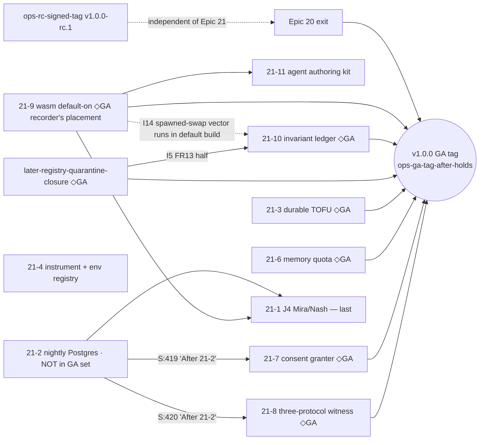

# Epic 21 remaining-scope preflight — 2026-11-12

| Record | Value / authority |
|---|---|
| Action | Epic-20-retrospective refinement input for Epic 21 (sprint-status `epic-20-retrospective` S:410: "re-preflights the rest of epic 21"). Proposed preflight, **NOT operator ratification**. Story files are not created here; story creation waits for the Epic 20 retrospective. |
| Measured checkout | `/home/lunarpulse/dev_ws`, `main`, HEAD `582f9509604449058ddbe5757ac3e0f0dee737a2`; local tracking ref `origin/main` = `23b2200bee8349c317bb2931051a8a3a5d507d03` (Q1/Q2). No fetch. Working tree carries other sessions' uncommitted 20-5 / fuzz files (Q1); none is read as evidence here. |
| Rulings in force | `decisions-2026-11-12-dedrift.md` (DD): `ga3`, `wasm` = on, `live` = skip, `authors` = agents-first, `drop`, `kfree`; `decisions-2026-11-12-acceleration.md` items 1–13; `docs/release/decisions-2026-11-12.md`. |
| Scope | Epic 21, 11 keys (S:413-423): **10 open** (`backlog`: 21-1, 21-2, 21-3, 21-4, 21-6, 21-7, 21-8, 21-9, 21-10, 21-11), **1 done** (21-5, S:417). Plus `later-registry-quarantine-closure` (S:448) because `ga3` puts it in the GA set. |
| Proof boundary | Read-only source reading + the prebuilt gate binary (no cargo, no build, no tests, no workflow dispatch, no git mutation). "Forecast" = read the touched files, never a prototype (ruling `kfree`, DD:85-87). |
| Files written | This report; `epics/epic-21-multi-host-on-live-substrate-w6.md` (three new story sections + dated OLD→NEW notes). Nothing else. |

## Source key

| Key | File |
|---|---|
| E21 | `/home/lunarpulse/dev_ws/_bmad-output/planning-artifacts/epics/epic-21-multi-host-on-live-substrate-w6.md` (line numbers are the pre-edit file) |
| S | `/home/lunarpulse/dev_ws/_bmad-output/implementation-artifacts/sprint-status.yaml` |
| D | `/home/lunarpulse/dev_ws/_bmad-output/implementation-artifacts/deferred-work.md` |
| DD | `/home/lunarpulse/dev_ws/_bmad-output/planning-artifacts/decisions-2026-11-12-dedrift.md` |
| RH | `/home/lunarpulse/dev_ws/RELEASE-HOLDS.md` |
| K | `/home/lunarpulse/dev_ws/xtask/kloc.toml` |
| KB | `/home/lunarpulse/dev_ws/xtask/kernel-core-baseline.toml` |
| NFR | `/home/lunarpulse/dev_ws/_bmad-output/planning-artifacts/prd/non-functional-requirements.md` |
| SC | `/home/lunarpulse/dev_ws/_bmad-output/planning-artifacts/prd/success-criteria.md` |
| RA | `/home/lunarpulse/dev_ws/_bmad-output/planning-artifacts/routing-audit-2026-10-22.md` |

Code cites are repo-relative and were re-read at HEAD `582f9509`.

## 0. The rulings as they bind Epic 21

| Ruling | What it changes for Epic 21 | Evidence |
|---|---|---|
| `ga3` | `v1.0.0` GA = Epic 20 exit + **21-3, 21-6, 21-7, 21-8, 21-9, 21-10** + `later-registry-quarantine-closure`. rc.1 unaffected. **21-9's membership is the recorder's placement, not the operator's words** (the operator named the invariant ledger, 21-3/6/7/8 and quarantine closure). | DD:28, DD:35-37; S:430; RH:105-111 |
| `wasm` = on | 21-9 turns the WASM host on in the default artifact; until it lands the tree stays OFF and `check-export-control` stays. NFR-Comp-1 not claimed. | DD:29, DD:41-54; RH:57-62 |
| `live` = skip | No paid key blocks anything. `ops-j4-live-incident-recording` no longer blocks 21-1; the 21-1 cassette source is chosen at story creation (D-21-PF-05). | DD:30, DD:118; S:412 |
| `authors` = agents-first | 21-11 re-rules the human N=12 author gate to an agent-author trial. | DD:31, DD:119-120; S:423 |
| `drop` | Every `ops-*` row is optional or dropped **except `ops-rc-signed-tag` and `ops-ga-tag-after-holds`** (release acts). No Epic 21 story waits for any other ops row. | DD:62-78; S:425-446 |
| `kfree` | Kernel growth inside the ADR-069 envelope (23,000 tokei) is self-service: measured at landing (`check-kernel-baseline`, `kloc-check --json`), re-pinned with `scripts/repin.py`, HISTORY row in the same commit. No operator ask, no FLAG-Winston grant, no reverted prototype. The "◆ FLAG-Winston" markers on 21-6 and 21-7 (E21:47, E21:120; S:418) keep their history but carry **no ask semantics** from here on. A D-row is owed only for a forecast that crosses the 22,000 alarm (`ENVELOPE ALARM`) or the 23,000 envelope. | DD:33, DD:83-93 |

## 1. HEAD measurements

| Instrument | HEAD value | Note |
|---|---|---|
| Kernel physical pin | **26062**, 90 files, set hash `6eaa5c6a…50fc`, changed/added/removed empty (Q3) | KB:505 |
| Kernel tokei row | **20429** (Q4) | K:264. **1571** to the 22,000 alarm, **2571** to the 23,000 envelope (arithmetic; ADR-069 constant `xtask/tests/recovery_lane_ceiling_rule.rs:388`). |
| Aggregate | **203354**, hardfail **203355**, `alarm=true`, `over_budget=[]` (Q4) | K:718. A passing exact pin is zero headroom, not room. |
| Crates Epic 21 touches (tokei / ceiling row) | maos-bin 38677/38677 (K:517) · xtask 45462/45462 (K:339) · maos-domain 10277/10277 (K:425) · maos-a2a-core 5037/5037 (K:470) · maos-a2a-tcp 1442/1621 (K:475) · maos-persistence 1/2000 (K:479) · maos-control 1496/1791 (K:484) · maos-cohort 5873/5873 (K:661) · maos-journey-test 946/1104 (K:681) · maos-wasm-host 3178/3178 (K:703) · maos-spirit-cli 942/942 (K:696) · maos-iac 8875/8875 (K:406) · maos-manifest 4765/4765 (K:415) · maos-providers 1679/1679 (K:427) · maos-spirit-sdk 1085/3000 (K:271) | Epic text E21:28 cites `kloc.toml:319/322/326/329/482/212` and 2026-09 values; all superseded by this row. |

## 2. Recommended order and dependency graph

Operator handoff order: **21-9 first** (every later hosted proof runs on the artifact GA ships); **21-10 in parallel** (tests + ledger; kernel-free expected — verified as a forecast in §5); **21-11 after 21-9** (an agent author with only the published kit needs the WASM form in the default artifact); **21-1 last**. The other GA stories (21-3, 21-6, 21-7, 21-8) and 21-2/21-4 run whenever picked, subject to the edges below.

**Hidden GA prerequisite.** S:419 and S:420 order 21-7 and 21-8 "After 21-2", and RA:26-27 records the same edge, but 21-2 is **not** in the `ga3` set (DD:28). As written, GA transitively waits for 21-2 (including its live re-record removal and the nightly scene). Open as **D-21-PF-02**; the GA set is not changed here.

| Edge | Status / evidence |
|---|---|
| 18-4 → 21-1, 15-6 → 21-1, 15-3/15-5 → 21-x | Satisfied: 18-4 done (S:280), 15-6 done (S:239), 15-3/15-5 done (S:236/238). |
| `ops-j4-live-incident-recording` → 21-1 | **Removed** by `live` = skip (DD:30; E21:54). E21:124 still lists it in Dependencies (kept as written by DD; superseded). |
| 21-5 → 21-1 ordering | 21-5 done (S:417). |
| 21-9 → 21-11 | S:423 ("Depends on 21-9 for the WASM form"). |
| `later-registry-quarantine-closure` → 21-10 (I5) | S:448 carries "the ADR-037 I5 FR13 flip"; `docs/invariants/README.md:33-35` records I5 FR13 asserted. I5 cannot read `guaranteed` for its FR13 half before that row lands. |
| 21-9 → 21-1 | [INFERENCE] soft: 21-1's scene runs native Mira/Nash, no WASM need; listed only because the handoff orders 21-1 last. |

## 3. Per-story readiness at HEAD

"Kernel" is a forecast (method in §5); "hosted" names the ACs whose proof needs a hosted run; "ops" lists only ops rows that may block (only `ops-rc-signed-tag` / `ops-ga-tag-after-holds` can).

| Key | Status (S) | GA | Kernel forecast | Hosted-proof needs | Ops dependency | Stale cites (detail §4) |
|---|---|---|---|---|---|---|
| 21-1 J4 Mira/Nash | backlog :413 | no | **0** | AC1 replay line runs hermetically in CI (`maos run` on a CI runner); the recording (if D-21-PF-05 A/C) is a local act, not CI | none (`ops-j4-live-incident-recording` optional, S:438) | 10 (§4.1) |
| 21-2 nightly Postgres | backlog :414 | **no, but GA-transitive via 21-7/21-8** (D-21-PF-02) | **0** | AC1 `reza-nightly` job needs one hosted `journey-nightly` run; AC3 drift plant hosted or local | none (`ops-nightly-cassette-rerecord` dropped as work, S:445) | 12 (§4.2) |
| 21-3 durable TOFU | backlog :415 | **yes** | **0** (no kernel-core file touched; kernel has no TOFU code: 0 `tofu` hits under `crates/maos-kernel-core/src`) | AC2 rotation real-timing legs (`t_10_4b_rotation_real_timing.rs`, `cert_rotation_trigger_14_2a.rs`) hosted | none | 11 (§4.3) |
| 21-4 instrument + env | backlog :416 | no | **0 lines**; the pin value changes instrument | gates only; hosted discipline run | none | 6 (§4.4) |
| 21-5 orchestrator move | **done** :417 | — | landed −827 tokei (K:264) | — | — | — |
| 21-6 memory quota | backlog :418 | **yes** | **+40…+120 tokei** | collective tier on the Postgres substrate (hosted services job) | none | 2 (§4.5) |
| 21-7 consent granter | backlog :419 | **yes** | **0…+20 tokei** | PG migration of consent side tables on the Postgres substrate; J3/Reza consent on live substrate | none | 4 (§4.5) |
| 21-8 three-protocol | backlog :420 | **yes** | **0** | hermetic fixture ACP + fixture MCP + loopback A2A in hosted discipline; public-MCP leg optional | none (public-server leg optional, `live` = skip) | 0 (no section yet) |
| 21-9 wasm default-on | backlog :421 | **yes (recorder's placement, D-21-PF-01)** | **0** for the default-on core; **+49…+143 tokei** for the inherited kernel rows it takes as ACs | macOS/Windows portability legs (D:1674), four-image `wasm-host-tests`, Epic-20-exit line 9 (engine on), `release.yml` artifact list (exercised only on a tag push), container image, stripped-size re-measure | none (`ops-brew-tap-and-aur-publication` optional) | 3 corrections + 38 inherited rows (§4.6) |
| 21-10 invariant ledger | backlog :422 | **yes** | **0 expected** (tests under `crates/maos-kernel-core/tests` are outside the pinned `src` set, `check_kernel_baseline.rs:74`); contingent: any in-`src` test seam or a fix forced by a falsified property is kernel growth | `invariant-lock` + `invariant_claims_20_3b` bind each `guaranteed` claim to an enabled discipline job (`docs/invariants/README.md:16-26`; `discipline.yml:774-810`); I1/I8/I11 v1.0 cadence is `fuzz` (fuzz workflows) | none | 2 (§4.7) |
| 21-11 agent authoring | backlog :423 | no unless ruled (D-21-PF-04) | **0** | `check-trial-attestation` clean-VM reload of each agent-built Spirit (`discipline.yml:5791-5804`) | none (`ops-external-cohort-and-pen-test` human half optional, S:440) | 1 major (`:325`, §4.8) |
| `later-registry-quarantine-closure` | backlog :448 | **yes** | **+30…+80 tokei** (S:448, UNMEASURED [INFERENCE]; under `kfree` no grant) | per its rows (D owner rows :1268, :1578-1586) | none | not re-preflighted (not an Epic 21 key) |

## 4. OLD → NEW cites at HEAD `582f9509`

`same` = still true; `moved` = new anchor; `false` = premise no longer holds. The epic file now carries these as dated notes beside each AC (E21 edits); the long AC lines themselves are kept verbatim.

### 4.0 Epic header (E21:9-28)

| OLD | NEW |
|---|---|
| RELEASE-HOLDS row 12 `RELEASE-HOLDS.md:59`; 14-2 clause (c.2) `:76-110` (E21:9, :76) | row 12 → **RH:86**; 14-2 section → **RH:123-243**, (c) **:133**, (c.2) **:147** (RH grew by the 2026-11-12 edits, DD:106-108). |
| `demo-reza` `xtask/src/main.rs:1012-1019` (E21:14, :19) | **moved** `xtask/src/main.rs:1155`; `xtask/src/demo_reza.rs:66` `run` same; "substrate incomplete" **:77** (was :71-81); `psql` probe **:138-139** (same); `--include-ignored` **:245**. No workflow invokes `demo-reza` (0 hits) — same. |
| `ignored_owner_audit` absent (E21:20) | same: no such target in `crates/maos-journey-test/tests`. |
| Operator lane `sprint-status.yaml:291` (E21:23) | **moved** S:438; row is optional (`live` = skip). |
| Kernel set `check_kernel_baseline.rs:31`; pin 24472/24474; 18933 tokei (E21:26) | `KERNEL_SRC` **`check_kernel_baseline.rs:74`**; physical pin **26062** (KB:505), tokei row **20429** (K:264). Two instruments still live (21-4 AC1). |
| Kloc rows `kloc.toml:319/322/326/329/482/212` (E21:28) | Replaced by §1 rows (K:470/475/479/484/661/339). |

### 4.1 21-1 (E21:60-63)

| OLD | NEW |
|---|---|
| `env_contract.rs` has only `MAOS_REPLAY_CASSETTE :255`, `MAOS_REPLAY_STRICT :265` | **false**: `MAOS_INFERENCE_MODE` :382, `MAOS_REPLAY_CASSETTE` :387, `MAOS_REPLAY_STRICT` :392 (15-6 landed). |
| `worker_spawn.rs:53-66` accepts only `--live/--once/--replay-llm` | **false**: `parse_run_args` `crates/maos-bin/src/worker_spawn.rs:88-139` accepts `--live`, `--once`, `--epic`, `--clock`+`--acceptance`; `--clock` **requires** `--acceptance` (:138) and the pair is "a Butler scene" (:61-63). AC1's `--clock compressed:90m` without `--acceptance` is refused today; `ClockSpec` does accept minutes (`crates/maos-spirit-sdk/src/clock.rs:162-180`). `--incidents` still new. |
| Mira inlet `spirits/mira/src/lib.rs:241`, `diagnose` :274, `AnomalySignal` :87-98 | same. |
| Daemon loads `Mira::default()` `main.rs:3827`; arms `main.rs:3797-3847`; scalar adapter `:3827-3829` | **moved**: topology loader `topology_load` `crates/maos-bin/src/main.rs:5069`; Mira arm **:5911-5957** (`Mira::default()` :5953), Nash **:5958-5960**; standalone arms :6801-6840; scene-free registry :1098-1099. |
| Researcher deferred-port template `main.rs:4590-4622` | **moved**: Researcher construction through `butler_seam`/`researcher_wiring` `main.rs:6652-6700`. |
| Smoke sites `:10786,:11040,:11227,:11303`; template `main.rs:10969-11040` | **moved**: `LoopbackA2ARouter` sites `main.rs:14018,14076,14145,14276`; template `smoke_a2a_consent_vocab_8_7` **:14213-14405** (`ADMIT_INTENT` :14231, `DENY_INTENT` :14232); `handle_intake` :14537. |
| Butler `[capabilities.required]` `manifest.toml:20-21` | `spirits/butler/manifest.toml:19-21`. |
| Mira smoke `spirit_smoke.rs:99-102,128-131`; manifests `mira:16-17`, `nash:14-15` | Mira smoke `:99-102`, **`:128-132`**; Mira manifest comment **:17**; Nash :14 same; **new**: Nash's own Decision-I assertion `spirits/nash/tests/spirit_smoke.rs:90-91` also inverts. |
| `journey_j4.rs:117` ignore | **:116** (attr), fn :119. |
| `frame.rs:386` `IntentAllowlistMismatch` | `crates/maos-domain/src/frame.rs:399` (enum :397). |
| `prd/project-scoping-phased-development.md:226` (45/50, 48/50) | **:227**. |
| Cassettes dir `j-butler j-researcher j0` | now `j-butler j-researcher j0 j1 providers`; fixtures `j-butler j-researcher j3`. |
| Cassette produced by the paid row (E21:24, :60) | superseded by `live` = skip; see D-21-PF-05/06 and §4.1a. |
| Tracker S:412 "(b) agent-authored (provenance `synthetic`)" | **false as written**: the replay reader accepts only `seed` or `live-record` (`crates/maos-bin/src/cassette_replay.rs:45-53`); `synthetic` is refused. D-21-PF-06. |

**§4.1a Ollama record-mode verification (cited, not run).** Record mode needs only a cassette path, not an eligible live provider (`crates/maos-bin/src/inference_mode.rs:52-54`); it wraps **every** registered driver (`main.rs:4043-4055`); Ollama is registered whenever `MAOS_OLLAMA_URL` is not `skip`, defaulting to `http://localhost:11434` (`main.rs:3877-3881, 3962-3972`); the `maos run` topology path flushes the recorder (`main.rs:6078-6084`); the flushed cassette is `provenance: live-record` with the response's real `model_id` (`cassette_replay.rs:274-310`). The Ollama model is the constant `llama3.1:8b` (`main.rs:17735`; no `MAOS_OLLAMA_MODEL` in `env_contract.rs`); the scope string `ollama.llama3.1:8b` already exists (`spirits/hello-spirit/manifest.toml:13`). **Conclusion: record mode supports Ollama at HEAD**, provided 21-1 AC2 lands the Mira/Nash inference seams first (`grep -cE 'Inference|provider'` = 0 in both libs). Strict replay checks `prompt_sha256` unless the entry uses the all-zero wildcard (`cassette_replay.rs:151-152`); an agent-authored cassette with wildcard hashes voids AC1's "STRICT reds on drift" leg.

### 4.2 21-2 (E21:69-72)

| OLD | NEW |
|---|---|
| `services:` at `discipline.yml:2930,2995,3077,3130`; template block `:2930-2943` | **moved** `.github/workflows/discipline.yml:5350` (check-cross-region-consensus), :5415 (multi-region-slo), :5499 (multi-tenant-loom), :5577 (reza-production-path); template **:5350-5363**; `rpo-rto-cadence.yml:46` same. |
| `check-multi-tenant-loom` `discipline.yml:3077-3120`, `extra-databases` :3104-3108, TEAM exports :3120-3123 | job **:5496**, `extra-databases` **:5529**, TEAM_A/B **:5555-5556**. |
| `check-cohort-mesh` `discipline.yml:3054` | **:5476**. |
| reza leg exports `discipline.yml:3182-3184` | under `check-reza-production-path` **:5574+**. |
| `check_loom_substrate_drift.rs` `WORKFLOW :66`, routes `:174-209` | `WORKFLOW` :66 same; routes **:174-212**. |
| `gate_common.rs:216-233` AdvisorySubstrate | class at `xtask/src/gate_common.rs:239-250`. |
| `check_reza_production_path.rs:456-457` tl-phase-b leg | **:400-407**. |
| `t_12_4a_digest_read.rs:593-596`, ignores `:298-526` | same (:593-596; ignores :298, :360, :414, :471 …). `cross_team_crossing_13_6b.rs:1641,1837,2354,2810` same. |
| `journey-nightly.yml:94` invalid `--live` (15-6 AC3) | **closed**: no `--live` in `journey-nightly.yml` at HEAD. |
| "Today's two" `#[ignore]` (`journey_j4.rs:117`, `journey_butler.rs:285`) | **three**: `journey_j4.rs:116`, `journey_butler.rs:283`, and **new** `recording_source_15_6.rs:38` (`"spawned by the parent with an isolated record-mode environment"`); AC4's audit must give it an `owner:` token too. |
| **Live re-record removal (DD:121-123, owner 21-2)** | Jobs `secret-gate` `journey-nightly.yml:52-65` (reads `MAOS_ANTHROPIC_API_KEY` :59) and `tier-2-rerecord` :68-~165 (three `MAOS_INFERENCE_MODE: record` steps :89-92, :114-118, :140-145; upload :150). **Pins that change** with removal: `xtask/tests/ci_shape_18_0.rs:517-560` (resolves job `tier-2-rerecord`, asserts the Butler and Researcher record steps' env/run, `!cancelled()`, and upload ordering — panics on a missing job); `xtask/tests/ci_shape_18_0.rs:1416-1440` (iterates nightly jobs for the nextest pin — still passes after removal); prose `tests/coverage-matrix.yaml:1236`, `tests/judge-config.toml:19`, `.github/workflows/discipline.yml:3841`, `docs/runbooks/provisioning-checklist.md:27` (cites `journey-nightly.yml:88`). Deferred rows that lose their witness: D:1412 ("the nightly is its proof" for the record-flush success path), D:1413, D:1419 (owner `ops-nightly-cassette-rerecord`, dropped as work). D-21-PF-07. |

### 4.3 21-3 (E21:76-83)

| OLD | NEW |
|---|---|
| `swap_serving_cert` `transport.rs:541`, doc `:536-540` | same (`crates/maos-a2a-tcp/src/transport.rs:541`, "NO production caller" :538). |
| callers `t_14_2_rotation_scene.rs:211`, `t_10_4b_rotation_real_timing.rs:550,1252` | **:210**; **:539, :1241**. |
| `cert_rotation_trigger_14_2a.rs:720-732`; `cert_rotation_14_2a.rs:723-742` | :720 same; cohort test fn **:724**-742. |
| `RuptureReason` `frame.rs:383-384`; `RuptureRejection` `:359-377` | enum **:397**; struct **:387**. |
| mismatch path `transport.rs:1032-1052`, sentinel :1034, journal call :1048-1052 | ~:1030-1052; journal call **:1049-1052**. |
| `journal_peer_identity_refusal` `router.rs:502-507` | `crates/maos-a2a-core/src/router.rs:496`. |
| `build_server_config` `transport.rs:1322-1334`, `None` :1333, resolver :1341 | **:1325**, `None` **:1336**, resolver **:1339-1345**. |
| cohort bootstrap `main.rs:9765-9824` | `load_cohort_daemon_bootstrap` **`main.rs:12340`** (state load :12361). |
| `Region::resolve_home` `region.rs:97` | **:89**. |
| `TeamEntry.region` `manifest.rs:154-159` | `crates/maos-cohort/src/manifest.rs:156` (same range). |
| kernel reader `operator_config.rs:203` `RegionSection::load` | `RegionSection` **:167**, `resolve_from_env_and_disk` **:179** (no fn named `load`). |

### 4.4 21-4 (E21:89-93)

| OLD | NEW |
|---|---|
| `kloc_check.rs:163-190` filters | `xtask/src/kloc_check.rs:294-317` (`-e target tests benches examples fuzz spirits` + spill fault file). |
| `check_kernel_baseline.rs:99-110` physical count | `count_rs_lines` **:470-480**. |
| pin 24472/24474 → tokei 18933 | physical **26062** (KB:505), tokei **20429** (K:264). |
| `env_contract.rs`: 479 tokei / 507 physical / 87 `EnvVar {` | **671 / 709 / 125** (Q5). |
| `MAOS_OPERATOR_HTTP_ENDPOINT` read at `subcommands.rs:1938` | read via `ENV_ENDPOINT` `crates/maos-cli/src/door_client.rs:32`; still absent from `env_contract.rs`. |
| `check_env_contract.rs:119`, `:89`, `main.rs:1303-1305` | :119, :89 same; dispatch `xtask/src/main.rs:1458-1459`. |

### 4.5 21-6, 21-7, 21-8

| OLD | NEW |
|---|---|
| 21-6: scan `limit` params `memory/mod.rs:363,894` | `crates/maos-kernel-core/src/memory/mod.rs:367, :853` (still scan page sizes; no quota anywhere in `memory/`). FR28 `functional-requirements.md:74` same; RI `requirements-inventory.md:556` same. |
| 21-7: tracker `sprint-status.yaml:316`; `deferred-work.md:1169-1171` | S:**419**; D:**1328-1330**. |
| 21-7: `retract()` `adapter.rs:641`; `deliver_typed(frame, 0, None)` `mailbox.rs:792` | `crates/maos-iac/src/adapter.rs:750`; `crates/maos-iac/src/adapter/mailbox.rs:798`. `IacBusPort` is a maos-domain trait (`crates/maos-domain/src/ports/iac_bus.rs:22`); kernel-origin `deliver_typed(frame, 0, None)` sites `maos-kernel-core/src/inference/mod.rs:204`, `scheduler/hook_dispatch.rs:242`. |
| 21-8: `success-criteria.md:50` | same. |

### 4.6 21-9 (tracker S:421)

| OLD (S:421, DD:45-53) | NEW |
|---|---|
| `crates/maos-bin/Cargo.toml:15,33` | same (`default = ["network"]` :15; `wasm-host = ["dep:maos-wasm-host"]` :33). |
| `xtask/src/check_export_control.rs:194,310` | same (:194 call, :310 fn; scanner :281-332; unit tests :477-547). |
| `decision_adrs_and_provisioning.rs` clauses (g)/(h) | (g) `xtask/tests/decision_adrs_and_provisioning.rs:921-941`, (h) **:943-948**; planted reds :1279-1291. |
| `docs/compliance/export-counsel-precondition.md` | same; "merge precondition" :4-14, satisfaction rule :62-73. |
| RELEASE-HOLDS "Standing mitigations" | RH:47-62. |
| `maos-wasm-runner` absent from `packaging/`, `release.yml`, `Dockerfile` | same: 0 `wasm` hits in `packaging/`, `release.yml`, `Dockerfile`. Artifact lists: `release.yml:76`, `xtask/src/release_dry_run.rs:27-43`, `packaging/deb/rules:6`, `packaging/rpm/maos.spec:35`, `packaging/homebrew/maos.rb:50`, `Dockerfile:9-16`. The daemon finds the runner only as a sibling of its own executable (`crates/maos-bin/src/main.rs:2605-2625`; fuel 10,000,000). |
| size bound 35,651,584 B `xtask/src/prepush.rs:509` | same. |
| (not in tracker) | **Epic 20 exit line 9 asserts the engine-off refusal**: `epics/epic-20-ship-it-w5.md:52`, `.github/workflows/discipline.yml:2962` (`grep -Fx "... wasm_engine_off"`), `xtask/tests/registry_exit_20_1.rs:36`; 26 `WasmEngineOff`/`wasm_engine_off` sites across 14 files. GA needs Epic 20 exit green **and** 21-9: D-21-PF-09. |
| (not in tracker) | `maos-bin` `feature = "wasm-host"`: 86 sites in `src` (DD:53 same), 110 with tests, 6 `not(feature = "wasm-host")`. CI's feature-on legs `discipline.yml:1466, 2137`. |

Inherited rows: **38 owner-tagged rows** (`Owner: \`21-9-wasm-host-default-on\``) plus the section header D:1736 that names the key (39 mentions). Every row is an AC or carries a ship-without justification in the epic's §21-9 table: **25 → ACs** (AC7–AC11; every security row, including D:1667 `write_atomic` and D:1668 hostile `time_cap_seconds`), **13 → justified** (index row, Info diagnostics/noise, test-only, operator-door-only, evidence-scope records, a ruled design pending D-21-PF-17, and D:1763 unreachable from the default artifact). Of the 25, the kernel-touching ones are D:1630/1675, :1665, :1666/1667, :1668/1695, :1718, :1740.

### 4.7 21-10 (tracker S:422)

| OLD | NEW |
|---|---|
| `docs/invariants/I1..I14.md` all `claim: asserted`; `property_test: null` in 13 of 14 (I5 names `principal_identity_20_3b.rs`) | same (Q6). Owners: `20-3b` ×12, `20-1b-…` (I5), `20-9-…` (I14) — all `done` keys (S:369, :298, :390), so every owner is stale. |
| (not in tracker) | v1.0 cadence: **I1, I8, I11 = `fuzz`**; I3, I9 = `CI`; the rest `runtime` (frontmatter `enforcement_cadence`). Fuzz targets today: `crates/maos-kernel-core/fuzz/fuzz_targets/cap_token_verify.rs`, `crates/maos-domain/fuzz/fuzz_targets/frame_deser.rs`, `crates/maos-manifest/fuzz/fuzz_targets/manifest_parser.rs`. No `proptest`/`quickcheck` in any `Cargo.toml`. |
| (not in tracker) | The bar for `guaranteed` is mechanical: `docs/invariants/README.md:16-26` + `xtask/tests/invariant_claims_20_3b.rs` (run first in the `invariant-lock` job, `discipline.yml:790-791`). `invariant-lock` needs a `tests/coverage-matrix.yaml` touch and an `enforcement_cadence` hunk in the same diff (`xtask/src/invariant_lock.rs:430-445, 505-513`); the ≥2-approval check applies only on `pull_request` events (`discipline.yml:796-804`; `invariant_lock.rs:515-533` returns 0/not-insufficient without a PR). |
| (not in tracker) | **Ledger write authority conflict**: the 20-9 closure skipped AC9.1 under the operator ruling "`docs/invariants/*.md` is never edited by a story" (D:1659; `20-9-…-evidence/closure/closure-note.md:33,43`), while 21-10's deliverable is the flip. D-21-PF-18. |
| SC "All 14 … empirically verified by v1.0" | `SC:38`. |

### 4.8 21-11 (tracker S:423)

| OLD | NEW |
|---|---|
| `xtask/src/check_third_party_trial.rs:325` (N=12 human authors; also DD:31, DD:119, `docs/runbooks/provisioning-checklist.md:40`) | **wrong anchor** (file unchanged since `1606a0a1`; :325 is the duplicate-id loop). The N=12 floor is **`:538-543`** (`let preliminary = t.participants_total < 12`); ≥10 successes **:453-456**; human strata floors **:463-499** (`no_prior_contribution` 4, `no_rust_spirit` 3, `no_rust` 2, `non_english` 2, `offline_only` 1); schema `Participant` :33-43 (no author-kind field); module doc :1-7. Enrolled `discipline.yml:4204-4225`. |
| (not in tracker) | `maos-spirit validate` and `inspect` are stubs that exit 1 "not yet implemented (v0.7+)" (`crates/maos-spirit-cli/src/bin/maos-spirit.rs:107-114`). An agent kit cannot point at them. D-21-PF-23. |
| (not in tracker) | NFR-Test-8 (NFR:85) and NFR-Onb-1 (NFR:125) define the human N=12 cohort; v1.0 milestone line `prd/project-scoping-phased-development.md:219` lists "Black-box third-party trial N=12 (NFR-Test-8)". The `authors` ruling supersedes it "as a v1.0 gate, once 21-11 lands" (DD:31): a PRD DELTA row is owed by 21-11. |

## 5. Kernel forecasts (ruling `kfree`; forecasts only)

Method: read the files each AC must touch; count only lines under `crates/maos-kernel-core/src` (the pinned set, `check_kernel_baseline.rs:74`); tests, fuzz and spirits are excluded (`kloc_check.rs:294-317`). Landing measures with `check-kernel-baseline` / `kloc-check --json`, re-pins with `scripts/repin.py`, HISTORY row in the same commit.

| Key | Forecast (tokei) | Files read / basis |
|---|---:|---|
| 21-1 | 0 | `maos-bin` topology arms (`main.rs:5911-5960`), `spirits/mira`, `spirits/nash`, `maos-journey-test`; Mira/Nash consume the existing kernel `InferencePortAdapter`; `idle_watchdog.rs` untouched (E21:58). |
| 21-2 | 0 | YAML, `xtask/src/check_loom_substrate_drift.rs`, one in-crate test. |
| 21-3 | 0 | maos-persistence/a2a-core/a2a-tcp/cohort/control/bin/domain; kernel `RegionSection` untouched (E21:83). |
| 21-4 | 0 lines | xtask instrument; the pin value changes unit. |
| 21-6 | +40…+120 | `memory/` is 3262 tokei; no quota exists; one check per tier write (`memory/for_spirit.rs:31` `write`, `write_entry_point.rs`), a typed refusal, a per-tier quota source. [INFERENCE] range. |
| 21-7 | 0…+20 | native attribution: `IacBusPort` is maos-domain, `deliver` is maos-iac `mailbox.rs:798`; kernel lines only if the sender pid must be threaded from the kernel send context. |
| 21-8 | 0 | binary-level witness. |
| 21-9 core | 0 | Cargo feature, xtask gate, packaging, docs, workflows. |
| 21-9 inherited kernel ACs | +49…+143 | D:1718 `authorize_principal_writes` release **+7 (priced at 20-9, `+9 phys / +7 tokei`)**; D:1665 `hot_swap/saga.rs:127-130` derive phase +2…+6; D:1666/1667 `hot_swap/archive.rs:46-56` unique temp + `O_NOFOLLOW`/create-new + RAII cleanup +10…+30; D:1668/1695 `schedule_watchdog.rs:300-303` concurrent fire with `min(cap, 30 s)` wall and next-poll decoupling in `idle_watchdog.rs:108-128` +20…+60; D:1630/1675 promotion-set registration on swap +10…+30; D:1740 F3 idle re-arm 0…+10 (0 if docs-only). |
| 21-10 | 0 expected | properties written in `crates/maos-kernel-core/tests/` against the public API; contingent growth only for an in-`src` seam or a fix forced by a falsified property. |
| 21-11 | 0 | xtask gate, docs, templates, `maos-spirit-cli`. |
| quarantine closure | +30…+80 | S:448 [INFERENCE]. |

**Cumulative worst case:** 20429 + 143 + 120 + 20 + 80 = **20792** < 22,000 alarm (1208 to spare) < 23,000 envelope. **No `ENVELOPE ALARM`; no envelope decision owed.**

## 6. Kloc forecasts (production tokei, method: read the touched files)

| Key | Crate deltas (forecast) | Basis |
|---|---|---|
| 21-9 | maos-bin +0…+120 net (F1/F2/F4, admission rules for schedule cap / telemetry listing / artifact fd, minus up to −60 for retiring `not(feature = "wasm-host")` branches, 6 sites); xtask −40…+30 (invert the leak scan `check_export_control.rs:281-332`, `release_dry_run.rs:27-43` +1 artifact, size bound); maos-wasm-host +5…+40 (F5 timer driver or typed refusal in `runner.rs`, artifact fd); maos-manifest +10…+25 (`[[schedule]]` caps, `manifest.rs:1904-1975`) | §4.6 cites |
| 21-10 | 0 (tests, fuzz uncharged); xtask 0…+30 only if `invariant_lock.rs` learns the fuzz cadence | `kloc_check.rs:294-317` |
| 21-11 | xtask +30…+90 (`check_third_party_trial.rs` author kind + agent floors + labels); maos-spirit-cli +60…+200 if D-21-PF-23 A implements `validate`; kit = Markdown/skill files (uncharged); `(unknown:templates)` row 11 today | §4.8 |
| 21-1/2/3/4/6/7 | epic text E21:28/42-47 stands as forecast, re-based on the §1 HEAD values; every touched row except maos-a2a-tcp/persistence/control/journey-test/spirit-sdk is at zero headroom | K rows in §1 |

## 7. Open operator D-rows

| ID | Decision / options | Rec. | Evidence |
|---|---|---|---|
| **D-21-PF-01** RULED 2026-11-12, option A (`decisions-2026-11-12-retro-preflight.md`) | 21-9 in the GA set (recorder's placement). **A** confirm; **B** remove (v1.0.0 ships engine-off, 21-9 lands after GA); **C** keep the default-on core (AC1–AC7) in GA, move the inherited-row ACs (AC8–AC11) to post-GA. | **A** | DD:35-37 (placement reasoning: cheaper before the LTS clock); RH:105-111, RH:116-118 already state it; S:430. C would ship third-party admission by default with the hostile-guest rows open. |
| **D-21-PF-02** RULED 2026-11-12, option C (= D-E20-11) (`decisions-2026-11-12-retro-preflight.md`) | Hidden GA prerequisite 21-2 (S:419-420 "After 21-2"; 21-2 not in `ga3`). **A** add 21-2 to the GA set; **B** split 21-2: only the part 21-7/21-8 consume (AC1 Postgres nightly scene + AC3 drift enrolment) is GA; **C** drop both ordering edges: 21-7's received ACs are code fixes provable on the per-commit Postgres jobs (`discipline.yml:5496-5557` already has `services:` and three team DBs), 21-8 is hermetic (S:420: "fixture ACP client + fixture MCP server + loopback A2A peer"). | **C** | S:419-420; RA:26-27; DD:28; E21:118-120. Under A, GA also waits for the live re-record removal and D-21-PF-07. |
| **D-21-PF-03** RULED 2026-11-12, option A (= D-E20-10) (`decisions-2026-11-12-retro-preflight.md`) | GA vs perf. `release.yml:165-171`: a `ga` tag gets `--perf-verdicts` without `--perf-absent-ok`, i.e. every metric must PASS; `ops-stable-perf-runner` is dropped as work (DD:70) and S:430 says GA "needs only the tag push". **A** extend ruling `rc` = b to GA: the `ga` case accepts ABSENT with the notes label (a workflow change; owner story named by the operator — 21-9 already touches `release.yml`); **B** keep PASS-for-GA and revive a perf runner (reverses `drop`); **C** accept hosted-runner verdicts as PASS (contradicts ADR-068's single-tenant design and the "no stable-runner timing claim" boundary, S:375). | **A** | `release.yml:155-171`; DD:70; S:375, S:430, S:443. GA also needs the T3 fuzz chain for the tag SHA (`release.yml:155-158`) — achievable, not dropped. |
| **D-21-PF-04** RULED 2026-11-12, option A (`decisions-2026-11-12-retro-preflight.md`) | 21-11 in the GA set. **A** not GA (S:423 default; release notes label NFR-Test-8/NFR-Onb-1 as not measured for human authors and report the agent trial under its own label); **B** add to GA. | **A** | S:423; DD:31; `ga3` list DD:28 omits it. |
| **D-21-PF-05** RULED 2026-11-12, option C (`decisions-2026-11-12-retro-preflight.md`) | 21-1 cassette source. **A** record Mira/Nash turns from a local model through the Ollama driver (supported: §4.1a), provenance `live-record`, J4 closure rate MEASURED for that model; **B** agent-authored cassette, J4 closure rate labelled **NOT MEASURED** in the story and the release notes; **C** A when a host with Ollama + `llama3.1:8b` is available at story time, else B. | **C** | `inference_mode.rs:52-54`; `main.rs:3962-3972, 4043-4055, 6078-6084, 17735`; `cassette_replay.rs:151-152, 274-310`; S:412; E21:54. |
| **D-21-PF-06** RULED 2026-11-12, option A (`decisions-2026-11-12-retro-preflight.md`) | Agent-authored provenance spelling (only under B). **A** use the existing `seed` with `model_id = "agent-authored"`; **B** add `synthetic` to the reader's accepted set (`cassette_replay.rs:45-53`) as a distinct label. | **A** | Reader accepts `seed`/`live-record` only; seed precedent `spirits/butler/tests/halt_eval_corpus_18_2.rs:124`. S:412 says `synthetic` (refused today). |
| **D-21-PF-07** RULED 2026-11-12, option A (`decisions-2026-11-12-retro-preflight.md`) | 21-2 removes the live re-record (`journey-nightly.yml:52-165`). What witnesses the record-flush success path (D:1412 "the nightly is its proof")? **A** a hermetic per-commit witness: record mode over the fixture driver (`fixture_replay` feature), flush, then strict replay of the written file; **B** keep the jobs (they already skip without the key, :72); **C** replace with an optional Ollama nightly leg. | **A** | DD:121-123; D:1412-1413, D:1419; pins `xtask/tests/ci_shape_18_0.rs:517-560`. B keeps a paid-key path the ruling made optional. |
| **D-21-PF-08** RULED 2026-11-12, option A (`decisions-2026-11-12-retro-preflight.md`) | `check-export-control` after default-on. **A** invert: the default closure must contain the engine and the runner, the STABILITY export fence states ON and no ECCN determination; **B** retire the leak half and keep only the ECCN/STABILITY document checks. | **A** | `check_export_control.rs:194, 281-332`; DD:46 "retire or invert"; a default-off regression would otherwise be silent (rule 11). |
| **D-21-PF-09** RULED 2026-11-12, option A (`decisions-2026-11-12-retro-preflight.md`) | Epic 20 exit line 9 asserts `wasm_engine_off` (`epic-20-ship-it-w5.md:52`, `discipline.yml:2962`, `registry_exit_20_1.rs:36`). **A** 21-9 re-rules line 9 to the engine-on observation (the installed TS Spirit answers) and keeps the typed refusal as a witness on a `--no-default-features --features network` build; **B** ship an engine-off artifact alongside; **C** leave line 9 (GA then needs two contradictory greens). | **A** | GA = Epic 20 exit + 21-9 (DD:28); 26 sites / 14 files (§4.6). |
| **D-21-PF-10** RULED 2026-11-12, option A (`decisions-2026-11-12-retro-preflight.md`) | Release size bound 35,651,584 B (`prepush.rs:509`) with the engine in. **A** re-measure the stripped default binary at landing and set the bound to the measured value plus a stated margin in the same commit; **B** keep the bound and fail if exceeded; **C** drop the bound. | **A** | DD:51-52 ("not measured here"); size unmeasurable without cargo. |
| **D-21-PF-11** RULED 2026-11-12, option A (`decisions-2026-11-12-retro-preflight.md`) | Inherited-row scope for 21-9. **A** the epic §21-9 table (25 ACs, 13 justified); **B** all 38 as ACs; **C** only F1–F5 + portability. | **A** | D owner rows :1630…:1763 (§4.6); security rows default to AC unless unreachable from the default artifact. |
| **D-21-PF-12** RULED 2026-11-12, option B (`decisions-2026-11-12-retro-preflight.md`) | Telemetry listening (D:1684). **A** loud admission-time declaration (TL field); **B** refuse a telemetry-listing manifest without an explicit scope. | **B** | D:1684 options (1)/(2); third-party listeners become default-reachable. |
| **D-21-PF-13** RULED 2026-11-12, option A (`decisions-2026-11-12-retro-preflight.md`) | Hook overrun cost (D:1696). **A** the link deadline ends the session (kill the running export); **B** keep: waiting cancelled, export runs to the session deadline. | **A** | D:1696; a hostile guest keeps executing today. |
| **D-21-PF-14** RULED 2026-11-12, option A (`decisions-2026-11-12-retro-preflight.md`) | Successor scope check (D:1686). **A** hierarchical containment per `Scope` kind and re-derive `declared_sends` at handover; **B** keep exact-match (D-20-9-10 A). | **A** | D:1686; successor runs with the predecessor's full sandbox. |
| **D-21-PF-15** RULED 2026-11-12, option A (`decisions-2026-11-12-retro-preflight.md`) | Not-ready spawned swap (D:1677). **A** the door waits for readiness up to the pre-warm wall; **B** keep `spawned_swap_not_ready` + operator retry. | **A** | D:1677 (hosted: four refusals, success on attempt 5, run 43217945522). |
| **D-21-PF-16** RULED 2026-11-12, option A (`decisions-2026-11-12-retro-preflight.md`) | FR11 archive on hot swap (D:1685). **A** write a version record from the committed-outcome closure; **B** write a swap marker. | **A** | D:1685; today a later cross-major load can be refused `migrator_missing`. |
| **D-21-PF-17** RULED 2026-11-12, option B (`decisions-2026-11-12-retro-preflight.md`) | Post-swap revert of a spawned Spirit (D:1676). **A** take D-20-9-11 B (`post_swap_window_open`, a kernel line); **B** keep the typed end `swap_reverted_after_retire`. | **B** | D:1676; ruled design, fail-closed, witnessed. |
| **D-21-PF-18** RULED 2026-11-12, option A (`decisions-2026-11-12-retro-preflight.md`) | Ledger write authority for 21-10. **A** 21-10 edits `docs/invariants/I*.md` (+ README routed-witness table) under `invariant-lock` (coverage-matrix touch + cadence hunk; push-to-main path needs no PR approvals); **B** 21-10 lands tests and a proposed ledger diff, the operator applies it; **C** no ledger edit; evidence only in `tests/coverage-matrix.yaml`. | **A** | D:1659 (standing "never edited by a story" rule); `invariant_lock.rs:430-445, 505-533`; `discipline.yml:774-810`; S:422 deliverable "the ledger flips". |
| **D-21-PF-19** RULED 2026-11-12, option C (`decisions-2026-11-12-retro-preflight.md`) | Property mechanism. **A** add `proptest` as a dev-dependency (lock + cargo-deny review); **B** hand-rolled seeded generators; **C** B plus cargo-fuzz targets for the three `v1.0: fuzz` invariants (I1, I8, I11) on the existing fuzz workflows. | **C** | No property crate in any `Cargo.toml`; cadence frontmatter; three existing fuzz targets (§4.7). |
| **D-21-PF-20** RULED 2026-11-12, option A (`decisions-2026-11-12-retro-preflight.md`) | GA bar for 21-10. **A** 14/14 `guaranteed`; **B** an invariant without a falsifiable predicate is ruled down to `asserted` with a named claim boundary (SC:38 "No predicate, no claim"), operator ruling per invariant. | **A** | SC:38; DD:28; I5 also needs the quarantine row (§2). |
| **D-21-PF-21** RULED 2026-11-12, option A (`decisions-2026-11-12-retro-preflight.md`) | Gate re-rule shape for 21-11. **A** one gate: `author_kind = "agent" | "human"` per participant, agent trials judged under their own floors and label, human floors optional and never blocking; **B** a second gate `check-agent-author-trial`, human gate advisory; **C** docs only, gate unchanged. | **A** | `check_third_party_trial.rs:33-43, 453-499, 538-543`; DD:31. |
| **D-21-PF-22** RULED 2026-11-12, option A (`decisions-2026-11-12-retro-preflight.md`) | Agent-trial denominator and harness. **A** N=12 blank-context runs across ≥3 harness/model combinations, transcripts committed, each produced Spirit re-verified by `check-trial-attestation` on a clean VM, floor ≥10/12; **B** N=3 preliminary; **C** N=1 demonstration. | **A** | NFR:85 floor shape; `discipline.yml:5791-5804`; S:423 "honest N and author kind `agent`". |
| **D-21-PF-23** RULED 2026-11-12, option A (`decisions-2026-11-12-retro-preflight.md`) | `maos-spirit validate`/`inspect` stubs. **A** implement `validate` (reuse the admission gate) as the kit's self-check, retire `inspect` or implement it; **B** the kit uses the existing `maos` admission path and the stubs are removed; **C** keep the stubs, kit omits them. | **A** | `maos-spirit.rs:107-114`; no stubs may ship as product verbs. |

## 8. Not measurable without cargo (stated, not guessed)

- Stripped default-binary size with `wasm-host` on, against 35,651,584 B (D-21-PF-10).
- Whether macOS/Windows compile `wasm-host` (D:1674: local cross-check fails in `ring`'s build script).
- Exact kernel/kloc deltas of every forecast in §5/§6; the landing measures them.
- Whether the Ollama record leg actually completes a 50-incident scene (no Ollama run here; `llama3.1:8b` availability unmeasured).
- Whether the WASM default build passes the existing `cargo deny` / duplicate-crate policies with wasmtime in the default closure.
- Whether any property in 21-10 falsifies an invariant (would turn a 0 forecast positive).

## 9. Observed command record

Gate prefix **G** = `env -u CI -u GITHUB_ACTIONS CARGO_MANIFEST_DIR=/home/lunarpulse/dev_ws/xtask /mnt/build/cargo-maos/debug/xtask`.

| Q | Command | Result |
|---|---|---|
| Q1 | `git log -1 --format='%H %D'`; `git status --porcelain` | rc 0; `582f9509… HEAD -> main`; other sessions' uncommitted 20-5/fuzz files. |
| Q2 | `git rev-parse origin/main` | `23b2200b…`. |
| Q3 | `G check-kernel-baseline --json` | rc 0, passed, 26062/26062, 90 files, hash `6eaa5c6a…50fc`, no changed/added/removed. |
| Q4 | `G kloc-check --json` | rc 0, passed, alarm true, aggregate 203354, `over_budget=[]`; per-crate §1. |
| Q5 | `grep -c 'EnvVar {'`, `wc -l`, `tokei` on `crates/maos-bin/src/env_contract.rs` | 125 / 709 / 671. |
| Q6 | frontmatter read of `docs/invariants/I1..I14.md` | 14 × `claim: asserted`; 13 × `property_test: null`. |
| Q7 | read/grep of every cite in §4 | as tabled. |
| Q8 | `G check-decision-register --json`; `G check-epic-close-coherence --json`, before and after both writes | Before: rc 0 / rc 0. **After: `check-decision-register` rc 0, `passed=true`, 23 rows, 6 open, `findings=[]`; `check-epic-close-coherence` rc 0, `passed=true`, 21 epics, authoritative src-lines 26062, `violations=[]`, stderr empty.** `intent-lineage-coverage-report.md` not modified. Neither gate proves an exit or a ruling. |
