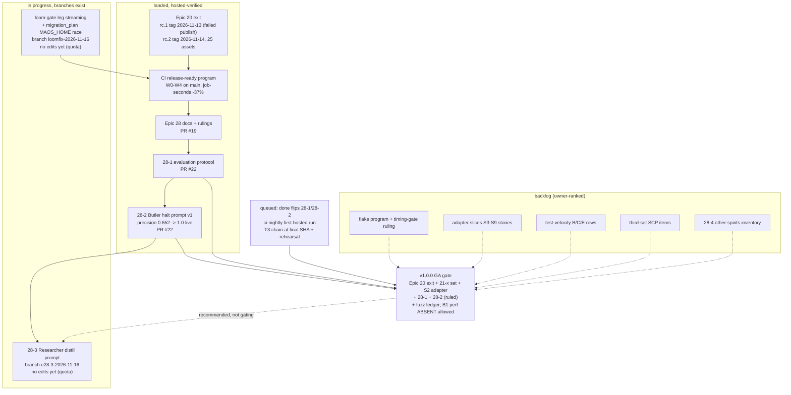

# Session roadmap and handoff — Epic 28 (Spirit quality) and the release-ready CI program

Written 2026-11-16 by the orchestrator, at main `fad08ae0`, for session continuity: this file records
what was done across the sessions of 2026-11-14..2026-11-16, what is half-done right now, and what
remains, in hierarchical stages. Resume order for a new session: read this file top to bottom, then the
files it names in "Resume pointers".

Two live worktrees hold in-progress branches (both clean, both based on `fad08ae0`):

| Worktree | Branch | State |
|---|---|---|
| `/home/lunarpulse/dev_ws-e283` | `e28-3-2026-11-16` | created, `docs-site` npm-ci done, **no code edits yet** |
| `/home/lunarpulse/dev_ws-loomfix` | `loomfix-2026-11-16` | created, `docs-site` npm-ci done, **no code edits yet** |

Both dev dispatches (Dev283, LoomFix, `coder` = anthropic/claude-sonnet-5-5) died at 2026-11-16 on
`429 rate_limit_error` with `retry-after-ms ≈ 3.6e8` (~100 h): the Anthropic quota is exhausted. Neither
agent changed any file (verified: `git status` clean in both trees). Re-dispatch when quota returns; the
full dispatch briefs are preserved verbatim in Stage 3 so nothing must be re-derived.

Canonical facts that keep being needed:

- Remote `lunarpulse/maos`; main = `fad08ae0` (2026-11-16, PR #22 merge, hosted discipline run
  `43823765832` attempt 1: `aggregate` success AND `release-ready` success).
- One cargo process at a time; `CARGO_TARGET_DIR=/mnt/build/cargo-maos-parity`.
- Before every push: `env -u CI -u GITHUB_ACTIONS cargo run -q -p xtask -- prepush` must exit 0.
  The `env -u` is not optional in this host shell: it exports `CI=true`, which alone fails 87 T3 tests
  locally (deferred-work row, Stage 5).
- Push form: `git -c credential.helper= -c 'credential.helper=!gh auth git-credential' push -q https://github.com/lunarpulse/maos/ <ref>:refs/heads/<branch>`.
- A fresh worktree needs `npm ci` in `docs-site/` or prepush `docs:build` fails (`docusaurus: not found`).
- A partial hosted re-run (`gh run rerun --failed`) can NEVER turn `aggregate` green: ledger bindings
  carry the run attempt (observed in run 43775115719; deferred-work row). Land on a new SHA or a full
  re-run only.
- Reports to the operator are in Korean (roadmap format); agent briefs in English.
- Model policy: `task` sonnet-5-5:medium · `coder` sonnet-5-5:high · `reviewer` openai-codex/gpt-6.1-sol ·
  `security-reviewer` zai/glm-5.3 · `light-reviewer` glm-5.3-flash · `review-light` gpt-6.1-terra:high ·
  `story-creator` claude-opus-5-5 · `scribe` claude-haiku-5-5:high. GLM quota was exhausted earlier →
  reviews run on GPT (substitution disclosed to the operator and accepted).

---

## Grand-plan roadmap view

The grand plan is `maos-grand-plan-2026-10-22.md`. Where the program actually stands:

Stage table (each stage is detailed in its section below):

| Stage | Scope | Status |
|---|---|---|
| 1 | Release track: rc.1/rc.2 tags, release pipeline fixes | done |
| 2 | CI release-ready program W0–W4 + flake fixes + Epic 28 docs/rulings | done, on main |
| 3 | Epic 28 implementation: 28-1, 28-2 landed; 28-3 + CI observability fixes | **in progress** |
| 4 | Proof closure: done flips, ci-nightly hosted, T3 chain, rehearsal, GA perf ruling | queued |
| 5 | Backlog: flake program, adapter slices, test-velocity rows, SCP items, 28-4 | backlog |

---

## Stage 1 — Release track (done, sessions of 2026-11-13..14)

- `v1.0.0-rc.1` tagged per ruling 13 (ordinary `git tag`, CI signs); release.yml publish failed on
  "docker cannot overwrite digest"; operator ruled option A (rc.2) plus land-all-first.
- `v1.0.0-rc.2` → `650efcff`, release.yml run `43700484361` success: prerelease, 25 assets
  (12 binaries, .deb/.rpm amd64+arm64, SHA256SUMS + .sig). Binaries verified locally with
  `verify-release.py`; deb/rpm signatures NOT externally verified.
- Known non-blocking: `container.yml` run 43700484370 (rpm tilde-vs-dot name — deferred-work row),
  docs-site Playwright on ubuntu-26.04.
- Rulings file: `decisions-2026-11-14-release-ci.md` (in main).

## Stage 2 — CI release-ready program W0–W4 (done, session of 2026-11-15)

Plan: `ci-release-ready-program-2026-11-14.md` (now carries §8 "Execution record" with everything below).

Landing chain, each with local prepush exit 0 AND hosted `aggregate` success on the exact SHA:

| Wave | PR | Main SHA | Hosted run |
|---|---|---|---|
| W1a | #17 | `9d939d56` | 43742007417 |
| W1b + Epic 28 docs + flake fixes | #19 | `b51d0091` | 43748593387 |
| W2 + W3 | #20 | `9b43ab1b` | 43755858681 |
| W4 | #21 | `6a4bda5c` | 43763468882 |

Content highlights and corrections to the plan (recorded in §8 of the plan doc):

- W1a removed 17 duplicate jobs. `windows-check`, `check-cert-rotation-trigger`, `check-exit-commands`
  STAY in `v1-0-ship-gate.needs` (registry `binding=blocking`; the plan §4 claim they leave was wrong).
- W1b: hermetic `server-exit-drain` (replay cassette; `MAOS_BIN` honors `CARGO_TARGET_DIR`);
  `container.yml` `~`→`.` asset rename; docs-site `retries: 0` + 360 s a11y budget; `mira-nash-bench`
  and `researcher-bench` removed (byte-identical `section_13_1` of `founder-loop-bench`); two orphan
  scripts deleted with their ANSI assertions moved into `maosctl_smoke.sh` / `audit_query_fr4_smoke.sh`.
- W2: 27 xtask gate jobs → `xtask-gates`; 15 smoke jobs → `smoke-suite`; PR comment shows vector
  failures and consolidated-job results.
- W3: `nfr-rel-11`, `expensive-tests`, `reproducible-build`, `determinism-tests`,
  `nfr-perf-1/8/j4-latency`, `clippy-advisory` → `ci-nightly.yml`, one recorded result each.
  `root_shutdown_unload_16_3` and `t3_terminal_helpers_17_7` joined the nextest serial group.
  `example-spirit-ts-tests` stayed (its artifact feeds `wasm-host-tests`).
- W4: `release-ready` fan-in job; `check-release-precondition --kind` (rc → release-ready; GA →
  aggregate AND release-ready; alpha → aggregate); pin file `xtask/release-ready-required.toml`
  (98 jobs + 27 steps); perf behavior unchanged (B1: `--perf-absent-ok` at rc and GA).

Measured hosted effect (job-seconds summed over run jobs):

| Run | Jobs | Job-seconds | Longest job |
|---|---:|---:|---|
| baseline 43571926114 | 199 | 45,244 | workspace-test-suite 31.7 min |
| after W1a+W1b (43748593387) | 177 | 40,819 | — |
| after W2+W3 (43755858681) | 129 | 29,349 | — |
| after W4 (43763468882) | 130 | 28,311 (−37%) | workspace-test-suite 32.4 min |

Critical path did not move (~31–32 min); wall time 59–75 min is runner queueing (up to ~52 min).

Three flakes root-caused and fixed (in PR #17/#19; recorded in deferred-work):

1. `t3_terminal_helpers_17_7` 20-instance teardown: exec-after-write race; now one shared script plus a
   symlink per instance. Cause inferred as ETXTBSY [INFERENCE, no strace]; 0/60 failures after.
2. Boot paths record the admitted manifest in `on_loaded` before `start`
   (fixes cold-swap 409 `cold_swap_predecessor_unknown`).
3. `ac4_root_e_a…` fixture uses `idle_window_ms = 300000`.
   Measured under 10-way stress: old 10/30 red → fixed 90/90 green.

W4 rehearsal: `release.yml` dry-run run 43769873728 on `6a4bda5c`: 5 guards, 3 builds, signing and
deb/rpm steps green; the ONLY red was the expected T3 fuzz-chain leg ("no complete T3 fuzz chain at this
SHA; dispatch fuzz-prerelease before tagging"). No PASS line for `release-ready` was printed — proving
that needs a T3 chain (~26 h) at the final SHA. Nothing was published.

## Stage 2b — Epic 28 foundations (done, same session)

- Epic file + stories 28-1..28-4 + `docs/research/spirit-evaluation-protocol.md` + decisions memo
  `decisions-2026-11-15-spirit-quality.md` landed in PR #19. All D-rows ruled by the operator:
  D-28-3-01 = B (28-3 is GA-recommended, not a precondition), D-28-1-03 = A (floor = max(spec minimum,
  Wilson lower bound rounded down)), D-28-1-02 = k=5 repeats, all others accepted as recommended.
- Butler live baseline pre-work (worktrees `dev_ws-e28`, `dev_ws-e282`): reference model pinned
  `claude-haiku-5-5` (sweep landed earlier with Haiku 5.5 model currency).

## Stage 3 — Epic 28 implementation (28-1, 28-2 LANDED; 28-3 + CI observability IN PROGRESS)

### 3.1 Story 28-1 — Spirit evaluation protocol (LANDED in PR #22)

- Per-row verdicts, `HaltScore.format_errors`, `FloorRecord` validation in
  `crates/maos-eval/src/halt_replay.rs` (NaN/range/inversion refused; strict round-down, no epsilon),
  `crates/maos-bench/src/halt_eval.rs`, `xtask/src/eval_report.rs` (new `eval-report` command),
  `journey-nightly.yml` `repeats` input, protocol doc.
- Two GPT review rounds (7 defects fixed), verdict ship. 70 tests; kloc: xtask raised
  46372 → 46744 with a `# RAISED` line (driver `eval_report.rs`, 736 tokei code lines + 7 wiring);
  the 21 KB history comment on the row was preserved byte-for-byte (verified by word-diff).
- Hosted proof of the k-repeat dispatch = the 28-2 live run (below).
- Story status `review` (flip to `done` pending — Stage 4).

### 3.2 Story 28-2 — Butler halt proposal prompt v1 (LANDED in PR #22)

- `spirits/butler/prompts/proposal-v1.txt` + train split; regenerated seed fixtures; corpus re-pin
  `d4b7b0f1…`; frozen 28-1 fixture root `xtask/tests/fixtures/eval-report/root/`; T5: promoted live
  cassette `crates/maos-journey-test/cassettes/j-butler/halt-corpus-v0.3.json`, new
  `spirits/butler/eval/floors.toml`, `halt_live_baseline_28_2.rs`, controls planted into the promoted
  cassette, `eval_halt_18_2.rs` updated.
- Paid live dispatch (journey-nightly run 43770006257, `rerecord=true`, `repeats=5`, haiku-5-5):
  **halt precision 1.0 (15/15, Wilson [0.796, 1.0]), recall 1.0, 0 format errors, flip rate 0, 0 FP**;
  tokens 352,795 in / 17,063 out; $0.0438. Floors stay at spec minimums 0.90/0.90/0.85 (Wilson lower
  bound below them). Root cause of the old 0.652: undefined default → model answered 0.5 for "no
  preference info" → manifest read it as <0.6 → halt; v1 defines the default.
- Verification: butler/eval/bench 224 tests; maos-bin eval 40 tests;
  `MAOS_INFERENCE_MODE=replay maos eval halt --class butler` exit 0 (provenance live-record, 30
  consumed, no missed floors). GPT review (Review282): ship.
- Honest limits (also in deferred-work): n=15 halts; examples cover the same boundary families as the
  tests; one model; post-tuning on the same corpus; replay does not authenticate live provenance;
  no Haiku 4.5 baseline. "Passes its calibrated floor" ≠ bounds above floors.
- Story status `review` (flip to `done` pending — Stage 4).

### 3.3 The landing of PR #22 itself (worth remembering: two hosted incidents)

1. First prepush on the rebased tree was red twice:
   - `kloc-check`: xtask 46,744 > ceiling 46,372 → fixed by the RAISED line above.
   - `workspace-nextest` 3 failures (`side_row_failure…`, `journey_binary_freshness…`,
     `configured_prebuilt_fixture…`). Isolated rerun 3/3 pass; CI-unset full nextest 6286/6286 pass.
     Cause NOT identified; suspicion only: the orchestrator killed a mid-prepush background job and its
     cargo/nextest children may have overlapped the next run on the shared target dir [INFERENCE].
   - A separate 87-failure run was self-inflicted: this shell exports `CI=true` (row recorded).
2. Hosted run 43775115719 attempt 1: `check-multi-tenant-loom` TIMED OUT at its 1500 s gate bound
   (CPU 14 min of 25 min wall; memory peak 8.0 GB; nothing in the log names the stalled leg — the gate
   is silent until it ends). Same step historically 510 s; whole job 685–922 s in 4 earlier runs. The
   PR touches no loom/kernel/gate code. Operator ruled option A: ONE diagnostic re-run of the failed
   job → attempt 2 passed the loom gate (11m49s) but `check-ship-gate-completeness` then refused all
   attempt-1 ledgers (binding carries the run attempt) → structurally un-greenable. Resolution: a fresh
   run on a new SHA `fad08ae0` (run 43823765832, attempt 1, `aggregate` + `release-ready` success),
   main fast-forwarded, branches `land-e28-2026-11-15` and `e28-2-2026-11-15` deleted.
   Net: 1 timeout in 6 hosted runs, unreproduced, NOT root-caused, NOT claimed fixed.

### 3.4 IN PROGRESS — story 28-3 Researcher distill prompt (branch `e28-3-2026-11-16`)

Story file: `28-3-researcher-distill-prompt.md` (read it; D-28-3-01..05 all RULED/ACCEPTED).
State: **no code written yet** — the Dev283 dispatch died on Anthropic 429 before any edit.
What exists from the 2026-11-15 live measurement (run 43708370483, sonnet-5-5, k=1): recall 1.0,
faithfulness 1.0, traceability 1.0, leakage 0.0, **hedge_preservation 17/18 = 0.944** vs floor 0.95
(Wilson [0.742, 0.990]); the one miss is `rd05-c1` ("seem to" → "appear to", a synonym the whole-word
metric rightly refuses); 11/29 completions carried meta-text. Live artifacts (local only):
`/home/lunarpulse/maos-evidence-archive/2026-11-15/live-rerecord-run-43708370483-cassettes/j-researcher/distill-corpus-v0.live{.json,.verdicts.json}`.

Work plan (T-numbering = story tasks):

- T0 done (rulings recorded; 28-1 landed).
- T1/AC3: `spirits/researcher/prompts/synthesis-v1.txt` (ROLE / OBJECTIVE / RULES: copy each listed
  hedge verbatim, add no fact, no meta-text / OUTPUT SCHEMA: strict one-object JSON `{"finding": string}`
  per D-28-3-04 C / EXAMPLES from the train file only / INPUT: statement + hedge list);
  `SYNTHESIS_PROMPT_VERSION`; `synthesis_prompt` renders the file byte-identically; pass the claim's
  `hedges` (lib.rs ~263-265); malformed completion → format error surfaced to the scorer (Butler
  pattern); `summarize` still bounds text.
- AC4: `spirits/researcher/tests/fixtures/distill-corpus-v0.train.jsonl`, hand-authored, provenance
  header, synonym traps, disjoint from rd01–rd16.
- T2: format-error count in the distill score (`distill_replay.rs`); distill floors through the 28-1
  `FloorRecord` (floor = max(spec minimum, Wilson lower bound); NFR-Aud-7 minimums recall 0.90 /
  faithfulness 0.98 / hedge 0.95 / traceability 1.0 / leakage 0.0 are never lowered);
  judge-only repeat mode D-28-3-03 A in `distill_eval.rs` (replay one recorded survey, live judge k
  times on the same findings; per-finding agreement + faithfulness mean/min).
- T3: hermetic dry run on a hand-planted v1 cassette (controls must still be detected);
  fixture regeneration via the generator-test pattern (Butler `halt_eval_corpus_18_2.rs`), NOT by
  hand-rewriting cassette hashes.
- T4: paid dispatch `include_researcher=true`, k=5 (D-28-1-02) + judge-only repeat; archive under
  `/home/lunarpulse/maos-evidence-archive/`; summarise in the story.
- T5: calibrate floors from the measurement; promote the median live run to
  `crates/maos-journey-test/cassettes/j-researcher/distill-corpus-v0.json` (D-28-3-05 A); re-pin corpus
  frozen surveys/verdicts + `tests/corpora/MANIFEST.toml:168`; `distill_live_baseline_28_3.rs`;
  `eval_distill_18_3.rs` follows the promoted figures; close the Researcher half of the
  `ops-nightly-cassette-rerecord` deferred-work row.
- T6: fmt, kernel baseline (expect unchanged), kloc (`maos-bench` forecast +25..+55 — a `# RAISED`
  line is likely; maos-bench measured 2775/ceiling 2875 shared with 28-1), prepush, PR, hosted, ff.
- Judge prompt `JUDGE_PROMPT` and `tests/judge-config.toml` must NOT change (would re-record every
  verdict).

The preserved Dev283 dispatch brief (paste back to the coder when quota returns) is in
`local://dev283-brief.md` beside this file; the LoomFix brief likewise in `local://loomfix-brief.md`.

### 3.5 IN PROGRESS — loom-gate leg streaming + migration_plan unit-test race (branch `loomfix-2026-11-16`)

State: **no code written yet** (LoomFix dispatch died on the same 429). Both deferred-work rows are at
the end of `deferred-work.md`. Scope:

1. `check-multi-tenant-loom` must stream `LEG start <name>` / `LEG end <name> <secs>s <verdict>` to
   STDERR from `run_exact_test_leg` (stdout `--json` contract untouched), and
   `scripts/run_cgroup_ceiling_17_2.py` must forward child stderr unbuffered. Keep xtask growth
   minimal (xtask is at zero headroom, ceiling 46744 — another `# RAISED` line if needed).
2. `migration_plan::tests::{persisted_plan_file_drift_is_refused_after_a_candidate_mutates_on_disk,
   plan_is_atomically_persisted_under_maos_home_and_round_trips}` fail 2/2 locally under libtest
   (panic `migration_plan.rs:408` "plan file exists") but hosted main passes 4/4 — fix the in-process
   MAOS_HOME race (serialize behind the existing lock from `cross_team_consent_13_3.rs:497` or per-test
   roots) without weakening any assertion, and find why hosted passes.

### 3.6 Landing order for Stage 3 remainder

1. Re-dispatch Dev283 (worktree `dev_ws-e283`) and LoomFix (worktree `dev_ws-loomfix`) — can run in
   parallel; different trees; orchestrator runs all cargo (one process at a time).
2. Verify each tree: targeted tests → fmt → kloc/kernel (RAISED lines as measured) → full prepush.
3. Land loomfix first (smaller, unblocks observability for everything after), then 28-3 code, then the
   28-3 paid dispatch (T4) and promotion (T5) as a second 28-3 landing.
4. Fold the Stage-4 done-flips into whichever PR lands last.

## Stage 4 — Proof closure (queued, no branch yet)

1. Flip 28-1 and 28-2 story files + `sprint-status.yaml` rows to `done` citing hosted run
   `43823765832` @ `fad08ae0` (a docs-only change still costs one hosted run — fold into a later PR).
2. Dispatch `ci-nightly.yml` once on main (never yet run hosted); check the recorded results and the
   `nightly-result-*` artifacts.
3. Re-own the two recurring flakes (D-E20-2) and the GA perf ABSENT wording (D-E20-10) — both need the
   operator's B1-vs-11-14-memo conflict resolved first (open operator question below).
4. T3 fuzz chain (~26 h, operator-initiated `fuzz-prerelease` dispatch) at the final pre-GA SHA, then
   a `release.yml` dry-run rehearsal to finally SEE `release-ready` PASS; then tag per ruling 13.
5. GA preconditions (as ruled): Epic 20 exit green + 21-3(AC1) + 21-6 + 21-7 + 21-9 + 21-10 + 21-12 +
   registry-quarantine-closure + adapter S2 + 28-1 + 28-2 + fuzz ledger; B1 allows perf ABSENT at GA.
   28-3 recommended, not gating.

Open operator questions (ask once, batched): GA perf wording conflict (B1 vs 11-14 memo) · CODEOWNERS
owner (needs a real handle) · `macos-latest` pinning · `example-spirit-ts-tests` decoupling ·
timing-gate policy ("paired delta blocking / absolute p95 advisory") · worktree pruning
(`dev_ws-w1b`..`dev_ws-w4`, `dev_ws-e28`, `dev_ws-e282` after Stage 3 lands).

## Stage 5 — Backlog (owner-ranked, unchanged from the tracker)

- Flake program (post rc.2): ClassifyFlakes A–E report; gate policy needs the operator ruling above;
  ledger nonce (run_id + producer attempt) + flake ledger; "rerun for green" ambiguity row 1156.
- Adapter slices S3–S9 story creation (rev 7 design is story-ready) after the third-set SCP items.
- Test-velocity rows B (retro D-rows 20-15/20-16, R3 budgets advisory, two-tier substrate tests),
  C (xtask artifact, rust-cache shared key + save-if main, cargo-deny off push path), E (prune
  `/mnt/build/cargo-maos-parity` when cargo idle).
- Third-set SCP items B1–B8 (GA set + sections, real-model leg, new GA story, wording, process diet,
  measures + required aggregate check).
- 28-4 other-spirits inventory (orchestrator, hello-spirit, observer, mira, nash, architect, reviewer,
  worker + digest) under the 28-1 method; must be re-created with ACs before leaving backlog.
- Deferred-work rows owned by `ops-ci-release-ready`: rc user-facing `~` vs `.` fix;
  `example-spirit-ts-tests` decoupling decision; `nfr-rel-11` + `expensive-tests` re-promotion before
  GA (10 consecutive green nightlies); the four rows added 2026-11-16 (loom timeout, partial-rerun
  binding, migration_plan race, `CI=true` pitfall).
- Operator-owned untracked paths in the stale main checkout (never touch): `spikes/gpui-operator-shell/`,
  `planning-artifacts/*gpui*`, `sprint-change-proposal-2026-11-11.md`.

## Verification gaps (do not silently promote any of these to "verified")

`release-ready` end-to-end PASS at a real tag (needs the T3 chain) · `ci-nightly.yml` hosted ·
`container.yml` rename and docs-site `retries: 0` on a tag/push · deb/rpm signatures external check ·
ETXTBSY cause [INFERENCE] · loom timeout cause unknown (1/6 runs) · Butler limits (n=15 halts, same
boundary families, one model, post-tuning same corpus, no Haiku 4.5 baseline) · Researcher half open ·
migration_plan hosted-vs-local difference unexplained · first-prepush 3 nextest failures unexplained.

## Disclosures (keep repeating to the operator)

GLM→GPT review substitution · agent relative-path slips into `dev_ws` (all reverted/rejected) ·
coder once rewrote two fixture JSONL data files with Python · evidence lives only in
`/home/lunarpulse/maos-evidence-archive/` and `/tmp` (no backup) · orchestrator once ran two cargo
processes (drain script + prepush; serialized by cargo's lock) · the W1b prepush rerun after `npm ci`
was an environment prerequisite, not a retry · this session: a `CI=true`-poisoned 87-failure local run,
and one operator-approved diagnostic re-run of a hosted job (recorded, not hidden).

## Resume pointers

1. This file, then `28-3-researcher-distill-prompt.md`, then the tail of `deferred-work.md`.
2. Briefs for the interrupted dispatches: `local://dev283-brief.md`, `local://loomfix-brief.md`.
3. CI program state: `ci-release-ready-program-2026-11-14.md` §8; rulings `decisions-2026-11-14-release-ci.md`,
   `decisions-2026-11-15-spirit-quality.md`.
4. Live evidence: `/home/lunarpulse/maos-evidence-archive/2026-11-15/` (`live-282-run1/`, the Researcher
   run above); job logs under `/tmp` are volatile.
