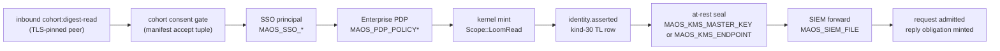

# ENT-1 — Enterprise-governed `cohort-a2a-daemon` posture

**Applies to:** v2.2 and later, `network`-feature builds only.
**Decision record:** [ADR-057](../adr/ADR-057-enterprise-governance-is-a-daemon-posture.md).
**Gate:** `check-multi-tenant-loom` legs `enterprise-governance-reaches-cohort-daemon`, `enterprise-governance-daemon-dead-wire-negative`, `enterprise-governance-daemon-dispatch-threaded` (blocking at v2.2).

There is no enterprise Spirit. The "enterprise-governed Spirit class" is a **posture you instantiate on the collective daemon**, and it attaches to a reference Spirit you already run. This runbook is the template.

---

## 1. What the posture does

With the posture attached, every collective operation the `cohort-a2a-daemon` serves — a cross-team cohort digest read — runs the full chain before it is admitted:



Any refusal in **SSO / PDP / mint / at-rest** turns the pending ACK into a NACK: no grant, no reply obligation, no cohort audit row. A SIEM sink failure is reported to the operator and the record stays buffered in the Transparency Log — it does not refuse the read (the record is already durable; see §6).

Without the posture the daemon serves those same reads with none of it. That was the state of every release before v2.2.

---

## 2. The four environment groups

Set as many groups as your deployment governs. Setting **none** leaves the daemon byte-for-byte in its pre-v2.2 behaviour, and the daemon says so on stderr at boot.

### SSO — who is asking

| Variable | Required | Meaning |
|---|---|---|
| `MAOS_SSO_JWKS` | yes | static JWKS document (JSON) for signature verification |
| `MAOS_SSO_ISSUERS` | yes | comma-separated trusted `iss` values |
| `MAOS_SSO_AUDIENCE` | yes | expected `aud` |
| `MAOS_SSO_ALGS` | no | allowed algorithms; default `RS256,ES256` |
| `MAOS_SSO_ASSERTION` | yes | the OIDC assertion the daemon presents at issuance |

Any `MAOS_SSO_*` variable being present turns the SSO arm on. If the verifier then cannot be built or is unhealthy, the subsystem is demoted to *configured-down* and **denies** issuance — it never falls open.

### PDP — may they

| Variable | Required | Meaning |
|---|---|---|
| `MAOS_PDP_POLICY_FILE` | one of | path to a Cedar policy set |
| `MAOS_PDP_POLICY_INLINE` | one of | inline Cedar policy text |
| `MAOS_PDP_REFRESH_INTERVAL_MS` | no | reconciler cadence, default 30 000 |
| `MAOS_PDP_STALENESS_TTL_MS` | no | fail-closed TTL, default 300 000 |

The daemon evaluates one issuance per collective operation with the authenticated principal's attributes (`sub`, `iss`, `aud`, plus any claim attributes) as PDP request attributes.

### At-rest — sealed

| Variable | Required | Meaning |
|---|---|---|
| `MAOS_KMS_MASTER_KEY` | yes, unless `MAOS_KMS_ENDPOINT` | hex-encoded 32-byte org master key (dev/CI custody; absent, malformed or all-zero refuses the boot) |

The daemon takes its sealer from the *same* hook the collective store uses. Unset ⇒ the governed record is byte-identical plaintext (the v1.5 default). Set-but-unhealthy ⇒ the read is refused; a sealed posture never degrades to plaintext. An invalid KMS configuration refuses the boot (exit 78). An external endpoint that is down at boot does not refuse the boot: sealed writes are refused until a probe succeeds. Sealed Collective rows are write-only until a reader exists (`RELEASE-HOLDS.md` row 23-8.a). **Identity assertions in the Transparency Log are not sealed by this story:** the `identity.asserted` row is plain JSON.

Instead of the local key, an operator who runs a KMS or HSM sets `MAOS_KMS_ENDPOINT` to a `maos.kms.v1` sidecar (wire: `docs/reference/kms-wire-v1.md`; reference sidecar for OpenBao Transit: `examples/kms-sidecar-openbao/`, not a release artifact, not security-reviewed):

| Variable | Required | Meaning |
|---|---|---|
| `MAOS_KMS_ENDPOINT` | instead of `MAOS_KMS_MASTER_KEY` | base URL of the sidecar: `https`, or `http` only to a literal loopback address. Setting both variables refuses the boot. Needs the default (`online-adapters`) build |
| `MAOS_KMS_BEARER` | no | bearer sent on wrap and unwrap to that endpoint; read through the credential store (the environment under `MAOS_SECRETS_BACKEND=encrypted-file`); never logged. While it is pending or unreadable every call is refused and the boot says so |
| `MAOS_KMS_ALLOW_PRIVATE` | no | `1` admits private (RFC 1918 / fc00::/7) **and loopback** addresses for the endpoint, including a name that resolves to them (the connection resolves the name again, so it can move between them); link-local and reserved never |

The endpoint is vetted once at boot. A host **name** is not SSRF-protected (the connection is not bound to the vetted addresses, `RELEASE-HOLDS.md` row 23-8.c): prefer a literal address. Three deployment conditions:

- **Loopback `http` does not authenticate the listener** (row 23-8.b). MAOS sends the data key (base64) and the bearer to whatever process listens on that port; if the sidecar is down another local user can bind the port, answer `/health`, collect data keys and the bearer, and replay the bearer to the real sidecar. Run the sidecar on a privileged or otherwise unclaimable port, or under the same OS user with the port bound before MAOS starts, or put TLS in front and use `https`. A Unix-domain-socket owner check is not implemented.
- **No private-CA `https`** (row 23-8.g): the transport trusts the bundled webpki roots only. Use a loopback sidecar or a publicly-trusted certificate; a CA-bundle setting is a follow-up decision.
- **Timeouts hold for a literal IP only** (row 23-8.d): 5 s per wrap/unwrap and 2 s per probe. For a host name the DNS lookup is not bounded, so a call can block longer; writes are still refused once health goes stale (30 s).

### SIEM — exported

| Variable | Required | Meaning |
|---|---|---|
| `MAOS_SIEM_FILE` | one of the two sinks | localhost sink path for the redacted NDJSON/CEF projection; resumes from a durable cursor |
| `MAOS_SIEM_ENDPOINT` | one of the two sinks | `host:port` (IPv6 in brackets, port default 6514) of a syslog-over-TLS (RFC 5425) collector; TLS only, one TLS connection per batch, acknowledged by the collector's `close_notify`; needs `MAOS_SIEM_CA_FILE` and an `online-adapters` build; with `MAOS_SIEM_FILE` it refuses the boot (`siem_config_conflict`) |
| `MAOS_SIEM_CA_FILE` | with the endpoint | PEM CA bundle the collector must chain to (the only trust anchors) |
| `MAOS_SIEM_CLIENT_CERT_FILE` / `MAOS_SIEM_CLIENT_KEY` | both or neither | mutual TLS: the certificate chain, and its PEM private key read through the credential store (`siem-client-key`; never logged, removed by `maos purge`) |
| `MAOS_SIEM_ALLOW_PRIVATE` | no | `1` or `true` admits private and loopback collector addresses; link-local and reserved are always refused |

---

## 3. The daemon attach pattern

The posture binds to the `control_spirit` already named in your daemon TOML. That Spirit's manifest must declare the collective read grant, because the kernel mints `Scope::LoomRead` only for a Spirit whose manifest declared it:

```toml
# spirits/<control_spirit>/manifest.toml
[capabilities.required.loom]
read = true
```

The composition root admits that Spirit through the ordinary admission path at daemon start. Nothing seeds the policy table by hand.

Boot output tells you exactly which posture you got:

```
maos: cohort-a2a-daemon collective reads are ENTERPRISE-GOVERNED (Story 13.5a) —
      control spirit researcher pid 0, sso=true, pdp=true, at-rest-seal=true, siem=true
```

or, if no group is set:

```
maos: cohort-a2a-daemon collective reads are UNGOVERNED — set
      MAOS_SSO_*/MAOS_KMS_*/MAOS_SIEM_* (and MAOS_PDP_POLICY*) to attach the
      enterprise daemon posture (Story 13.5a)
```

**Read that line on every deploy.** It is the difference between governed and silently ungoverned.

---

## 4. Worked example — governing `researcher` under the collective daemon

`researcher` is an existing reference Spirit; its manifest already declares `loom.read`. No new crate, no scaffold, no `maos-spirit-cli` generation step is needed — the posture attaches to what you run today. (When you *do* need a fresh Spirit for other reasons, the real scaffold is `maos-spirit-derive`'s `#[spirit]` + `maos-spirit-sdk` / `spirit_test`, with `examples/example-spirit` and `cargo run -p xtask -- example-spirit-regen` as the living template — not ADR-008, which is the registry publish/discover protocol.)

`daemon.toml`:

```toml
manifest_path   = '/etc/maos/cohort-manifest.toml'
authority_keys  = ['<hex ed25519 authority pubkey>']
local_host      = 'host-a'
control_spirit  = 'researcher'
peers           = [ ... ]

[tcp]
listen_addr     = '0.0.0.0:8443'
own_cert_chain  = '/etc/maos/tls/host-a.chain.pem'
own_private_key = '/etc/maos/tls/host-a.key.pem'
peer_pins       = [ ... ]

[digest_summary]
frames    = 0
halts     = 0
conflicts = 0
```

Launch:

```sh
export MAOS_SSO_JWKS="$(cat /etc/maos/idp-jwks.json)"
export MAOS_SSO_ISSUERS='https://idp.example.com'
export MAOS_SSO_AUDIENCE='maos-cohort-daemon'
export MAOS_SSO_ASSERTION="$(cat /run/secrets/daemon-oidc-assertion)"

export MAOS_PDP_POLICY_FILE=/etc/maos/policy.cedar

export MAOS_KMS_MASTER_KEY="$(cat /run/secrets/org-master-key.hex)"

# Either a local file sink ...
export MAOS_SIEM_FILE=/var/log/maos/siem.ndjson
# ... or a syslog-over-TLS collector (one sink per Host; online-adapters build):
# export MAOS_SIEM_ENDPOINT=siem.example.com:6514
# export MAOS_SIEM_CA_FILE=/etc/maos/siem-ca.pem
# export MAOS_SIEM_CLIENT_CERT_FILE=/etc/maos/siem-client.pem   # optional mutual TLS
# export MAOS_SIEM_CLIENT_KEY="$(cat /run/secrets/siem-client-key.pem)"

export MAOS_COHORT_DAEMON_CONFIG=/etc/maos/daemon.toml
export MAOS_ONE_SHOT=cohort-a2a-daemon
maos
```

Verify a governed read afterwards:

```sh
# the provenance row for the principal that authorized the read
maosctl audit query --kind identity.asserted

# the sealed governed-collective-read record, correlated to the digest request_id
maosctl audit query --intent-contains cohort:digest-read-governed
```

---

## 5. Failure modes and what they mean

| Symptom | Cause | Action |
|---|---|---|
| Boot log says **UNGOVERNED** | no enterprise env group set, or `MAOS_COHORT_DAEMON_CONFIG` absent | set the groups; re-deploy |
| Boot fails: `control Spirit manifest ... is unreadable` | `control_spirit` has no `spirits/<id>/manifest.toml` under the process CWD | run `maos` from the workspace/install root, or fix `control_spirit` |
| Every collective read NACKs with `kernel capability mediation failed` | control Spirit does not declare `[capabilities.required.loom] read = true` | add the grant, re-admit |
| Every collective read NACKs with `enterprise SSO is configured but MAOS_SSO_ASSERTION is absent` | SSO group set without an assertion | supply `MAOS_SSO_ASSERTION` |
| Every collective read NACKs with `enterprise PDP denied capability issuance for loom.read` | a Cedar `forbid` fires for the control-Spirit subject | fix the policy, or accept the deny |
| Every collective read NACKs with `at-rest seal refused` | the KMS is unhealthy: with `MAOS_KMS_ENDPOINT`, the sidecar or its KMS is down, answered 5xx or something other than `maos.kms.v1`, or no probe succeeded in the last 30 s; with `MAOS_KMS_MASTER_KEY`, the key is unusable | repair the KMS or the sidecar; sealing resumes at the next successful probe (every 10 s). The daemon will not write plaintext under a sealed posture |
| Boot exits 78 with `kms_config_conflict`, `kms_config_incomplete`, `kms_master_key_invalid`, `kms_endpoint_refused` or `kms_endpoint_unsupported_build` | `MAOS_KMS_ENDPOINT` and `MAOS_KMS_MASTER_KEY` both set; a `MAOS_KMS_*` variable with neither; a master key that is not 64 hex characters or is all zero; an endpoint that is `http` to a non-loopback host, a private/link-local address without `MAOS_KMS_ALLOW_PRIVATE`, or carries userinfo/query/fragment; the endpoint in a build without `online-adapters` | fix the variables named in the message (no value is printed); an endpoint that is merely unreachable is not a boot refusal |
| `SIEM export not acknowledged (<code>) — N record(s) remain` | the sink did not acknowledge a batch; the cursor stayed. Codes: `siem_sink_connect_failed` (nothing listens or the route is down), `siem_sink_timeout` (a bounded wait expired), `siem_sink_tls_refused` (the collector's certificate does not chain to `MAOS_SIEM_CA_FILE` or does not name the endpoint host, or it refused our client certificate), `siem_sink_no_close_notify` (the collector read the batch but did not answer our `close_notify`, RFC 5425 §4.4, or its close was already readable before ours), `siem_sink_drain_exhausted` (the collector kept sending post-handshake records until the pre-close look gave up, so an earlier close cannot be ruled out: the batch is re-sent), `siem_sink_io`, `outbound_*` (the endpoint's host class is refused: set `MAOS_SIEM_ALLOW_PRIVATE=1` for a private collector), `siem_sink_file_io` (the file sink cannot be written), `siem_file_tail_unrecoverable` (a failed append left a partial line the service may not cut back: restore write permission on the file; nothing is appended meanwhile), `siem_source_unavailable` (the log or a registered segment file cannot be read), `siem_client_key_pending`, `siem_cursor_io`, `siem_journal_failed` (N is "an unknown number of" when the log could not be counted) | repair the collector, route or file sink named by the code; reads keep flowing, the rows stay in the Transparency Log and are delivered once the sink answers. One line is printed per distinct reason |
| Boot exits 78 with `siem_config_conflict`, `siem_endpoint_unsupported_build`, `siem_endpoint_refused`, `siem_ca_missing`, `siem_ca_invalid`, `siem_client_incomplete`, `siem_client_cert_invalid` or `siem_client_key_invalid` | `MAOS_SIEM_ENDPOINT` and `MAOS_SIEM_FILE` both set; the endpoint in a build without `online-adapters`; an endpoint that is not `host:port` or whose host class the policy refuses; no `MAOS_SIEM_CA_FILE`, or one that holds no PEM certificate; `MAOS_SIEM_CLIENT_KEY` without `MAOS_SIEM_CLIENT_CERT_FILE`; a client certificate whose key is missing, unparsable or not its key | fix the variables named in the message (no value is printed); an endpoint that is merely unreachable is not a boot refusal |

---

## 6. Known limitations (v2.2)

- **Live-WAL SIEM export reads the live log in bounded batches (no snapshot copy).** `maos-audit::query_with_redaction` still requires a quiesced database. The SIEM export therefore reads each batch (at most 512 rows / 1 MiB) through one short read transaction on a normal read-only connection to the live file (plus the quiesced sealed segments) and ENDS that transaction before it touches the sink, so a stalled collector never pins a WAL read mark (which would stall a rotation checkpoint and the audit writer behind it) and no copy of the log is made on the audit filesystem. A tick with nothing after the cursor costs one `max(rowid)` lookup. A leftover `*.siem-snapshot-*` file from an older build is removed at boot.
- **The SIEM cursor is durable, and delivery is at-least-once (Story 23-4).** The export keeps `siem-cursor.json` beside the audit database (the insertion id and `frame_id` of the last acknowledged row, plus a hash of the sink). A restart resumes after it: nothing acknowledged is re-sent and nothing is lost. A batch is re-sent only when its acknowledgement did not arrive (a crash before the cursor write, or a collector that did not answer our `close_notify`); a re-send carries the same CEF `externalId`, so deduplicate on it. A reset (first enable on an existing log, a changed sink, an unreadable cursor, a restored log) re-sends every retained row and journals a `siem.cursor.reset` row; the old file is kept as `siem-cursor.json.corrupt-<ns>`. If segment expiry removed rows the SIEM had not received, one `siem.gap` row says which ids (RELEASE-HOLDS 23-4.d). "Acknowledged" means the collector read the batch, not that it stored it (23-4.c).
- **PDP subject granularity is per-posture.** The daemon governs under one control-Spirit pid, so a Cedar subject-deny binds to the daemon, not to an individual tenant Spirit.
- **Air-gap builds cannot take this posture.** `maos-sso`, `maos-secrets`, and `maos-siem` are optional dependencies behind the `network` feature and are compiled out of `air-gap` builds. `maos-pdp` is non-optional, so PDP mediation remains available there; SSO, at-rest seal, and SIEM do not.
