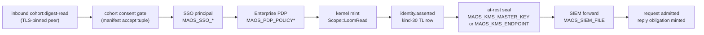

# ENT-1 — Enterprise-governed `cohort-a2a-daemon` posture

**Applies to:** v2.2 and later, `network`-feature builds only.
**Decision record:** [ADR-057](../adr/ADR-057-enterprise-governance-is-a-daemon-posture.md).
**Gate:** `check-multi-tenant-loom` legs `enterprise-governance-reaches-cohort-daemon`, `enterprise-governance-daemon-dead-wire-negative`, `enterprise-governance-daemon-dispatch-threaded` (blocking at v2.2).

There is no enterprise Spirit. The "enterprise-governed Spirit class" is a **posture you instantiate on the collective daemon**, and it attaches to a reference Spirit you already run. This runbook is the template.

---

## 1. What the posture does

With the posture attached, every collective operation the `cohort-a2a-daemon` serves — a cross-team cohort digest read — runs the full chain before it is admitted:



Any refusal in **SSO / PDP / mint / at-rest** turns the pending ACK into a NACK: no grant, no reply obligation, no cohort audit row. A SIEM sink failure is reported to the operator and the record stays buffered in the Transparency Log — it does not refuse the read (the record is already durable; see §6).

Without the posture the daemon serves those same reads with none of it. That was the state of every release before v2.2.

---

## 2. The four environment groups

Set as many groups as your deployment governs. Setting **none** leaves the daemon byte-for-byte in its pre-v2.2 behaviour, and the daemon says so on stderr at boot.

### SSO — who is asking

| Variable | Required | Meaning |
|---|---|---|
| `MAOS_SSO_JWKS` | yes, unless `MAOS_SSO_DISCOVERY_ISSUER` | static JWKS document (JSON) for signature verification (the air-gap key source; works with no network) |
| `MAOS_SSO_DISCOVERY_ISSUER` | no | OIDC issuer URL (https, no userinfo, query or fragment) whose discovery document and rotating keys the verifier follows instead of `MAOS_SSO_JWKS`. `MAOS_SSO_ISSUERS` must hold **exactly this one issuer** (one issuer per Host; a second entry is `sso_discovery_issuers_not_exclusive`). Setting it together with `MAOS_SSO_JWKS` leaves SSO configured-down. Needs the `online-adapters` build and a public https issuer (Story 23-2) |
| `MAOS_SSO_JWKS_TTL_SECS` | no | seconds a discovered key set is trusted; default 3600 (1…604800). Only with `MAOS_SSO_DISCOVERY_ISSUER`. Past it, assertions fail closed until a refresh succeeds. The TTL starts when a fetch completes. **Revocation window, in terms of the last published set that contains the key:** a successful refresh revokes a key only when the set it publishes omits it. A fetch can obtain a set containing the key, the issuer can then withdraw it, and that in-flight fetch still completes and renews the key's TTL; the key verifies until the first successful refresh that returns a set without it, and never past the TTL counted from the completion of the last successful fetch whose set contained it (at most 7 days at the maximum TTL, in monotonic time, plus any time the host is suspended, in wall time). Half the TTL plus the idle tick is a scheduling target, not a completion bound: it needs a refresh to start and succeed and `MAOS_SSO_JWKS_MIN_REFRESH_SECS` at most TTL/2; when the minimum equals the TTL the idle-only path can expire the keys (fail closed) before the next fetch completes. An attacker who can block the fetch (without breaking TLS) can keep a withdrawn key valid for the full TTL. A valid but empty key set retires the keys at once; a malformed one keeps them |
| `MAOS_SSO_JWKS_MIN_REFRESH_SECS` | no | minimum seconds between two refresh attempts (measured from when the previous fetch actually began, millisecond resolution); default 30, at most the TTL. Only with `MAOS_SSO_DISCOVERY_ISSUER`. There is no knob for the 30 s fetch bound described below |
| `MAOS_SSO_ISSUERS` | yes | comma-separated trusted `iss` values |
| `MAOS_SSO_AUDIENCE` | yes | expected `aud` |
| `MAOS_SSO_ALGS` | no | allowed algorithms; default `RS256,ES256` |
| `MAOS_SSO_ASSERTION` | yes | the OIDC assertion the daemon presents at issuance; a directed task that carries its own (`maosctl ask --assertion-file`) overrides it for that task's turn |

Any `MAOS_SSO_*` variable being present turns the SSO arm on. If the verifier then cannot be built or is unhealthy, the subsystem is demoted to *configured-down* and **denies** issuance — it never falls open. Configured-down with a typed reason (printed once at boot as `maos: SSO is configured but down: <reason>`, and appended to every denial): both key sources set (`sso_key_sources_exclusive`), a tuning knob without `MAOS_SSO_DISCOVERY_ISSUER` (`sso_tuning_without_discovery`), an unusable knob (`sso_tuning_invalid: <name>`), a discovery issuer that is not https or is not the only entry of `MAOS_SSO_ISSUERS` (`sso_discovery_issuer_not_https`, `sso_discovery_issuer_invalid`, `sso_discovery_issuer_not_trusted`, `sso_discovery_issuers_not_exclusive`), a `MAOS_SSO_*` variable whose value is not valid UTF-8 (`sso_env_not_unicode: <NAME>`; the name, never the value, is printed, and the variable is never read as absent), and a build without `online-adapters` (`sso_discovery_needs_online_adapters`).

**Discovery mode.** An issuer that is unreachable at boot does **not** demote SSO: the Host stays up, issuance is denied (`identity provider is unavailable`) until the first key fetch succeeds, and the refresher retries by itself every minimum interval. A document whose `issuer` differs from the configured one by any byte, a `jwks_uri` that is not https or that resolves to a loopback, link-local, private or reserved address, and a redirect from either URL each load no key. A private-address IdP is not supported. **A fetch that does not answer within 30 s is abandoned** (`sso_discovery_fetch_abandoned`) and the next refresh runs on a fresh worker; at most one abandoned worker exists at a time, and its late answer is dropped. If the issuer **never answers at all and the operating system never times the connection out**, the abandoned and the replacement workers stay stuck and discovery stays down (issuance denied) until one fetch answers; restart the Host if that does not happen. A successful answer with no usable key retires the cached keys. The response body is capped at 10 MiB by the transport before discovery's own 256 KiB check, and the JWKS content type is not checked. A key whose `kid` is over 256 bytes is skipped, not a refusal of the refresh. No positive round trip to a live IdP over TLS has been exercised. **The principal is asserted, not authenticated, at the door** until Story 24-1: whoever holds the door bearer chooses the assertion they carry. A carried assertion is copied in memory (environment value, per-task scope, per-mint string) and none of the copies is zeroised; `maosctl ask --assertion-file` follows symlinks (mounted secrets are symlinks) and checks the opened file (regular file, size cap), so a FIFO is refused.

### PDP — may they

| Variable | Required | Meaning |
|---|---|---|
| `MAOS_PDP_POLICY_FILE` | one of | path to a Cedar policy set |
| `MAOS_PDP_POLICY_INLINE` | one of | inline Cedar policy text |
| `MAOS_PDP_REFRESH_INTERVAL_MS` | no | reconciler cadence, default 30 000 |
| `MAOS_PDP_STALENESS_TTL_MS` | no | fail-closed TTL, default 300 000 |

The daemon evaluates one issuance per collective operation with the authenticated principal's attributes (`sub`, `iss`, `aud`, plus any claim attributes) as PDP request attributes.

### At-rest — sealed

| Variable | Required | Meaning |
|---|---|---|
| `MAOS_KMS_MASTER_KEY` | yes, unless `MAOS_KMS_ENDPOINT` | hex-encoded 32-byte org master key (dev/CI custody; absent, malformed or all-zero refuses the boot) |

The daemon takes its sealer from the *same* hook the collective store uses. Unset ⇒ the governed record is byte-identical plaintext (the v1.5 default). Set-but-unhealthy ⇒ the read is refused; a sealed posture never degrades to plaintext. An invalid KMS configuration refuses the boot (exit 78). An external endpoint that is down at boot does not refuse the boot: sealed writes are refused until a probe succeeds. Sealed Collective rows are write-only until a reader exists (`RELEASE-HOLDS.md` row 23-8.a). **Identity assertions in the Transparency Log are not sealed by this story:** the `identity.asserted` row is plain JSON.

Instead of the local key, an operator who runs a KMS or HSM sets `MAOS_KMS_ENDPOINT` to a `maos.kms.v1` sidecar (wire: `docs/reference/kms-wire-v1.md`; reference sidecar for OpenBao Transit: `examples/kms-sidecar-openbao/`, not a release artifact, not security-reviewed):

| Variable | Required | Meaning |
|---|---|---|
| `MAOS_KMS_ENDPOINT` | instead of `MAOS_KMS_MASTER_KEY` | base URL of the sidecar: `https`, or `http` only to a literal loopback address. Setting both variables refuses the boot. Needs the default (`online-adapters`) build |
| `MAOS_KMS_BEARER` | no | bearer sent on wrap and unwrap to that endpoint; read through the credential store (the environment under `MAOS_SECRETS_BACKEND=encrypted-file`); never logged. While it is pending or unreadable every call is refused and the boot says so |
| `MAOS_KMS_ALLOW_PRIVATE` | no | `1` admits private (RFC 1918 / fc00::/7) **and loopback** addresses for the endpoint, including a name that resolves to them (the connection resolves the name again, so it can move between them); link-local and reserved never |

The endpoint is vetted once at boot. A host **name** is not SSRF-protected (the connection is not bound to the vetted addresses, `RELEASE-HOLDS.md` row 23-8.c): prefer a literal address. Three deployment conditions:

- **Loopback `http` does not authenticate the listener** (row 23-8.b). MAOS sends the data key (base64) and the bearer to whatever process listens on that port; if the sidecar is down another local user can bind the port, answer `/health`, collect data keys and the bearer, and replay the bearer to the real sidecar. Run the sidecar on a privileged or otherwise unclaimable port, or under the same OS user with the port bound before MAOS starts, or put TLS in front and use `https`. A Unix-domain-socket owner check is not implemented.
- **No private-CA `https`** (row 23-8.g): the transport trusts the bundled webpki roots only. Use a loopback sidecar or a publicly-trusted certificate; a CA-bundle setting is a follow-up decision.
- **Timeouts hold for a literal IP only** (row 23-8.d): 5 s per wrap/unwrap and 2 s per probe. For a host name the DNS lookup is not bounded, so a call can block longer; writes are still refused once health goes stale (30 s).

### SIEM — exported

| Variable | Required | Meaning |
|---|---|---|
| `MAOS_SIEM_FILE` | yes | localhost sink path for the redacted NDJSON/CEF projection |

---

## 3. The daemon attach pattern

The posture binds to the `control_spirit` already named in your daemon TOML. That Spirit's manifest must declare the collective read grant, because the kernel mints `Scope::LoomRead` only for a Spirit whose manifest declared it:

```toml
# spirits/<control_spirit>/manifest.toml
[capabilities.required.loom]
read = true
```

The composition root admits that Spirit through the ordinary admission path at daemon start. Nothing seeds the policy table by hand.

Boot output tells you exactly which posture you got:

```
maos: cohort-a2a-daemon collective reads are ENTERPRISE-GOVERNED (Story 13.5a) —
      control spirit researcher pid 0, sso=true, pdp=true, at-rest-seal=true, siem=true
```

or, if no group is set:

```
maos: cohort-a2a-daemon collective reads are UNGOVERNED — set
      MAOS_SSO_*/MAOS_KMS_*/MAOS_SIEM_* (and MAOS_PDP_POLICY*) to attach the
      enterprise daemon posture (Story 13.5a)
```

**Read that line on every deploy.** It is the difference between governed and silently ungoverned.

---

## 4. Worked example — governing `researcher` under the collective daemon

`researcher` is an existing reference Spirit; its manifest already declares `loom.read`. No new crate, no scaffold, no `maos-spirit-cli` generation step is needed — the posture attaches to what you run today. (When you *do* need a fresh Spirit for other reasons, the real scaffold is `maos-spirit-derive`'s `#[spirit]` + `maos-spirit-sdk` / `spirit_test`, with `examples/example-spirit` and `cargo run -p xtask -- example-spirit-regen` as the living template — not ADR-008, which is the registry publish/discover protocol.)

`daemon.toml`:

```toml
manifest_path   = '/etc/maos/cohort-manifest.toml'
authority_keys  = ['<hex ed25519 authority pubkey>']
local_host      = 'host-a'
control_spirit  = 'researcher'
peers           = [ ... ]

[tcp]
listen_addr     = '0.0.0.0:8443'
own_cert_chain  = '/etc/maos/tls/host-a.chain.pem'
own_private_key = '/etc/maos/tls/host-a.key.pem'
peer_pins       = [ ... ]

[digest_summary]
frames    = 0
halts     = 0
conflicts = 0
```

Launch:

```sh
export MAOS_SSO_JWKS="$(cat /etc/maos/idp-jwks.json)"
export MAOS_SSO_ISSUERS='https://idp.example.com'
export MAOS_SSO_AUDIENCE='maos-cohort-daemon'
export MAOS_SSO_ASSERTION="$(cat /run/secrets/daemon-oidc-assertion)"

export MAOS_PDP_POLICY_FILE=/etc/maos/policy.cedar

export MAOS_KMS_MASTER_KEY="$(cat /run/secrets/org-master-key.hex)"

export MAOS_SIEM_FILE=/var/log/maos/siem.ndjson

export MAOS_COHORT_DAEMON_CONFIG=/etc/maos/daemon.toml
export MAOS_ONE_SHOT=cohort-a2a-daemon
maos
```

Verify a governed read afterwards:

```sh
# the provenance row for the principal that authorized the read
maosctl audit query --kind identity.asserted

# the sealed governed-collective-read record, correlated to the digest request_id
maosctl audit query --intent-contains cohort:digest-read-governed
```

---

## 5. Failure modes and what they mean

| Symptom | Cause | Action |
|---|---|---|
| Boot log says **UNGOVERNED** | no enterprise env group set, or `MAOS_COHORT_DAEMON_CONFIG` absent | set the groups; re-deploy |
| Boot fails: `control Spirit manifest ... is unreadable` | `control_spirit` has no `spirits/<id>/manifest.toml` under the process CWD | run `maos` from the workspace/install root, or fix `control_spirit` |
| Every collective read NACKs with `kernel capability mediation failed` | control Spirit does not declare `[capabilities.required.loom] read = true` | add the grant, re-admit |
| Every collective read NACKs with `enterprise SSO is configured but MAOS_SSO_ASSERTION is absent` | SSO group set without an assertion | supply `MAOS_SSO_ASSERTION` |
| Every mint is denied with `identity provider is unavailable` and SSO uses discovery | no key fetch has succeeded yet, or the cached keys are older than `MAOS_SSO_JWKS_TTL_SECS` (stale keys are never served), or the last answer named no usable key | check that the issuer and its `jwks_uri` are reachable over public https; the refresher retries every `MAOS_SSO_JWKS_MIN_REFRESH_SECS`, a fetch older than 30 s is abandoned (`sso_discovery_fetch_abandoned`) and replaced, and issuance resumes at the first successful refresh; an issuer that never answers at all leaves discovery down until it does (restart the Host if it stays stuck) |
| An assertion signed by a freshly rotated key is denied `identity key material unavailable` | the `kid` is unknown and the last refresh was less than `MAOS_SSO_JWKS_MIN_REFRESH_SECS` ago (refresh-limited) | retry after the minimum interval; the next unknown `kid` triggers exactly one refresh |
| The FIRST collective (digest) read after an identity-provider key rotation NACKs with `identity provider is unavailable` or `identity key material unavailable`, and the peer's retry succeeds | a collective read is verified inside the cohort admission lock and never waits for key discovery: an unknown `kid`, or a key set past its TTL, is refused at once and the refusal asks the refresher to run (limited by `MAOS_SSO_JWKS_MIN_REFRESH_SECS`) | have the peer retry; no operator action. If every retry keeps failing, see the two rows above (the refresh itself is failing) |
| `maosctl ask --assertion-file` is refused with `sso_assertion_invalid` | the assertion is empty, oversized, outside the compact-JWT alphabet (refused at the route; no receipt row is written), or does not verify against this Host's SSO configuration (bad signature, expired, wrong issuer or audience), or the Host has no SSO configured; nothing was queued | fix or renew the assertion; omit the flag to use the Host's environment assertion |
| Every collective read NACKs with `enterprise PDP denied capability issuance for loom.read` | a Cedar `forbid` fires for the control-Spirit subject | fix the policy, or accept the deny |
| Every collective read NACKs with `at-rest seal refused` | the KMS is unhealthy: with `MAOS_KMS_ENDPOINT`, the sidecar or its KMS is down, answered 5xx or something other than `maos.kms.v1`, or no probe succeeded in the last 30 s; with `MAOS_KMS_MASTER_KEY`, the key is unusable | repair the KMS or the sidecar; sealing resumes at the next successful probe (every 10 s). The daemon will not write plaintext under a sealed posture |
| Boot exits 78 with `kms_config_conflict`, `kms_config_incomplete`, `kms_master_key_invalid`, `kms_endpoint_refused` or `kms_endpoint_unsupported_build` | `MAOS_KMS_ENDPOINT` and `MAOS_KMS_MASTER_KEY` both set; a `MAOS_KMS_*` variable with neither; a master key that is not 64 hex characters or is all zero; an endpoint that is `http` to a non-loopback host, a private/link-local address without `MAOS_KMS_ALLOW_PRIVATE`, or carries userinfo/query/fragment; an endpoint host name that resolves to 17 or more distinct addresses (or whose lookup does not finish in 2 s); the endpoint in a build without `online-adapters` | fix the variables named in the message (no value is printed); an endpoint that is merely unreachable is not a boot refusal |
| `SIEM export ... failed — records buffered` | snapshot, projection, or sink I/O failed | repair the local sink or inspect filesystem/SQLite health; reads keep flowing and records remain buffered |

---

## 6. Known limitations (v2.2)

- **Live-WAL SIEM export uses a consistent snapshot.** `maos-audit::query_with_redaction` still requires a quiesced database for deterministic projection. The enterprise runtime therefore creates a transactionally consistent `VACUUM INTO` snapshot for each live forward, projects that snapshot, and removes it afterwards. Snapshot creation failure is surfaced as sink-down and leaves the source log untouched.
- **The SIEM watermark is process-local.** Once-per-record holds within one daemon lifetime. After a restart the tail may be re-projected; deduplicate downstream.
- **PDP subject granularity is per-posture.** The daemon governs under one control-Spirit pid, so a Cedar subject-deny binds to the daemon, not to an individual tenant Spirit.
- **Air-gap builds cannot take this posture.** `maos-sso`, `maos-secrets`, and `maos-siem` are optional dependencies behind the `network` feature and are compiled out of `air-gap` builds. `maos-pdp` is non-optional, so PDP mediation remains available there; SSO, at-rest seal, and SIEM do not.
